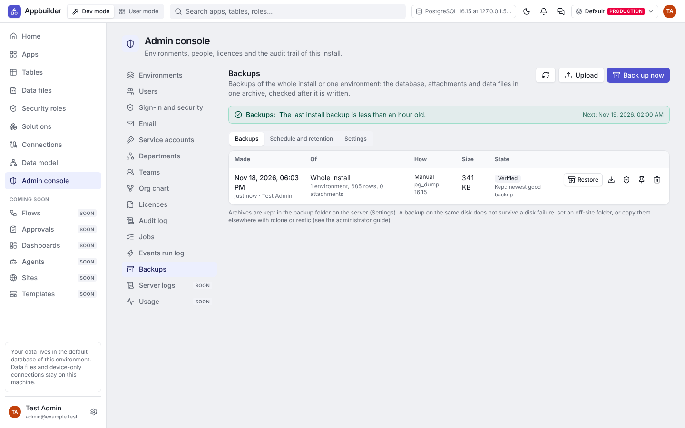
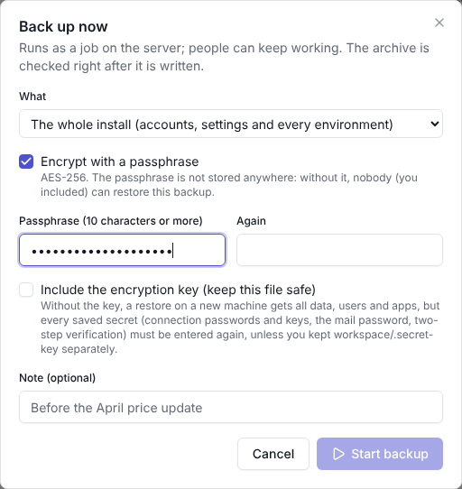
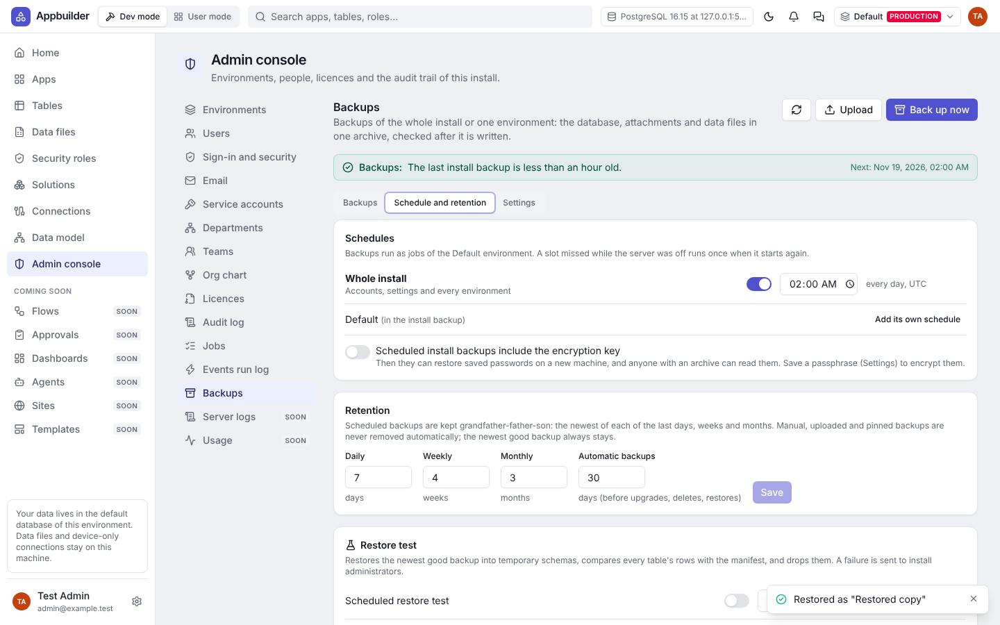
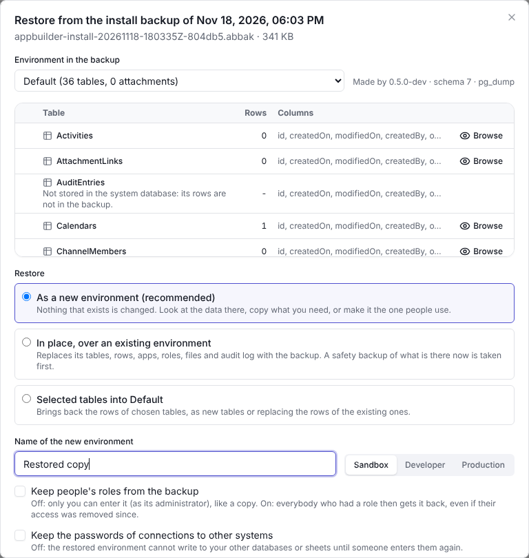
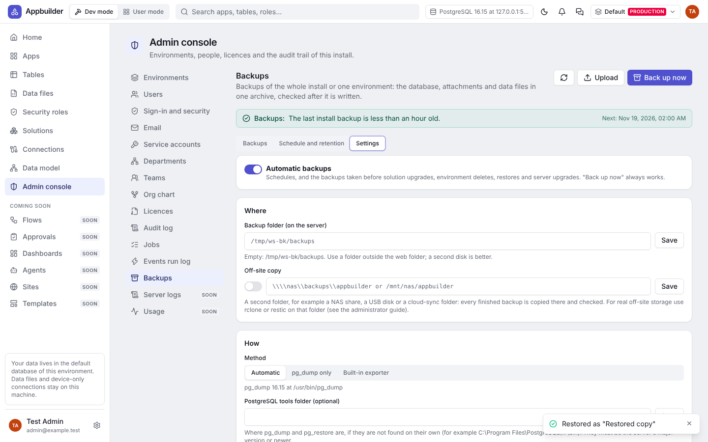

# Backup and restore

Appbuilder backs itself up. **Admin console > Backups** makes, checks, keeps and restores backups of the whole install or of
one environment; a nightly install backup is on from the first start. This page is the administrator's guide; the
step-by-step for a dead machine is [Disaster recovery](disaster-recovery.md); the design and the archive format are in
`docs/dev/backup.md`. Doing it by hand with `pg_dump` is still possible: [Appendix: manual backup with pg_dump](#appendix-manual-backup-with-pg_dump).



## What a backup contains

| Kind | Contains | Not in it |
| --- | --- | --- |
| **Install backup** | Schema `ab` (users with their password hashes, organisation, settings, the environment registry and access, the install audit log, notifications; saved secrets still **sealed** with the install's key), **every environment** (its schema: tables and rows, apps, roles, connections, solutions, audit log, jobs, schedules) and every environment's **attachments and data files** | Sign-in sessions (everybody signs in again after a restore), pending one-time links (password resets, invitations: send them again), the backup catalogue itself, the encryption key (unless you include it, below), other databases you connected to, Google Sheets |
| **Environment backup** | One environment: its schema, attachments and data files | Accounts (they are install-wide), the install audit log |

Every backup is **one archive file** (`appbuilder-<install or environment>-<UTC time>-<id>.abbak`): a standard tar file
holding the database dump, the files, and a **manifest** listing the Appbuilder version and schema versions, each
environment and its tables with their row counts, and a SHA-256 checksum of every file in the archive. Optionally the whole
archive is encrypted with a passphrase (AES-256-GCM, key from scrypt).

The database part is **one consistent snapshot**: one `REPEATABLE READ` transaction, whose snapshot `pg_dump` uses too, so
every table of every environment is from the same instant while people keep working. Changes committed after that
instant are simply not in the backup. Attachments and data files are copied right after; an attachment deleted in those
seconds is reported in the manifest as missing (its record is in the backup, its file is not).

## How a backup is made

- **pg_dump** when it is usable: found in the folder set under **Settings > PostgreSQL tools folder**, in
  `APPBUILDER_PG_BIN`, on the `PATH`, or in the usual install folders (`C:\Program Files\PostgreSQL\<n>\bin`,
  `/usr/lib/postgresql/<n>/bin`, Homebrew, Postgres.app), and of the **same or a newer major version** than the server.
- Otherwise the **built-in exporter**: the table structure read from PostgreSQL's catalogue and the rows streamed with
  `COPY ... TO STDOUT` per table (compressed), inside the same kind of snapshot. It needs no external program and restores
  the same data (tested: both methods restore byte-identical rows). It does not copy database functions, triggers or types
  of your own in an environment schema (Appbuilder creates none; the manifest warns when there are some).
- **Settings > Method**: Automatic (default), pg_dump only (a backup fails if it is not usable), or Built-in exporter.

Each backup runs as a **job** (Admin console > Jobs, in Default; one at a time) and reports its progress live on the
Backups page. Memory stays small whatever the size: 1,000,000 rows and 500 MB of attachments were backed up with the
server's memory growing by about 10 MB (see [Performance](#performance)).

**Every backup is checked right after it is written**: the archive is read back, every file is compared with its
checksum, and the rows of every table are counted again and compared with the manifest. Only then is it listed as
**Verified**. A backup that fails (disk full, check failed) is listed as **Failed** with the reason, its partial file is
removed, and install administrators get a notification.

## Back up now

**Back up now** asks what (the whole install, or one environment), an optional **passphrase**, and, for an install
backup, whether to **include the encryption key**:



- **Passphrase**: at least 10 characters. It is **never stored** (a scheduled backup's saved passphrase is the exception,
  below). Without it, nobody can restore that backup, you included.
- **Include the encryption key (keep this file safe)**. Saved secrets (passwords and keys of connections to other
  systems, the mail server password, two-step verification secrets, the saved backup passphrase) are sealed with the
  install's key, `workspace/.secret-key` (or `APPBUILDER_SECRET_KEY`).
  - **Without the key** (the default), a restore on a new machine brings back all data, users, apps and settings, but every
    saved secret must be entered again, unless you kept `.secret-key` separately (recommended: keep it in a password
    manager or a safe, apart from the backups).
  - **With the key**, the archive alone restores everything, and anyone holding the file can read those secrets: encrypt
    such a backup with a passphrase, and store it like a password.

## Schedules and retention

**Schedule and retention** tab. Out of the box: a **nightly install backup at 02:00 in the server's time zone**. Each
environment can get its own schedule in addition (for example hourly for a busy production environment). A slot missed
while the server was off runs **once** when it starts again (misfire: run once). The schedules are jobs of the Default
environment's schedule list (`sched_backup_install`, `sched_backup_env_<id>`); change them here, not on the Jobs page.



**Retention** is grandfather-father-son, per scope (the install, each environment), over the scheduled backups that
succeeded: walking from the newest, keep the newest backup of each of the last **7 days** that have one, of each of the
last **4 weeks**, and of each of the last **3 months** (calendar periods in the server's time zone; one backup can count
for all three). Automatic backups (before upgrades, deletes, restores, server upgrades) are kept **30 days**. **Manual**,
**uploaded** and **pinned** backups are never removed automatically, and the newest good backup of each scope always
stays. Failed entries go after 30 days. Retention runs after each scheduled or manual backup and hourly; the list shows
for each backup why it is kept, or that it goes at the next run. Deleting a backup also deletes its off-site copy.

## Automatic backups before risky changes

With automatic backups on (Settings), Appbuilder backs up **before** it changes things that cannot be undone otherwise:

| Before | What is backed up | If that backup fails |
| --- | --- | --- |
| A **solution upgrade in place** (import or deploy over an existing solution) | the target environment | Nothing changes. The dialog says why and offers **Upgrade without a backup** or Cancel. |
| **Deleting an environment** | that environment (restorable later as a new environment) | Nothing is deleted. **Delete without a backup** or Cancel. |
| **Restoring an environment in place** | that environment ("safety backup") | Nothing is restored. **Restore without a safety backup** or Cancel. |
| A **server upgrade** that changes the database schema (first start of a new version) | the whole install, before the first migration step | The server does not upgrade the database and says why in its console; fix the cause, or start once with `APPBUILDER_MIGRATION_BACKUP=skip`. |

The upgrade plan says "A backup of this environment is taken before anything changes"; when automatic backups are off it
says so in amber, and the change goes ahead without one. Each switch is in Settings.

## Restore

**Restore** on a backup opens what it contains: its environments, their tables with row counts (**Browse** shows the rows
of a table as they were in the backup, read-only, page by page) and three ways to restore:



| Way | What happens | Safety |
| --- | --- | --- |
| **As a new environment** (recommended) | A new environment (name and type of your choice) with the backup's tables, rows, apps, roles, solutions, connections, attachments and data files. | Nothing that exists changes. By default only you can enter it (as its administrator) and connections to other systems lose their passwords, like a copy; tick the options to keep people's roles from the backup or the passwords. Counts against the environment limit. |
| **In place** | Replaces everything in an existing environment (usually the same one) with the backup. | Type the environment's name. A **safety backup** of what is there now is taken first. While it runs the environment is **Restoring**: requests to it answer "being restored", open pages show a notice, other tabs are told over the live connection. The archive is checked completely first, and the database part is **one transaction**: if anything fails, the environment keeps its data and opens again. Files are prepared next to the environment's folder and swapped in after the database commit. |
| **Selected tables** into the current environment | The rows of chosen tables, **as new tables** (new name "… (restored <date>)" and id, rows keep their ids, attachments copied with new ids) or **replacing** the rows of the existing tables. | A plan first, like a solution upgrade: rows now and in the backup, columns that differ (only-in-backup columns are left out, newer ones stay blank, changed types are converted); replacing needs a tick. One transaction. Tables stored outside the system database (data files, linked tables of other connections) and views are not restorable this way: restore the environment. Table events do not run for restored rows. |

What a restored environment does **not** bring back: its own **pending jobs and undispatched events** from the moment of
the backup are cancelled (they would act a second time), and people's **access** that was given after the backup stays
(access is install-level); roles are those of the backup. Its audit log is the backup's: the restore itself is recorded
in the install audit log and in the restored environment's log.

**Versions.** A backup made by an older Appbuilder is restored and then brought to this version by the normal
migration (per environment, in the same transaction). A backup from a **newer** Appbuilder (higher schema version, or a
newer archive format) is **refused** with a clear message: restore it with that version or newer.

**Encrypted backups** ask for their passphrase before anything is shown (a wrong one fails cleanly: "The passphrase is
wrong, or the backup file was changed"). Scheduled backups encrypted with the saved passphrase open without asking.

**The whole install** (a new machine, or a database that is gone) is restored from the command line: see
[Disaster recovery](disaster-recovery.md).

## Download and upload

**Download** streams the archive to your computer. Because it is a copy of everything, it needs a recent sign-in: you
are asked for your password (or an authenticator code) if you did not enter it in the last 10 minutes. **Upload** adds an
archive from your computer (for example one made on another install, or a copy kept off-site); a plain one is checked at
once, an encrypted one when you give its passphrase. Every backup, download, upload, deletion, verification and restore
is in the **install audit log** (`backup.create`, `backup.fail`, `backup.download`, `backup.upload`, `backup.delete`,
`backup.verify`, `backup.restore`, `backup.restore_failed`, `backup.restore_test`, `backup.prune`, `backup.settings`).

## Settings



- **Backup folder**: default `workspace/backups` (outside the web folder). Any absolute folder the server can write to;
  not inside the web folder or an environment's folder. A second disk is better. `APPBUILDER_BACKUP_DIR` on the server
  fixes it (the page then shows it read-only). The folder holds the archives and, while work runs, `.tmp-*`, `.work-*`
  and `.upload-*` entries (removed afterwards, also after a crash). Archives copied into the folder by hand are found and
  listed at the next start (or after an install restore).
- **Off-site copy**: a second folder (a NAS share, a USB disk, a cloud-sync folder such as OneDrive). Every verified
  backup is copied there and the copy is checked against the original's checksum; a failure is shown on the backup and
  notified. This is **not** an off-site backup by itself if the folder is on the same machine: see [Off-site](#off-site).
- **Passphrase for scheduled backups**: saved **sealed with the install's encryption key** so the server can use it at
  night. Anyone who has both the database (or an install backup) and `.secret-key` can recover it; and to restore on
  another machine you need the passphrase itself, so keep a copy of it. Forget it to stop encrypting.
- **Automatic backups before risky changes**: the four switches above. The master switch **Automatic backups** turns
  schedules and these off ("Back up now" always works).
- **Warn when the last good install backup is older than** 36 hours (default): install administrators get a
  notification, at most once a day. The **Admin console** shows the backup health on every page (green, amber when the
  last backup is old or failed), and each environment's details show its last backup.
- **Restore test** (Schedule tab; off by default, Sundays 04:00 when on): restores the newest good backup into temporary
  schemas, compares every table's rows with the manifest, and drops them; the result is shown on the backup, a failure is
  notified. **Run it now** does it at once.

## Off-site

A backup on the same disk does not survive a disk failure, a fire or ransomware. Point the off-site folder at storage on
another machine, or copy the backup folder elsewhere with a tool made for it:

- **rclone** (`rclone sync D:\Backups\Appbuilder remote:appbuilder-backups --max-age 48h`), scheduled after the nightly
  backup, to S3-compatible storage, SharePoint/OneDrive, Google Drive and many more. Use a remote that keeps old versions
  (or object lock) so a compromised server cannot delete them.
- **restic** (`restic -r <repository> backup D:\Backups\Appbuilder`): deduplicated, encrypted snapshots with its own
  retention (`restic forget --keep-daily 7 --keep-weekly 4 --keep-monthly 12 --prune`).

Appbuilder does not upload to clouds itself. Keep `.secret-key` and the passphrase **apart** from the backups.

## Export environment data

**Export data** (on the Backups page; environment administrators see it too) downloads every table of the current
environment as CSV files in one ZIP:

- `tables/<Table>.csv`: one file per table of the default database, system tables with rows included (comments,
  activities, reference data); projections (Users, Roles, logs) and reporting views are left out. UTF-8, comma separated,
  first line = column names, dates in ISO format, lists and records as JSON.
- `attachments.csv`: the attachment files (table, row, column, file name, type, size, SHA-256). The files themselves
  are not in the export: they are in a backup.
- `manifest.json`: environment, time, who exported, every table with its file, row count and columns.

It is streamed (a table of a million rows does not need memory or a temporary file) and is **not a backup**: use it to
move data to another system or keep a readable copy. Text that a spreadsheet would run as a formula (starting with `=`,
`+`, `-`, `@`) gets a leading `'`. Security: environment administrators only (it is every row of every table: row and
column security do not apply), after a recent sign-in (you are asked for your password or a code first), recorded in
the audit log as `environment.export_data`. Not supported yet: choosing tables, other formats, a ZIP over 4 GB.

## Restore drill

`node scripts/drill/restore-drill.mjs` runs the Phase-0 exit drill end to end: it starts a server on a database it
creates (default `appbuilder_drill` on the sandbox server; `DRILL_DB_*`), seeds rows of every common type, attachments, a
data file and a second environment, records every table's rows and a checksum of every row and of every attachment,
makes an encrypted install backup with the key from the API and downloads it, stops the server, **drops the database and
deletes the workspace**, restores with `node server/main.ts restore`, starts the server again and compares everything.
Run on 18 Nov 2026 (PostgreSQL 16.15, 2,000 rows, 5 attachments, 2 environments): **DRILL PASSED in 20.6 s** (backup and
check 1.1 s, restore 2.6 s, archive 1.2 MB; 8 tables and 10 attachments identical). Do your own drill on a test machine
after installing and after major changes: a backup you have never restored is not a backup.

## Performance

Measured in the sandbox (2 CPUs, PostgreSQL 16 on the same machine, `server/core/backup/backup.large.integration.test.ts`
with `APPBUILDER_TEST_LARGE=1`): one environment with **1,000,000 rows** and **500 MB of attachments** (100 random 5 MB
files): pg_dump backup and its check **8.2 s**, built-in exporter **7.4 s**, archive 511 MB; restore as a new environment
(check, files, database, indexes) **16.5 s**. The server process's memory grew from 225 MB to at most 242 MB throughout.

## Things that are not covered

- **Point-in-time recovery.** A backup is a snapshot. For "restore to 14:32" set up PostgreSQL WAL archiving
  (`archive_mode`, `pg_basebackup`) yourself; Appbuilder's backups complement it.
- **Other databases and Google Sheets** you connected: back them up with their own tools.
- **Audit log tamper-evidence**: see [Audit log](audit-log.md). An archive without a passphrase can be changed by someone
  who also rewrites its manifest; the checksum recorded when it was made (in the catalogue) and encryption (each 64 KB
  block authenticated) detect that.
- **Several servers on one database** (not supported anyway): backups wait for each other through a database lock, but
  progress and the passphrase of a queued manual backup live in the process that queued it.

## Appendix: manual backup with pg_dump

The procedure we documented before the built-in feature. It still works and needs nothing but PostgreSQL's tools; the
built-in backups do the same and more (one consistent snapshot of database and files, checks, retention, restore of one
environment or table).

### Manual backup

1. **Database.** Use `pg_dump` (installed with PostgreSQL; on Windows in `C:\Program Files\PostgreSQL\17\bin`) in its
   **custom format** (`--format=custom`: compressed, restorable selectively with `pg_restore`):

   ```
   pg_dump --host=127.0.0.1 --port=5432 --username=appbuilder --format=custom --file=appbuilder-2026-01-31.dump appbuilder
   ```

   - Replace `appbuilder` (the last word) with your database name. `pg_dump` asks for the password; for a scheduled backup
     put it in a [password file](https://www.postgresql.org/docs/current/libpq-pgpass.html) (`%APPDATA%\postgresql\pgpass.conf`
     on Windows, `~/.pgpass` on Linux, readable only by that user) instead of a command line or a script.
   - `pg_dump` takes a consistent snapshot while Appbuilder keeps running; no need to stop it.
   - The `appbuilder` role owns everything Appbuilder created, so it can dump the whole database. A separate read-only backup
     role needs `CONNECT` on the database, `USAGE` on the schemas `ab` and `env_default` and `SELECT` on their tables (and on
     tables makers create later: `ALTER DEFAULT PRIVILEGES`). The superuser `postgres` works too.
   - Use a `pg_dump` of the same or a newer major version than the server.
   - One environment alone: `--schema=env_default` (plus `--schema=ab` for the users it refers to).
2. **Workspace.** Stop the server (or at least do this at a quiet moment: data files are written a moment after each
   edit) and copy the whole `workspace` folder, including the hidden `.secret-key` file.
3. **Store both off the machine.** A backup on the same disk does not survive a disk failure. Encrypt it if it leaves
   the PC (the dump contains password hashes and data).
4. **Check that it worked.** `pg_restore --list appbuilder-2026-01-31.dump` must list the schemas `ab` and `env_default` and a
   `TABLE DATA` entry per table; an error or an empty list means failure. Better: do a test restore (below). A backup you have
   never restored is not a backup.

How often is up to you: after the last change you can afford to lose. A daily dump scheduled with Windows Task Scheduler
is a sensible minimum for a live installation. Also back up before every upgrade ([Upgrades](upgrades.md)).

### Manual restore

Restore into an empty database; never over a running installation you want to keep.

1. Stop the Appbuilder server.
2. Create the empty database and, if needed, the role (see [Installation](installation.md#prepare-the-database);
   `scripts/setup-postgres.ps1` / `.sh` do both). If the database still exists, drop it first (as a superuser:
   `dropdb --host=127.0.0.1 --username=postgres --force appbuilder`). The database must be UTF8 and owned by the Appbuilder role:

   ```sql
   CREATE DATABASE appbuilder OWNER appbuilder ENCODING 'UTF8' TEMPLATE template0;
   ```
3. Load the dump as the Appbuilder role, so it owns what it restores (works the same in cmd, PowerShell and Linux shells):

   ```
   pg_restore --host=127.0.0.1 --port=5432 --username=appbuilder --dbname=appbuilder --no-owner --exit-on-error appbuilder-2026-01-31.dump
   ```

   `--no-owner` makes the restoring role the owner of every object, which is what you want when the role name differs on the
   new machine. The identity sequence of the audit log is restored with the data, so new entries continue the numbering.
4. Put the saved workspace folder back (with `.secret-key` and `server.json`). Start the server. Sign in. This was tested:
   with the original workspace and the same database login, the server started (schema version 4, up to date), sign-in worked,
   the rows were back, and new rows and audit entries were written.
5. **If the database login or address is different** from the one recorded in `server.json` (new machine, new user),
   stop the server, delete `workspace/server.json` (or change the `APPBUILDER_DB_*` variables), start the server and enter
   the new details on the setup screen, on this PC, with the setup code printed in the server window. Because the
   restored database already contains users, nobody becomes administrator and your accounts still work. Making the setup
   screen reachable relies on there being no `server.json` (it also holds the `setupComplete` marker that keeps the setup
   closed); see [Connections](connections.md#the-default-database).
6. **If `.secret-key` is lost**, the server reports "The saved database password cannot be decrypted (was
   workspace/.secret-key replaced?). Run the database setup again." Delete `server.json` and run the setup (with the setup
   code from the server window). A new key is
   created; users, roles and apps are intact, but **every other saved connection secret is unreadable** (for example the
   Google service-account key): open each such connection and enter the secret again.
7. Copy back the `workspace/env/` folder (data files and attachments of every environment). These are not in the dump;
   without them tables of data-file connections show errors and attachments are missing.
8. Check: sign in, open an app, look at a few rows, open **Connections** and press **Test** on each.

After a restore, the *Default database* connection is rebuilt from `server.json` or the environment (it cannot be edited in
the portal).

### Test a manual backup

Do this once, and again after major changes. Never point a test at the production database.

1. Create a scratch database with another name (for example `createdb --owner=appbuilder appbuilder_restoretest` as a superuser)
   and load the dump into it with `pg_restore --no-owner --dbname=appbuilder_restoretest ...`.
2. Copy the workspace to another folder.
3. Start a second server on another port with the scratch values:
   `APPBUILDER_DB_NAME=appbuilder_restoretest APPBUILDER_WORKSPACE=C:\scratch\ws PORT=5199` plus the usual
   `APPBUILDER_DB_HOST`, `_USER` and `_PASSWORD` variables, then open `http://localhost:5199`.
   When `APPBUILDER_DB_*` is set the server uses it instead of `server.json`.
4. Sign in and check your data. Stop the scratch server, drop the scratch database (`dropdb --force appbuilder_restoretest`),
   delete the scratch folder.

### The manual drill we ran

On 18 Nov 2026, against the sandbox PostgreSQL 16.15 (port 5433, sandbox-only account `abdev`) and a server that had been through
the setup, the sample data and the documentation walkthrough (2 users, 3 tables, 2 apps, 8 contacts, 31 audit entries):

```bash
pg_dump -h 127.0.0.1 -p 5433 -U abdev -d appbuilder_test_docs -Fc -f /tmp/abbackup/appbuilder.dump    # 33,851 bytes
pg_restore -l /tmp/abbackup/appbuilder.dump      # schemas ab and env_default, 19 TABLE DATA entries
tar -C /tmp -czf /tmp/abbackup/workspace.tar.gz ws-docs                                               # the workspace folder
dropdb -h 127.0.0.1 -p 5433 -U abdev --force appbuilder_test_docs                                     # the wipe
createdb -h 127.0.0.1 -p 5433 -U abdev -E UTF8 -T template0 appbuilder_test_docs
pg_restore -h 127.0.0.1 -p 5433 -U abdev -d appbuilder_test_docs --no-owner --exit-on-error /tmp/abbackup/appbuilder.dump
```

Counts before and after were identical (users 2, table definitions 3, apps 2, contacts 8, audit entries 31). The server then
started against the restored database ("system schema version 4 (up to date)"), the administrator signed in, the Contacts query
returned 8 rows, a new row was inserted, and the audit log continued with ids 32 and 33. The scripted drill of the built-in feature is `scripts/drill/restore-drill.mjs` (see [Restore drill](#restore-drill)).

