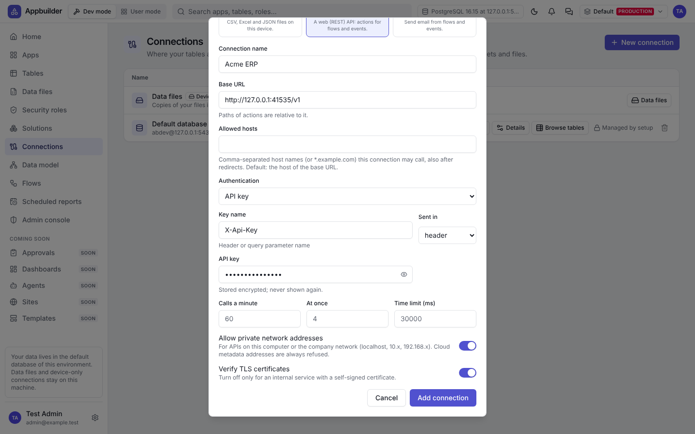
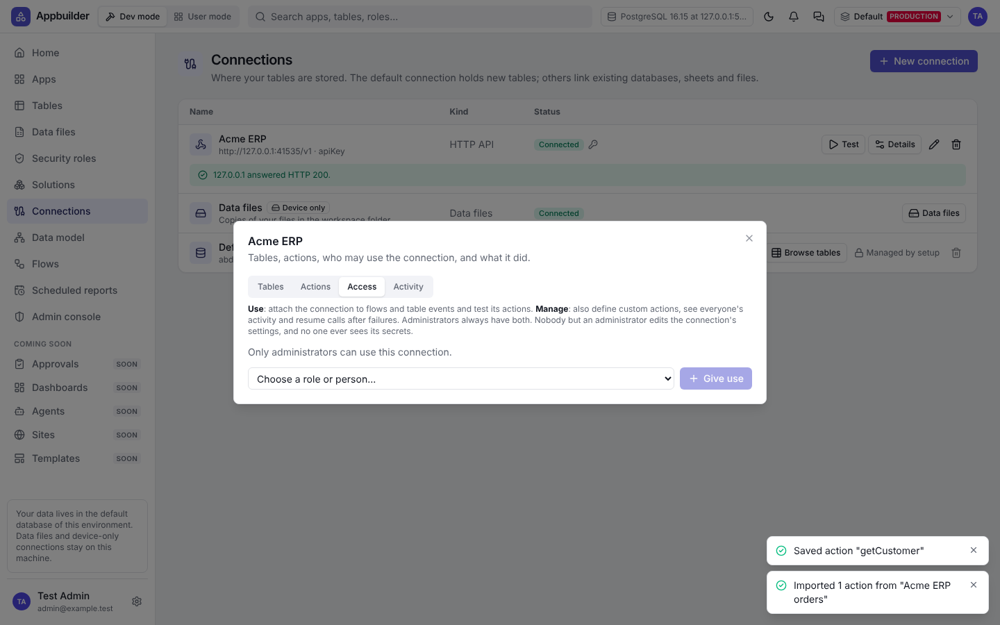
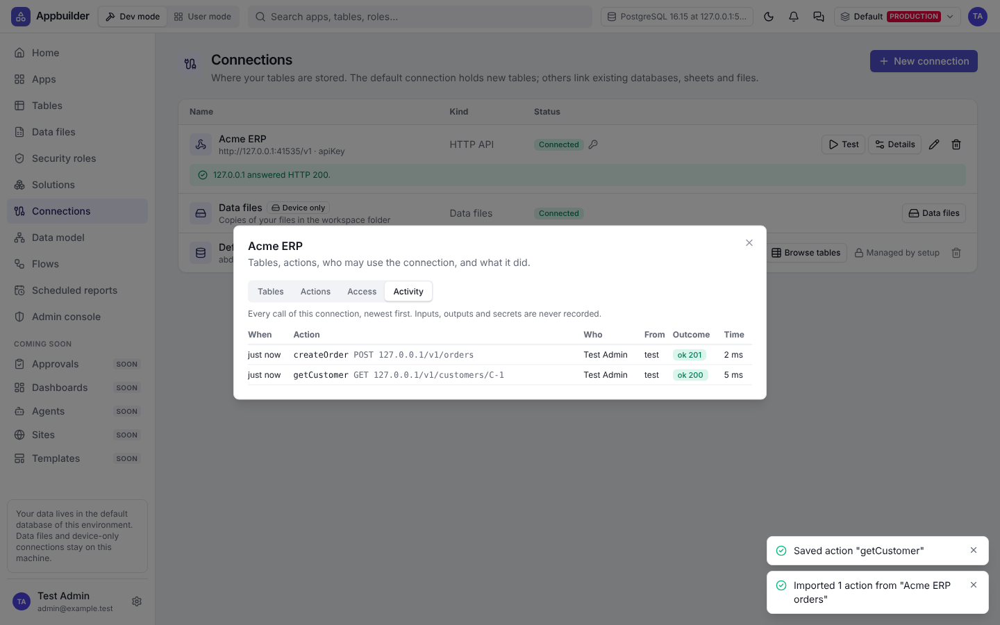

# Connections

A *connection* tells Appbuilder where a table's rows live. There are four kinds:

| Kind | What it is | Who adds it |
| --- | --- | --- |
| **PostgreSQL** | A database. The built-in *Default database* is Appbuilder's own PostgreSQL database; other PostgreSQL connections link existing databases. | Built in; administrators add others |
| **MySQL / MariaDB** | An existing MySQL or MariaDB database (link its tables, or create tables there). It can no longer hold Appbuilder's own data. | Administrator |
| **Data files** | CSV, Excel (`.xlsx`) or JSON files copied into the workspace. One built-in connection, device only. | Built in; makers add files |
| **Google Sheets** | A Google spreadsheet, read and written through a Google service account. | Administrator |

Open **Connections** in the portal. Makers can see connections, test them and link existing tables; only administrators
can add, edit, delete or choose the default. Passwords and keys are never shown again after you save them.

## The default database

When you finish the first-run setup, Appbuilder creates a connection called **Default database** (connector `postgres`) that
points at the PostgreSQL database you entered. That database holds the system tables (schema `ab`: users and sessions; schema
`env_default`: `ab_roles`, `ab_tables`, `ab_audit`, and so on) and, in `env_default`, the tables makers create (see
[schema](../dev/schema.md)). Table changes and app or solution imports on it are all-or-nothing: if anything fails, nothing is
left behind.

**The Default database connection is read-only in the portal** (it shows *Managed by setup* instead of an edit button,
and `PATCH /api/v1/connections/conn_default` answers 400). The system tables stay where the setup put them (the server
reads that location from `workspace/server.json` or from the `APPBUILDER_DB_*` variables), and this connection is
rewritten from there at every start; earlier versions let you edit it, and the edit silently reverted at the next
restart (tables created in between seemed to vanish).

To move Appbuilder to a **different database or server**:

1. Stop the server. Back up (see [Backup and restore](backup-and-restore.md)).
2. Copy the data: `pg_dump` the old database and `pg_restore` it into the new one (the system tables and your tables live in
   the same database, so one dump holds both; see [Backup and restore](backup-and-restore.md)).
3. Point Appbuilder at the new database: if you use `APPBUILDER_DB_*`, change them; otherwise delete
   `workspace/server.json`. Start the server and the setup screen appears on this PC; it needs the setup code printed in
   the server window. Enter the new login. Because the new database already has users, you go straight to the sign-in
   page; nobody becomes administrator.
   (The setup screen is only reachable while no administrator is recorded; there is no portal page to change the setup
   database later. While `server.json` says `setupComplete`, the setup stays closed even if the database is unreachable.)

You can also make **another PostgreSQL connection the default for new tables** (below); that does not move the system
tables, and tables created there are not part of Appbuilder's all-or-nothing changes.

## Add a PostgreSQL or MySQL connection

**Connections > New connection > PostgreSQL** (or **MySQL / MariaDB**). Enter a name, host, port (5432 or 3306), database, user
and password, and for PostgreSQL the **schema** whose tables you want (default `public`). *Use SSL* encrypts the connection
(TLS 1.2 or newer; the server certificate **must be valid**; a self-signed certificate is refused).

- A PostgreSQL connection may not name the schemas `ab` or `env_...` (Appbuilder's own) or PostgreSQL's catalogs
  (`pg_...`, `information_schema`).

- The connection is **saved even when the test fails**. It then shows status *error* with the reason; fix it with the
  pencil button, or press **Test**.
- Use a database user with the **least privileges** the purpose needs. For read-only reporting grant `SELECT` only. Any
  write that the database refuses is reported as "The database user is not allowed to do this."
- Each connection uses a pool of at most 10 database connections with a 10-second connect timeout.
- **Never use the database of another application** (for example a website's database) unless you want makers to be
  able to read and change its tables. See [Link existing tables](#link-existing-tables).

**Set as default** (administrators): new tables are created in that connection. Only a PostgreSQL connection that passes the
test can be the default. The default connection cannot be deleted; choose another default first.

**Delete** is refused while tables or data files still use the connection ("N table(s) use this connection ...").
Unlinking or moving them first lets you delete it.

## Link existing tables

Linking registers a table that already exists in a PostgreSQL or MySQL database or a Google Sheet so apps can use it **without
copying the rows**. **Connections** > open the connection > **Browse** shows what can be linked, then press **Link**.

- Tables whose names start with **`ab_` are never listed or linkable**: they are Appbuilder's own. (An attempt to use one
  is refused: "Tables starting with "ab_" are reserved for the platform".)
- The list shows every other table in that database, including those already used by Appbuilder as normal tables, and
  any table belonging to another program in the same database.
- **Already linked tables are not offered and cannot be linked again** (409 "... is already linked as the table "X"").
  This also holds through a second connection to the same database (same host, port and database name, and for PostgreSQL
  the same schema; `localhost`, `127.0.0.1` and `::1` count as the same host) or the same spreadsheet. Before, re-linking created a second registration
  with fresh default privileges, a way around the privileges of the first.
- **Who can browse.** Makers and administrators, for every connection (there is no per-connection permission). The list
  shows every table the connection's database user can see: **a database shared with other applications exposes their
  tables' names, columns and, once linked, rows to every maker.** Give Appbuilder its own database, or a database user
  that can see only what makers may see.
- Appbuilder needs to address each row by a column named **`id`**. For a table to be **writable** through Appbuilder it
  must have these five columns (this is what Appbuilder's own tables have):

  | Column | PostgreSQL type | MySQL type |
  | --- | --- | --- |
  | `id` | `text NOT NULL`, unique | `CHAR(36) NOT NULL`, unique; holding a UUID text such as `9b99b3c0-e0b2-4c5b-a41b-03ec8b8e8d4a` |
  | `createdOn`, `modifiedOn` | `timestamptz(3) NULL` | `DATETIME(3) NULL` |
  | `createdBy`, `owner` | `text NULL` | `VARCHAR(64) NULL` |

  (Names are case-sensitive in PostgreSQL: the columns are `"createdOn"` and so on, quoted.)

  New rows get a generated UUID in `id`; a table whose `id` is a number (for example `INT AUTO_INCREMENT`) cannot be
  written to.
- **The consent box.** When a table lacks any of the five, the Browse dialog shows "This table lacks Appbuilder's system
  columns (...). I agree that Appbuilder adds them ...". **Link** works either way:
  - **Ticked** (`ensureIdColumn: true` in `POST /api/v1/connections/:id/link`): for PostgreSQL and MySQL, Appbuilder runs
    `ALTER TABLE ... ADD COLUMN` for each missing column (owner with an index). A missing `id` is added (PostgreSQL `text`,
    MySQL `CHAR(36)`), every existing row gets a UUIDv7, then it becomes `NOT NULL` with a unique index; existing rows get the
    current time in `createdOn` / `modifiedOn`. On PostgreSQL all of it is one transaction. Your own primary key stays. For a Google Sheet tab the `id`
    column is added and filled, and the other columns are added as headers. The table is then linked **writable**. Needs
    `ALTER` rights. Back up first.
  - **Not ticked**: the table is linked **read-only** and nothing is changed in it. Queries read only the columns the
    table really has (before, a table that had `id` but lacked the other four linked writable and then every read failed
    with "A column does not exist in the database table"). A table without `id` reads with an empty `id`, so apps cannot
    tell its rows apart.

  To prepare a table yourself instead (for example with your DBA), the equivalent SQL for a table `crm_clients` with its
  own key `client_no` is, on PostgreSQL 13+:

  ```sql
  BEGIN;
  ALTER TABLE crm_clients
    ADD COLUMN id text NULL,
    ADD COLUMN "createdOn" timestamptz(3) NULL,
    ADD COLUMN "modifiedOn" timestamptz(3) NULL,
    ADD COLUMN "createdBy" text NULL,
    ADD COLUMN owner text NULL;
  UPDATE crm_clients SET id = gen_random_uuid()::text, "createdOn" = now(), "modifiedOn" = now();
  ALTER TABLE crm_clients ALTER COLUMN id SET NOT NULL;
  CREATE UNIQUE INDEX uq_crm_clients_id ON crm_clients (id);
  CREATE INDEX ix_crm_clients_owner ON crm_clients (lower(owner));
  COMMIT;
  ```

  and on MySQL:

  ```sql
  ALTER TABLE crm_clients
    ADD COLUMN id CHAR(36) NULL,
    ADD COLUMN createdOn DATETIME(3) NULL,
    ADD COLUMN modifiedOn DATETIME(3) NULL,
    ADD COLUMN createdBy VARCHAR(64) NULL,
    ADD COLUMN owner VARCHAR(64) NULL;
  UPDATE crm_clients SET id = UUID(), createdOn = UTC_TIMESTAMP(3), modifiedOn = UTC_TIMESTAMP(3);
  ALTER TABLE crm_clients MODIFY id CHAR(36) NOT NULL, ADD UNIQUE KEY uq_id (id), ADD KEY ix_owner (owner);
  ```

  Rows that existed before have no `owner`, so roles limited to *Own* rows will not see them; an administrator can give
  them one with **Assign to me** in the table's settings
  ([Users and roles](users-and-roles.md#table-privileges)).
- **What a linked table gets.** Default privileges follow the rule in
  [Users and roles](users-and-roles.md#what-new-tables-get-automatically): Maker and full-access roles get full access,
  Viewer-like roles get read-only, all other roles get nothing. Give other roles privileges yourself.
- **Removing a linked table.** **Delete table** removes only Appbuilder's registration; the table and its rows stay in
  the database. The server refuses `dropSource` for a linked table (422). For tables Appbuilder created, the delete
  dialog offers *Also delete the table in the database*, unticked by default.
- **Columns of linked tables.** Removing a column only **unmaps** it: Appbuilder stops showing and writing it, the
  column and its values stay in your table. Makers can still **add** columns and **change column types** on writable
  linked tables, which runs `ALTER TABLE` on your table.

## Data files

Use data files to work with a spreadsheet or export without a database. **Data files** page (makers).

- **Device only.** A file you add is **copied** into `workspace/files/`. The original on your disk is never read again or
  changed. Edits made in apps go to the copy. The copy is *not* in the database, is not in a `pg_dump`, and is not shared with
  any other PC. To take file data online it must be packaged in a solution; to turn it into a database table use *Move to
  database* (the table keeps its name, so formulas keep working).
- **File types:** `.csv`, `.xlsx`, `.json`. Other types are refused, including old `.xls`. Macro-enabled (`.xlsm`) and
  binary (`.xlsb`) Excel files are refused ("save as .xlsx"), as is any workbook containing macros.
- **Size:** the upload limit is **25 MB** per file (the file reader itself allows 50 MB, the web route stops at 25).
  Whole files are held in memory while the server runs; large files make the server slower.
- **One table per sheet.** Excel: one per sheet that has a header row (empty sheets are skipped). CSV: one table named
  after the file. JSON: an array of objects, or an object whose values are arrays of objects (one table each). A sheet
  name can be at most 31 characters in Excel, 100 otherwise.
- **First row = column names.** Names are changed to simple identifiers (letters, digits, `_`); the original header is
  kept as the display name. Types are guessed from the data: number, decimal, yes/no, date, date and time, email, link,
  text, long text.
- **Excel details that are not carried over:** a formula cell is read as the *value last calculated by Excel* (the
  formula is not kept); rich text becomes plain text; error cells become empty; only cell values are read, not
  formatting, merged cells, charts or pivot tables. We did **not** verify what happens to formatting or charts in the copy
  when Appbuilder writes changes back to the `.xlsx`; assume they are not preserved. The original file is untouched.
- **System columns** are added to the copy: `id` (a UUID), `createdOn`, `modifiedOn`, `createdBy`, `owner`.
- **Replace** loads a newer version of the file over the copy; rows are matched by `id` when the new file has it.
- **Download** returns the current copy including edits, and needs full read access (all rows, all columns) to every table
  of that file.
- A flag *modified since import* marks files whose copy has been edited.
- File connections are not for several PCs. Back up `workspace/files/` ([Backup and restore](backup-and-restore.md)).

## Google Sheets, end to end

Appbuilder talks to Google with a **service account**: a robot identity with its own email address. It can only see the
spreadsheets you share with that address. The steps below follow Google Cloud's current console; Google changes its
screens from time to time, so names may differ slightly. We have not walked through the Google console for this guide;
the Appbuilder side was checked against the code and a live test with a deliberately fake key.

1. **Create a project.** Open `console.cloud.google.com`, sign in with the Google account that will own this, and create
   (or pick) a project.
2. **Enable the Google Sheets API.** *APIs & Services* > *Library* > search *Google Sheets API* > **Enable**. (The Drive
   API is not needed.)
3. **Create a service account.** *IAM & Admin* > *Service Accounts* > **Create service account**. Give it a name. You
   do not need to grant it any project roles.
4. **Create a JSON key.** Open the service account > *Keys* > *Add key* > *Create new key* > **JSON**. A `.json` file
   downloads. It contains `client_email` and `private_key`. **Treat it like a password.** (If your Google Workspace
   administrator has blocked service-account key creation, you cannot do this step until they allow it.)
5. **Share the spreadsheet.** Open the spreadsheet in Google Sheets > **Share**. Paste the service account's
   `client_email` (it looks like `name@project.iam.gserviceaccount.com`) and choose **Editor**. Appbuilder also shows
   this address after you paste the key. Without this step Google answers "access denied".
6. **Add the connection.** *Connections > New connection > Google Sheets*. Paste the spreadsheet URL (or just its id,
   the part after `/d/`), and paste the **whole contents** of the JSON file as the key. **Add connection.** Status
   should become *connected* and the message names the spreadsheet and the service account.
7. **Link the tabs.** *Browse* the connection: each tab is a table candidate; the first row is the column names.

Things to know:

- **`id` column.** To write to a tab, Appbuilder must be able to find each row, so the tab needs a column headed `id`
  (any capitalisation) holding a **unique value in every row**. A tab without one is linked **read-only** from the
  portal (see the note about the consent box above). To make it writable, add the `id` column yourself in Google Sheets
  and give each row a unique value (a number or text), then link. The API can add and fill the `id` column with consent
  (`ensureIdColumn`).
- **Values.** Writes use `RAW` mode, so nothing a user types can turn into a formula. Dates are written as ISO text
  (`2026-03-05`, or a full ISO date-time). Column types are guessed from the first 200 rows.
- **Freshness.** Appbuilder caches a sheet for 15 seconds, so a change made directly in Google Sheets can take up to
  15 seconds to show. Writes are queued per spreadsheet. Google's rate limits apply: Appbuilder retries up to 4 times
  with growing waits (and honours Google's `Retry-After`, up to 30 seconds) on status 429 and 5xx.
- **Access rules apply only through Appbuilder.** Anyone you shared the sheet with in Google can read and edit it
  without Appbuilder's roles and filters. Share it with as few people as possible.
- **The key.** It is stored encrypted in `ab_connections` with the workspace key, and never shown again. To rotate it,
  edit the connection and paste a new key. After restoring a backup without `.secret-key` you must paste the key again
  ([Backup and restore](backup-and-restore.md)). Use a dedicated service account for Appbuilder; delete its key in Google
  Cloud if the PC is lost.
- Spreadsheet permissions: the connection asks Google for the `spreadsheets` scope (read and write of the sheets shared
  with the account).

## Test a connection

Press **Test** on a connection (makers and administrators). Appbuilder opens a fresh connection (PostgreSQL and MySQL: logs in
and asks for the server version, PostgreSQL also checks that the schema exists; Google Sheets: signs in and reads the spreadsheet's title and tabs), then stores the result as
the connection's status (*connected* or *error*) and last error. Editing a connection's settings or secret re-tests it
automatically. The Data files connection has nothing to test.

## What the messages mean

### PostgreSQL

| Message | Meaning and what to do |
| --- | --- |
| Could not connect to HOST:PORT: connection refused. Check that PostgreSQL is running ... | Nothing is listening there. Start PostgreSQL (Windows service `postgresql-x64-17`); check host and port (default 5432). |
| Could not find the server "HOST". / Timed out connecting to HOST:PORT. | Host name does not resolve / firewall, wrong address, or the machine is off. |
| Access denied for user "U": wrong user name or password. | Wrong login. `scripts/setup-postgres.*` sets the role's password again. |
| The server does not accept connections from this computer for user "U" and database "D" ... pg_hba.conf | `pg_hba.conf` has no line for this address, user and database (or only `hostssl`). Add one and reload PostgreSQL, or turn SSL on. |
| The database "D" does not exist on HOST:PORT. | Create it (`scripts/setup-postgres.*`), tick *Create the database if it does not exist* in the setup, or fix the name. |
| User "U" is not allowed to connect to the database "D" (missing CONNECT privilege). | `GRANT CONNECT ON DATABASE D TO U`. |
| User "U" may not create schemas in the database "D". Make the user the owner ... | Setup only: the role needs to own the database (`ALTER DATABASE D OWNER TO U`) or `GRANT CREATE ON DATABASE D TO U`. |
| The database uses the ... encoding; Appbuilder needs UTF8. | Create the database with `ENCODING 'UTF8' TEMPLATE template0`. |
| This database holds an Appbuilder schema of version N, which is not supported on PostgreSQL. | Setup only: use an empty database. |
| The server at HOST:PORT does not support SSL. | Turn SSL off, or enable `ssl = on` in `postgresql.conf`. |
| Connected to PostgreSQL ..., but the schema "S" does not exist in "D". | Fix the schema name of the connection. |
| A value contains a NUL character, which the database cannot store | PostgreSQL text cannot hold the character `\0`; remove it from the value. |

The run-time messages of the MySQL table below ("The database is not reachable", "The database user is not allowed to do
this", "A column does not exist in the database table", "already linked", "reserved for the platform") mean the same for
PostgreSQL connections.

### MySQL / MariaDB

| Message | Meaning and what to do |
| --- | --- |
| Could not connect to HOST:PORT: connection refused. | Nothing is listening there. Start MySQL; check host and port. |
| Could not find the server "HOST". | The host name does not resolve. Check spelling and network. |
| Timed out connecting to HOST:PORT. | Firewall, wrong address, or the machine is off. |
| The connection to HOST:PORT was closed by the server. If the server requires SSL, turn SSL on. | The server dropped the connection, often because it requires SSL. |
| Access denied for user "U": wrong user name or password. | Wrong login, or the user is not allowed from this host (`'U'@'127.0.0.1'` and `'U'@'localhost'` are different accounts). |
| The database "D" does not exist on HOST:PORT. Create it first, or check the name. | Create the database or fix the name. |
| User "U" has no access to the database "D" (or it does not exist). | Grant the user rights on that database, or fix the name. |
| The server uses an authentication method this connector cannot use over an insecure connection. Turn SSL on, or switch the user to mysql_native_password. | MySQL 8 account plugin: ask the database administrator for a `mysql_native_password` or `caching_sha2_password` account usable over SSL, and turn SSL on. |
| The SSL handshake with HOST:PORT failed. | The server does not support SSL (turn SSL off) or the TLS setup is wrong. |
| The server's SSL certificate could not be verified (CODE). | Use a valid certificate, or turn SSL off for a trusted local server. Self-signed certificates are refused. |
| The server does not allow connections from this machine for user "U". | Host-based block (`ER_HOST_NOT_PRIVILEGED`). |
| The server has too many connections right now. | Retry; check `max_connections`. |
| The database is not reachable | At run time: the database stopped or the network dropped. Apps get this until it is back (the pool reconnects). |
| The database user is not allowed to do this | The connection's user lacks the privilege for the action (for example `INSERT` on a read-only account). |
| A column does not exist in the database table | The table changed outside Appbuilder (a column was dropped or renamed there). |
| "T" is already linked as the table "X" (N). | That physical table is registered already, possibly through another connection to the same database. Use table X. |
| The default database connection is managed by the setup ... | The Default database cannot be edited in the portal; see [The default database](#the-default-database). |
| The saved database password cannot be decrypted (was workspace/.secret-key replaced?). Run the database setup again. | Shown at start: the key file does not match `server.json`. Restore the right `.secret-key`, or run the setup again. |
| Tables starting with "ab_" are reserved for the platform | You tried to use an Appbuilder system table. |
| "T" was not found in "C". / "T" is already linked. | The table is gone from the source, or already registered. |

### Google Sheets

| Message | Meaning and what to do |
| --- | --- |
| The service-account key must be the JSON file downloaded from Google Cloud. | You pasted something that is not JSON. Paste the whole file. |
| The service-account key must contain "client_email" and "private_key". | Wrong or truncated file; download a new key. |
| Google Sheets needs the service-account key. | Add connection without a key. |
| Could not find a spreadsheet id. Paste the sheet URL (...) or the id itself. | The URL/id is not recognisable. |
| Google rejected the service-account credentials (REASON). Check that the key is current and the Google Sheets API is enabled for its project. | The key was deleted, disabled or never existed, or the API is off. (We saw "Invalid grant: account not found" with a fake key.) |
| Google denied access to the spreadsheet (HTTP 403 or 404). Share it with EMAIL (Editor access), and make sure the Google Sheets API is enabled for the key's project. | The sheet is not shared with the service account as Editor, the id is wrong, or the API is off. 404 can also mean a wrong id. |
| Could not reach Google: ... | No internet, a proxy, or Google is down. |
| No service-account key is configured for this connection. | The stored key is missing or unreadable (for example after a restore without `.secret-key`): paste the key again. |
| The private key in the service-account key could not be used to sign | The key is malformed or not an RSA key. |
| The spreadsheet has no tab named "T". | The tab was renamed or deleted in Google Sheets. |
| Tab "T" has no id column, so rows cannot be located. | Add an `id` column with unique values. |
| Tab "T" has no header row, so rows cannot be added. | Put column names in row 1. |

## HTTP and Email connections (actions)

Since P1 a connection can offer **actions** for flows and table events instead of tables: **HTTP (REST API)** calls a web
service, **Email** sends mail through the install's relay. Administrators create them in **Connections > New
connection** (makers cannot). Makers then define and test actions on the connection's **Details > Actions** tab
([maker guide](../guide/maker/connections-and-actions.md)).



HTTP settings: the base URL, the **allowed hosts** (the only hosts the connection may ever call, also after redirects;
default the base URL's host; `*` is refused, so a connection is never an open proxy), the authentication (none, API key in
a header or the query, basic, bearer token, OAuth 2.0 client credentials), the limits (calls a minute, calls at once,
time limit) and two switches:

- **Allow private network addresses**: needed for APIs on this computer or the company network (localhost, 10.x,
  172.16-31.x, 192.168.x). Off by default, so a public host name that suddenly resolves to an internal address is refused.
  Cloud metadata addresses (169.254.x) are refused always. `APPBUILDER_OUTBOUND_PRIVATE=deny` refuses private addresses
  for every connection whatever the switch says.
- **Verify TLS certificates**: on by default; turn it off only for an internal service with a self-signed certificate.

Secrets (API key, password, token, client secret, secret headers) are encrypted on the server and never shown again,
never returned by any API, and replaced by `[hidden]` if an API echoes them back. Typing a new secret replaces all secret
parts of the connection. Signing in as each user (OAuth authorization code) is not supported yet.

### Connection access

Each connection has its own **Access** tab (Details > Access):

| Level | Can |
| --- | --- |
| Use | See and test the actions, attach the connection to flows and table events, see their own calls |
| Manage | Also define custom actions, import OpenAPI documents, see everyone's calls, resume calls after failures |
| Administrator | Everything, including the connection's settings and the grants |

Nobody has access by default except administrators. Grant "use" to a role or a person. Attaching is checked when a maker
saves a flow or event; after that the flow or event runs with the connection whoever triggers it (that is what attaching
means). Every grant change is audited (`connection.access`).



### Activity

**Details > Activity** lists every call: when, which action, who (or which flow or event), the outcome and the duration;
never inputs, outputs or secrets. Kept 90 days (the "Connector activity retention" schedule in Admin console > Jobs).
After 5 failures in a row a connection pauses its calls for 30 seconds (up to 5 minutes); the Actions tab shows
"Circuit open" and managers can resume calls.



### Email limits and the suppression list

The Email connector and notification and report emails go through the relay of Admin console > Email. Limits per
environment, counting recipients over all Email connections: `APPBUILDER_EMAIL_PER_HOUR` (default 200) and
`APPBUILDER_EMAIL_PER_DAY` (default 1000); a connection may set lower ones. Above them a flow's email fails with a
retryable "limit" error.

**Admin console > Email** (install administrators) also has the **notification defaults** (per kind: in the app, email
right away or as a digest, and a lock so users cannot change it; for example approvals always by email), the logo of
notification emails, the number of immediate emails per person and hour, the **suppression list** (addresses that get no
email from flows, notifications or reports; password resets and invitations still go out) and every person's delivery log.
Bounces are **not** detected automatically: Appbuilder does not receive mail, so add addresses that bounce by hand.

### Webhooks

Flows can be started by other systems through a signed web address: see [webhook security](webhook-security.md).

## Not supported yet

- Changing the system database from the portal (an administrator can call `POST /api/v1/setup/database` from this PC).
- Other databases (PostgreSQL, SQL Server, Oracle) or other spreadsheet services.
- OAuth sign-in to Google; only service accounts work.
- Syncing data files between PCs.
- Per-connection access for table connections beyond "administrators manage, makers browse, link and test" (action
  connections have Use and Manage grants, above).
- Actions on database connections (stored procedures or SQL queries written by makers): not in this phase.
- OAuth 2.0 sign-in per user (authorization code) for HTTP connections; client credentials only.
