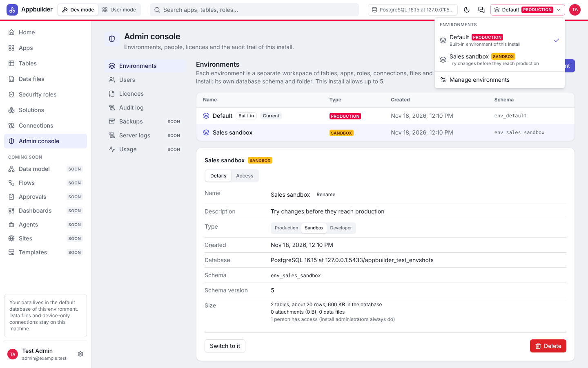
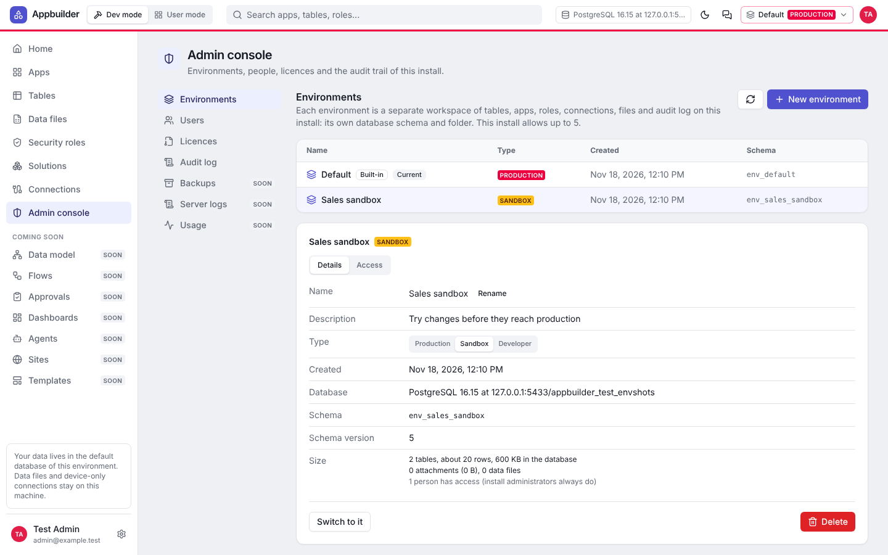
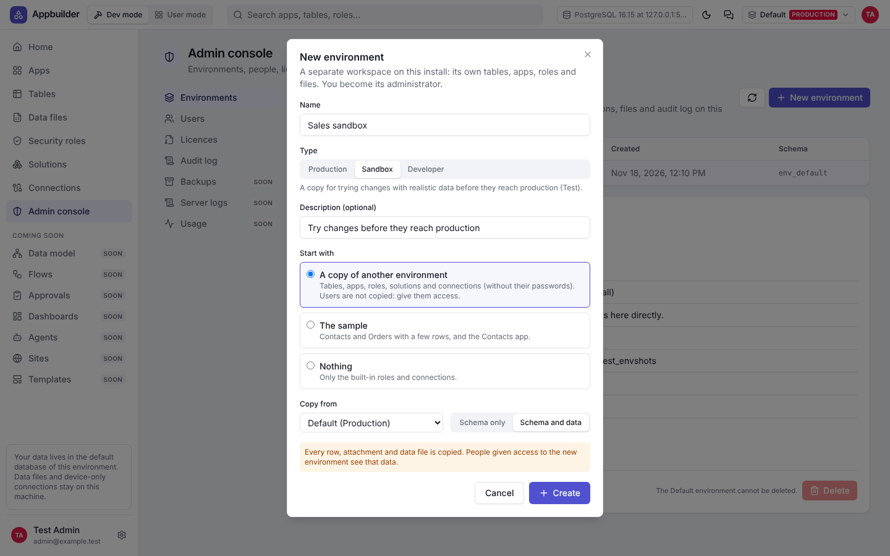

# Environments

An **environment** is a separate workspace on one Appbuilder install: its own tables and rows, apps, security roles,
connections, solutions, data files, attachments and audit log. A typical small organisation has two or three:

| Type | Badge | Use it for |
| --- | --- | --- |
| **Production** | red | Where people do their daily work. Can be **locked**: then apps, tables and roles change only by deploying a solution into it. |
| **Sandbox** | amber | A copy for trying changes with realistic data before they reach production (Test). |
| **Developer** | blue | A maker's own workspace to build in without affecting anyone else. |

Every install has the built-in **Default** environment (production). It cannot be deleted. People's **accounts** are
shared by every environment (one email, one password); what they may do is decided **per environment** (their roles there).

The environment you work in is shown at all times in the top bar (name and type badge, a lock when it is locked, and a thin
line in the type's colour under the bar), also in the Studio. Switch with the picker:

Switching loads the other environment's workspace. App tabs belong to an environment: the other environment's tabs close
and the ones you had open in this one come back. A page that showed something of the old environment (a table, a solution,
an app in the Studio) goes back to the start page. If the Studio has changes that are not saved yet, you are asked first.
Your choice is remembered on your account (and in the browser), so the next sign-in opens the same environment.

## Who may do what

| Who | What |
| --- | --- |
| **Install administrator** (a flag on the account) | Creates, renames, changes, locks and deletes environments; gives and removes access; manages accounts (add, disable, delete, set passwords); reads the install-level audit log. Enters **every** environment and is an administrator in each. The first administrator from setup is one. |
| **Environment administrator** (the Administrator role in that environment) | Everything inside that environment (roles, users' roles there, all data, connections, its audit log), and its access list. Not other environments, not accounts. |
| Everybody else | Enters only the environments they were given access to, and does there what their roles there allow. |

Details, and how an older install was converted: [Users and roles](users-and-roles.md#install-administrators-and-environment-roles).

## Manage environments

**Admin console > Environments** (install administrators; environment administrators see their own environments' details and
access). The table lists every environment with its type, state and schema; select one for its details:

- **Details**: name (rename), type, **Locked** switch (production only), when and by whom it was created, the database and
  schema (`env_<id>`), the schema version, its size (tables, an estimate of the rows, the space it takes in the database,
  attachments and data files on disk, how many people have access), and its **last backup** (install administrators;
  amber when no backup contains it yet).
- **Access**: the people who may enter it. *Give access* adds someone (optionally as environment administrator); the switch
  makes or unmakes them environment administrator (it gives or takes the Administrator role there); *Remove* takes them out
  **and removes every role they held there**. Install administrators are listed as *Always*. Giving someone a role in an
  environment (Users page) also lets them in.

### Create one

**New environment**: a name (unique, at most 60 characters), the type, an optional description, and what it starts with:

- **A copy of another environment**, *schema only*: tables (empty), apps, security roles, solutions and connections.
  *Schema and data*: also every row, the autonumber counters, attachments and data files. The copy is made inside the
  database (`INSERT ... SELECT`), in one transaction with the rest.
- **The sample**: Contacts and Orders with rows, and the Contacts app.
- **Nothing**: only the built-in roles (Administrator, Maker, Viewer) and connections (Default database, Data files).

What a copy never takes: people's roles (you are the only one with access, as its administrator: give access to others),
the audit log, sessions, and the **passwords and keys of connections to other systems**. A sandbox copied from production
does not write to your other databases or Google Sheets until someone enters credentials for it. With *schema only*, data
files and their tables are left out (they are data).

The environment gets an id from its name (`Sales test` becomes `sales_test`), which also names its database schema
(`env_sales_test`) and its folder (`workspace/env/sales_test/`). The id never changes, also not when you rename it.

**Limit.** An install has at most **5** environments (including Default and failed ones). Set `APPBUILDER_MAX_ENVIRONMENTS`
(1 to 50) before starting the server to change it. At the limit, *New environment* is disabled with the reason.

If creating fails (for example the disk is full), nothing of it is left in the database or on disk, and it is listed as
**Failed** with the reason. Delete it and create it again.

### Change the type, lock

Install administrators change the type on the details page. The last production environment cannot become something else
(make another one production first). **Locking** is for production environments: in a locked environment the server refuses
(403, "This environment is locked ...") every change to apps, tables, columns, security roles, solutions and data files,
for everybody including administrators. What still works: data (rows), users and their roles, connections, and importing or
deploying a solution into it. The Studio opens apps there **read-only**, with a banner, and does not save. Changing the type
away from production unlocks it.

### Delete one

**Delete** asks you to type the environment's name. It removes its database schema with every table and row, its apps,
roles, connections, solutions, audit log, attachments and data files (its folder), and everybody's access to it. A
**backup of it is taken first** (when automatic backups are on): Admin console > Backups can restore it later as a new
environment. If that backup fails, nothing is deleted and you choose **Delete without a backup** or Cancel. The
Default environment and the last production environment cannot be deleted. If you are working in the environment you delete,
you are switched to another one first. Deleting is written to the install-level audit log.

## Audit

Each environment has its own audit log (**Admin console > Audit log**, the environment's name). Install administrators have a
second tab, **Install**, with environment and install-level actions: `environment.create`, `environment.create_failed`,
`environment.update`, `environment.lock`, `environment.unlock`, `environment.delete`, `environment.access_grant`,
`environment.access_revoke`, `install.admin_grant`, `install.admin_revoke`, `install.user_create`, `install.user_disable`,
`install.user_enable`, `install.user_delete`, `solution.deploy`, `schema.migrate`, `environment.migrate_failed`. See
[Audit log](audit-log.md).

## Where the data is

| What | Where |
| --- | --- |
| The list of environments, who may enter them, the install audit log, accounts and sessions | schema `ab` of the database |
| An environment's tables, rows, apps, roles, connections, solutions, audit log | schema `env_<id>` |
| Its attachments and data files | `workspace/env/<id>/attachments/`, `workspace/env/<id>/files/` |

An install upgraded from version 0.4 (one environment) had its files in `workspace/attachments/` and `workspace/files/`;
the first start of this version moves them into `workspace/env/default/` (see [Upgrades](upgrades.md)).

## When an environment is not available

At every start the server brings each environment's schema to the current version, each in its own transaction. If one
fails (or it was upgraded by a newer Appbuilder), only that environment is marked **Failed** with the reason, the server
logs `ENVIRONMENT <id> NOT AVAILABLE`, and everything else works. Requests to it answer 503 with the reason; the picker
shows it greyed out. The next successful start clears it. An environment that was being created or deleted when the server
stopped is marked failed too: delete it (again).

## Back up and restore an environment

Admin console > Backups ([Backup and restore](backup-and-restore.md)): back up one environment on its own (now, or on its
own schedule; the nightly install backup contains every environment), restore a backup **as a new environment**
(recommended), **in place** over an existing one (typed confirmation, a safety backup first, one transaction), or
**selected tables** into the current one. While an environment is restored in place its state is **Restoring**: requests to
it answer "being restored", the picker greys it out, open pages show a notice, and people working in it are moved to
another environment they may enter until it is back. Solution upgrades in place take a backup of the target first.

## Not supported yet

- Environment variables, connector policies per environment, copying an existing environment over another one, moving
  people's roles along with a copy.
- Pausing flows and outgoing email in a copy (there are no flows yet).
