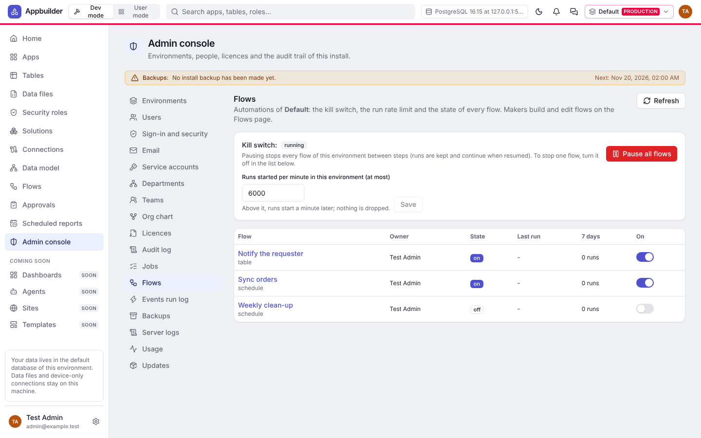

# Flows: administration

Flows (Dev mode > Flows) run automation on the server: on data changes, schedules, buttons in apps and web requests. This
page is for environment administrators: who may do what, run-as identities, the kill switch, limits, retention, and what
happens on copies, backups and restores. Makers: [guide/maker/flows.md](../guide/maker/flows.md). Design:
[dev/flows.md](../dev/flows.md).

## Who may do what

| Action | Who |
| --- | --- |
| Create a flow, change or delete their own | Makers (in a locked production environment: nobody; flows arrive by solution) |
| Change or delete any flow, give a flow to another owner | Administrators |
| Make a flow run as a **service account**, or change one that does | Administrators only, with an explicit confirmation; audited `flow.run_as_service` |
| Attach a connection to a flow | Administrators, and people the connection is granted to ("use", see [connections](connections.md)); audited `flow.connection_granted` |
| Run a flow by hand (Run now, `RunFlow` in apps, the API) | Its owner, administrators, and the roles granted on that flow (the flow's **Who may run it** tab) or on every flow (`PUT /api/v1/flows/permissions/all`) |
| See a run's steps and data | The flow's owner and administrators; the person who started a run sees its status only |
| Turn a flow on or off | Its owner and administrators (in a locked environment administrators only) |
| Pause all flows (kill switch) | Administrators |

## Run-as identities

Every step that reads or writes data does so with one identity, and row and column security, validation rules and table
events apply exactly as if that person did it by hand:

* **owner** (the default): the flow's owner. Whoever the owner lets run the flow gets the owner's rights for what the flow
  does; owners decide that, so review the **Who may run it** list of flows owned by people with broad rights.
* **triggering user**: the person whose change, button or call started the run. A restricted user cannot make such a flow
  read or write anything they could not do by hand. Changes made by the system do not start such flows.
* **service account**: one of the install's service accounts (Admin console > Service accounts), with its roles. Only an
  administrator sets it, the change needs a confirmation, and it is audited; a solution that brings such a flow needs an
  administrator and an explicit confirmation of the import plan.

Changing the run-as identity or the owner of a flow is confirmed explicitly and audited (`flow.run_as_changed`,
`flow.owner_changed`). When an owner's account is **disabled**, the flow's next run fails, the flow is marked
**suspended**, administrators get a notification and the audit log gets `flow.suspended`; give the flow a new owner
(`PUT /api/v1/flows/:id` with `ownerId` and `confirmRunAs: true`) or turn it on again once the owner is active.

## Kill switch

**Admin console > Flows** shows the kill switch with its state (running, or paused since when), the environment's run limit
and every flow with its state (on, off, suspended with the reason, "paused (kill switch)"), its owner, its last run and its
failures over 7 days, with a switch per flow (administrators may turn flows off and on also in a locked production
environment).

**Pause all flows** (Admin console > Flows, or the Flows page; `PUT /api/v1/flows/settings { "paused": true }`, audited `flows.paused`) stops every
flow of the environment at its next step: no step runs, no run starts, manual runs are refused. Triggers still record their
runs (nothing is lost); when you **resume** (`flows.resumed`) everything continues where it stopped. To stop one flow, turn
it off; to stop one run, cancel it.

## Limits

Per run: 5,000 steps, 5,000 items per loop, 20 parallel iterations, a time limit (the flow's `timeoutMinutes`, at most 30
days), trigger payload 256 KB, step output 1 MB; per flow at most 250 steps and 600 runs started per minute (its
`maxRunsPerMinute`); per environment 6,000 runs started per minute (`PUT /api/v1/flows/settings
{ "environmentRunsPerMinute": n }`). Runs beyond a rate start a minute later; none is dropped. A change of a table starts
runs for at most 1,000 rows of one bulk change. Flows do not trigger themselves (see the maker guide), and nothing starts
from a change made 8 levels deep.

## Child flows

A flow may call another flow (the step "Run a child flow") only if the person saving it and the flow's owner may run that
flow by hand, and at run time only if the flow's run-as identity may (owner, administrators, roles granted on it).
Otherwise the step fails with "may not run". So a maker's flow cannot start a flow that runs as an administrator or a
service account unless that flow is granted to the maker's role.

## Failures

The owner hears about the first failure of a flow at once; further failures within a day go into a summary sent each
morning (07:05 UTC, schedule **Flow failure digest**) to the owner and the environment's administrators. A failing flow is
never switched off on its own. With the **health email** on (Admin console > Server logs), install administrators also get
an alert when flow runs fail and the count in the daily summary ([operations](operations.md#health-email-and-heartbeat)). The **Flow runs** system table (Data > tables) lists runs for reports and record timelines;
the Admin console's **Jobs** page shows the engine's jobs (`flow.advance`, `flow.resume`, `flow.timeout`,
`flow.schedule`).

## Retention

Finished runs are deleted after the flow's `retentionDays` (default 30) by the schedule **Flow run retention** (02:23 UTC;
Admin console > Jobs > Schedules). Running and waiting runs are never deleted. The audit log keeps the definition changes.

## Copies, backups, restores and solutions

* **Environment copy**: flows, their versions, connection references and run permissions are copied, **turned off**; no
  schedule runs until someone turns a flow on. Connections of a copy have no secrets (see [environments](environments.md)).
* **Backup and restore**: runs are in the environment backup. After a restore, runs that were queued, running or waiting
  when the backup was taken are **cancelled** with a note, because approvals, callbacks and other systems may have moved on
  since; resubmit the ones that matter from the run history.
* **Solutions**: flows travel as components. New flows arrive turned off unless the import says otherwise; every connection
  the flows use is mapped to a connection of the target environment in the import plan; service-account flows need an
  administrator. See [upgrades](upgrades.md) and the maker guide to [solutions](../guide/maker/solutions.md).
