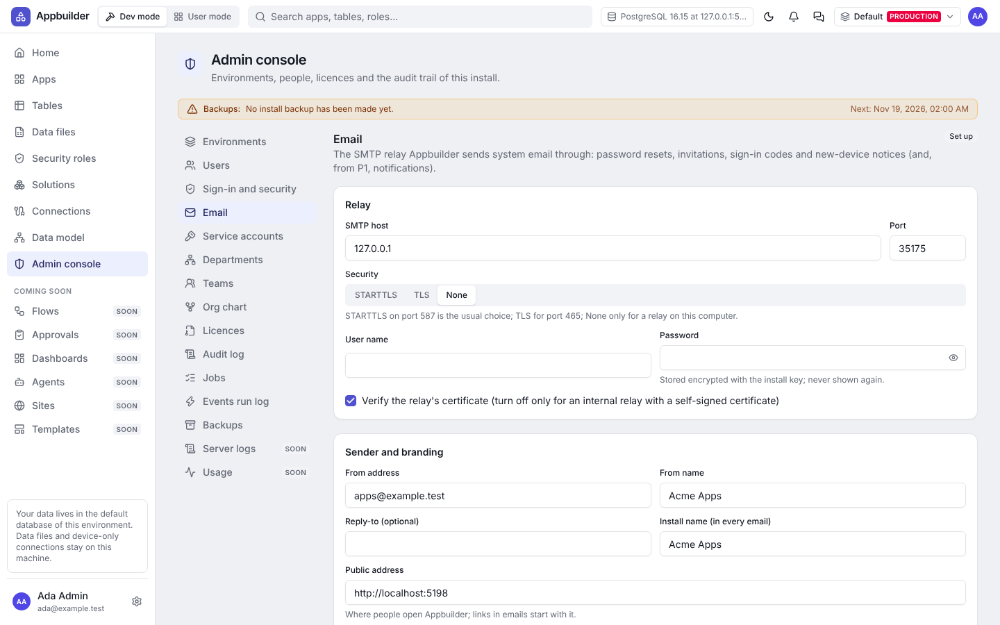

# Installation

Appbuilder is a Node.js server plus a web app. The server keeps its data in PostgreSQL and a few files (attachments, data
files, an encryption key, logs) in a *workspace folder*. People use it in a browser.

There are two ways to install it:

- **The installers** (this page, first part): one script on a Windows PC or a Linux server installs Node.js, PostgreSQL,
  Appbuilder as a service, and optionally HTTPS. This is the normal way for a business.
- **From the source folder** ([Install from source](#install-from-source-developers)): `npm ci`, `npm run build`,
  `npm start`. For developers and for trying it out.

## Requirements and sizing

| Item | Windows installer | Linux installer |
| --- | --- | --- |
| System | Windows 10 or 11, Windows Server 2016 or newer, 64-bit | Ubuntu 22.04 or 24.04, Debian 12 (x86-64 or ARM64), with systemd |
| Rights | An elevated PowerShell (Windows PowerShell 5.1 or PowerShell 7) | root (`sudo`) |
| Internet | Needed for the downloads, unless you use an [offline bundle](#offline-install) | Same (PostgreSQL from apt; see the offline notes) |

Sizing for **20 to 50 users** with PostgreSQL on the same machine (our estimate from the test runs and PostgreSQL's
defaults, not a load test of 50 people):

| | Minimum (the installers refuse less) | Recommended |
| --- | --- | --- |
| Memory | 4 GB (Windows), 2 GB (Linux) | 8 GB (Windows), 4 GB (Linux) |
| CPU | 2 cores | 4 cores |
| Disk | 3 GB free (Windows), 2 GB (Linux) | SSD; 20 GB plus 3 times the database size for backups; a second disk for the backup folder |

The program itself is about 45 MB, Node.js about 80 MB, PostgreSQL about 300 MB. The database grows with your data
(about 1 GB per million rows of a typical 20-column table); install backups are compressed copies of it.

## Which way users reach it

| Choice | Option | Who can open Appbuilder | Firewall |
| --- | --- | --- | --- |
| Only this computer (default) | `-Https None` / `--https none` | People at this PC (or, on a server, through an SSH tunnel or Remote Desktop) | unchanged |
| The local network | `-Https Lan` / `--https lan` | PCs on the same network, at `https://<this PC's name>/` | port 443 opened only with `-OpenFirewall` / `--ufw`, and on Windows only for the local subnet on Domain and Private networks |
| The internet, with a domain name | `-Https Domain -Domain apps.example.com` / `--https domain --domain apps.example.com` | Anyone who can sign in | ports 80 and 443 (80 is needed to obtain and renew the certificate) |

Appbuilder itself always listens on `127.0.0.1` only. For the network and internet choices the installers put
**Caddy** in front of it as a second service: Caddy terminates HTTPS and forwards to Appbuilder on the same machine.

Guidance:

- **A LAN is not a safe place by itself.** Use HTTPS on the LAN too (passwords and session cookies otherwise travel in
  clear text), require two-step verification for administrators, and keep the firewall rule to the local subnet.
- **Internet exposure** is supported only through `-Https Domain`, on a server you keep updated, with two-step
  verification required for administrators, email set up (password resets), backups copied off the machine, and the
  [hardening checklist](hardening-checklist.md) done. The first-run setup cannot be done through the internet address (see
  [First-run setup](#first-run-setup)). Prefer a VPN if only your own staff need it from outside.
- The first-run setup is always done on the machine itself (or through an SSH tunnel to it).

## Install on Windows

1. Download `appbuilder-<version>.zip` and check its SHA-256 against the value published with it
   (`Get-FileHash .\appbuilder-<version>.zip`). Unpack it (right-click > Extract All), for example to
   `C:\Install\appbuilder-<version>`.
2. Open **PowerShell as administrator** (Start, type PowerShell, right-click > Run as administrator) and run:

   ```powershell
   cd C:\Install\appbuilder-<version>
   powershell -ExecutionPolicy Bypass -File .\scripts\install\windows\install.ps1
   ```

   With HTTPS for the local network: add `-Https Lan -OpenFirewall`. See every option with
   `Get-Help .\scripts\install\windows\install.ps1 -Detailed`. Add `-WhatIf` to see every step without changing anything.
3. When it says **Done**, follow the [first-run setup](#first-run-setup) it prints: read the one-time setup code with
   `Get-Content 'C:\ProgramData\Appbuilder\workspace\setup-code.txt'` (elevated), open `http://localhost:5174/` (Start menu >
   Appbuilder) and create the first administrator. The database is already connected.

What the Windows installer does, in order (each step prints what it does):

1. Checks Windows (version, 64-bit), memory, disk space and administrator rights.
2. Checks every file of the release against its `SHA256SUMS` list.
3. Closes the program folder `C:\Program Files\Appbuilder` and the data folder `C:\ProgramData\Appbuilder` to everyone
   except SYSTEM and Administrators (the program folder stays readable for Users).
4. **Node.js**: unpacks the version pinned in `scripts/install/manifest.txt` into `C:\Program Files\Appbuilder\node`
   (Appbuilder's own copy: an installed or updated system Node.js does not affect it). The download is checked against
   the pinned SHA-256.
5. **PostgreSQL**: if a PostgreSQL 15 or newer already answers on `127.0.0.1:5432`, it is used (the installer asks once
   for its superuser password, which is not stored). Otherwise it installs **PostgreSQL 17** from the official EDB
   binaries ZIP (checksum-verified; only the server and client programs are unpacked, not pgAdmin or StackBuilder):
   `initdb` into `C:\ProgramData\Appbuilder\pgdata` (UTF-8, `scram-sha-256` passwords, listening on `127.0.0.1` only),
   registered as the Windows service **appbuilder-postgresql**, running under its own virtual account
   `NT SERVICE\appbuilder-postgresql`, restarted on failure. Its superuser password is random and kept encrypted with
   Windows DPAPI (machine scope) in `C:\ProgramData\Appbuilder\admin`, which only SYSTEM and Administrators can open, so
   that running the installer again can repair the database role.
6. Copies the release to `C:\Program Files\Appbuilder\app` (a different release already there is kept as `app.previous`).
7. Creates the role `appbuilder` (no superuser, `CREATEDB` or `CREATEROLE` rights) and the database `appbuilder` it owns,
   with a **random password made on this PC**: it is never shown, never put on a command line and never written in clear
   text. PostgreSQL receives only its SCRAM-SHA-256 verifier; Appbuilder's own code receives it on standard input and stores
   it sealed (AES-256-GCM with the install key) in `workspace\server.json`, exactly as the setup screen would. The setup
   screen therefore skips its database step.
8. Writes the configuration (`C:\ProgramData\Appbuilder\config\appbuilder.env`, `C:\Program Files\Appbuilder\install.json`)
   and registers the service **Appbuilder** with [WinSW](#third-party-software-the-installers-download) under the virtual
   account `NT SERVICE\Appbuilder` (no password, no administrator rights): automatic (delayed) start, restart after 10 s,
   30 s and 60 s on failure, a 30-second graceful stop, its console output in `C:\ProgramData\Appbuilder\logs` rolled at
   10 MB (8 files kept). Then it sets the final permissions: the data folder for SYSTEM, Administrators and
   `NT SERVICE\Appbuilder` only; the configuration folder read-only for the service; the PostgreSQL data for its own
   account only. It starts the service and waits until `GET /api/v1/health` answers `ok`.
9. With `-Https Lan` or `-Https Domain`: unpacks Caddy into `C:\Program Files\Appbuilder\caddy` and runs it as the service
   **Appbuilder-Caddy** under `NT SERVICE\Appbuilder-Caddy` (its certificates in `C:\ProgramData\Appbuilder\caddy`), sets
   `APPBUILDER_ALLOWED_HOSTS` and `APPBUILDER_TRUST_PROXY=1` for Appbuilder, and opens the firewall only with
   `-OpenFirewall`. With `-Https Lan` it also adds Caddy's certificate authority to this PC's trusted roots and copies it to
   `C:\ProgramData\Appbuilder\appbuilder-local-ca.crt` for the [other PCs](#trust-the-local-certificate).
10. Adds the Start-menu entry **Appbuilder** (opens `http://localhost:5174/`) and the command
   `C:\Program Files\Appbuilder\appbuilder.cmd`, and prints the first-run instructions.

Run it again at any time to **repair** an install: what is there and intact is kept, missing pieces are put back, the
database password is replaced only if the saved one stopped working. A newer release's installer also updates Node.js; for
the app alone use the [updater](upgrades.md).

Options: `-Https None|Lan|Domain`, `-Domain`, `-AcmeEmail`, `-LanNames name1,name2,192.168.1.10` (the names and addresses
clients use; default: the computer name, its DNS name and its IPv4 addresses), `-OpenFirewall`, `-Postgres
Auto|Install|Existing`, `-PgPort`, `-PgSuperUser`, `-Port` (Appbuilder's local port, 5174), `-Offline <folder>`,
`-InstallDir`, `-DataDir`, `-Yes` (no questions), `-Force` (an untested Windows version), `-WhatIf`.

**Uninstall**: `& 'C:\Program Files\Appbuilder\app\scripts\install\windows\uninstall.ps1'` (elevated). It removes the
services, firewall rules, Start-menu entry and program folder and **keeps** the data folder and the PostgreSQL service
with its data, so installing again picks everything up. `-RemoveData` also deletes the data and the PostgreSQL the
installer installed, after you type `DELETE <COMPUTERNAME>`.

> The Windows installer has not yet been run on a real Windows machine: it was checked by parsing it with PowerShell,
> PSScriptAnalyzer (Windows PowerShell 5.1 compatibility rules), unit tests of its functions and a full `-WhatIf` run with
> the Windows-only commands replaced (see [Release process](../dev/release-process.md#what-was-tested)). Run it on a test PC
> first and report anything that differs from this page.

## Install on Linux

1. Copy `appbuilder-<version>.zip` to the server, check it (`sha256sum appbuilder-<version>.zip` against the published
   value) and unpack it (`sudo apt install unzip` if needed): `unzip appbuilder-<version>.zip`.
2. Run:

   ```bash
   sudo bash appbuilder-<version>/scripts/install/linux/install.sh
   ```

   With a domain name and an automatic certificate: `--https domain --domain apps.example.com --acme-email it@example.com
   --ufw`. For the local network: `--https lan`. `--dry-run` prints every step without changing anything; `--help` lists
   all options.
3. Do the [first-run setup](#first-run-setup): `sudo cat /var/lib/appbuilder/workspace/setup-code.txt`, then open
   `http://localhost:5174/` on the server or, from your PC, through an SSH tunnel:
   `ssh -L 5174:127.0.0.1:5174 you@server`, then `http://localhost:5174/` in your browser.

What the Linux installer does: checks the system (distribution, systemd, memory, disk) and the release files
(`SHA256SUMS`); installs the tools it needs (`curl`, `xz-utils`, `gnupg`) when missing; Node.js from the official tarball
(checksum pinned in the manifest) into `/opt/appbuilder/node`; PostgreSQL (an existing local 15+ is used through the
`postgres` account, otherwise **PostgreSQL 17 from the PGDG apt repository**, whose signing key fingerprint is checked;
`--postgres distro` takes the distribution's package where it is 15 or newer); a system user `appbuilder`; the release in
`/opt/appbuilder/app` (root-owned, read-only for the service); the role and database with a random password, sealed into
`/var/lib/appbuilder/workspace/server.json` as on Windows; `/etc/appbuilder/appbuilder.env` (root:appbuilder, 0640);
`/opt/appbuilder/install.json`; the command `/usr/local/bin/appbuilder`; and the systemd unit `appbuilder.service`:
`Restart=on-failure`, logs to the journal, and the hardening options `NoNewPrivileges`, `ProtectSystem=strict` (writable:
only `/var/lib/appbuilder`), `ProtectHome`, `PrivateTmp`, `PrivateDevices`, `ProtectKernelTunables/Modules/Logs`,
`ProtectControlGroups`, `ProtectClock`, `ProtectHostname`, `RestrictSUIDSGID`, `RestrictRealtime`,
`RestrictNamespaces`, `LockPersonality`, `RestrictAddressFamilies`, an empty capability set, `SystemCallFilter=@system-service`
(`MemoryDenyWriteExecute` stays off: Node.js compiles JavaScript at run time). With `--https`: Caddy from **Caddy's apt
repository** (fingerprint checked), `/etc/caddy/Caddyfile`, and `ufw` rules with `--ufw` (the installer never enables ufw
itself: allow SSH first). Logs: `journalctl -u appbuilder` (journald rotates it) and the rotating file log in
`/var/lib/appbuilder/workspace/logs`.

Run it again to repair, as on Windows. **Uninstall**: `sudo bash /opt/appbuilder/app/scripts/install/linux/uninstall.sh`
(keeps `/var/lib/appbuilder` and the database); `--remove-data` deletes them after you type `DELETE <host name>`.

The Linux installer was run end to end on clean Ubuntu 24.04, Ubuntu 22.04 and Debian 12 systems (install, setup, backup,
update, automatic rollback, HTTPS for the LAN, repair, uninstall): about 40 to 50 seconds for the install on a fast
connection.

## Offline install

Many sites have slow or no internet. Prepare a bundle on any computer with internet and Node.js 22.18 or newer:

```bash
node appbuilder-<version>/scripts/install/prepare-offline.mjs --os windows --out D:\appbuilder-bundle --release appbuilder-<version>.zip
node appbuilder-<version>/scripts/install/prepare-offline.mjs --os linux --out /media/usb/appbuilder-bundle
```

It downloads every file the installer needs from `scripts/install/manifest.txt`, checks each against its pinned checksum
(a mismatch deletes the file and stops), and writes `bundle.txt`. On the offline machine:

```powershell
.\scripts\install\windows\install.ps1 -Offline D:\appbuilder-bundle
```

```bash
sudo bash scripts/install/linux/install.sh --offline /media/usb/appbuilder-bundle
```

The installer then takes every download from the folder and still checks every checksum. Windows bundles hold Node.js,
PostgreSQL, WinSW and Caddy (about 450 MB). Linux bundles hold Node.js and Caddy; PostgreSQL 15 or newer must already be
installed (from the distribution's media or a local apt mirror), as must `curl` and `xz-utils`.

## HTTPS

### Trust the local certificate

With `-Https Lan` / `--https lan`, Caddy issues certificates from its own certificate authority, made on this server. The
server itself trusts it (Windows installer). Every other PC must trust it once, or browsers show a warning:

- **Windows client**: copy `appbuilder-local-ca.crt` (in `C:\ProgramData\Appbuilder` or `/var/lib/appbuilder`), then in an
  elevated PowerShell: `Import-Certificate -FilePath .\appbuilder-local-ca.crt -CertStoreLocation Cert:\LocalMachine\Root`.
  For many PCs, distribute it by Group Policy (Computer Configuration > Windows Settings > Security Settings > Public Key
  Policies > Trusted Root Certification Authorities).
- **macOS**: double-click it, add it to the System keychain, set it to "Always Trust".
- **Firefox** uses its own store unless `security.enterprise_roots.enabled` is on: import it under Settings > Certificates.

Check its fingerprint on the client against the server's before you trust it (`certutil -dump appbuilder-local-ca.crt`
or `openssl x509 -noout -fingerprint -sha256 -in appbuilder-local-ca.crt`). Anyone who holds Caddy's CA key could issue
certificates your PCs trust: it lives in Caddy's data folder, which only SYSTEM/Administrators/Caddy (Windows) or root and
`caddy` (Linux) can read.

### A domain name

With `-Https Domain` / `--https domain`, Caddy obtains and renews a Let's Encrypt certificate itself. Before installing:
point the domain's DNS record at the server and let ports 80 and 443 reach it. Appbuilder adds
`Strict-Transport-Security` through Caddy. If the certificate cannot be obtained, the installer says so; the Caddy log
(`journalctl -u caddy`, or `C:\ProgramData\Appbuilder\logs\Appbuilder-Caddy.*.log`) gives the reason.

## Third-party software the installers download

The installers download only over HTTPS, only the versions pinned in `scripts/install/manifest.txt`, and check every
file against the pinned SHA-256 (SHA-512 for Caddy, from Caddy's own checksum file) before using it. apt repositories are
added only after their signing key's fingerprint matches the manifest; apt then verifies every package. The licences
below were read from each project's own licence file.

| Software | Version | Licence | Used by | Source |
| --- | --- | --- | --- | --- |
| Node.js | 24.22.3 (LTS) | MIT (Node.js bundles third-party code under its own permissive licences, listed in its `LICENSE` file) | both | nodejs.org; checksums from `SHASUMS256.txt` |
| PostgreSQL | 17.12 (Windows) / 17 from PGDG (Linux) | PostgreSQL Licence | both, unless you use an existing one | Windows: the EDB binaries ZIP from get.enterprisedb.com (EDB publishes no checksum: the pinned SHA-256 is of the file we checked on 18 Nov 2026). The Windows build includes ICU, OpenSSL (Apache-2.0), zlib, zstd, lz4, libxml2 (MIT) and, as unmodified dynamically linked libraries, gettext's libintl and libiconv (LGPL-2.1); their licences are in the ZIP's `commandlinetools_3rd_party_licenses.txt`. Linux: apt.postgresql.org |
| WinSW | 2.12.0 (`WinSW.NET461.exe`) | MIT | Windows service wrapper | GitHub release of winsw/winsw (no published checksum: the pinned SHA-256 is of the release asset on 18 Nov 2026) |
| Caddy | 2.11.9 (Windows ZIP, Linux offline tarball) / current stable from Caddy's apt repository | Apache-2.0 | HTTPS option | GitHub release of caddyserver/caddy (SHA-512 from its checksums file); dl.cloudsmith.io/public/caddy/stable |

Why WinSW: Node.js is not a Windows service program, so `sc.exe` alone cannot run it (the service manager stops a program
that does not answer it within 30 seconds). WinSW is a small, MIT-licensed, widely used wrapper with restart on failure,
log rolling and graceful stop; NSSM has had no release since 2017; Servy is newer and less proven.
([Decision D25](../decisions.md))

## First-run setup
Open `http://localhost:5174` **on the PC that runs the server** (or through an SSH tunnel to it). The setup screen refuses
requests from any other computer, whatever address or `Host` header they use, and also requests that came through a
reverse proxy (they carry `X-Forwarded-For`, `Forwarded`, `X-Real-IP` or `Via`): the HTTPS address the installers set up
cannot be used for the setup. The setup asks for the **setup code**.

After the installers, the database is already connected, so the setup has only one step (create the administrator).

**The setup code.** While setup is needed, the server prints a one-time code when it starts (in its window, or in the
service log), and, when installed by the installers, writes it to `workspace/setup-code.txt` (readable by administrators
and the service only; `APPBUILDER_SETUP_CODE_FILE` names the file). The file is deleted once the first administrator exists:

```
============================================================
  FIRST-RUN SETUP CODE:  K7QD-M2XP
  Open Appbuilder on THIS computer (http://localhost:5174/) and
  type this code in the setup screen. It changes on every start.
============================================================
```

Type it in the field *Setup code (shown in the server window)*, with or without the dash. It is 8 characters from an
alphabet without look-alikes (no `0/O`, `1/I/L`), changes at every start, and is replaced (and no longer printed) as soon
as the administrator exists. 20 wrong codes within 15 minutes block further tries for a while. It is not written to the
server's log file (`workspace/logs`), and diagnostics bundles remove it. The API takes it as
`setupCode` in the JSON body or in the `X-Appbuilder-Setup-Code` header.

1. **Connect your database.** Enter Host, Port (5432), Database, User and Password, and tick *Use SSL* for a database on another
   machine. The box *Create the database if it does not exist* needs a role with `CREATEDB` (if that fails, the server carries on
   and the connection test decides; the scripts above create the database already). Appbuilder tests the login, creates its
   schemas (`ab` and `env_default`, see [schema](../dev/schema.md)), and saves the login in `workspace/server.json` with the
   password **encrypted** (see [Secrets at rest](security-model.md#secrets-at-rest)). Clear messages explain the usual problems:
   wrong user name or password, the database does not exist, PostgreSQL is not running (connection refused), no `pg_hba.conf`
   entry, the role may not create schemas in the database (with the `GRANT` to run), a database that is not UTF8.
2. **Create administrator and sign in.** Enter your name, email and a password (minimum 10 characters). This creates the
   first user, the three built-in roles (Administrator, Maker, Viewer) and signs you in.

What else happens at step 2:

- If the workspace folder holds data from the older file-based version (`workspace.yaml`, `apps/`, `tables/`), it is
  **migrated** instead of seeding sample data. See [Upgrades](upgrades.md#migrating-an-older-file-based-workspace).
- Otherwise a **sample** is created in your database: tables *Contacts* and *Orders* (stored as `t_contacts` and
  `t_orders`) with example rows, and a *Contacts app*. Delete them from the Tables and Apps pages if you do not want them.

**Only someone at this PC who can read the server window or the setup code file can do the setup.** The two setup requests need no sign-in,
but they need the setup code and must come from the PC itself (the server checks the connection's real address,
127.0.0.1 or ::1, not a header, and no proxy headers). Still, finish the setup right after the first start.

After step 2:

- setup can no longer create an administrator, the code is rotated and `"setupComplete": true` is written to
  `workspace/server.json`;
- the database can be changed only by a signed-in administrator calling `POST /api/v1/setup/database` from this PC (the
  portal has no screen for it), **even while the database is unreachable**: then nobody can sign in, so re-pointing
  Appbuilder means editing `workspace/server.json` (or setting `APPBUILDER_DB_*`) and restarting. Before this change an
  unreachable database at start made the setup screen open again for anyone.
- If an administrator points Appbuilder at an empty database, the marker is cleared and a new setup code is printed, so
  a first administrator can be created there.

You can skip step 1 by setting the `APPBUILDER_DB_*` environment variables (see below). Step 2 is still needed.


## Set up email (SMTP relay)

Password reset links, invitations, sign-in codes and new-device notices are sent through an SMTP relay you already have
(your mail provider's submission server, Microsoft 365, Google Workspace, or a relay in your network). Without it
everything still works, with administrator reset codes and temporary passwords instead.

1. Sign in as an install administrator, open **Admin console > Email**.
2. Enter the relay: host, port and security. The usual choice is **STARTTLS on port 587**; **TLS** is port 465; **None**
   only for a relay on this computer (a user name and password are never sent unencrypted to another host). Leave
   *Verify the relay's certificate* on unless your internal relay has a self-signed certificate.
3. User name and password of the relay account (stored encrypted with the install key, never shown again).
4. The sender: from address (one the relay may send as), from name, optional reply-to, the **install name** shown in
   every email, and the **public address** people open Appbuilder at (links in emails start with it; behind a proxy use
   its `https://` address).
5. **Save**, then **Send test email**. The answer of the relay is shown; failures say why (wrong password, refused sender,
   certificate). The delivery log underneath lists every email (recipient, subject, status, attempts, last error; never
   the body).

Emails are queued as jobs (Admin console > Jobs, type `mail.send`) and retried with backoff when the relay is
temporarily unavailable (up to 6 attempts); a permanent refusal (5xx) stops at once. Details:
[Sign-in and identity](sign-in-and-identity.md#email).



## Environment variables

All are optional. Set them before starting the server (`npm start` or `node server/main.ts`). Read from
`server/main.ts`, `server/core/config.ts` and `server/core/secrets.ts`. The installers write them to the service's
environment file (`appbuilder.env`; on Windows also into the WinSW configuration).

| Variable | Default | Meaning |
| --- | --- | --- |
| `PORT` | `5174` | TCP port to listen on. A non-numeric or zero value falls back to 5174. If the port is taken the server exits with "Port N is already in use. Set PORT to another value." |
| `APPBUILDER_HOST` | `127.0.0.1` | Address to listen on. **Leave it alone**; see the warning below. |
| `APPBUILDER_WORKSPACE` | `workspace` folder next to `package.json` | The workspace folder. Use a path **outside** the repository folder (see [Upgrades](upgrades.md)). Created if missing. |
| `APPBUILDER_SECRET_KEY` | none | 64 hexadecimal characters (32 bytes). If set, it is used as the encryption key and `workspace/.secret-key` is not read or created. A value that is not exactly 64 hex characters stops the server at start. |
| `APPBUILDER_DB_HOST` | none | Together with `_NAME` and `_USER`: configures the PostgreSQL database at every start and **skips the setup screen**. If any of the three is missing, the variables are ignored. |
| `APPBUILDER_DB_PORT` | `5432` | |
| `APPBUILDER_DB_NAME` | none | |
| `APPBUILDER_DB_USER` | none | |
| `APPBUILDER_DB_PASSWORD` | empty | The database password, in plain text in the process environment. |
| `APPBUILDER_DB_SSL` | off | `true` turns SSL on (TLS 1.2 or newer, certificate **must verify**). |
| `APPBUILDER_ALLOWED_HOSTS` | none | Extra host names (comma-separated) that the `Host` and `Origin` headers may name, besides `localhost`, `127.0.0.1`, `::1` and the `APPBUILDER_HOST` address. Only needed behind a reverse proxy with its own name. These names are **not** proof that a request is local. |
| `APPBUILDER_SECURE_COOKIE` | off | `1`: the session cookie `ab_session` always carries `Secure` (the browser sends it only over HTTPS). Set it when users reach Appbuilder through an HTTPS reverse proxy. Without HTTPS in front, sign-in then stops working, because browsers drop `Secure` cookies on plain `http://` (except on `localhost` in current Chrome and Firefox). |
| `APPBUILDER_TRUST_PROXY` | off | `1`: trust the `X-Forwarded-Proto` header from a reverse proxy; when it says `https`, the cookie gets `Secure`. Only set it when a proxy you control is the only way to reach the port (otherwise any client can send the header; harmless for `Secure`, but nothing else is derived from it). |
| `APPBUILDER_LIVE_MAX_PER_USER` | 20 | Realtime sockets (`/api/v1/live`) one user may hold at once, all tabs and devices together. One per open tab. |
| `APPBUILDER_LIVE_MAX_CONNECTIONS` | 5000 | Realtime sockets for the whole server. |
| `APPBUILDER_REAUTH_SECONDS` | 600 | How long a sign-in or re-authentication counts as recent for sensitive actions (changing the sign-in email, turning two-step verification off, creating API keys, deleting an environment, exporting all data). |
| `APPBUILDER_INSTALL_ROOT` | none | Set by the installers: the program folder (`C:\Program Files\Appbuilder`, `/opt/appbuilder`), where `install.json` describes the install. The command-line tools and Admin console > Updates use it. |
| `APPBUILDER_SETUP_CODE_FILE` | none | Also write the first-run setup code to this file (owner-only), deleted once the first administrator exists. The installers set `workspace/setup-code.txt`. |
| `APPBUILDER_LOG_DIR` | `<workspace>/logs` | Folder of the server's file log (JSON lines, rotated). |
| `APPBUILDER_LOG_LEVEL` | the Admin console setting, else `info` | `info`, `warn` or `error`: what goes into the file log. Set here, the Admin console cannot change it. |
| `APPBUILDER_LOG_MAX_MB` / `APPBUILDER_LOG_FILES` | 10 / 10 | Size at which the log file rotates, and how many files are kept. |
| `APPBUILDER_LOG_FILE` | on | `off`: no file log (console only). |
| `APPBUILDER_PG_BIN` | `PATH` | Folder of `pg_dump` / `pg_restore` for backups (the installers set the installed PostgreSQL's `bin`). |
| `APPBUILDER_BACKUP_DIR` | `<workspace>/backups` | The backup folder; set, it cannot be changed in the Admin console (the installers set `<data>/backups`). |

Notes:

- With `APPBUILDER_DB_*` set, the database login is **not** written to `server.json`, and it takes precedence over
  `server.json`. The server also creates the database at start when it is missing and the role has `CREATEDB`.
- Environment variables are visible to other processes running as the same Windows user. For a business install prefer
  the setup screen, which stores the password encrypted.
- Windows: set a permanent variable for your user with
  `[Environment]::SetEnvironmentVariable("APPBUILDER_WORKSPACE", "D:\AppbuilderData", "User")`, then start a new
  PowerShell.


## Install from source (developers)

Without the installers you need Node.js **22.18 or newer** (the server is TypeScript that Node runs directly), PostgreSQL
15 or newer, and git. Then, in a copy of the repository:

```
npm ci
npm run build
npm start            # http://localhost:5174
```

On Windows, `scripts/setup-offline.ps1` does the same in one go (checks Node.js and git, clones or `git pull --ff-only`,
`npm ci`, `npm run build`, starts the server in its own window and opens the browser; `-Path`, `-Repo`), and
`scripts/start.ps1` starts an existing copy. **Closing that window stops the server.** This is the way to try Appbuilder
or to develop it; for a business install use the installers above (a service, its own Node.js, tight permissions,
backups folder, updates).

### Prepare the database

Appbuilder needs an empty PostgreSQL database and a login role that **owns** it (the owner may create the schemas `ab` and
`env_default` in it). Use a **dedicated database and role for Appbuilder**, never the `postgres` superuser, and do not point it at
the database of another application: makers can link and edit tables of the default database (except `ab_*` tables), see
[Connections](connections.md#link-existing-tables).

#### Install PostgreSQL

- **Windows**: PostgreSQL 17 from winget. The installer asks for the password of the superuser `postgres` (remember it; you need it
  once, in the next step) and installs the Windows service `postgresql-x64-17`, which starts automatically:

  ```powershell
  winget install --id PostgreSQL.PostgreSQL.17 -e --interactive
  ```

  (or the installer from <https://www.postgresql.org/download/windows/>). The tools land in `C:\Program Files\PostgreSQL\17\bin`.
- **Linux**: your distribution's packages (`sudo apt install postgresql`, `sudo dnf install postgresql-server`) or the PGDG
  repositories for version 17.

#### With the script

`scripts/setup-postgres.ps1` (Windows) and `scripts/setup-postgres.sh` (Linux) create the role and the database:

```powershell
.\scripts\setup-postgres.ps1
.\scripts\setup-postgres.ps1 -Database appbuilder -User appbuilder -Port 5432 -SuperUser postgres
.\scripts\setup-postgres.ps1 -PsqlPath "D:\PostgreSQL\17\bin\psql.exe"
```

```bash
scripts/setup-postgres.sh                 # asks for the superuser password (connects over TCP to 127.0.0.1:5432)
scripts/setup-postgres.sh --peer          # local superuser through "sudo -u postgres" (Debian/Ubuntu/RHEL default)
scripts/setup-postgres.sh --host db.internal --port 5432 --database appbuilder --user appbuilder --superuser postgres
```

What they do:

1. Find `psql` (PATH, `C:\Program Files\PostgreSQL\<version>\bin`, Scoop; on Linux `/usr/lib/postgresql/*/bin` and others). If
   there is none they print the install command above and stop.
2. Windows: if nothing answers on the port, start the `postgresql*` service (needs an administrator PowerShell if it is stopped).
3. Ask for the superuser's password and twice for the new role's password (at least 12 characters) without showing them
   (`Read-Host -AsSecureString`, `read -s`).
4. Create (or update) the login role `appbuilder` with **no** superuser, `CREATEDB` or `CREATEROLE` rights, and the database
   `appbuilder` (`ENCODING 'UTF8'`, `TEMPLATE template0`) owned by it; `CONNECT` on it is revoked from `PUBLIC`. Running a script
   again only changes the role's password.

Passwords are never echoed, logged, written to disk or put on a command line: the superuser password reaches `psql` through the
`PGPASSWORD` variable of that one process, and the new role's password is turned into a SCRAM-SHA-256 verifier on your computer
first, so even PostgreSQL's statement log cannot contain it. Database and role names may contain lowercase letters, digits and `_`.

#### Manual SQL

Run this as a superuser (for example `psql -U postgres`). `\password appbuilder` asks for the password without echoing it and
sends only the SCRAM verifier:

```sql
CREATE ROLE appbuilder LOGIN NOSUPERUSER NOCREATEDB NOCREATEROLE;
\password appbuilder
CREATE DATABASE appbuilder OWNER appbuilder ENCODING 'UTF8' TEMPLATE template0;
REVOKE ALL ON DATABASE appbuilder FROM PUBLIC;
GRANT CONNECT, TEMPORARY ON DATABASE appbuilder TO appbuilder;
```

**Privileges.** Ownership of its database is all the role needs: Appbuilder creates the schemas `ab` and `env_default` in it, and
makers create, alter and drop tables there. A role that does not own the database needs `GRANT CREATE ON DATABASE appbuilder TO
appbuilder`; without it the setup stops with "User ... may not create schemas in the database ..." and the command to run.

**Locale and ICU.** Appbuilder compares text case-insensitively. It uses the ICU root collation for that when the server has it
(the official builds for Windows, Debian/Ubuntu and the Docker image do); otherwise the database's `LC_CTYPE` decides, and a `C`
locale lowercases only ASCII letters. See [connectors](../dev/connectors.md#postgresql-connector).

**Authentication.** PostgreSQL 14+ uses `scram-sha-256` passwords. Connections from the same PC over TCP are allowed by the
default `pg_hba.conf` of the Windows installer and the Linux packages. If the connection fails with "no pg_hba.conf entry", add a
`host appbuilder appbuilder 127.0.0.1/32 scram-sha-256` line and reload PostgreSQL.


## The workspace folder

Installers: `C:\ProgramData\Appbuilder\workspace` or `/var/lib/appbuilder/workspace`. From source: `workspace\` next to
`package.json` (listed in `.gitignore`), or `APPBUILDER_WORKSPACE`. Layout:

| Path | What it is | Back it up? |
| --- | --- | --- |
| `server.json` | The saved PostgreSQL login: host, port, database, user, SSL, and the password encrypted, plus `"setupComplete": true` once the first administrator exists. Written by the setup (or the installers). Without `APPBUILDER_DB_*` it holds the login; with them only the marker. | Yes |
| `.secret-key` | The encryption key (64 hex characters), created on first start. **If you lose it, every saved connection password and Google key becomes unreadable.** Absent when you use `APPBUILDER_SECRET_KEY`. | **Yes, and keep it safe** |
| `env/<id>/files/`, `env/<id>/attachments/` | Data files and uploaded attachments of each environment. | Yes |
| `logs/` | The server's file log: `appbuilder.log` and the rotated `appbuilder.1.log` ... (see [Operations](operations.md#logs)). | No (diagnostics only) |
| `ops.json` | The log level chosen in Admin console > Server logs. | No |
| `setup-code.txt` | The first-run setup code, until the first administrator exists. | No |
| `backups/` | Install and environment backups, unless the backup folder is elsewhere (the installers use `<data>/backups`). | Copy it off the machine |
| `legacy-phase2/` | Only if an older file-based workspace was migrated: the original files. | Yes, until you are sure you do not need it |

The installers close the data folder to everyone except SYSTEM, Administrators and the service account (Windows ACLs) or
make it owned by the `appbuilder` user with mode 0700 (Linux). From source on Windows, the server's `0600` file modes have
no effect: keep the workspace inside a folder only the Appbuilder user can read.

## What listening on 127.0.0.1 means

`127.0.0.1` is the PC's *loopback* address: only programs on that PC can connect. Other computers on your network
cannot reach the server, and that is the main reason it needs no firewall or TLS setup.

It does **not** mean "only you": every user account and every program on that PC can open the port. On a PC shared by
several Windows users, or a Remote Desktop server, any of them can reach the sign-in page and the setup screen. They
still need a valid Appbuilder login, but the protection is the application's own, not the network's.

### Changing the listening address is not supported

`APPBUILDER_HOST` exists, but setting it (for example to `0.0.0.0`, or the PC's LAN address) is **not supported** and
makes the system less safe:

- The server's Host check compares the `Host` header with the configured host names, and a client chooses its headers.
  With `APPBUILDER_HOST=0.0.0.0` a computer on your network that sends `Host: localhost` passes that check and reaches the
  sign-in page and the API. (Before this version it could also run the first-run setup and make itself administrator;
  the setup now checks the connection's real address and needs the setup code, see [First-run setup](#first-run-setup).)
- There is no TLS, so passwords and session cookies would travel in clear text.
- The login throttle (below) would be the only brake on password guessing.

For access from other PCs use the installers' HTTPS option (Caddy in front, Appbuilder still on `127.0.0.1`), Remote
Desktop, or an SSH/VPN tunnel to the loopback port. Do not expose the port itself.

## Behind a reverse proxy

The installers' `-Https` / `--https` option sets up Caddy for you. This section is for your own proxy. Appbuilder listens on
`127.0.0.1` and has no TLS of its own; a proxy on the same machine must:

- pass **WebSocket upgrades** on `/api/v1/live` (live data refresh, presence, notifications). Without them Appbuilder still
  works, but pages refresh every 30 seconds instead of at once and show "Live updates paused";
- keep the browser's `Host` and `Origin` headers (the server checks both; list the proxy's name in `APPBUILDER_ALLOWED_HOSTS`);
- not cut idle connections faster than about a minute (the server pings every 25 seconds).

Caddy (automatic HTTPS; Caddy 2 proxies WebSockets and keeps `Host` by default):

```
appbuilder.example.com {
	reverse_proxy 127.0.0.1:5174
}
```

Start Appbuilder for it with `APPBUILDER_ALLOWED_HOSTS=appbuilder.example.com` and `APPBUILDER_TRUST_PROXY=1` (Caddy sends
`X-Forwarded-Proto: https`) or `APPBUILDER_SECURE_COOKIE=1`.

nginx needs the upgrade headers spelled out:

```
location / {
    proxy_pass http://127.0.0.1:5174;
    proxy_set_header Host $host;
    proxy_set_header X-Forwarded-Proto $scheme;
}
location /api/v1/live {
    proxy_pass http://127.0.0.1:5174;
    proxy_http_version 1.1;
    proxy_set_header Upgrade $http_upgrade;
    proxy_set_header Connection "upgrade";
    proxy_set_header Host $host;
    proxy_read_timeout 120s;
}
```

Check it: open Appbuilder through the proxy; the top bar must not show "Live updates paused", and the browser's developer
tools list a WebSocket `/api/v1/live` with status 101.


## Not supported yet

- Installers for other systems (macOS, RHEL/Fedora, Windows on ARM), MSI/WinGet packages, a Docker image.
- Windows: the installer has not been run on real Windows yet (see the note under [Install on Windows](#install-on-windows)).
- An offline Linux install of PostgreSQL itself (install it from your distribution's media or mirror first).
- Running Appbuilder on a different machine from its PostgreSQL through the installers (they install or use a local one;
  for a remote database run the installer with `-Postgres Existing` against a tunnel, or install from source).
- High availability or more than one Appbuilder server per database.
- Checking the Node.js version at start of a source install: an unsupported version fails with whatever error it produces.
