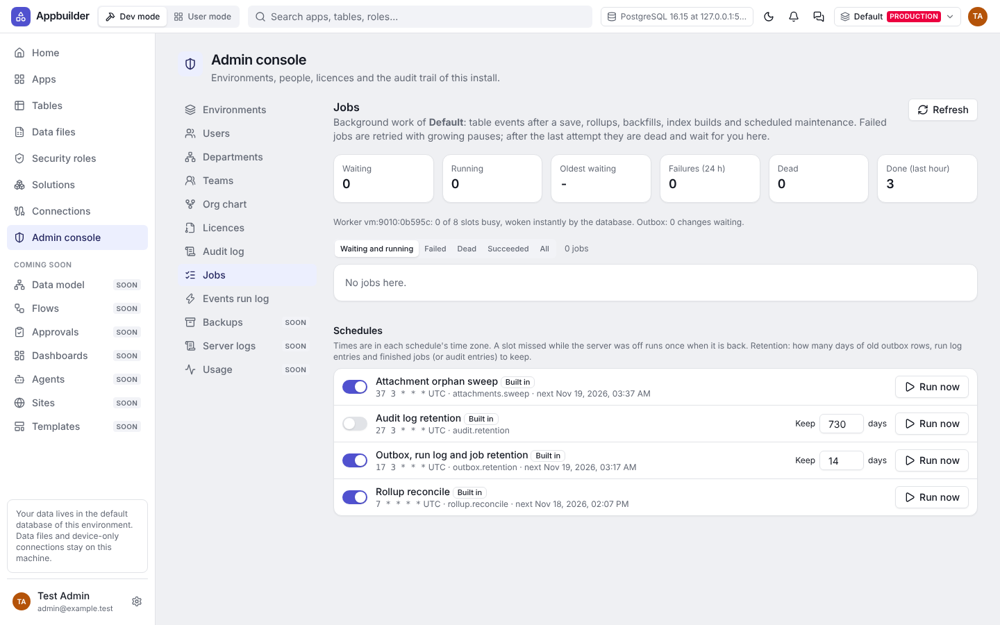
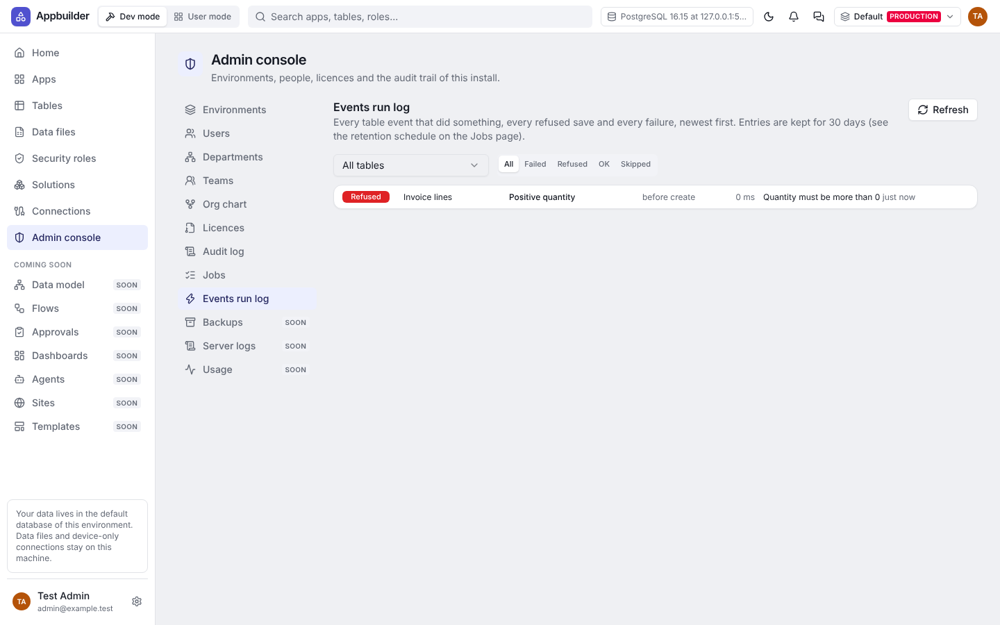

# Jobs, schedules and the events run log

Admin console > **Jobs** and > **Events run log**, for administrators of the current environment. Each environment has its
own queue, schedules and log. Design: `docs/dev/events-and-jobs.md`.

## What jobs are

Work the server does in the background: table events that run after a save, rollup updates, recalculating a formula column
after its formula changed, building the index of a column marked *Indexed*, deleting attachment files once the change that
removed them is saved, and the scheduled maintenance below. The server runs them itself; nothing else needs to be installed
or kept running.

## The Jobs page

- **Waiting, Running, Oldest waiting, Failures (24 h), Dead, Done (last hour)**: the health of the queue. A growing *Oldest
  waiting* means the server cannot keep up or is stopped.
- The line under the numbers shows the worker of this server (busy slots, and whether the database wakes it instantly) and
  how many saved changes wait to be turned into jobs (the outbox).
- **Jobs**: waiting and running, failed (waiting for another try, with the error and the time of the next try), dead (all
  tries used), succeeded, or all. **Retry** queues a failed, dead or cancelled job again; **Cancel** stops a waiting one. Both
  are recorded in the audit log.
- A failed job is tried again after a pause that grows (seconds, then minutes, at most ten). After the last try (usually 5)
  it is *dead* and stays on this page until you retry or cancel it. Jobs that fail because of their input (for example a
  table event whose formula cannot work for that row) die at once: fix the cause, then **Retry**.
- If the server stops while a job runs, the job is taken back and run again (after 30 seconds without a sign of life from
  the server that had it). Jobs are therefore written to be safe to run twice.

## Schedules and retention

| Schedule | Default | What it does |
| --- | --- | --- |
| Outbox, run log and job retention | daily 03:17 UTC, keep 14 days | Deletes processed saved-change records older than *Keep* days, run log entries older than 30 days and finished jobs older than 14 days |
| Audit log retention | off, keep 730 days | Deletes audit entries of this environment older than *Keep* days. Turn it on only if your policy allows deleting audit history |
| Attachment orphan sweep | daily 03:37 UTC | Removes files no row refers to any more (older than an hour) |
| Rollup reconcile | hourly | Recalculates every rollup column from its rows |

Use the switch to turn a schedule on or off, **Keep ... days** to change a retention period, and **Run now** to start it at once.
A slot missed while the server was off runs once when the server is back. The default outbox retention can also be set for
new environments with the `APPBUILDER_OUTBOX_RETENTION_DAYS` variable.

## The events run log

Every table event that did something, every save refused by a validation rule or event, every failure, and events that were
skipped (for example because events kept triggering each other and the chain was stopped), newest first, filtered by table
and status. Makers see the same log for one table under the table designer's **Events** tab.

## Settings (environment variables)

| Variable | Default | Meaning |
| --- | --- | --- |
| `APPBUILDER_JOBS` | on | `off` does not start the worker (jobs wait) |
| `APPBUILDER_JOBS_CONCURRENCY` | 8 | jobs at once |
| `APPBUILDER_JOBS_POLL_MS` | 1000 | how often to look for work when the database does not wake the worker |
| `APPBUILDER_JOBS_VISIBILITY_MS` | 30000 | silence after which a running job is taken back |
| `APPBUILDER_JOBS_STOP_GRACE_MS` | 10000 | how long a stopping server waits for running jobs |
| `APPBUILDER_EVENT_BUDGET_MS` | 2000 | time allowed for the before-save logic of one row |
| `APPBUILDER_AFTER_EVENT_BUDGET_MS` | 30000 | time allowed for one after-save event |
| `APPBUILDER_EVENT_MAX_DEPTH` | 8 | how many events may trigger each other in a chain |
| `APPBUILDER_OUTBOX_RETENTION_DAYS` | 14 | default retention of the outbox |
