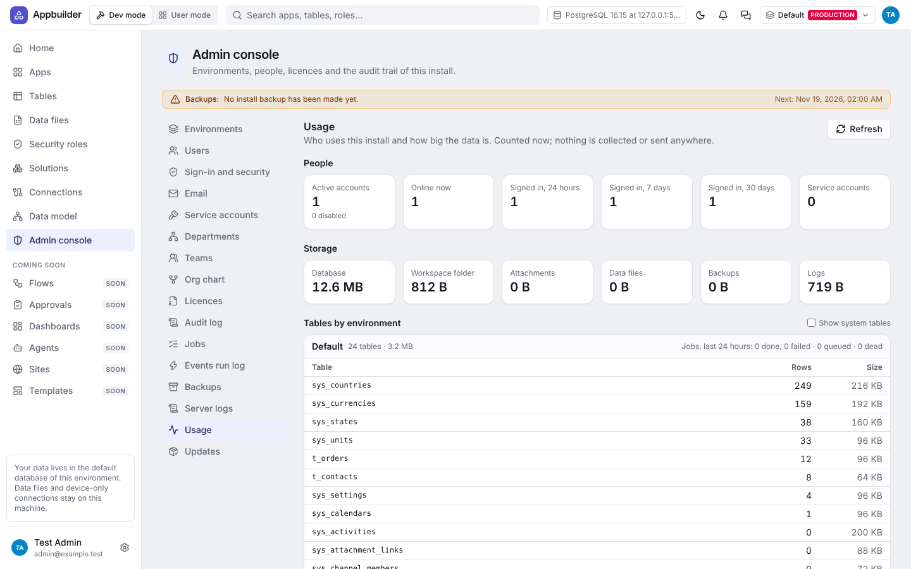

# Operations

Running an install made by the [installers](installation.md): where files live, the services, logs, health, the
diagnostics bundle for support, and usage. For updates see [Upgrades](upgrades.md); for backups
[Backup and restore](backup-and-restore.md).

## Where files live

| What | Windows | Linux |
| --- | --- | --- |
| Program (the release; replaced by updates) | `C:\Program Files\Appbuilder\app` (`app.previous`: the release before) | `/opt/appbuilder/app` (`app.previous`) |
| Node.js (Appbuilder's own copy) | `C:\Program Files\Appbuilder\node` | `/opt/appbuilder/node` |
| PostgreSQL programs (when installed for Appbuilder) | `C:\Program Files\Appbuilder\pgsql` | the distribution's or PGDG's packages (`/usr/lib/postgresql/17`) |
| Install description | `C:\Program Files\Appbuilder\install.json` | `/opt/appbuilder/install.json` |
| Command-line tools | `C:\Program Files\Appbuilder\appbuilder.cmd` | `/usr/local/bin/appbuilder` |
| Service configuration | `C:\Program Files\Appbuilder\service\Appbuilder.xml` (WinSW) and `C:\ProgramData\Appbuilder\config\appbuilder.env` | `/etc/systemd/system/appbuilder.service`, `/etc/appbuilder/appbuilder.env` |
| Workspace (`server.json`, `.secret-key`, attachments, data files, logs) | `C:\ProgramData\Appbuilder\workspace` | `/var/lib/appbuilder/workspace` |
| Backups | `C:\ProgramData\Appbuilder\backups` | `/var/lib/appbuilder/backups` |
| PostgreSQL data (when installed for Appbuilder) | `C:\ProgramData\Appbuilder\pgdata` | `/var/lib/postgresql/17/main` |
| Service wrapper logs | `C:\ProgramData\Appbuilder\logs` | the journal (`journalctl -u appbuilder`) |
| Staged updates and update history | `C:\ProgramData\Appbuilder\updates` | `/var/lib/appbuilder/updates` |
| HTTPS (Caddy) | `C:\Program Files\Appbuilder\caddy`, data in `C:\ProgramData\Appbuilder\caddy` | `/etc/caddy/Caddyfile`, data in `/var/lib/caddy` |

Who may read them: the data folder only SYSTEM, Administrators and `NT SERVICE\Appbuilder` (Windows), or the `appbuilder`
user (Linux, mode 0700 on the workspace and backups). The program folder is read-only for the service.

## Service control

| | Windows (elevated PowerShell) | Linux |
| --- | --- | --- |
| Status | `Get-Service Appbuilder, appbuilder-postgresql, Appbuilder-Caddy` | `systemctl status appbuilder` |
| Stop / start / restart | `Stop-Service Appbuilder` / `Start-Service Appbuilder` / `Restart-Service Appbuilder` | `sudo systemctl stop|start|restart appbuilder` |
| After changing the environment file | re-run the installer (it rewrites the WinSW configuration), or edit `Appbuilder.xml` and restart | `sudo systemctl restart appbuilder` |

Both restart Appbuilder by themselves when it fails (Windows: after 10, 30 and 60 seconds, the count resets after an hour;
Linux: `Restart=on-failure` after 5 seconds). Stopping is graceful: running jobs get up to 10 seconds, connections are
closed, then the process exits. The services start at boot (Windows: delayed automatic start, after PostgreSQL).

## Health

- `GET /api/v1/health` is open to anyone and answers only `{"status":"ok"}` (HTTP 200), `starting` or `degraded` (HTTP
  503), nothing else. Use it for monitoring. `starting`: no database is configured yet, or it has not been reachable for
  less than two minutes after start; `degraded`: the database does not answer, is newer than this release, or an
  environment failed to migrate. `appbuilder health` asks it from the command line.
- **Admin console > Server logs** shows the detailed checks to install administrators (`GET /api/v1/admin/health`):
  database (reachable, answer time, version), clock (difference to the database server; more than 5 seconds is a warning:
  sign-in codes and schedules need correct clocks), environments, disk space of the workspace, backup and log folders
  (warning below 10 % free, error below 1 GB), backups (age of the last good install backup), the job queue (queued,
  running, dead; a warning when a due job waited more than 10 minutes), email (an SMTP relay set up), live connections,
  memory, versions (Appbuilder, commit, Node.js, PostgreSQL, schema of the database and of the server).


## Logs

The server writes every log line twice: human-readable to its console (the service log: `journalctl -u appbuilder`, or the
WinSW logs `C:\ProgramData\Appbuilder\logs\Appbuilder.out.log` and `.err.log`, rolled at 10 MB, 8 kept) and as one JSON
object per line to `workspace/logs/appbuilder.log`:

```json
{"t":"2026-11-18T19:27:15.996Z","l":"warn","m":"backup retention: ...","rid":"4f2a9c1e0b7d3a11"}
```

`t` time (UTC), `l` level (`info`, `warn`, `error`), `m` the message, `rid` the request id (`X-Request-Id`, or generated)
when the line belongs to a request, `cid` the correlation id when it differs, `job` the job id when it belongs to a job.
The same request id is in the outbox rows, jobs and event runs the request caused. The file rotates at 10 MB and 10 files
are kept (`appbuilder.1.log` is the newest old one): about 100 MB at most. The first-run setup code is never written to it.

**Admin console > Server logs** lists the newest lines first (up to 500 per view), filters by level, time and text (a
request id finds every line of that request: click it), follows new lines every 5 seconds, and downloads the log files
(secrets removed, as in the diagnostics bundle). The **log level** (what is written: info, warnings and errors, or errors
only) is set there and stored in `workspace/ops.json`, unless `APPBUILDER_LOG_LEVEL` is set in the service environment.
Other settings: `APPBUILDER_LOG_DIR`, `APPBUILDER_LOG_MAX_MB`, `APPBUILDER_LOG_FILES`, `APPBUILDER_LOG_FILE=off`
([Environment variables](installation.md#environment-variables)).

Not logged: request bodies, passwords, tokens, the data people read. There is no access log of every request.

## Diagnostics bundle

When you ask for support, send a diagnostics bundle: **Admin console > Server logs > Diagnostics bundle**, or on the server
`appbuilder diagnostics --out bundle.zip` (also works when the server does not start). It is one ZIP with:

| File | Content |
| --- | --- |
| `README.txt` | what is inside, notes (for example "the database could not be opened: ...") |
| `versions.json`, `system.json` | release, Node.js, OpenSSL, operating system, CPU count, memory, time zone, disk space |
| `config.json` | the server configuration, the `APPBUILDER_*` variables, `server.json` without the password, `install.json`, whether `.secret-key` exists |
| `health.json` | the detailed health (from the Admin console) |
| `schema.json` | schema versions of the database and of each environment, the last migration, environments that failed |
| `recent-errors.json` | the last failed and dead jobs, failed event runs, failed backups and failed emails (no payloads, no email bodies) |
| `release-check.json` | whether the program files still match the release's `SHA256SUMS` (changed files are a common cause of odd errors) |
| `logs/`, `service-logs/` | the server's log files and the last 2 MB of each service wrapper log |

Before anything is written, it removes: passwords and passphrases (in connection strings, `key=value` and JSON), the
install key and other 64-hex keys, sealed secrets, session cookies, bearer tokens, the secret part of API keys, SCRAM
verifiers, private keys, the setup code; e-mail addresses are shortened to `a***@example.com`. Not included at all: the
database contents, `.secret-key`, backups, attachments, data files. Creating one is recorded in the install audit log
(`diagnostics.bundle`). Look inside before you send it; it still names your tables, environments and host names.

## Usage

**Admin console > Usage** (install administrators) shows, counted when you open it: active, disabled and service
accounts; people online now; people who signed in within 24 hours, 7 days and 30 days; the size of the database, the
workspace folder, attachments, data files, backups and logs; per environment its tables with row counts (exact up to
100,000 rows, PostgreSQL's estimate above, marked `~`) and sizes, and jobs done and failed in the last 24 hours by type.
Nothing is collected over time or sent anywhere.



## Command-line tools

| Command | What it does |
| --- | --- |
| `appbuilder version` | the installed release, commit, build date, schema version, trusted release keys |
| `appbuilder health` | `ok`, `starting`, `degraded` or `down` (exit code 0 only for ok) |
| `appbuilder update <zip>` | installs a release ([Upgrades](upgrades.md)); root / elevated |
| `appbuilder verify-release <zip or folder>` | checks a package's checksums and signature without installing it |
| `appbuilder diagnostics [--out file]` | writes a diagnostics bundle |
| `appbuilder restore <archive> ...` | disaster recovery from an install backup ([Disaster recovery](disaster-recovery.md)) |

On Linux `appbuilder restore` runs as the `appbuilder` user so the restored files belong to the service. The tools read
the service's environment file themselves.

## Not supported yet

- Metrics endpoints for Prometheus or similar, alerts by email when a health check fails (the backup warning is the only
  notification).
- Usage over time (history, charts), app opens per app.
- Sending the diagnostics bundle from the server: you download it and send it yourself.
