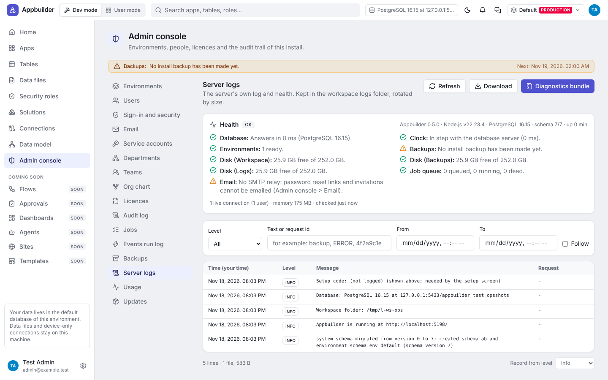
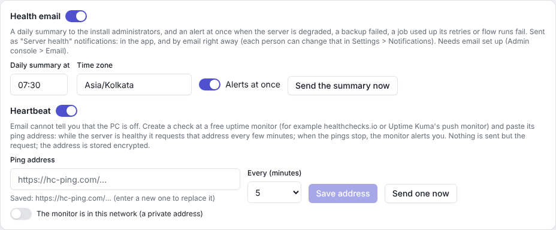

# Operations

Running an install made by the [installers](installation.md): where files live, the services, logs, health, the
diagnostics bundle for support, and usage. For updates see [Upgrades](upgrades.md); for backups
[Backup and restore](backup-and-restore.md).

## Where files live

| What | Windows | Linux |
| --- | --- | --- |
| Program (the release; replaced by updates) | `C:\Program Files\Appbuilder\app` (`app.previous`: the release before) | `/opt/appbuilder/app` (`app.previous`) |
| Node.js (Appbuilder's own copy) | `C:\Program Files\Appbuilder\node` | `/opt/appbuilder/node` |
| PostgreSQL programs (when installed for Appbuilder) | `C:\Program Files\Appbuilder\pgsql` | the distribution's or PGDG's packages (`/usr/lib/postgresql/17`) |
| Install description | `C:\Program Files\Appbuilder\install.json` | `/opt/appbuilder/install.json` |
| Command-line tools | `C:\Program Files\Appbuilder\appbuilder.cmd` | `/usr/local/bin/appbuilder` |
| Service configuration | `C:\Program Files\Appbuilder\service\Appbuilder.xml` (WinSW) and `C:\ProgramData\Appbuilder\config\appbuilder.env` | `/etc/systemd/system/appbuilder.service`, `/etc/appbuilder/appbuilder.env` |
| Workspace (`server.json`, `.secret-key`, attachments, data files, logs) | `C:\ProgramData\Appbuilder\workspace` | `/var/lib/appbuilder/workspace` |
| Backups | `C:\ProgramData\Appbuilder\backups` | `/var/lib/appbuilder/backups` |
| PostgreSQL data (when installed for Appbuilder) | `C:\ProgramData\Appbuilder\pgdata` | `/var/lib/postgresql/17/main` |
| Service wrapper logs | `C:\ProgramData\Appbuilder\logs` | the journal (`journalctl -u appbuilder`) |
| Staged updates and update history | `C:\ProgramData\Appbuilder\updates` | `/var/lib/appbuilder/updates` |
| HTTPS (Caddy) | `C:\Program Files\Appbuilder\caddy`, data in `C:\ProgramData\Appbuilder\caddy` | `/etc/caddy/Caddyfile`, data in `/var/lib/caddy` |

Who may read them: the data folder only SYSTEM, Administrators and `NT SERVICE\Appbuilder` (Windows), or the `appbuilder`
user (Linux, mode 0700 on the workspace and backups). The program folder is read-only for the service.

## Service control

| | Windows (elevated PowerShell) | Linux |
| --- | --- | --- |
| Status | `Get-Service Appbuilder, appbuilder-postgresql, Appbuilder-Caddy` | `systemctl status appbuilder` |
| Stop / start / restart | `Stop-Service Appbuilder` / `Start-Service Appbuilder` / `Restart-Service Appbuilder` | `sudo systemctl stop|start|restart appbuilder` |
| After changing the environment file | re-run the installer (it rewrites the WinSW configuration), or edit `Appbuilder.xml` and restart | `sudo systemctl restart appbuilder` |

Both restart Appbuilder by themselves when it fails (Windows: after 10, 30 and 60 seconds, the count resets after an hour;
Linux: `Restart=on-failure` after 5 seconds). Stopping is graceful: running jobs get up to 10 seconds, connections are
closed, then the process exits. The services start at boot (Windows: delayed automatic start, after PostgreSQL).

## Health

- `GET /api/v1/health` is open to anyone and answers only `{"status":"ok"}` (HTTP 200), `starting` or `degraded` (HTTP
  503), nothing else. Use it for monitoring. `starting`: no database is configured yet, or it has not been reachable for
  less than two minutes after start; `degraded`: the database does not answer, is newer than this release, or an
  environment failed to migrate. `appbuilder health` asks it from the command line.
- **Admin console > Server logs** shows the detailed checks to install administrators (`GET /api/v1/admin/health`):
  database (reachable, answer time, version), clock (difference to the database server; more than 5 seconds is a warning:
  sign-in codes and schedules need correct clocks), environments, disk space of the workspace, backup and log folders
  (warning below 10 % free, error below 1 GB), backups (age of the last good install backup), the job queue (queued,
  running, dead; a warning when a due job waited more than 10 minutes), email (an SMTP relay set up), live connections,
  memory, versions (Appbuilder, commit, Node.js, PostgreSQL, schema of the database and of the server), and the
  **event loop**: how long requests waited behind other work of this server process, as p50 / p99 / max over the last
  minute (a warning above 100 ms p99) and since start (`process.eventLoop`, measured like
  `perf_hooks.monitorEventLoopDelay` with a 10 ms timer; on Windows the timer's 15.6 ms granularity adds about 5 ms to
  every figure). `process.printWorkers` and `process.tableCache` show the print worker pool and the table list cache.

### Server work off the request loop

- **Prints** (PDF layout and writing) run in a small pool of worker threads, so a print no longer delays the other
  requests of the install. `APPBUILDER_PRINT_WORKERS` (default 2 on a machine with 3 or more CPUs, at most 8; `0` runs
  prints on the request loop as before), `APPBUILDER_PRINT_QUEUE` (prints that may wait, default 32; one more is
  answered 503 "busy, try again in a minute"). The print time limit of Print settings stops the worker that runs past
  it. Bulk prints wait for room instead of failing. The PDF bytes are the same as before for the same input.
- **CSV imports** parse, check and insert in slices that give other requests their turn (every 10 ms of work). Still
  all or nothing, with the same limits and the same error messages. `APPBUILDER_IMPORT_YIELD=off` turns the slicing off.
- **The table list** (every table definition of an environment, read by most requests) is kept in memory per
  environment and read again after every change of the data model (tables, columns, solutions, templates, deploys,
  environment copies, restores) and at least every 60 s (`APPBUILDER_TABLE_CACHE_TTL_MS`), so a change made by another
  process (a command-line tool on a running server) shows within a minute. Permissions are still applied per request.
  `APPBUILDER_TABLE_CACHE=off` turns it off.



## Health email and heartbeat

Under the health checks, Admin console > Server logs has two optional alerts (install administrators; settings
`GET|PUT /api/v1/admin/health-alerts`, audited `install.health_alerts`):

- **Health email**: a **daily summary** at the time you choose (in your time zone) and, with **Alerts at once** on, an alert
  within five minutes when the server is degraded, a backup failed, jobs used up their retries (dead) in an environment,
  or flow runs failed. Each condition alerts once (again after 12 hours if it lasts; a degraded server again after it
  recovered). They are "Server health" notifications to every install administrator: in the bell, and by email right away
  (email must be set up; each administrator can change the channel in Settings > Notifications). **Send the summary now**
  tries it.
- **Heartbeat**: email cannot tell you that the PC is off. Create a check at an uptime monitor (for example healthchecks.io,
  or a push monitor in Uptime Kuma) and paste its ping address. While the server is healthy it requests the address every
  1 to 60 minutes; when the PC is off, the server is stopped or unhealthy, the pings stop and the monitor alerts you. The
  request carries no data, goes through the outbound policy (no redirects, 10 s; a monitor in your own network needs the
  "in this network" switch), and the address is stored encrypted and never shown again (only its host). **Send one now**
  tries it; the last result is shown.

Jobs (Default environment, install schedules): `ops.health_watch` (every 5 minutes), `ops.health_daily`, `ops.heartbeat`.



## Logs

The server writes every log line twice: human-readable to its console (the service log: `journalctl -u appbuilder`, or the
WinSW logs `C:\ProgramData\Appbuilder\logs\Appbuilder.out.log` and `.err.log`, rolled at 10 MB, 8 kept) and as one JSON
object per line to `workspace/logs/appbuilder.log`:

```json
{"t":"2026-11-18T19:27:15.996Z","l":"warn","m":"backup retention: ...","rid":"4f2a9c1e0b7d3a11"}
```

`t` time (UTC), `l` level (`info`, `warn`, `error`), `m` the message, `rid` the request id (`X-Request-Id`, or generated)
when the line belongs to a request, `cid` the correlation id when it differs, `job` the job id when it belongs to a job.
The same request id is in the outbox rows, jobs and event runs the request caused. The file rotates at 10 MB and 10 files
are kept (`appbuilder.1.log` is the newest old one): about 100 MB at most. The first-run setup code is never written to it.

**Admin console > Server logs** lists the newest lines first (up to 500 per view), filters by level, time and text (a
request id finds every line of that request: click it), follows new lines every 5 seconds, and downloads the log files
(secrets removed, as in the diagnostics bundle). The **log level** (what is written: info, warnings and errors, or errors
only) is set there and stored in `workspace/ops.json`, unless `APPBUILDER_LOG_LEVEL` is set in the service environment.
Other settings: `APPBUILDER_LOG_DIR`, `APPBUILDER_LOG_MAX_MB`, `APPBUILDER_LOG_FILES`, `APPBUILDER_LOG_FILE=off`
([Environment variables](installation.md#environment-variables)).

Not logged: request bodies, passwords, tokens, the data people read. There is no access log of every request.

## Diagnostics bundle

When you ask for support, send a diagnostics bundle: **Admin console > Server logs > Diagnostics bundle**, or on the server
`appbuilder diagnostics --out bundle.zip` (also works when the server does not start). It is one ZIP with:

| File | Content |
| --- | --- |
| `README.txt` | what is inside, notes (for example "the database could not be opened: ...") |
| `versions.json`, `system.json` | release, Node.js, OpenSSL, operating system, CPU count, memory, time zone, disk space |
| `config.json` | the server configuration, the `APPBUILDER_*` variables, `server.json` without the password, `install.json`, whether `.secret-key` exists |
| `health.json` | the detailed health (from the Admin console) |
| `schema.json` | schema versions of the database and of each environment, the last migration, environments that failed |
| `recent-errors.json` | the last failed and dead jobs, failed event runs, failed backups and failed emails (no payloads, no email bodies) |
| `release-check.json` | whether the program files still match the release's `SHA256SUMS` (changed files are a common cause of odd errors) |
| `logs/`, `service-logs/` | the server's log files and the last 2 MB of each service wrapper log |

Before anything is written, it removes: passwords and passphrases (in connection strings, `key=value` and JSON), the
install key and other 64-hex keys, sealed secrets, session cookies, bearer tokens, the secret part of API keys, SCRAM
verifiers, private keys, the setup code; e-mail addresses are shortened to `a***@example.com`. Not included at all: the
database contents, `.secret-key`, backups, attachments, data files. Creating one is recorded in the install audit log
(`diagnostics.bundle`). Look inside before you send it; it still names your tables, environments and host names.

## Usage

**Admin console > Usage** (install administrators) shows, counted when you open it: active, disabled and service
accounts; people online now; people who signed in within 24 hours, 7 days and 30 days; the size of the database, the
workspace folder, attachments, data files, backups and logs; per environment its tables with row counts (exact up to
100,000 rows, PostgreSQL's estimate above, marked `~`) and sizes, and jobs done and failed in the last 24 hours by type.
Nothing is collected over time or sent anywhere.


## Recycle bins

Tables can keep deleted rows for a number of days ([Data](../guide/maker/data.md#deleted-rows-the-recycle-bin)): new tables
30 days, tables from before version 10 off until a maker turns it on. What administrators should know:

- **Retention**: per table (Settings > Recycle bin), 1 to 3,650 days. The built-in schedule **Recycle bin purge**
  (`data.recycle-purge`, hourly at :23, Admin console > Jobs) deletes for good what ran out: the rows, then their
  attachment files. You may change its time; turning it off lets the bins grow.
- **Storage**: deleted rows stay in their tables until purged, with their attachment files. The table designer shows how
  many rows are in a table's bin and about how much space they use (without files). Indexes leave deleted rows out, so
  queries do not slow down; the space counts towards backups and disk.
- **Empty now**: administrators can delete a table's bin for good (Settings > Recycle bin, type the table name) or single
  deletes from the **Deleted** view. Both are in the audit log (`table.recycle.empty`, `row.purge`).
- **Restoring** is open to people who could delete the row and can see it, and to administrators. The audit log records
  `row.delete` (with the batch), `row.restore` and `row.purge`.
- **Exports and copies**: export environment data leaves deleted rows out unless you tick **Include deleted rows**;
  environment copies with data leave them out; solution data never carries them. **Backups** contain them (a restored
  environment has its bins); a single table restored from a backup brings its deleted rows back without their undo
  information, and the purge removes them after the table's retention.
- **Not covered**: deleting a whole table (use a backup) and tables of other connections (they delete for good).

## Command-line tools

| Command | What it does |
| --- | --- |
| `appbuilder version` | the installed release, commit, build date, schema version, trusted release keys |
| `appbuilder health` | `ok`, `starting`, `degraded` or `down` (exit code 0 only for ok) |
| `appbuilder update <zip>` | installs a release ([Upgrades](upgrades.md)); root / elevated |
| `appbuilder verify-release <zip or folder>` | checks a package's checksums and signature without installing it |
| `appbuilder diagnostics [--out file]` | writes a diagnostics bundle |
| `appbuilder restore <archive> ...` | disaster recovery from an install backup ([Disaster recovery](disaster-recovery.md)) |
| `appbuilder read-only on --reason <r> [--message <text>]` | makes the install read-only (`suspended`, `payment`, `maintenance` or `licence`); a running server applies it within 5 seconds ([Read-only installs](#read-only-installs)) |
| `appbuilder read-only off` / `status` | writable again / shows the state (exit code 3 while read-only) |
| `appbuilder migrate` | creates or upgrades the database schema, then exits (hosted installs; [Hosting](hosting.md)) |
| `appbuilder admin invite --email <e> --name <n>` | an install administrator without a password and a one-time invitation email ([Hosting](hosting.md)) |
| `appbuilder hosting-check` | prints the hosting settings and their problems (exit code 1 with problems) |

On Linux `appbuilder restore` runs as the `appbuilder` user so the restored files belong to the service. The tools read
the service's environment file themselves (`APPBUILDER_ENV_FILE` too). Changes made by `read-only`, `migrate` and
`admin` are in the install audit log with source `cli`, the operating-system user and the host name.

## Read-only installs

An install can be put in **one read-only state** with a reason: suspended by its operator, unpaid, maintenance, or (later)
its licence could not be verified for more than three days. Set it with `appbuilder read-only on --reason ...` (stored in
the database, no restart; ended with `read-only off`) or with `APPBUILDER_READ_ONLY` in the service environment (ends when
it is removed and the service restarted).

While read-only:

- every change is refused with HTTP 503 and the error code `install_read_only` (`licence_read_only` for the licence
  reason), a message that says why and what still works, and `Retry-After: 300`. Signed-in people see a banner with the
  same words;
- reading works: apps, lists, dashboards, reports, the Admin console;
- **exports always work**: Admin console > Export data, backups (scheduled, made now, downloaded, verified), CSV
  downloads, a chat conversation's export;
- signing in and out works, with the second step, invitations, a forgotten password and a forced password change; an
  install administrator can still create a reset code or remove a lost second step for someone;
- phones keep their offline changes waiting (the 503 is "try again later") and send them when the install is writable;
- live connections stay open;
- background work that would change data waits: table events, flows, approval and task reminders, notification and
  WhatsApp sends, scheduled reports and snapshots, retention sweeps. Queued work is kept and runs when the install is
  writable; a schedule's missed runs follow its misfire setting, as after the server was off. Emails (sign-in codes,
  reset links), backups and health alerts go on. The full list is in [docs/dev/hosting.md](../dev/hosting.md).
- inbound webhooks and WhatsApp callbacks are answered 503, which their senders retry later.

## Not supported yet

- Metrics endpoints for Prometheus or similar; alerts by SMS or chat (the health email and the heartbeat are the alerts).
- Usage over time (history, charts), app opens per app.
- Sending the diagnostics bundle from the server: you download it and send it yourself.
