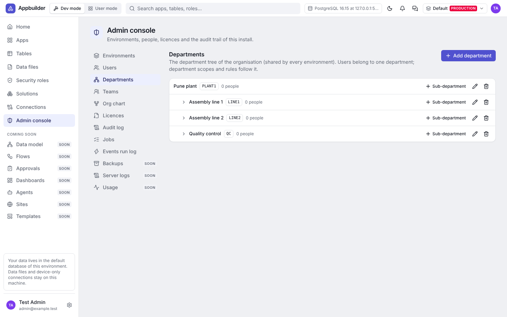
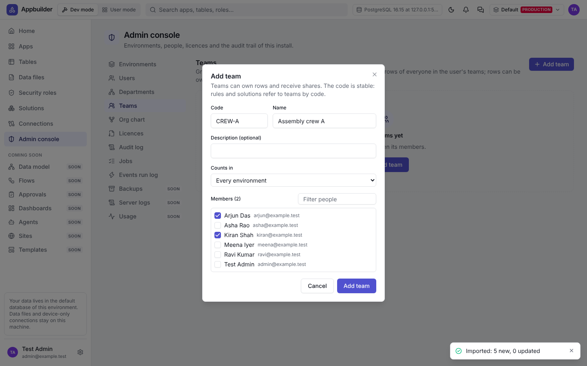
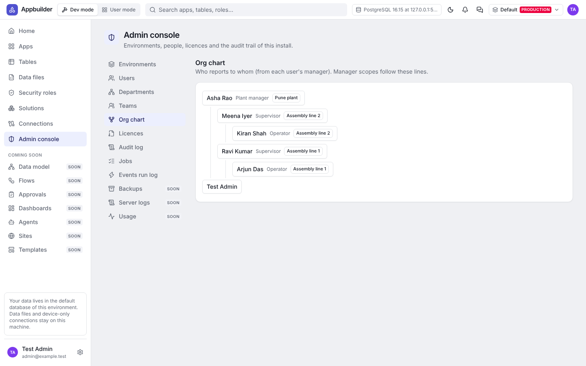
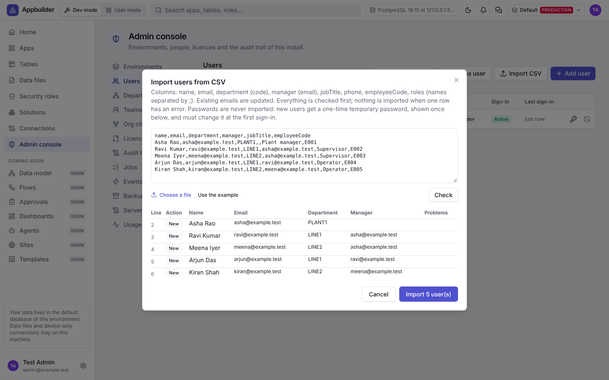
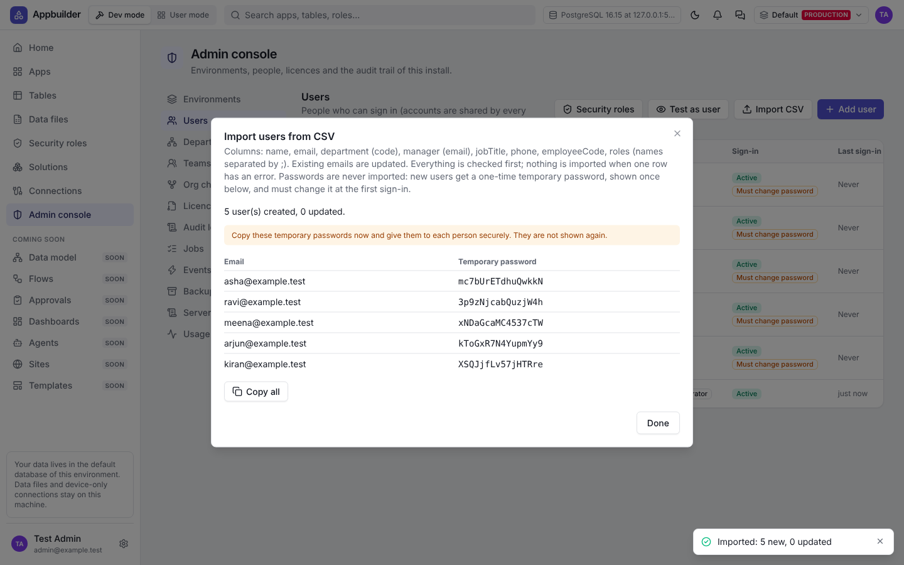

# Organisation: departments, managers and teams

Appbuilder knows how your organisation is built: which **department** each person is in, who their **manager** is, and
which **teams** they belong to. Roles use this to give people the rows of their team, their department or the people who
report to them (see [Users and roles](users-and-roles.md#which-rows-scopes)), and formulas can read it with `User()`.

The organisation is **install-wide**: the same departments, managers and teams in every environment (like user
accounts). Only install administrators change departments and the organisation fields of users. A team can be limited
to one environment; administrators of that environment manage such a team.

Everything here is in **Admin console** (Dev mode, administrators): **Users**, **Departments**, **Teams** and
**Org chart**. Demo mode has the same pages and rules over the browser workspace (not a security boundary).

## Departments

*Admin console > Departments* shows the department tree. **Add department** asks for:

| Field | Meaning |
| --- | --- |
| Code | Short and stable, for example `PLANT1` or `MATHS`. Row rules (`@department:PLANT1`) and solutions refer to departments by code, so do not reuse a code for something else. Letters, digits, `.`, `_`, `-`; unique. |
| Name | What people see. |
| Part of | The department above it, or *(top level)*. |

**Sub-department** adds a department below one. Moving a department (changing *Part of*) moves everything below it; the
department scopes follow at once.

 A department cannot be moved below itself or one of its own sub-departments. A
department with sub-departments cannot be deleted; delete or move them first. Deleting a department leaves its people
without a department (their accounts and rows stay).

## Users: department, manager and the rest

*Admin console > Users > Edit* has, besides name, email and roles:

| Field | Used for |
| --- | --- |
| Department | Department scopes, `@myDepartment`, `User().Department` |
| Manager | Manager scopes, `@myManager`, `@myReports`, the org chart, `User().Manager` |
| Job title, Phone, Employee code | Shown in the console; `User().JobTitle` |

A user cannot be their own manager, and a manager cannot report (directly or indirectly) to the person they manage:
the server refuses a change that would make the reporting line go round in a circle. Should a circle exist anyway
(for example written into the database by hand), Appbuilder still works: every reporting line is followed at most once
per person and at most 32 levels deep.

Deleting a user removes their team memberships and every share made to them, and the people who reported to them lose
their manager (set a new one). Rows they own keep them as owner.

## Teams

*Admin console > Teams* lists teams with their members. A team has a **code** (stable, like a department code), a name,
an optional description, its **members**, and **Counts in**: *every environment* (install administrators manage it) or
one environment (administrators of that environment manage it).

Teams do three things:

- **Team scope**: a role with the *Team* scope on a table lets the user see the rows owned by themself, by anyone in any
  of their teams, and by those teams.
- **Team-owned rows**: on tables with *Rows can be owned by teams* (table designer, Settings) a row can be given to a team.
- **Shares**: a row can be shared with a team (everyone in it).

Removing someone from a team takes those rows away from them at once (on the next request).



## Org chart

*Admin console > Org chart* draws who reports to whom from each user's manager, with job titles and departments.
People without a manager are at the top. People caught in a reporting circle are listed at the end, so nobody
disappears.



## Import users from a CSV file

*Admin console > Users > Import CSV* adds or updates many people at once. The first line names the columns:

```
name,email,department,manager,jobTitle,phone,employeeCode,roles
Asha Rao,asha@example.com,PLANT1,,Plant manager,,E001,Plant manager
Ravi Kumar,ravi@example.com,LINE1,asha@example.com,Supervisor,,E002,Supervisor;Operator
```

- `name` and `email` are required. An email that already has an account updates that person (name, roles when the
  column is there, organisation fields); a new email creates an account.
- `department` is the department **code** (the name also works). `manager` is the manager's **email**: an existing user
  or someone else in the same file. `roles` are role names of the current environment, separated by `;`.
- **Check** shows a preview: one line per row with *New*, *Update* or *Error* and the problems (unknown department,
  unknown manager, duplicate email, a reporting circle, an invalid email). **Nothing is imported while one row has an
  error**: the import is all or nothing, in one transaction.
- **Passwords are never imported** (a `password` column is ignored and said so). Every new account gets a one-time
  **temporary password** of 16 letters and digits, shown once after the import (with *Copy all*). The person must choose a
  new password when they first sign in. There is no email sending yet: hand the temporary passwords over yourself, on a
  secure channel. They are stored hashed and never written to the audit log.





The audit log records `user.import` with the emails created and the number updated.

## In formulas: User()

| Field | Value |
| --- | --- |
| `User().Department` | Department name (blank when none) |
| `User().DepartmentCode` | Department code |
| `User().Manager` | A record with `FullName`, `Email`, `Id` (blank when none) |
| `User().JobTitle` | Job title |
| `User().Teams` | A table of `Name`, `Code`, `Id` (teams counting in this environment) |

For example `If(User().DepartmentCode = "QA", ...)` or `CountRows(User().Teams)`. These are for showing and guiding
in an app; what a person may read or change is decided by roles on the server, not by formulas.

## API

| Request | Who | What |
| --- | --- | --- |
| `GET /api/v1/org` | signed-in users | Directory: administrators get departments, teams with members and users with department and manager; everyone else active users' names and emails and the teams of the environment (for share pickers) |
| `POST/PATCH/DELETE /api/v1/departments[/:id]` | install administrators | `{ code, name, parentId?, description? }` |
| `POST/PATCH/DELETE /api/v1/teams[/:id]` | install administrators; environment administrators for teams of their environment | `{ code, name, description?, environmentId?, memberIds? }` |
| `PATCH /api/v1/users/:id` | install administrators for the organisation fields | `departmentId`, `managerId`, `jobTitle`, `phone`, `employeeCode` (`null` clears) |
| `POST /api/v1/users/import` | install administrators | `{ csv, commit? }`: preview, or the import with `{ created: [{ email, name, temporaryPassword }], updated }` |

Every change is in the audit log (`org.department_*`, `org.team_*`, `user.update` with the changed fields, `user.import`).
