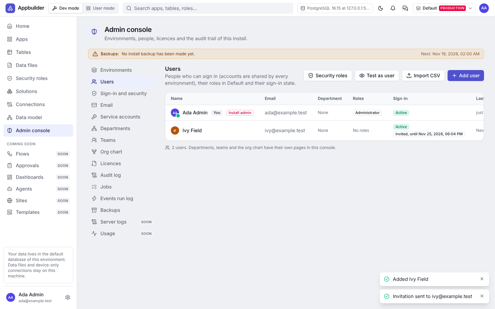
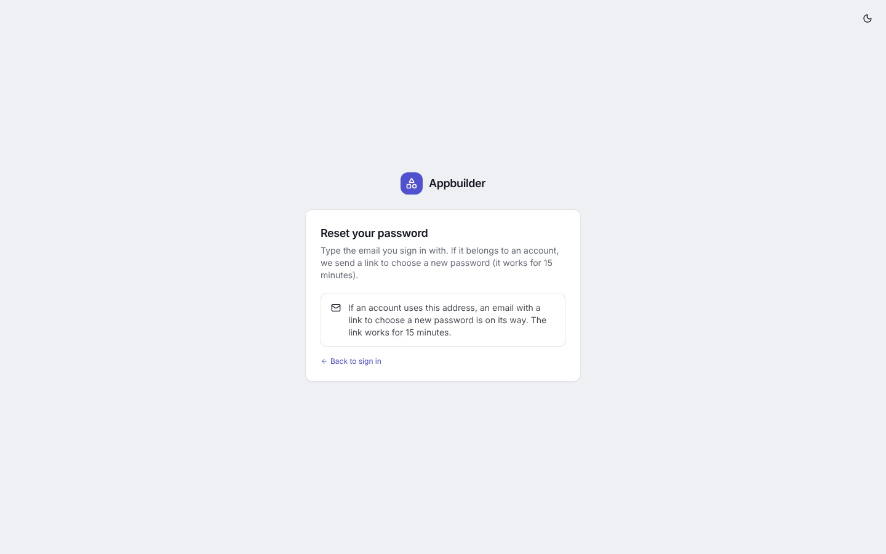
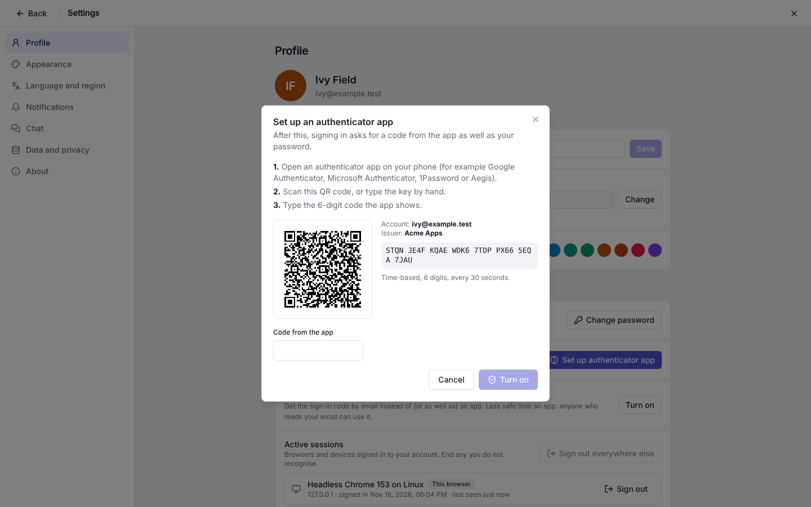
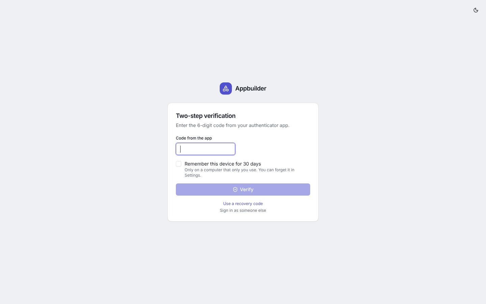
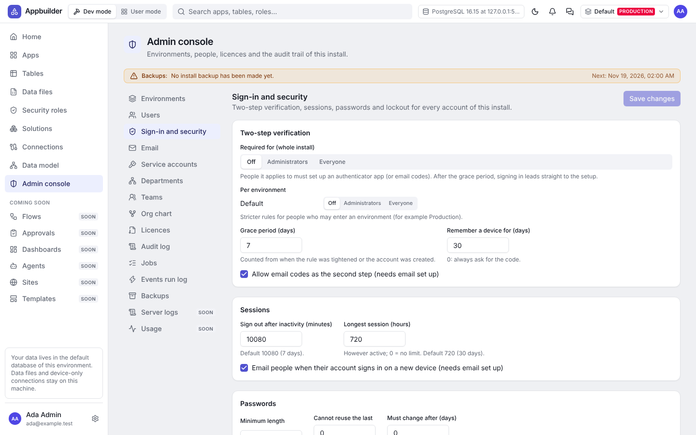
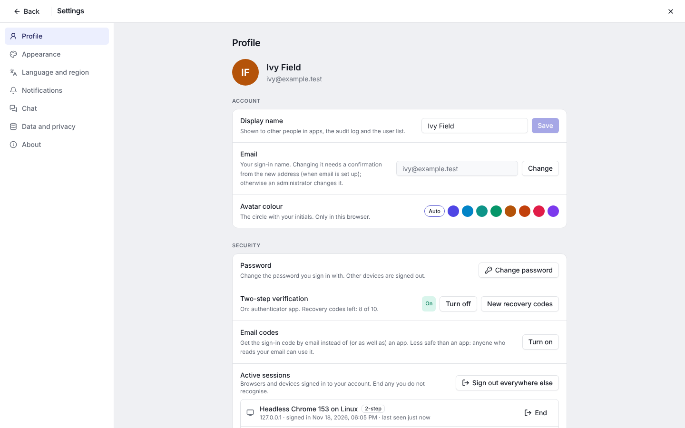
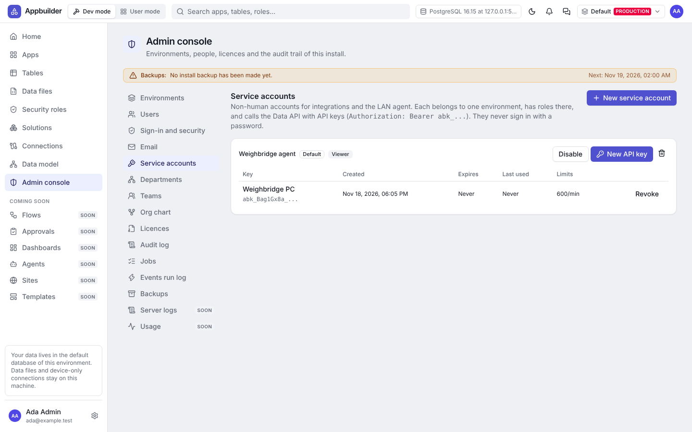
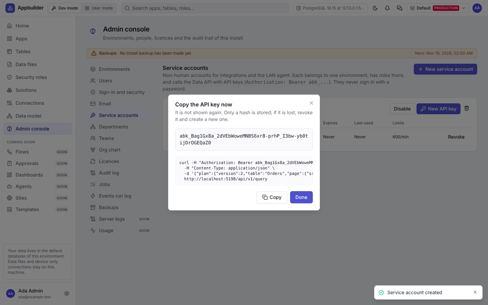

# Sign-in and identity

For install administrators. How people sign in, how they recover access, how sessions end, and how integrations sign in
with API keys. All of it is install-wide (accounts are shared by every environment). Built in P0 package I; the design is
in [docs/dev/auth.md](../dev/auth.md), the threat model in [Security model](security-model.md).

Admin console pages: **Users** (invitations, reset codes, sessions, two-step reset), **Sign-in and security** (policy and
sign-in log), **Email** (SMTP relay), **Service accounts** (API keys). People manage their own sign-in in **Settings >
Profile**. Demo mode has no sign-in: these pages and rows say they need the server.

## What works with and without email

| Feature | With email set up | Without email |
| --- | --- | --- |
| First password of a new person | Invitation link (7 days), they choose it | Temporary password set by an administrator, changed at first sign-in |
| Forgotten password | "Forgot your password?" emails a link (15 minutes) | An administrator creates a one-time reset code (24 hours) |
| Change of sign-in email | The person changes it; the new address confirms (24 hours) | An install administrator changes it in Users |
| Second step by email code | Available (unless turned off in the policy) | Not offered |
| "New sign-in" notice | Sent for a device the account was not used on before | Not sent |

Nothing fails silently: without email the screens say what to do instead (the sign-in screen offers "I have a reset code",
Add user offers only the temporary password, Settings hides email codes).

## Email

Admin console > **Email**. Set up once for the install; the steps are in [Installation](installation.md#set-up-email-smtp-relay).

- Security modes: **STARTTLS** (required when chosen; the connection is refused if the relay does not offer it), **TLS**
  (implicit, port 465), **None** (only for a relay on this computer when a password is used). TLS 1.2 or newer.
  Certificates are verified unless you turn that off for an internal relay.
- Sign-in methods: AUTH PLAIN, else AUTH LOGIN. OAuth (XOAUTH2) is not supported: use an app password or a relay account.
- The password is sealed with the install's secret key (`workspace/.secret-key` or `APPBUILDER_SECRET_KEY`), like
  connection passwords. Losing the key means entering it again.
- Every email is a job of type `mail.send` in the Default environment's queue: 6 attempts with backoff (2 s doubling, at
  most 10 minutes) for temporary failures; a permanent refusal (5xx) is not retried. The message itself is sealed in the
  job (it can hold a reset link or a code). The **delivery log** keeps recipient, subject, template, status (queued, sent,
  retrying, failed), attempts and the last error, never the body.
- System emails: test, password reset, invitation, email change (to the new address) and notice (to the old one),
  sign-in code, new-device sign-in, password changed. Each has a plain-text and an HTML part, branded with the install
  name. Subjects never contain codes or links.
- The jobs run in the server process; with `APPBUILDER_JOBS=off` nothing is sent.

## Invitations

Users > **Add user** > *Send an invitation email*. The link (`<public address>/#invite=<token>`) works once, for 7
days. Resending replaces the old link; revoking ends it. Accepting sets the password (the policy applies) and signs the
person in. An account that already has a password cannot be invited (use a reset). Audited: `user.invited`,
`user.invitation_revoked`, `user.invitation_accepted`.

## Forgot password

Sign-in screen > **Forgot your password?**

- With email: the person types their address; the answer is always "If an account uses this address, an email ... is on
  its way" (the same for unknown addresses, disabled accounts and service accounts, and it takes the same time: the work
  happens after the answer is sent). The link works once, for 15 minutes; asking again revokes earlier links. At most 3
  emails per address an hour (further requests answer the same and send nothing); 20 requests per client address in 15
  minutes.
- Without email (or always, with "I have a reset code"): an install administrator opens the person's menu in Users >
  **Create one-time reset code** (12 characters, valid 24 hours, shown once, audited). The person types their email, the
  code and a new password.
- A reset ends every session of the account and forgets remembered devices. **Two-step verification still applies** at
  the next sign-in. 10 wrong reset attempts per client address in 15 minutes are refused for a while.

## Two-step verification

People turn it on in **Settings > Profile > Two-step verification > Set up authenticator app**: scan the QR code (or
type the key), type the current code, and save the 10 **recovery codes** (each works once; "New recovery codes" makes a
new set and invalidates the old one). Any app that supports time-based codes works (Google Authenticator, Microsoft
Authenticator, 1Password, Aegis, ...): 6 digits, 30 seconds, SHA-1.

Signing in then asks for a code after the password. A code works once (the same code cannot be used twice, even within
its 30 seconds). Alternatives on that screen: a recovery code, or (when allowed) a code by email. **Remember this device
for 30 days** skips the step on that browser; people see and forget remembered devices in Settings.

**Email codes** (Settings > Profile > Email codes > Turn on, confirmed with a code sent to the account's address) are an
alternative or additional second step. Weaker than an app: whoever reads the mailbox can use them. You can turn them off
for the install in the policy.

Turning a method off, and new recovery codes, need the password (or a code) again. While the policy requires two-step
verification, the last method cannot be turned off.

**Lost phone:** the person signs in with a recovery code. Without recovery codes: an install administrator uses Users >
menu > **Reset two-step verification** (audited `user.mfa_reset`; signs the person out everywhere); the person signs in
with the password and sets it up again.

## Sign-in and security policy

Admin console > **Sign-in and security** (install administrators change it; every change is audited as
`install.security_policy` with the values before and after).

### Two-step verification policy

| Setting | Default | Meaning |
| --- | --- | --- |
| Required for (whole install) | Off | *Administrators*: install administrators and anyone with an administrator role in some environment. *Everyone*: every person (not service accounts). |
| Per environment | Off | The same for the people who may enter that environment (*Administrators*: its administrators). Use it for Production. |
| Grace period | 7 days | From when the rule was tightened (or the account was created, whichever is later). During it Settings shows "Your administrator requires it from ..."; after it, signing in leads straight to the setup and nothing else works until it is done (403 `mfa_enrolment_required`). |
| Remember a device for | 30 days | 0: "Remember this device" is not offered. |
| Allow email codes | On | Email codes as a second step (needs email). |

### Locked out: the last administrator

If the only install administrator forgot their password or lost their second factor, recover on the **server machine**
with the `appbuilder` command (installed servers; in a source checkout `node server/main.ts admin ...`). It needs the
workspace's secret key and database login, so run it as a user who can read the workspace folder (Windows: an
administrator PowerShell; Linux: `sudo`). It works whether the server runs or not.

| Command | What it does |
| --- | --- |
| `appbuilder admin list` | The install administrators and environment administrators, with status and two-step verification |
| `appbuilder admin reset-password <email>` | Prints a **one-time reset code valid 15 minutes** (never a password). On the sign-in screen choose *Forgot password?*, then *I have a reset code* |
| `appbuilder admin reset-mfa <email>` | Removes the person's two-step verification and ends their sessions; they set it up again at the next sign-in if the policy requires it |
| `appbuilder admin make-install-admin <email>` | Makes an account an install administrator (and enables it if it was disabled) |

Every use is in the install audit log (`install.cli_reset_code`, `install.cli_mfa_reset`, `install.cli_make_admin`) with
source `cli`, the operating-system user and the host name. Without access to the secret key the command refuses (it never
creates a key).

> **Warning.** Anyone with administrator rights on the server PC can take over Appbuilder this way. That is already true
> of the database and the workspace (they hold everything); protect the machine, its administrator accounts and backups
> accordingly ([hardening checklist](hardening-checklist.md)).

## Sessions

| Setting | Default | Meaning |
| --- | --- | --- |
| Sign out after inactivity | 10080 minutes (7 days) | A session not used for this long ends. |
| Longest session | 720 hours (30 days) | A session ends this long after sign-in however active (0: no limit). |
| Email people about new devices | On | "New sign-in to your account" when an account signs in on a browser it was not signed in on before (needs email). |

Changes apply to new sessions at once and to existing ones at their next request (the idle check), or at their next
renewal (the expiry).

### Password policy

| Setting | Default | Meaning |
| --- | --- | --- |
| Minimum length | 10 | 8 to 64. |
| Refuse common passwords | On | A bundled list of 2,087 passwords of 8 or more characters (from SecLists `10k-most-common.txt`, MIT licence), also with digits or symbols appended; one repeated character. Checked offline. |
| Cannot reuse the last | 0 (off) | Up to 24 earlier passwords are kept as hashes. |
| Must change after | 0 days (never) | When set, a password older than this must be changed right after the next sign-in. Current guidance (NIST SP 800-63B) advises against forced periodic changes; leave it off unless a rule requires it. |

### Lockout

| Setting | Default | Meaning |
| --- | --- | --- |
| Wrong passwords per email and address / within | 8 / 15 minutes | Further attempts from that address for that email are refused (429) until the window passes. |
| Slow down after (per email, an hour) | 10 | From then each attempt waits 1 s, 2 s, 4 s ... (at most 5 minutes) after the previous failure. |
| Block the email after (an hour) | 50 | Blocked for the rest of the hour. |
| Wrong second-step codes / lock for | 10 / 15 minutes | The account's second step is locked (even the right code is refused). A single pending sign-in also ends after 5 wrong codes (the password is asked again). |

Counters are kept in the server's memory (a restart clears them). See the trade-off in
[Security model](security-model.md#sign-in-throttle).

### Sign-in log

Under the policy: every sign-in and failed attempt of everybody (time, account or typed email, result and reason,
method, browser and address), newest first, filter by result. People see their own last 50 in Settings > Profile >
Sign-in history. Reasons: wrong password, unknown email, account disabled, too many attempts, wrong code, code used
twice, second step locked, invalid reset code, API key problems (unknown, revoked, expired, address not allowed).

Entries older than **180 days** are deleted every night by the "Sign-in log retention" schedule, and email delivery log
entries older than **90 days** by "Email delivery log retention" (both on the Jobs page of the Default environment; only
install administrators can change the number of days or switch them off). See [Jobs](jobs.md#schedules-and-retention).

## Sessions

People: **Settings > Profile > Active sessions** lists every browser signed in (device, address, when signed in, last
seen, "This browser"), with **End** per session and **Sign out everywhere else**. Install administrators: Users > menu >
**Sessions**, with **Sign out everywhere**. Ending a session closes its open pages' live connection at once and their
next request goes to the sign-in screen.

A session also ends at sign-out, after the idle timeout, at its absolute end, when the password changes (other
sessions), on a password reset (all), when the account is disabled or deleted, and when its two-step verification is
reset.

## Confirming it is you (re-authentication)

These actions need the password, or a code from the authenticator app, typed within the last 10 minutes
(`APPBUILDER_REAUTH_SECONDS`): changing the sign-in email, turning a second-step method off, new recovery codes,
creating an API key, deleting an environment, exporting all data. The portal asks in a small dialog and then carries on.

## Changing the sign-in email

Settings > Profile > Email > **Change** (needs email set up and re-authentication). A confirmation link goes to the new
address (24 hours), a notice to the current one. Nothing changes until the link is opened; then reset links and older
confirmation links stop working. Audited (`user.email_change_requested`, `user.email_changed`). Without email, install
administrators change emails in Users.

## Service accounts and API keys

Admin console > **Service accounts** (install administrators). A service account is a non-human account for one
integration (the LAN agent, a weighbridge PC, a script): it belongs to **one environment**, has **roles there** like a
person, and never signs in with a password (it is not shown in Users).

**New API key** (needs re-authentication): a name, an optional expiry in days, optional allowed addresses (IP addresses or
ranges such as `192.168.1.0/24`, IPv4 or IPv6) and an optional rate limit (default 600 requests a minute per key). The key
is shown **once**:

- Format `abk_<8 characters>_<43 characters>`. The first part (the prefix) is shown in lists to tell keys apart; only a
  SHA-256 hash of the whole key is stored.
- Use it as `Authorization: Bearer <key>` on the Data API: `/api/v1/query`, `/api/v1/data/...`, `/api/v1/attachments...`,
  reading `/api/v1/tables`, and `/api/v1/auth/session` (to see who you are). Everything else answers 403. Examples:
  [Data API](../dev/data-api.md#api-keys-bearer-authentication).
- The key works only in its account's environment (a request naming another environment is refused) and only as far as
  the account's roles allow.
- **Revoke** stops a key at once. Disabling or deleting the account stops all its keys. The list shows when and from where
  each key was last used.
- Audited: `install.service_account_create|update|delete`, `install.api_key_create|revoke`. Failed key uses are in the
  sign-in log.

## Audit entries

Environment audit log (the environment the request ran in): `auth.login` (with the method), `auth.login_failed`,
`auth.login_throttled`, `auth.mfa_failed`, `auth.mfa_enabled`, `auth.mfa_disabled`, `auth.recovery_code_used`,
`auth.recovery_codes_regenerated`, `auth.reauth_failed`, `auth.reset_requested`, `auth.password_changed`,
`auth.password_expired`, `auth.session_revoked`, `auth.sessions_revoked`, `auth.device_forgotten`,
`user.email_change_requested`. Install audit log as well: `auth.password_reset`, `user.invited`,
`user.invitation_revoked`, `user.invitation_accepted`, `user.reset_code_created`, `user.mfa_reset`,
`user.session_revoked`, `user.sessions_revoked`, `user.email_changed`, `install.security_policy`,
`install.email_settings`, `install.email_settings_removed`, `install.email_test`, service accounts and API keys (above).

## Not supported yet

- Single sign-on (SAML, OpenID Connect), passkeys and WebAuthn security keys, sign-in with Microsoft or Google (P3.5).
- SMS codes. Push approvals.
- A check against a large breached-password corpus (only the bundled list, offline).
- Per-role or per-app policies; IP restrictions for people (only for API keys).
- Lockout counters shared between several server processes (they are per process).
- OAuth (XOAUTH2) sign-in to the SMTP relay; DKIM signing (the relay does that).
