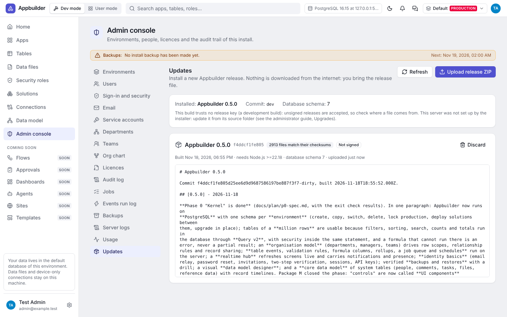

# Upgrades

An install made by the [installers](installation.md) is updated with a **release package** (`appbuilder-<version>.zip`) and
the `appbuilder update` command, or prepared in **Admin console > Updates**. Nothing is downloaded automatically and the
server never contacts us: you bring the file. A source checkout is updated with git ([below](#update-a-source-checkout)).

## Before you update

1. **Read the release notes** (`RELEASE-NOTES.md` in the package, or Admin console > Updates after uploading it).
2. **Back up**: Admin console > Backups > Back up now (whole install), and copy it off the machine
   ([Backup and restore](backup-and-restore.md)). When the new release changes the database schema the server also takes
   an install backup by itself before it migrates ("Before a server upgrade"), but a backup you moved elsewhere is the
   reliable way back.
3. Tell users: the service is stopped for about a minute (longer when the database is migrated and large).

## Update an installed server

On the server, as root (Linux) or in an elevated PowerShell (Windows):

```bash
sudo appbuilder update /path/to/appbuilder-0.6.0.zip
```

```powershell
& 'C:\Program Files\Appbuilder\appbuilder.cmd' update C:\Install\appbuilder-0.6.0.zip
```

The updater, in order (each step is printed):

1. Unpacks the package next to the installed release (`<install folder>\app.staging`, the same disk, so the switch is a
   rename) and checks **every file** against the package's `SHA256SUMS` (missing, changed or added files refuse it).
2. Checks the **signature** (`SHA256SUMS.sig`, Ed25519) against the release keys the **installed** release trusts (never
   against keys inside the new package). An install that trusts a key refuses unsigned packages and packages signed with
   another key; `--allow-unsigned` exists for builds you made yourself. A development build that trusts no key accepts
   unsigned packages and says so.
3. Refuses a **downgrade** (an older version), a release that needs a newer **Node.js** than the service runs (run the new
   release's installer instead: it updates Node.js too), and a release whose database schema is **older** than the
   database's.
4. Checks that the running server is **healthy** (`GET /api/v1/health` answers `ok`); otherwise it stops, because it could
   not judge the new release (`--force` overrides).
5. Asks for confirmation (`--yes` skips it), **stops the service**, renames `app` to `app.previous` (the release before is
   deleted) and `app.staging` to `app`, sets the permissions, and **starts the service**. At start the server **migrates the
   database** if the release needs it, taking its pre-migration install backup first (see
   [What happens to the database](#what-happens-to-the-database)).
6. Waits until `GET /api/v1/health` answers `ok` (default up to 10 minutes: a large migration takes time;
   `--health-timeout <seconds>`).
7. **If the new release does not become healthy, it rolls back the app folder by itself**: stops the service, moves the new
   release to `app.failed` (for the logs and support), puts `app.previous` back, starts it and checks it. See
   [Roll back](#roll-back) for the database.

Each update is recorded in `<data>\updates\history.json` (shown in Admin console > Updates). Exit codes: 0 updated (or
already installed), 2 failed and rolled back, 3 refused before anything changed.

Other options: `--reinstall` (the same release again, for example after files were damaged), `--allow-downgrade` (only
with a matching database restore), `appbuilder verify-release <zip or folder>` (check a package without installing it),
`appbuilder version` (the installed release, its commit, build date, schema version and trusted keys).

### The Updates page (Admin console)

Install administrators see the installed release (version, commit, build date, schema version, trusted keys), can
**upload a release ZIP**, and see whether its checksums match, whether it is signed by a trusted key, what it needs
(Node.js, schema) and its **release notes**. A package that passes is kept in `<data>\updates\staged`, and the page shows
the one command that installs it:

```
sudo appbuilder update --staged
& 'C:\Program Files\Appbuilder\appbuilder.cmd' update --staged      (elevated PowerShell)
```

The page does not install the release itself, on purpose: the service runs under a low-privilege account that may not
change its own program files, so a stolen administrator session cannot replace the server's code. The `update --staged`
command checks the staged package again as root / Administrator before installing it (the service account could have
changed the staged files; a signed package makes that detectable).



## What happens to the database

On every start the server runs its schema step (`migrate()` in `server/core/meta-store.ts`) in two phases:

1. It reads `schemaVersion` from `ab.settings` (downgrade guard below), then, in **one transaction** (PostgreSQL DDL is
   transactional, so a failed step leaves the database as it was), creates or completes schema `ab`, runs the install-level
   upgrade steps the database has not had yet, in order, and records the new `schemaVersion`.
2. Then **each environment** schema (`env_<id>`), in **its own transaction**: it reads that environment's `schema_version`
   (`ab.environments`), refuses one that a newer server migrated (downgrade guard per environment), completes its tables,
   runs its upgrade steps and records its version. An environment whose step fails is marked **Failed** with the reason
   (`ERROR ENVIRONMENT <id> NOT AVAILABLE` on the console, `environment.migrate_failed` in the install audit log); the
   others, and the server, keep working. The next start tries it again. See [Environments](environments.md#when-an-environment-is-not-available).

Current version: **7**.

**Before the first step** of an upgrade that changes the schema (the database is at version 4 or later but below the
server's), the server writes an **install backup** of the database as it is into the backup folder (trigger "Before a
server upgrade"; [Backup and restore](backup-and-restore.md#automatic-backups-before-risky-changes)). If that backup fails,
the server does **not** upgrade the database: it logs `DATABASE NOT UPGRADED: the backup before the schema upgrade failed`,
data routes answer 503 with the reason, and it does not retry. Fix the cause (disk space, the backup folder), or start once
with `APPBUILDER_MIGRATION_BACKUP=skip` to upgrade without it. Switch it off in Admin console > Backups > Settings.

| Version | Step |
| --- | --- |
| 1 to 3 | The MySQL/MariaDB system store of versions 0.1 to 0.4. **There is no upgrade from MySQL** (decision D14): a PostgreSQL database never has these versions, and a 0.5 server pointed at an old MySQL database cannot connect to it at all. |
| 4 | The PostgreSQL layout: schema `ab` (settings, users, sessions, environments, licence) and the environment schema `env_default` (see [schema](../dev/schema.md)). |
| 5 | Real environments: `ab.environments` gets state, schema version, lock, description, creator; new tables `ab.environment_access` (who may enter which environment) and `ab.audit` (install-level audit); `ab.users` gets `is_install_admin` and `last_environment_id`. Data: every user who held an Administrator role becomes an **install administrator**; every user keeps access to Default (environment administrators: the Administrator role holders). Files: `workspace/attachments/` and `workspace/files/` move into `workspace/env/default/` (only what is not there yet; nothing is overwritten or deleted). |
| 6 | P0 wave 3: organisation (`ab.departments`, `ab.teams`, `ab.team_members`, new user fields), in-app notifications (`ab.notifications`, `ab.user_settings`); in every environment record sharing (`ab_shares`) and the event and job kernel (`ab_outbox`, `ab_jobs`, `ab_schedules`, `ab_table_events`, `ab_event_runs`). Only new tables and columns: nothing existing changes. After the upgrade the built-in maintenance schedules appear on the Jobs page of each environment. A version 5 server refuses a version 6 database. |
| 7 (backups) | The backup catalogue in schema `ab` (`ab.backups`, `ab.backup_ops`; package J). Only new tables. After the upgrade a nightly install backup at 02:00 (server time) is scheduled; the first start writes an install backup before migrating. |

- **Moving from 0.4 (MySQL) to 0.5 (PostgreSQL).** Since there are no customer installations yet, there is no conversion. Install
  PostgreSQL ([Installation](installation.md#prepare-the-database)), point the new version at an empty database and start fresh.
  To carry apps and tables over, export them as **solution packages with data** from the 0.4 installation first and import them
  into the new one ([Solutions](../guide/maker/solutions.md)); users and roles have to be created again.
- **The migration summary** (from which version to which, and what each step did) is printed to the server console at
  start and written to the audit log of Default and the install-level audit log as `schema.migrate` (details:
  `{ from, to, steps, environments }`). An up-to-date database prints "system schema version 6 (up to date)" and writes nothing.
- The data tables (`t_...` in each `env_<id>`) are yours and are not touched by upgrades. (Linked tables are touched only when a
  maker agrees to add system columns while linking, see [Connections](connections.md).)
- The schema step needs the Appbuilder role to own the database (or have `CREATE` on it), as set up by
  `scripts/setup-postgres.*` ([Installation](installation.md#prepare-the-database)).

### Running an older version against a newer database

The server refuses a database whose `schemaVersion` is **higher** than the version it knows (downgrade guard). It does
not run any statement against it (not even `CREATE TABLE IF NOT EXISTS`), prints

```
ERROR DATABASE NOT USED: The database schema is version 6, but this Appbuilder only knows version 5. ...
```

and stays up without a database: every data route answers 503, `GET /api/v1/status` reports `setup.incompatible: true`,
the browser shows "This database needs a newer Appbuilder", and the setup screen cannot be used to point it elsewhere.
It does not retry. Start the newer version again, or restore the pre-upgrade backup into the database before starting
the old code.

## Solution upgrades in an environment

Not the Appbuilder upgrade, but the one makers and administrators do every day: importing or deploying a newer version of a
solution into an environment where it already exists **upgrades it in place** (same apps, tables and roles; data kept), after a
plan that lists every new, changed and removed app, table, column and role, with destructive changes (a dropped table or
column loses its data) in red. The whole upgrade runs in one transaction: if any step fails (for example a value that does not
convert to a column's new type), nothing changes. See [Solutions](../guide/maker/solutions.md#deploy-to-another-environment).

Before it changes anything, the upgrade takes a **backup of the target environment** (the plan says "A backup of this
environment is taken before anything changes"; the result names the backup). If that backup fails, nothing changes: the
dialog explains why and offers **Upgrade without a backup** or Cancel. With automatic backups switched off (Admin console >
Backups > Settings) the plan says so in amber and no backup is taken. To undo an upgrade, restore that backup in place
or as a new environment ([Backup and restore](backup-and-restore.md#restore)).

## Roll back

**The app folder** is rolled back automatically when the new release fails its health check (above). To go back by hand
after a successful update (the new release works but you do not want it): stop the service, rename `app` to `app.failed`
and `app.previous` to `app`, start the service. That is enough when the update did **not** change the database schema
(`appbuilder version` and the release notes show the schema version).

**The database is never restored automatically.** If the new release had migrated the database before it failed, the
previous release refuses the newer schema ([below](#running-an-older-version-against-a-newer-database)) and the updater
says so, naming the pre-migration backup and the command:

```bash
sudo systemctl stop appbuilder
sudo appbuilder restore /var/lib/appbuilder/backups/appbuilder-install-<date>-<id>.abbak --force
sudo systemctl start appbuilder
```

(Windows, elevated: `Stop-Service Appbuilder`, `& 'C:\Program Files\Appbuilder\appbuilder.cmd' restore <file> --force`,
`Start-Service Appbuilder`; see [Disaster recovery](disaster-recovery.md).) Why this is a decision for a person and not
automatic: a restore discards everything written since the backup (with the server up, users may already have entered
data under the new release), it replaces the whole database, and the failure may have nothing to do with the database
(then fixing the cause and running the update again keeps all data). The updater keeps both release folders and the
backup, so either way is open.

From a source checkout: `git checkout <the previous commit>`, `npm ci`, `npm run build`, and the same restore when the
schema had changed.

## Update a source checkout

For an install from source ([Installation](installation.md#install-from-source-developers)), stop the server, then in
the Appbuilder folder (Node 22.18 or newer):

```
git pull --ff-only
npm ci
npm run build
```

Then start the server as usual (`start.ps1`, or your scheduled task). `--ff-only` stops with an error instead of merging
if you have local changes; resolve that before going on. `npm ci` installs exactly the versions in `package-lock.json`.
`npm run build` compiles the web interface (`tsc -b && vite build`); the server itself runs the TypeScript files
directly and is not built.

On a PC set up with `scripts/setup-offline.ps1`, running that script again also updates the installation (it assumes
port 5174).

After start, sign in and check an app, **Connections > Test**, and the console for errors.


## Migrating an older file-based workspace

Early versions (phase 2) kept data in files: `workspace.yaml`, `tables/*.schema.yaml` and `apps/*.app.yaml` in the
workspace folder, and CSV data. The current version stores everything in PostgreSQL. A conversion exists, but it runs only
**once, at the moment the first administrator is created on the setup screen**, and only if those files are found in
the workspace folder.

What it does (tested with a sample old workspace):

- Tables become tables on the built-in **Data files** connection (so they stay on this PC and are not in the database;
  use *Move to database* afterwards if you want that).
- Roles are merged by name with the built-in roles. Users are created **without passwords**: an administrator must set a
  password for each ([Users and roles](users-and-roles.md#create-a-user)).
- Apps are brought over.
- Old files are **moved** to `workspace/legacy-phase2` (or `-2`, `-3` if that exists). Nothing is deleted.
- A summary of what was converted is written **only to the server's console**, so keep that window open or copy the
  text. If the conversion fails, the error is logged and setup carries on with an empty system (the sample data), and
  your old files stay in place.

Because it only runs at first-administrator creation, you cannot run it again later on a running system. To retry:
restore or recreate the old files in a clean workspace, drop and recreate the database (or use a new one) and run the
setup again.
If no old files are found, the setup instead creates sample data: two tables (Contacts, Orders) and a "Contacts app".
Delete them if you do not want them.

## Not supported yet

- Automatic downloads or update notifications (by design there is no phone-home; you bring the release file).
- Zero-downtime updates: the service is restarted, which briefly interrupts users (sessions survive: they are in the
  database). In-memory sign-in throttle counters are reset.
- Installing a staged update from the browser (see [Admin console > Updates](#the-updates-page-admin-console) for why).
- Re-running the legacy conversion on a live system.
