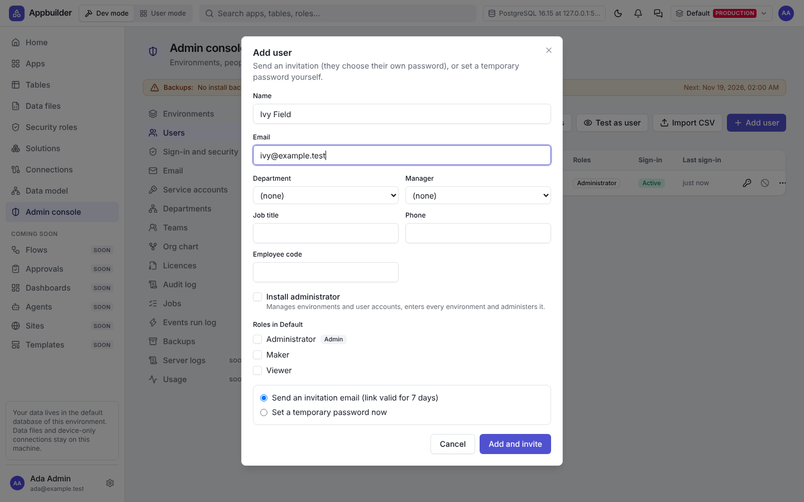
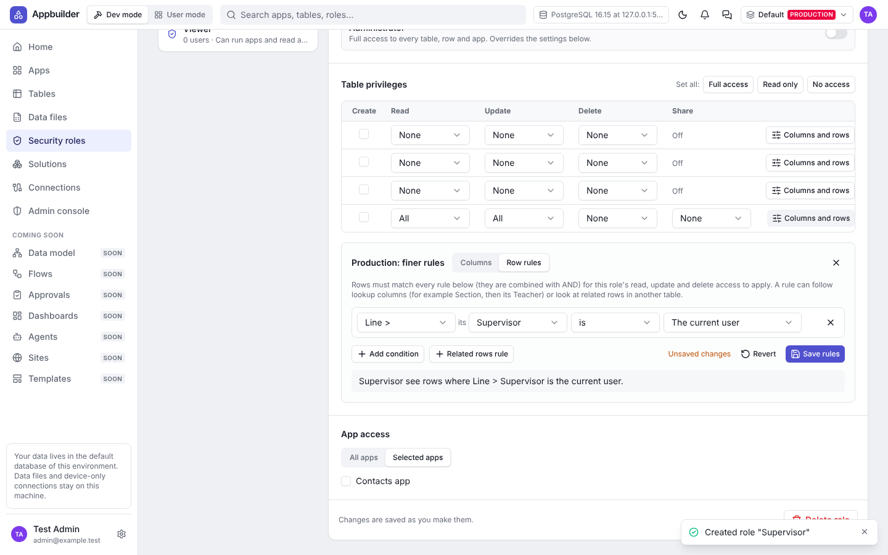
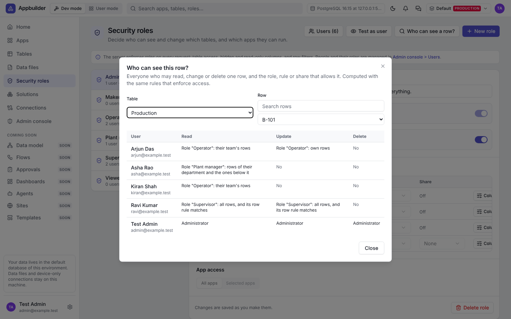
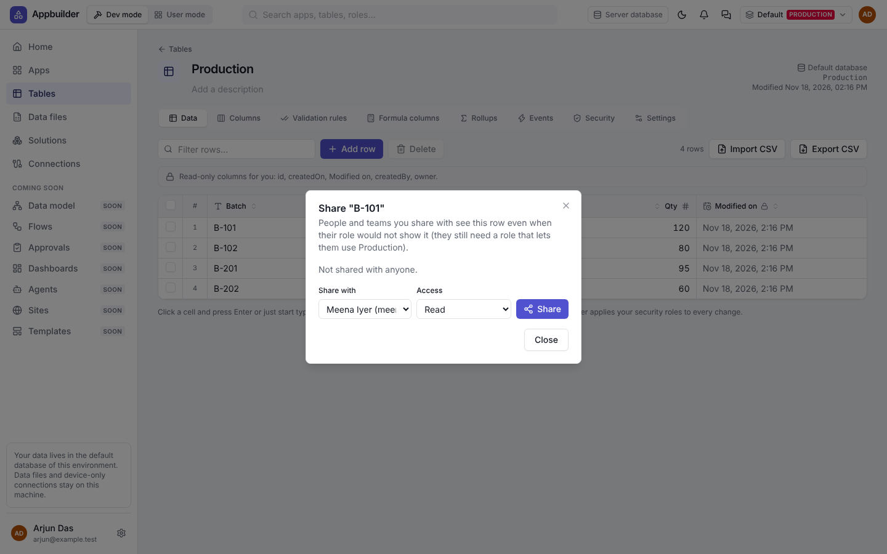
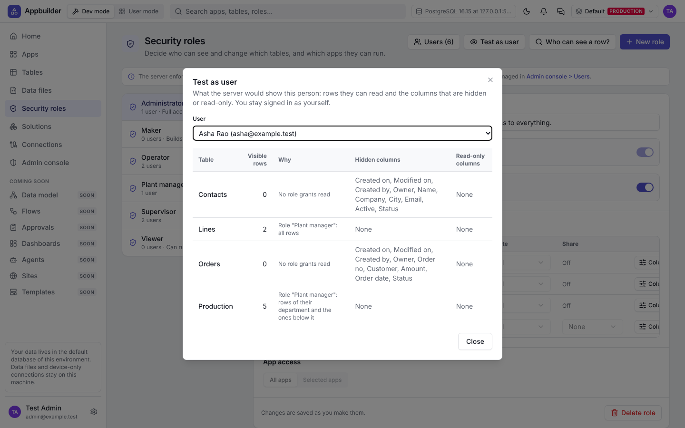

# Users and roles

Access in Appbuilder has four layers, all enforced by the server:

1. **Who you are**: a user account with an email and password. Accounts are install-wide: the same in every
   [environment](environments.md).
2. **Which environments you may enter**: given by an install administrator or an environment's administrator.
3. **What kind of user you are in an environment**: *Administrator*, *Maker*, or an ordinary user (your roles there).
4. **What you may do with each table** there: table privileges (create/read/update/delete), column access and row filters,
   given through **roles**. A user can have several roles. Roles belong to an environment.

## Install administrators and environment roles

There are two kinds of administrator, kept apart on purpose:

| | Install administrator | Environment administrator |
| --- | --- | --- |
| What makes you one | the **Install administrator** box on your account (`ab.users.is_install_admin`) | the **Administrator** role (any role with the Administrator switch) in that environment |
| Environments | creates, renames, changes the type of, locks and deletes them | none |
| Who may enter | gives and removes access to any environment | gives and removes access to their environment |
| Accounts | adds, renames, disables, deletes accounts; sets other people's passwords; makes others install administrators | none (they assign roles to existing accounts) |
| Inside an environment | administrator of **every** environment (enters all of them without being given access) | administrator of that environment only: roles, users' roles there, all data, connections, its audit log |
| Audit log | the install-level log (Admin console > Audit log > Install) | the environment's log |

An environment administrator is exactly what "Administrator" meant before there were environments, now limited to one
environment. Being given a role in an environment (Users page, while you work in it) also lets the person in; removing their
access removes every role they held there. The access list keeps a copy of who administers the environment
(`ab.environment_access.is_env_admin`), updated with every role change, so the install-level view does not need to open
every environment.

Guards: at least one active **install administrator** must remain (you cannot remove your own flag, disable or delete the
last one), and in every environment at least one active user must keep an Administrator role (as before).

**Upgrading from 0.4** (one environment): everybody who held an Administrator role became an install administrator, and
everybody kept access to Default, with the same roles. Nothing else changed for them.

Users live in the **Admin console** (Dev mode menu, administrators only) under **Users**: install administrators add
people, set or reset their password, enable or disable them; administrators of the environment you are in assign their roles
there (the dialog's role list is titled *Roles in <environment>*). Install administrators carry an *Install admin* badge. The roles themselves are edited on the **Security roles**
page. Each page links to the other (*Security roles* button on the Users page, *Users* button and a note on the
Security roles page).

The Users table shows, per person: their roles, whether they can sign in (*Active* or *Disabled*), *No password* (an
administrator has not set one yet), *Must change password* (an administrator set the password; the person chooses their
own at the next sign-in) and the last sign-in. In demo mode the same page lists the people you can run apps as; switch
between them from the avatar menu at the right end of the top bar.

People change their own **display name** themselves (Settings > Profile; the server allows only the name, see
`PATCH /api/v1/auth/profile` in `docs/dev/data-api.md`). Email, roles and status stay with an administrator.

## Built-in roles

Created when the first administrator is set up (`ensureBuiltinRoles` in `server/core/auth.ts`).

| Role | Flag | Table privileges | Apps |
| --- | --- | --- | --- |
| **Administrator** | Administrator | Everything, on every table and every app. Settings on the role are ignored. | All |
| **Maker** | Maker | Create, read, update and delete **all rows** of every table (at the time the role was created, and every table created or linked later, see below). | All |
| **Viewer** | none | Read all rows of every table. No create, update or delete. | All |

You can edit Maker and Viewer (and add your own roles). **Administrator** is special: a role with the Administrator
switch on bypasses every check. Every Administrator is also a Maker.

Roles control three separate things, so keep them apart:

- **Maker switch**: may build things (create apps, tables, connections to test, solutions). It says nothing about which
  data the person may read. The Maker role *happens to* carry full table privileges.
- **Table privileges**: what the person can do with the data.
- **App access**: which apps the person may open (below).

### What new tables get automatically

When a table is created, linked or imported, every non-administrator role gets default privileges on it
(`defaultPrivilegeFor` in `server/routes/meta/tables-core.ts`):

- a role with the Maker flag, or a role that already has full access (create, read all, update all, delete all) on
  **every** table, gets **full access** to the new table;
- the role named *Viewer* (any case), or a role that already has read-only access (read all, nothing else) on **every**
  table, gets **read-only**;
- every other role gets **no access**. This is the safe default for restricted roles; we confirmed it by running the
  server.

Read-only tables (for example linked read-only) never grant write access by default.

## Create a user

1. **Admin console** > **Users** > **Add user** (install administrators). Enter name, email and the role(s) in the
   environment you are in; tick **Install administrator** for someone who should manage the install. A new user with a
   role may enter the current environment; give access to others in Admin console > Environments > Access.
2. The first password, one of two ways:
   - **Send an invitation email** (offered when email is set up, Admin console > Email; the default then). The person
     gets a link valid for **7 days** and chooses their own password; they are signed in right after. The Users list
     shows "Invited, until ..."; the row's menu (three dots) can **Resend invitation** (the old link stops working) or
     **Revoke invitation**. An expired invitation shows "Invitation expired".
   - **Set a temporary password** (the only way without email): the key button on the row, **Set password**. Give the
     password to the person by another channel. It is temporary: at their first sign-in Appbuilder shows only *Choose a
     new password* (no way around it except signing out) until they have set their own.

A user with no password cannot sign in. Users created without a role can sign in but see nothing: a user with no roles
has no apps and gets "table does not exist" for every table (confirmed by running the server).

Rules (`server/routes/meta/security.ts`):

- The email must look like an address (`name@host.tld`), at most 190 characters, and is stored in lower case. It must
  be unique. The name is required, at most 100 characters.
- Changing a role, a status or a password takes effect on the person's **next request**; it does not wait for them to
  sign in again.

## Passwords and policy

From `server/core/password.ts`:

- At least **10** characters (the install's minimum, 8 to 64, set in Admin console > Sign-in and security), at most
  **1024**.
- Must not be the same as the user's email address (compared without case and surrounding spaces).
- Must not be on the bundled list of about 2,000 common passwords (or such a word followed by digits and symbols).
- Optional, off by default: not one of the last N passwords; a maximum age after which the password must be changed at
  the next sign-in. There is no complexity rule (length and the common-password list matter more).
  [Password policy](sign-in-and-identity.md#password-policy).
- Stored as an scrypt hash (see [Security model](security-model.md#passwords)). Nobody, including administrators, can
  read a password.

Password changes:

- **User changes own password** (account menu): must give the current password and a different new one. All the user's
  *other* sessions (other browsers) are signed out; this one stays signed in. Wrong current passwords count towards the
  login throttle.
- **Administrator sets or resets a password** (key button on the user, or a password given when creating the user): the
  new password must meet the policy. The user's sessions are signed out and the account is marked **must change
  password** (`ab.users.must_change_password`). At the next sign-in the user gets a session that can only change the
  password, sign out and read its own session (`/auth/password`, `/auth/logout`, `/auth/session`, plus `/status`);
  every other request answers 403 with the code `password_change_required`, and the portal shows the change dialog
  without a *Cancel* button. Changing it clears the mark. An administrator setting their **own** password this way is not
  marked.
- **Forgot password** on the sign-in screen: with email set up, a link valid for 15 minutes is emailed; without email
  an install administrator creates a **one-time reset code** (row menu > *Create one-time reset code*, valid 24 hours,
  shown once) that the person types on the sign-in screen ("I have a reset code"). Either way every session ends and
  two-step verification still applies at the next sign-in. If the only administrator forgets the password and email is
  not set up, see [Locked out](#locked-out).

## Sessions, two-step verification and the sign-in menu

The three-dots menu on a user's row (install administrators; [details](sign-in-and-identity.md)):

- **Sessions**: where the account is signed in (browser, address, signed in, last seen); end one, or **Sign out
  everywhere**. Open pages of an ended session lose their live connection at once.
- **Create one-time reset code**: see above. Audited (`user.reset_code_created`).
- **Reset two-step verification** (shown when it is on): removes the authenticator app, email codes, recovery codes and
  remembered devices and signs the person out everywhere. For a lost phone. Audited (`user.mfa_reset`).
- **Send / Resend / Revoke invitation** for accounts without a password.

The Sign-in column shows **2-step** for accounts with two-step verification. Service accounts are not listed here; they
have their own page (Admin console > Service accounts).

### Locked out by the login throttle

After 8 failed sign-ins for the same email from the same address within 15 minutes the server refuses further attempts
from there (even the correct password) with "Too many attempts. Try again in a few minutes." In addition, from the 10th
failed sign-in for an email within an hour (from any address) each further attempt must wait 1, 2, 4 ... seconds (at
most 5 minutes) after the previous failure, and 50 failures in an hour block the email until the oldest is an hour old.
The counters are kept in memory: they clear by themselves, or when the server restarts. Anyone can trigger the
per-account wait for a known email; see [Security model](security-model.md#sign-in-throttle).

### Locked out

There is no command-line password reset. If the only administrator cannot sign in, restore access by one of:
"Forgot your password?" on the sign-in screen (when email is set up), asking another administrator for a one-time reset
code (create at least two install administrators), or, as an advanced step, updating the
`password_hash` of an install administrator in the `ab.users` table with a hash made by the server's own code. Treat the second
as a support task; we have not documented a tested procedure for it.

## Disable or delete a user

- **Disable** (the stop button on the user's row): the user can no longer sign in and their sessions end immediately. All
  their data (`createdBy`, `owner` values, audit entries) is kept. Enable again with the same button.
- **Delete** (the bin button on the user's row, with a confirmation): removes the user, their role links and their sessions. Rows they created keep
  the old user id in `createdBy` and `owner`, which no longer matches anyone. If you use "own rows" privileges, those
  rows become invisible to everyone except people with *All* scope. Prefer disabling.

### The last-administrator guard

At least one **active** user must always keep an administrator role. The server refuses (409 "At least one active user
must keep an administrator role.") to disable, delete or remove the administrator role from the last such user, to
delete the Administrator role, or to switch off its Administrator flag. You also cannot disable or delete **your own**
account. All confirmed by running the server and in `server/routes/meta/security.test.ts`.

## What makers and administrators can do

Taken from the sign-in level each API route requires (`auth: 'user' | 'maker' | 'admin'` in `server/core/*.ts` and
`server/routes/meta/*.ts`).

| Ability | Ordinary user | Maker | Administrator |
| --- | :---: | :---: | :---: |
| Sign in, sign out, change own password | yes | yes | yes |
| Open an app | only apps allowed by their roles | **every** app | every app |
| Read, add, change, delete rows, import and export CSV, upload attachments | as the table privileges allow | as the table privileges allow | everything |
| Create, edit, duplicate, delete, import and export apps | no | yes | yes |
| Create tables, add/change/remove columns, delete tables, move tables to another connection | no | yes | yes |
| Add, replace, download, delete data files | no | yes (download needs full read access to all the file's tables) | yes |
| Create, edit, delete solutions; import and export solution packages | no | yes | yes |
| Test a connection, list its tables, **link existing tables** | no | yes | yes |
| Create, edit, delete connections; set the default connection | no | no | yes |
| Create, edit, delete roles | no | no | yes |
| Create, edit, disable, delete users; set passwords | no | no | yes |
| Test as user (security preview) | no | no | yes |
| Change the database after setup | no | no | yes |
| Import roles and connections from a solution package | no | skipped with a warning | yes |

Things a Maker can do that you may not expect. **Treat Maker as a trusted role.**

- **Makers see the structure of the whole database.** Listing "source tables" of a database connection shows every table
  and column in that database except those starting with `ab_` and those already linked. There is no per-connection
  permission: every maker can list and link through every connection.
- **Linking a table that is already linked is refused** (409, naming the existing table), also through a second
  connection to the same database or spreadsheet. A maker can still *link a table nobody has linked yet* and then gets
  full access to it by default, or delete a registration and link the table again: if you do not want someone to read a
  table in a connected database, do not give them the Maker flag, and do not share that database with other
  applications.
- **Makers can destroy data in tables Appbuilder created.** **Delete table** only removes Appbuilder's registration
  unless the maker ticks *Also delete the table in the database*, which the dialog offers only for tables Appbuilder
  created; for those, removing a column also issues `ALTER TABLE ... DROP COLUMN`. **Linked tables are never dropped**,
  and removing one of their columns only unmaps it. Makers can still add and change columns of a writable linked table
  (`ALTER TABLE ... ADD/MODIFY`). There is no recycle bin. Back up first ([Backup and restore](backup-and-restore.md)).
- **Makers can open every app** and read its definition (formulas, text, constants), whatever the app-access list says.

## Table privileges

For every table, a role sets (`server/core/security.ts`, rules shared with demo mode in `src/platform/orgsec.ts`):

| Setting | Values | Meaning |
| --- | --- | --- |
| Create | yes / no | May add rows. |
| Read | a scope (below) | Which rows can be seen. |
| Update | a scope | Which rows can be changed. |
| Delete | a scope | Which rows can be deleted. |
| Share | a scope (tables with sharing on) | Which rows the role may share with other people and teams. |
| Columns | None / Read / Update per column | Hide a column, make it read-only, or editable (default). |
| Row rules | list of rules | Further limits the rows, for Read, Update, Delete and Share (and checks what Create writes). |

### Which rows: scopes

| Scope | Rows whose owner is ... |
| --- | --- |
| None | no rows |
| Own | the user |
| Team | the user, anyone in one of the user's teams, or one of those teams (team-owned rows) |
| Direct reports | the user or someone whose manager is the user |
| Reporting line | the user or anyone below the user in the reporting line, however deep (cut at 32 levels; circles are followed once) |
| Department | anyone in the user's department (a user without a department: the user) |
| Department tree | anyone in the user's department or any department below it |
| All | any row |

Departments, managers and teams are set up in [Organisation](organisation.md). Changes apply on the next request.

- **Own** means rows whose `owner` is the user. `owner` is a system column that Appbuilder sets to the person who
  created the row. Clients cannot change it, except on tables with **Rows can be owned by teams**: there a user may give a
  row to a team they belong to (administrators: to any user or team), subject to the Update rules. Rows imported through
  Appbuilder (CSV import, a new table from CSV, a solution or app package with data) get the importing user as `owner`
  and `createdBy`. Rows that existed in a **linked** table before it was linked have no owner, so **owner-based scopes
  cannot see them**; an administrator can fix that with **Assign to me** (*Tables* > the table > *Settings* > *Assign
  owner to rows without owner*, or `POST /api/v1/tables/:id/assign-owner`, optional `{ "userId": ... }`). A linked table
  without an `owner` column grants nothing to owner-based scopes.
- The system columns `id`, `createdOn`, `modifiedOn`, `createdBy`, `owner` can be read but never written by clients
  (owner: see above). `id` can never be hidden.

### Row rules

*Security roles* > a role > *Columns and rows* > *Row rules*. All rules of a role on a table are required (AND), and they
apply together with the scope ("my department's rows that also match the rules"). A rule is one of:

- **A condition on a column**: column, operator, value. Operators: *is*, *is not*, *is one of*, *contains*, *starts
  with*, *is less than*, *is at most*, *is greater than*, *is at least*, *is empty*, *is not empty*. Text comparisons
  ignore upper/lower case.
- **A condition through lookups**: pick a lookup column, then a column of the row it points to ("Section, its
  Teacher"), at most two steps. Example: on *Attendance*, `Section > Teacher is the current user`. The condition holds
  when the looked-up row exists and matches.
- **Related rows** (a junction table): "a row of *Enrolments* exists whose *Student* is *this row*, and where *Section >
  Teacher* is the current user". The link can also be to a column of this row ("whose *Student* is *this row's
  Student*"). Exactly one condition says how the related row belongs to this one.
- **Any of** groups (one of several conditions; made through the API or a solution, shown in the editor).

The value can be a fixed value or one of these, resolved for the signed-in user on every request:

| Value | Means |
| --- | --- |
| Current user (`@me`) / Current user's email (`@myEmail`) | the user's id / email |
| Current user's department (`@myDepartment`) / department code (`@myDepartmentCode`) | |
| Current user's department or one below it (`@myDepartmentTree`) | a list |
| One of the current user's teams (`@myTeams`) | a list of team ids |
| Current user's manager (`@myManager`) | a user id |
| One of the current user's direct reports (`@myReports`), anyone in their reporting line (`@myReportsTree`) | lists |
| Team *X* (`@team:CODE`), department *X* (`@department:CODE`), department *X* or below (`@departmentTree:CODE`) | by code, so they survive moving a solution to another install |

A list value works with *is* ("is one of") and *is not* ("is none of"). **A comparison with something the user does not
have (no department, no manager, an unknown code) never matches**, so a missing value never opens rows.

Rules can only use tables of the same connection as the table they protect (they run inside one SQL statement). The
editor and the server refuse a rule that names a missing column, a column that is not a lookup, more than two steps,
a misspelled `@` value, or a related-rows rule without exactly one link to this row. A rule that stops matching the
table later (a column was removed) makes that role grant **nothing** on the table (it fails closed).

**Who can see this row?** (*Security roles* page, or a row's menu in the table grid, administrators) lists everyone who
may read, change or delete one row and why: the role and scope, the rule, a share, or administrator.

### Record sharing

Turn **Record sharing** on in the table designer (*Settings* > *Ownership and sharing*). Then the owner of a row, and
anyone whose role has a **Share** scope covering it, can share that single row with a person or a team, for **Read** or
**Read and change** (the second only if they may change the row themselves). In the table grid: the row number >
*Share...*; in apps: `Share(record, userOrTeam, "Read" | "Edit")`, `Unshare(record, userOrTeam)`, `SharedWith(record)`.

- A share adds that row to what the recipient's role already allows. **The recipient still needs a role with Read on
  the table** (Update for an edit share), like in Dataverse: sharing never opens a table to someone who has no access to
  it at all. Shares never grant Delete.
- Taking a share back (*Share...* > the cross, or `Unshare`) works at once. Anyone may give up a share made to them.
- Turning sharing off makes all shares of the table stop applying (they come back if you turn it on again). Deleting a
  row, a user or a team removes their shares. Shares are per environment and are copied with the data of an environment.

### Known limits of row filters

- **Row filters also check what is written.** A new row must match the row filter of a role that grants Create (the
  filter is resolved for the user, so `@me` and `@myEmail` work); otherwise the server refuses it. A change to a row must
  satisfy the Update rule both before and after the change, so a user restricted to `Region = West` cannot create a row
  with `Region = East` or edit a West row into East. Administrators are not checked. One exception is deliberate: a
  permitted update may move a row *out of the user's read visibility* (for example a role that can update every row but
  only read West rows); the row then simply disappears from that user's view.
- **Column access is checked on use.** A query that mentions a hidden column is refused with "You do not have access
  to the column"; hidden columns are never returned.
- **Large tables.** Queries run in the database with the user's row filters and column access in the same statement, so counts,
  totals and pages only ever cover rows the user may see. (Connections that can't run queries use the first 5,000 rows the user may
  see.)

## How several roles combine

If a user has several roles, the **broadest** access wins, separately for each part:

- **Scope** (Read/Update/Delete): reported as the broadest across the roles (None < Own < Direct reports < Reporting line
  < Team < Department < Department tree < All); the rows themselves are decided per role, as below.
- **Create**: allowed if *any* role allows it.
- **Rows**: each role contributes its own condition (its scope plus its row rules); the user gets the rows matching
  **any** of them (OR), plus the rows shared with them. If one role grants all rows with no rule, the user sees all rows.
- **Columns**: for each column, the best of the roles that can read the table: Update > Read > None. A column is hidden
  only if **every** role that can read the table hides it. A column not mentioned counts as *Update*.
- **Apps**: all apps of all roles added together; "All apps" on any role means all.
- **Maker/Administrator**: any role with the flag gives it.

There is no way to *deny* something one role grants. Put restrictions in one role and give that role alone to people
who should be restricted. We confirmed these rules by running the server (see the "Staff + HR" example below) and with
`server/core/unit.test.ts` ("own scope and union of roles", "CLS ... max over granting roles").

## Worked examples

The examples use a table **Employees** with columns *Name*, *Email*, *Region*, *Salary*, *Status*. Each was run against
a real server and gave the results shown.

### Sales reps see only their own customers

Role *Sales Rep*: Employees (or your *Customers* table): **Create** yes, **Read** *Own*, **Update** *Own*, **Delete**
*None*.

- A rep who adds a row owns it. Their list shows only their rows. Another rep's rows are not listed, and asking for one
  returns "Row not found" (not "not allowed", so existence is not revealed).
- Ownership is fixed when the row is created and cannot be reassigned through Appbuilder. If customers are imported by
  an administrator, or reps change, *Own* does not fit. Use an assignment column instead:

Alternative: add a column *SalesRepEmail*, set the role to **Read** *All* and add the row filter
*SalesRepEmail is* **Current user's email**. Reassigning a customer is then an ordinary edit of that column (give
reps *Read* access to that column so they cannot reassign).

### Region managers see their region

Role *West Manager*: **Read** *All*, **Update** *All*, **Delete** *None*, with row filter *Region is West*.

- The manager sees only West rows. Create a similar role per region, or one role with the filter *Region is one of*
  `West, South` for a manager of two regions.
- For a single role that fits every manager, add a column holding the manager's email and use
  *ManagerEmail is* **Current user's email**.
- Reminder: the filter does not stop the manager from *writing* a row into another region (see limits above).

### Hide the salary column from everyone except HR

- Role *Staff*: **Read** *All* on Employees, and under **Columns** set *Salary* to **None**.
- Role *HR*: **Read** *All*, **Update** *All*, *Salary* left at **Update** (the default).

A user with only *Staff* sees every column except Salary. A query naming Salary is refused. The CSV export also leaves
the column out. A user with **both** *Staff* and *HR* sees Salary (the broadest wins).

### A read-only status column

Role *Status Read-only*: **Read** *All*, **Update** *All*, under **Columns** set *Status* to **Read**.

The user can change Name, Region and the other columns, but changing *Status* is refused with "Status is read-only for
you." The column is still visible.

### A school: teachers see their students, parents their own child

Tables: *Students*, *Sections* (*Teacher*: the teacher's user id), *Enrolments* (*Student*, *Section*: lookups),
*Guardians* (*Student*: lookup, *Parent*: the parent's user id), *Attendance* (*Student*, *Section*: lookups).

- Role **Teacher**: *Students* Read All with the related-rows rule "a row of *Enrolments* exists whose *Student* is this
  row, and where *Section > Teacher* is the current user"; *Attendance* Create, Read All, Update All with the rule
  "*Section > Teacher* is the current user" (so a teacher can only record attendance for their own sections: a row for
  another section is refused, and a student they cannot see cannot be picked).
- Role **Parent**: *Students* Read All with "a row of *Guardians* exists whose *Student* is this row and whose *Parent* is
  the current user"; *Attendance* Read All with the same rule linked through "*Student* is this row's *Student*".

### A plant: supervisors see their line, the plant manager the whole plant

Departments *PLANT1* with *LINE1* and *LINE2* below; supervisors and operators in the line departments, managers set.
Table *Production* (*Line*: lookup to *Lines*, which has a *Supervisor*).

- **Operator**: *Production* Create, Read Team, Update Own (their crew's batches; they change only their own).
- **Supervisor**: *Production* Read All, Update All with the rule "*Line > Supervisor* is the current user".
- **Plant manager**: *Production* Read Department tree (every batch of everyone in the plant's departments).

Both examples are fixtures of the automated tests (`server/core/orgsec.integration.test.ts`).

## App access

Each role lists which apps its users may open: **All apps**, or a chosen list. A new role created in the portal starts
with **no apps** until you choose some (a role sent to the API without `apps` also gets none). Opening an app that is
not allowed is refused ("You do not have access to this app."); non-makers do not see other apps in the list. Makers and
administrators can open everything.

App access only controls opening the app. The data an app shows is still limited by table privileges, row filters and
column access, so give a role table privileges for every table its apps use.

Anyone who can open an app can read its definition, including every formula and text in it, by inspecting the
network traffic. Never put secrets in an app.

## Test as user

Before you tell people it works, check it. **Test as user** (administrators only, on the Security roles page and on
Admin console > Users) shows, for a
chosen user and each table: whether they can create, read, update and delete, whether a row filter applies, how many
rows they can see and **why** (one line per role that grants read, with its scope and whether row rules limit it, and
rows shared with them), which columns are hidden and which are read-only. For one row, use **Who can see a row?**.

 It is computed by the same engine that enforces
access (`GET /api/v1/security/preview`), not a copy. We confirmed that the preview for the *Staff* example listed
*Salary* as hidden and the right row count.

Test as user shows what the *rules* give. It does not sign you in as them. To see an app as someone sees it, sign in
with their account, or a test account that has the same roles.

## Directory visibility

Admin console > Users > **Directory visibility** decides whom people who are not administrators see in the **Users**
system table and everything built on it: person pickers, @mention suggestions, the share dialog's people list, and
avatars of people looked up by id. One setting per environment, changed by its administrators (audited as
`environment.directory_visibility`):

| Setting | A non-administrator sees |
| --- | --- |
| Everyone in this environment (default) | every active person with access to this environment |
| People in the same department | active people of their own department (Admin console > Departments), and themselves |
| Only administrators see the directory | only themselves |

Everyone always sees their own row; administrators always see everyone. People with no access to the environment are
never listed, whatever the setting. Names of the people who wrote a comment or own a task **on a record you can read**
are still shown on that record's timeline (they are part of the record's history).

## Licences (preview)

Admin console > **Licences** shows the planned model only: this build checks no licence file and limits nothing. The page
previews which pass each active person would need (Full user: builds and administers; Operator: uses apps; External:
supplier and customer portals, nobody yet) from their roles. Uploading a licence file arrives with P3.

## Not supported yet

- Denying access that another role grants (roles only add).
- Sharing with a whole department or role (share with a team instead), time-limited shares, and an "assign" privilege
  separate from Update (giving a row to a team needs Update rules that still cover the row afterwards).
- Sign-in by anything other than email and password plus a second step (TOTP or email codes): no single sign-on, no
  passkeys, no directory (Active Directory, Google, Microsoft) integration (P3.5).
- Complexity rules; account lockout other than the throttles described above.
- Permissions on individual apps beyond "may open", or on individual columns of a linked Google Sheet beyond what the
  table definition shows (Appbuilder, not Google, enforces access to the sheet's data).
