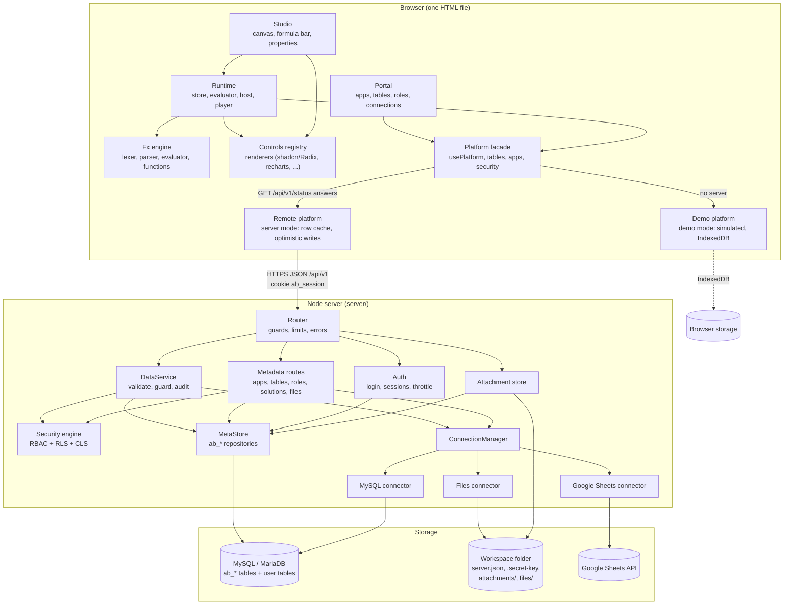

# Architecture

Appbuilder is a desktop low-code app builder. Makers design apps on a canvas with Excel-style formulas; data lives in MySQL, data
files or Google Sheets; the server decides who may see what. The decisions behind the shape are in
`/home/claude/appbuilder-demo/docs/decisions.md` (D1 to D12). This page describes the code as it is.

- **Browser**: React 19 + TypeScript, built with Vite into **one HTML file** (`dist/index.html`). Hash routes, zustand + immer for
  state, Tailwind 4 for styles.
- **Server**: Node (22.18 or newer) running TypeScript directly through type stripping (`node server/main.ts`); no build step, no
  framework. It serves the Data API under `/api/v1` and the built app from `dist/`.
- **Storage**: a MySQL/MariaDB database (system tables `ab_*` plus user tables) and the **workspace folder** on disk.
- **Demo mode**: the same browser build can run with no server at all, simulating the platform over IndexedDB.

What is not supported: multi-tenant hosting, horizontal scaling of the Node server (it keeps session throttling, security caches and
the files store in process memory), real-time collaboration (two makers saving the same app overwrite each other, last write wins),
and any server-side formula evaluation (formulas run only in the browser).

## Component diagram



A PHP gateway for shared hosting (D12) replaces the whole Server box and keeps the arrow labelled `/api/v1` unchanged; see
`data-api.md`.

## Repository layout

| Path | What lives there |
| --- | --- |
| `src/contracts.ts` | The shared contract: `AppDef`, `ControlNode`, Fx types, `PropMeta`, `ControlType`. Changes need the architect's agreement. |
| `src/fx/` | Formula engine. No React, no DOM. `index.ts` exports `fx` (`check`, `evaluate`, `referencedNames`, `renameIdentifier`, `functions`, `enums`, `parseNamedFormulas`, `setUserFunctions`, `signatureAt`). |
| `src/controls/` | Control registry (`index.ts`), control components, `sets/` (Insert-pane order), `icon/` (lucide and animated icons). |
| `src/components/ui/` | shadcn-style wrappers over Radix and other libraries. |
| `src/platform/` | The platform facade (`index.ts`), `remote.ts` (server mode), `core.ts` (demo mode), `contracts.ts` (platform types), `http.ts` (Data API types, shared with the server), `rowfilter.ts`, `storage.ts`. |
| `src/runtime/` | App stores (`createAppStore`: definition and runtime state; the shared `useStore` plus one per app tab), store context, evaluator, Fx host, player (`RunApp`, `RenderNode`), design sizes, autosave session. |
| `src/studio/` | The editor: canvas, formula bar, properties panel, left rail, command bar. |
| `src/portal/` | The application shell (`Portal.tsx`, `Shell.tsx`: Dev mode and User mode, app tabs in `UserMode.tsx`, `workspace.ts`), the planned-module registry (`modules.ts`) and the maker pages: home, apps, tables, data grid, roles, solutions, connections, data files, sign-in. |
| `src/chat/` | Chat dock, pop-out window and their coordination; `ChatPanel.tsx` is the boundary the chat module will fill. |
| `src/router.ts`, `src/App.tsx`, `src/main.tsx` | Hash router, top-level composition, entry. |
| `server/main.ts` | Process entry: creates the app, HTTP server, static files, graceful shutdown. |
| `server/core/` | Router, auth, security engine, DataService, values, conditions, services wiring, meta store, connection manager, attachments. |
| `server/routes/meta/` | Metadata routes (apps, tables, connections, security, solutions, files), packages (YAML), seed data, legacy migration. |
| `server/connectors/{mysql,files,gsheets}/` | The connectors. |
| `server/vite-plugin.mjs` | Mounts the same API handler into the Vite dev and preview servers. |
| `scripts/` | PowerShell installers (`setup-mysql.ps1`, `setup-offline.ps1`, `start.ps1`), `gen-animated-icons.mjs`, `gen-notices.mjs`, `docs/` (reference generators and their test), `docs-shots/` (screenshot capture, developer tool). |
| `docs/` | Documentation (see `docs/README.md` for the rules). |

## Module boundaries: who may import what

These are the rules the code follows. They are not enforced by a tool yet (oxlint has no import rules configured), so reviewers
enforce them.

```
contracts.ts   <- imported by everyone (types only)
fx             -> contracts only. No React, no DOM, no platform, no controls.
platform       -> contracts, fx values where needed. Never imports studio, portal, controls.
controls       -> contracts, components/ui, platform types and a few calls (data table, Form, attachment controls), runtime attachment helpers
components/ui  -> third-party UI libraries, lib/utils. Nothing from the app.
runtime        -> fx, controls (registry), platform (through runtime/data.ts), contracts
studio         -> runtime, controls, fx, platform, components/ui, portal (UserMenu, SizePicker), chat (ChatButton)
portal         -> platform, components/ui, router, chat, runtime public pieces (RunApp, sizes, sample/store for Start with data),
                  studio (the shell mounts Studio). Not runtime or studio internals.
chat           -> components/ui, lib, portal/theme. Nothing else (the chat module will add platform).
server/**      -> server/** with relative `.ts` imports, plus `import type` from src/platform/{contracts,http}.ts and src/contracts.ts
```

Specific rules:

1. **Third-party UI libraries** (Radix, recharts, react-day-picker, cmdk, react-useanimations) are imported only from
   `src/components/ui/` and `src/controls/` (decision D5). Portal and Studio use `@/components/ui/*`.
2. **Formula evaluation reaches the platform through `src/runtime/data.ts`**, a safe bridge: every call is wrapped so the runtime
   keeps working when the platform is a stub or fails (reads give empty values, writes throw a `PlatformError` that becomes a formula
   failure). The evaluator, host and store use only this bridge; `RunApp.tsx`, `session.ts` (autosave) and `attachments.ts` import
   `@/platform` directly because they need app and upload calls.
3. **The server never imports client code at run time.** It uses `import type` (erased by type stripping) from
   `src/platform/contracts.ts`, `src/platform/http.ts` and `src/contracts.ts`, and `import { DEFAULT_ROW_CAP, API_BASE, ... } from
   '../../src/platform/http.ts'`, which therefore must stay free of React, the DOM and the `@/` alias. Never `import '@/...'` in
   server code: the alias does not exist at run time.
4. **Server TypeScript must be erasable**: relative imports with the `.ts` extension, `import type` for types, no enums, no
   namespaces, no parameter properties (`erasableSyntaxOnly` in `tsconfig.server.json`). Checked by `npm run typecheck:server`.
5. **Connectors know nothing about users or security**; security lives in `security.ts` and `data.ts` (see `connectors.md`).
6. **Client security code only mirrors the server** (see `security-engine.md`). Never make a client-only decision that protects data.

Known exceptions to keep in mind: a few controls import runtime helpers (`@/runtime/attachments`, `@/runtime/AttachmentCell`) for
attachment cells, the player (`src/runtime/RunApp.tsx`) imports the Studio's `Toasts`, the Studio command bar imports
`UserMenu` from the portal, and `src/platform/samples.ts` imports the sample app from `src/runtime/sample.ts` for seeding. These
are the places where the dependency graph is not a clean layering.

## The app definition format

An app is stored as one JSON document, `AppDef` (`/home/claude/appbuilder-demo/src/contracts.ts`), in `ab_apps.definition`. In demo
mode it is a YAML file in browser storage; packages (`GET /apps/:id/package`) wrap the same structure in YAML.

```jsonc
{
  "formatVersion": 2,                 // 1 = legacy 960x600 fixed size; migrated to 2 ("fit") on load by migrateApp()
  "name": "Help desk",
  "width": 1920, "height": 1080,      // design size of every screen; landscape or portrait (phone 360x800, ...)
  "scaleMode": "responsive",          // or "fit": scale uniformly and letterbox
  "theme": { "mode": "light", "primary": "...", "radius": 8, "font": "..." },
  "dataSources": ["Tickets"],         // names of platform tables the app uses; their rows are loaded when the app opens
  "appProps": { "OnStart": "=Set(Open, true)", "Formulas": "Total = Sum(Tickets, Price);" },
  "screens": [
    {
      "id": "n_ab12",                 // stable, never shown
      "name": "Screen1",              // unique across the whole app; used in formulas
      "type": "Screen",
      "props": { "Fill": "=Color.White" },
      "children": [
        { "id": "n_cd34", "name": "Button1", "type": "Button",
          "props": { "Text": "=\"Save\"", "OnSelect": "=Patch(Tickets, Defaults(Tickets), {Title: TextInput1.Value}); Notify(\"Saved\")" },
          "children": [] }
      ]
    }
  ]
}
```

Rules:

- **Every property is a formula string that starts with `=`.** A literal is a formula too: text is `="Save"`, a number `=40`, a boolean
  `=true`, a colour `=RGBA(79, 70, 229, 1)` or `=Color.Red`, blank is `=Blank()`. There are no "plain" values, which keeps the
  evaluator uniform. A property that is missing from `props` takes the control's default (`PropMeta.default`, itself a formula).
- **Formulas are stored as text and are never executed by the server.** The server stores and returns them; the browser evaluates
  them. A formula can only affect data through the Data API with the caller's own session, so the server's security applies.
- `ControlNode.type` is a key in the control registry (`controls.get(type)`); an unknown type makes the registry throw, so a
  control type name is part of the stored format and must never be renamed.
- `name` is unique across the whole app (not per screen) because formulas refer to controls by bare name (`TextInput1.Value`). Renaming a
  control rewrites formulas with `fx.renameIdentifier` (only references, not strings or record labels).
- `children` of a `Gallery` are the **row template**, evaluated once per item with `ThisItem` in scope. Other containers (`Container`,
  `Row`, `Column`, `Grid`, `Card`, `Dialog`, `Sheet`, ...) hold direct children. Container flags are on `ControlType`
  (`isContainer`, `isTemplate`, `isOverlay`).
- `appProps.OnStart` runs when the app starts (and once at design time with table writes skipped). `appProps.Formulas` holds **named
  formulas and user-defined functions**: `Name = expr;` entries parsed by `fx.parseNamedFormulas`; a definition with parameters is a
  user-defined function.
- `dataSources` lists table names, not ids (formulas use table names too). Adding a data source loads that table's rows when the app
  opens.

## How the runtime evaluates formulas

The evaluator is `/home/claude/appbuilder-demo/src/runtime/evaluator.ts` (`Evaluator`, one instance per open app, reused and
incrementally invalidated through `getEvaluator`).

**Scope resolution.** `fx.evaluate(formula, scope)` asks the scope to resolve every bare identifier (`FxScope.resolve(name)`). The
evaluator's `resolveName(node, ctx, name)` looks names up in this order:

1. `ThisItem`: the current gallery row (innermost gallery of the node's context).
2. `Self` and `Parent`: a record of the control itself, or of its parent container.
3. `App`: `{ Width, Height, DesignWidth, DesignHeight, Name, ActiveScreen }`; `User()` (a special name for the signed-in user's record);
   `Param:<name>` (a URL query parameter).
4. A **control name** (`byName`): the record of that control (its evaluated properties and outputs, e.g. `TextInput1.Value`).
5. A **screen context variable** (`UpdateContext`) of the screen the formula lives on.
6. A **global variable** (`Set`).
7. A **collection** (`Collect`).
8. A **named formula** from `App.Formulas`.
9. A **platform table** (`isTable(name)`): its rows, from the platform cache.
10. Otherwise undefined, which the engine reports as "Name isn't recognised".

Names the maker cannot use for variables or controls (`ThisItem`, `ThisRecord`, `Self`, `Parent`, `App`, `User`, `true`, `false`,
function names, enum names) are reserved (`reserved` in the store's rename and add logic).

**Dependency tracking.** Each evaluated property is a cache entry keyed `P|<nodeKey>|<prop>`. While a property computes, every read
is recorded in the current frame (`record(dep)`): other properties (`P|...`), outputs `o:<outKey>`, variables `v:<name>`, collections
`k:<name>`, screen context `c:<screen>:<name>`, form modes `f:<key>`, the screen size `e`, the current user `u`, platform tables `t:<name>`,
and named formulas `N|<name>`. The frame becomes the entry's forward dependencies and the reverse index (`rdeps`) is updated. When the
runtime state changes, `update(rt, env)` compares the previous and new state per key (`diffFlat`) and `invalidate(dep)` drops every
entry that transitively depends on what changed. Each node has a version number that is bumped when its entries drop; `RenderNode`
subscribes to its own node's version, so typing in one input re-renders only the controls that read it. A definition change that does
not alter the structure (names, types, nesting) is adopted incrementally with `withApp`, which invalidates only the changed properties;
a structural change builds a new evaluator.

**Failure handling.** A formula that fails yields the property's default value and an error message shown in the Studio; it never throws
into the control. Circular references are detected through the evaluation stack and reported as "Circular reference" (the default value
is used). Action properties (`kind: 'action'`) are syntax-checked when read and only run when fired.

**Events and the host.** A control calls `fire('OnSelect')`; the store's `fire(nodeId, event, ctx)` runs the action formula through
`runFormula` in `/home/claude/appbuilder-demo/src/runtime/host.ts`. The host implements `FxHost`
(`setVar`, `updateContext`, `collect`, `clear`, `remove`, `patch`, `navigate`, `back`, `notify`, `form` operations, `select`, `setFocus`,
`launch`, `copy`, `trace`, `exit`, `refresh`) against a **copy** of the runtime state, so a failing chain leaves nothing half applied: on
success the result (`RunResult`: variables, context, collections, nav stack, toasts, outputs to merge, form modes, follow-up events,
deferred form submits, trace entries) is committed to the store in one update. Table writes (`Patch`, `Remove`, `Collect` into a
table, form submits) go to the platform. In server mode a form submit is **deferred**: the verdict arrives later, the store awaits it,
then writes `LastSubmit` or `Error` and fires `OnSuccess` or `OnFailure`. Design-time runs (`App.OnStart` while editing) set
`dryData` so no data is written.

**Data in formulas.** `src/runtime/data.ts` returns `platform.tables.rows(name)`. The row list for a table that is not loaded yet is
empty until `ensureTablesLoaded` (called from `linkPlatform()` for `app.dataSources`) brings it in; the store's `dataKey`
(`platformDataKey()`) changes whenever rows or table definitions change, which invalidates the `t:<name>` entries.

## Request lifecycles

### A query (read)

1. A formula such as `Filter(Tickets, Status = "Open")` resolves `Tickets` to `platform.tables.rows('Tickets')`.
2. In server mode the remote platform keeps a **lazy per-table cache**. For an unloaded table it returns `[]`, starts
   `POST /api/v1/data/Tickets/query` with `{ top: 5000 }`, and notifies subscribers when the rows arrive (the runtime's `dataKey`
   changes and formulas re-evaluate). If a write finished while the load was in flight, it re-reads (at most twice). The server's
   `truncated` flag is recorded so the UI can warn. `Filter`, `Sum`, `Sort` and the rest run in the browser over those rows.
3. **Server side** (`server/core/router.ts`, `data-routes.ts`, `data.ts`): the router checks Host, Origin and the session cookie
   (resolving the user and loading their roles); `dataRoutes` finds the table (404 if the user has no privilege on it at all);
   `DataService.query` validates the query, rejects columns the user may not read (403), ANDs the user's **row predicate** into
   `where`, narrows `select` to visible columns, asks the connector for `cap + 1` rows (cap 5000) to know whether to set `truncated`,
   and removes hidden columns from the output (`rowOut`). Dates leave as ISO text, numbers as numbers.
4. The browser converts dates to `Date` and adds `__id`. Focus events reload loaded tables older than 30 seconds.

### A write (insert, update, delete)

1. A control or formula calls `Patch(...)`, `Collect(...)`, a form submit, or the portal grid. This reaches
   `platform.tables.insert/update/delete`.
2. **Client pre-validation** (`src/platform/remote.ts`): required and unique columns, type coercion, and the **mirrored privileges**
   (`grantOf`, `rowOk`, `assertWritable`). A refusal throws `PlatformError` immediately and nothing changes.
3. **Optimistic apply**: the write becomes an `Op` on the table entry; the visible `rows` are recomputed as the confirmed rows with
   all in-flight ops replayed, and subscribers are notified. The UI changes at once. A new row gets a client-generated UUID `id`.
4. **Ordered send**: ops go through a serial promise chain, so the server sees writes in the order the maker made them
   (`POST .../rows`, `PATCH .../rows/:id`, `POST .../delete`).
5. **Server validation** (`data.ts`): coerces and validates every value (types, required, unique, lookup targets, attachments,
   column access), then the **RLS guard**: for update and delete the user's update or delete predicate is passed to the connector and
   applied atomically with the write (`WHERE id = ? AND <guard>`); `0` affected rows becomes 403 (the user can read the row) or 404.
   Insert needs the table's `create` privilege. Every successful write is written to `ab_audit`.
6. **Success**: the server's row is folded into the confirmed rows (the optimistic row is replaced by what was really stored: server
   timestamps, autonumber, trimmed values) and the epoch advances.
7. **Failure (rollback)**: the op is dropped, the visible rows are recomputed without it (the optimistic change disappears) and a
   `DataErrorEvent { table, op, rowIds, error }` goes to `platform.onDataError` listeners. The runtime logs it and, in preview or the
   player, shows a toast with the server's message. A 401 anywhere (except from `/auth/login`) signs the user out.
8. `platform.tables.flush()` waits for the chain and rejects with the first error. Form submits await it so `OnSuccess` and `OnFailure`
   reflect the server's verdict.

Multi-row writes are all or nothing where the connector allows it: a multi-row delete checks every row's permission before deleting
(one transaction on MySQL), and a CSV import validates every row first and runs `replace` (delete + inserts) in one transaction on
MySQL. On the files and Google Sheets connectors the delete and the insert remain two writes (see `connectors.md`).

### Sign-in

`POST /auth/login` verifies the scrypt hash (with a dummy comparison for unknown users), rotates the session, sets the `ab_session`
cookie and returns the `Session` including effective privileges. The client loads `GET /workspace` and shows the portal. Details in
`data-api.md`.

## Server startup and shutdown

`server/main.ts` calls `createApp()` (`server/core/app.ts`), which builds the services (`services.ts`) and registers routes in this
order: auth, data, attachments, metadata routes. The router prefers the route with more literal segments; on a tie the first
registered wins. Requests starting with `/api` go to the router; everything else is served from `dist/` with an SPA fallback.

Configuration is by environment variable: `PORT` (5174), `APPBUILDER_HOST` (127.0.0.1), `APPBUILDER_WORKSPACE` (`./workspace`),
`APPBUILDER_SECRET_KEY` (64 hex characters; otherwise `workspace/.secret-key` is created), `APPBUILDER_ALLOWED_HOSTS` (extra
Host/Origin names), `APPBUILDER_SECURE_COOKIE=1` and `APPBUILDER_TRUST_PROXY=1` (Secure session cookie), and the optional
database bootstrap `APPBUILDER_DB_HOST/PORT/NAME/USER/PASSWORD/SSL` which skips the setup screen (and creates the database if
needed). Without them the setup wizard calls `POST /setup/database` and the settings are saved to `workspace/server.json` with
the password sealed; `setupComplete: true` is added once the first administrator exists (`ServerConfig` in `contracts.ts`,
`loadConfig` in `config.ts`).

Boot (`services.boot()`, `app.ts`):

- A configured database that cannot be reached is never thrown: `state.unavailable` and `state.databaseError` are set,
  `GET /status` reports `setup.unavailable`, and a background timer retries with backoff (1 s doubling to 30 s,
  `retryDelayMs`) until it connects; `services.retrying()` exposes the pending retry (tests). Retrying stops for permanent
  problems (undecryptable password, incompatible schema) and on `close()`.
- A database whose schema version is above `SCHEMA_VERSION` is not used at all (`state.incompatible`, `SchemaTooNewError`):
  data routes answer 503, setup is refused, no retry.
- The schema migration summary is logged and audited (`schema.migrate`).
- While setup is needed (no `setupComplete`, or a database without users) a one-time setup code is generated
  (`services.setupCode`) and printed in a banner; `/setup/*` require it and are `loopbackOnly` routes (the router checks
  `req.socket.remoteAddress`). It rotates when the administrator is created. Tests pass `printSetupCode: false` to
  `createApp` and read `services.setupCode.current()`.

At boot the server also sweeps attachments that no row references (older than an hour, at most 5000 per run) and purges expired
sessions hourly. `SIGINT`/`SIGTERM` flush the files connector, close connections and the database pool, then exit.
`server.requestTimeout` is 10 minutes (large uploads).

## Packaging

- **Single-file build**: `npm run build` runs `tsc -b` (typecheck, no emit) and `vite build`. `vite-plugin-singlefile` inlines all
  JavaScript, CSS and the lazily loaded animated-icon modules into `dist/index.html` (about 3.8 MB). The server serves that file, so
  deploying the client is copying one file. The Vite config also mounts the API into `vite` and `vite preview` through
  `server/vite-plugin.mjs`, which loads the server core lazily so merely loading the config has no side effects.
- **Run it**: `npm run build`, then `npm start` (`node server/main.ts`). `npm run dev` runs Vite with the API mounted (hot reload).
  The Windows installers in `scripts/` (`setup-mysql.ps1`, `setup-offline.ps1`, `start.ps1`) prepare MySQL and start the server.
- **Demo mode**: if `GET /api/v1/status` does not answer within 800 ms with `{ app: 'appbuilder' }`, the facade falls back to the demo
  platform (`src/platform/core.ts`), so the same `dist/index.html` also works when opened as a static file or hosted on any static
  web server. It seeds a sample workspace into IndexedDB (falling back to memory if IndexedDB fails), simulates roles for one person
  at the keyboard (**not a security boundary**), persists with a 300 ms debounce, and fails features that need the server (connections,
  data files, attachments, passwords) with "This needs the local server".
- **Packages**: apps and solutions export as YAML (`kind: appbuilder/app` or `appbuilder/solution`, `packageVersion: 1`), see
  `data-api.md`. Import always creates new instances, never overwrites.
- Not packaged: an installer for the Node server itself (Node must be installed), a Docker image, a PHP gateway (planned).

## Where to read next

`data-api.md` (the HTTP contract), `schema.md` (tables), `security-engine.md`, `connectors.md`, `frontend.md` (extending the client),
`testing.md`.
