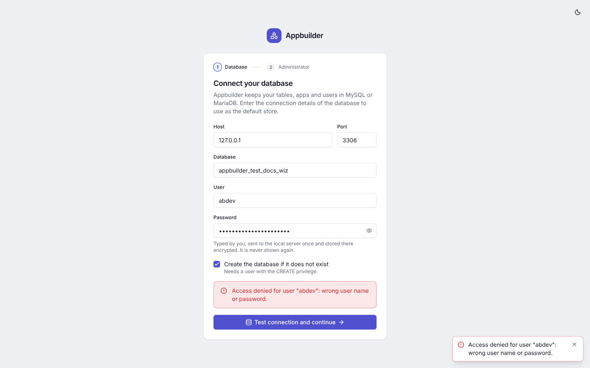
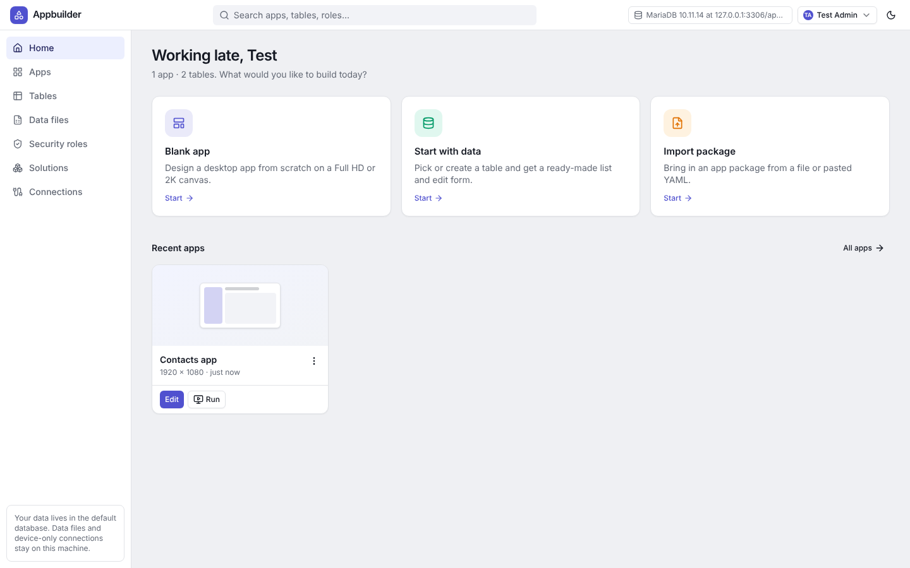
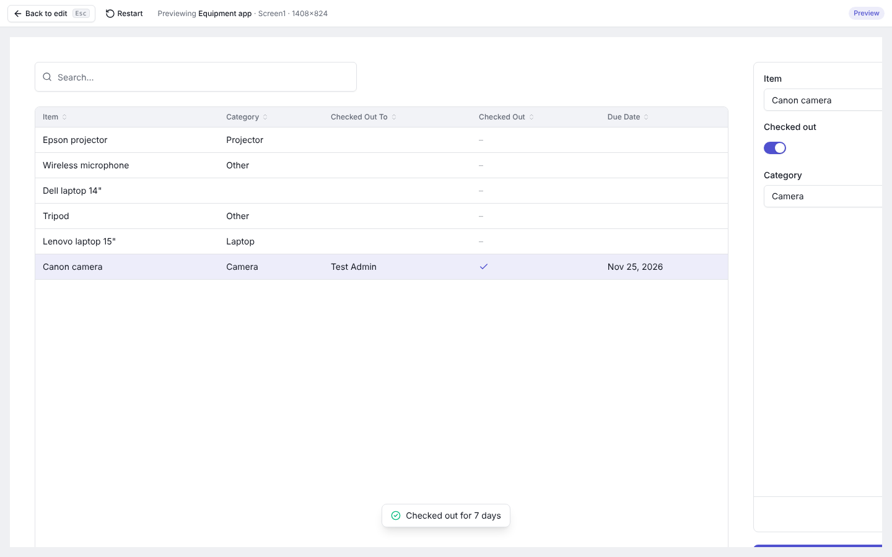

# Getting started

Appbuilder is a tool for building small business apps (forms, lists, dashboards) without writing code. You design screens on a canvas, connect them to tables, and describe behaviour with short formulas. Apps run in a browser window on the same machine that runs Appbuilder.

## What you need

- Windows 10 or 11.
- Node.js. The installer checks for version 20, but the server itself needs **Node 22.18 or newer**. Install the current LTS release to be safe.
- git.
- MySQL 8 or MariaDB 10.4 or newer.

## Install

1. Open PowerShell and run `scripts\setup-offline.ps1`. By default it installs into `%USERPROFILE%\Appbuilder-Demo`. Use `-Path` to choose another folder.
2. The script downloads or updates the code, installs dependencies, builds the app, starts the server in a new window, and opens http://localhost:5174 in your browser.

Leave the server window open while you use Appbuilder. Closing it stops the server.

## Set up the database

If you do not already have a MySQL or MariaDB server and database for Appbuilder, run `scripts\setup-mysql.ps1`. It:

1. Finds a `mysql-*` folder inside `%USERPROFILE%\MySQL` (use `-MySqlHome` to change this) and starts MySQL if it is not running.
2. Asks you twice for a password for the new `appbuilder` user (at least 10 characters).
3. Creates the `appbuilder` database and user.
4. Prints the values to type into the setup wizard.

Options: `-Database`, `-User`, `-Port` (default 3306).

## Start Appbuilder later

Run `npm start` in the Appbuilder folder, or run `scripts\start.ps1`, which also opens your browser. The default address is http://localhost:5174. To use another port, set the `PORT` environment variable.

## First run: the setup wizard

The first time you open Appbuilder it asks you to set up a database and the first administrator.

**Step 1: Database.** Enter the host (default `127.0.0.1`), port (`3306`), database name (`appbuilder`), user (`appbuilder`) and password. Tick "Create the database if it does not exist" if you want Appbuilder to create it.

If something is wrong the wizard tells you in plain words, for example that the password is wrong:

See [Troubleshooting](troubleshooting.md) for each message.

**Step 2: Administrator.** Enter your name, email, and a password of at least 10 characters. A strength meter helps you choose.

When you finish, you are signed in. Appbuilder also adds a few sample tables (Contacts and Orders) and a sample "Contacts app".

## A tour of the portal

The portal is where you manage everything. The left menu has:

- **Home**: shortcuts, including "Start with data".
- **Apps**: your apps. Open, run, rename, duplicate, export.
- **Tables**: your data (Maker role).
- **Data files**: CSV, Excel and JSON files used as tables (Maker role).
- **Connections**: where data lives, such as MySQL or Google Sheets (Maker role).
- **Solutions**: bundles you move between machines (Maker role).
- **Security roles**: who can see and change what (Administrator only).

If a page says "Not available for your role", ask an administrator to give you the Maker role.

## Build your first app in 10 steps

We will build "Equipment checkout": a list of equipment, a search box, and a button that checks the selected item out for seven days.

1. Open **Tables** and choose **New table**. Name it `Equipment`.
2. Add the columns **Item** (Single line of text), **Checked out to** (Single line of text), **Checked out** (Yes/No) and **Due date** (Date).

   
3. Open the **Columns** tab and add a **Category** column of type **Choice** with the options Laptop, Camera, Projector, Other.

   
4. Back in the **Data** tab, choose **Add row** and enter a few items. You can also use **Import CSV** (the header must use column names such as `Item,Category,CheckedOut`).

   
5. Go to **Home** and choose **Start with data**, then pick Equipment. Appbuilder creates "Equipment app" with a table of rows and a form, and opens it in the Studio.

   
6. Click the table. In the formula bar choose the property **Columns** and enter `Item, Category, CheckedOutTo, CheckedOut, DueDate`. Do not type a leading `=`; the bar shows it for you. This hides system columns.

   
7. Insert a **SearchBox** (Insert menu). Then select the table, choose **Items**, and enter:

   `Filter(Equipment, IsBlank(SearchBox1.Value) || SearchBox1.Value in Item)`

   
8. Insert a **Button**, set **Text** to `Check out`. Set **OnSelect** to:

   `Patch(Equipment, DataTable1.Selected, {CheckedOut: true, CheckedOutTo: User().FullName, DueDate: DateAdd(Today(), 7, "Days")}); Notify("Checked out for 7 days", NotificationType.Success)`

   Set **DisplayMode** to `If(IsBlank(DataTable1.Selected), DisplayMode.Disabled, DisplayMode.Edit)` so the button is off until a row is picked.

   
9. Choose **Preview** at the top right. Select a row and click **Check out**. The row shows your name, the box is ticked, and a due date appears. Press `Esc` to return to editing.

   
10. Choose the **Run in window** icon next to Preview to open the app in its own window, the way your users will use it.

## Next steps

- [Apps](maker/apps.md): create, export and run.
- [The Studio](maker/studio.md): design tools and shortcuts.
- [Formulas](maker/formulas.md): a friendly tutorial.
- [Data](maker/data.md): tables, files and connections.
- [Security for makers](maker/security-for-makers.md)
- [Troubleshooting](troubleshooting.md)
