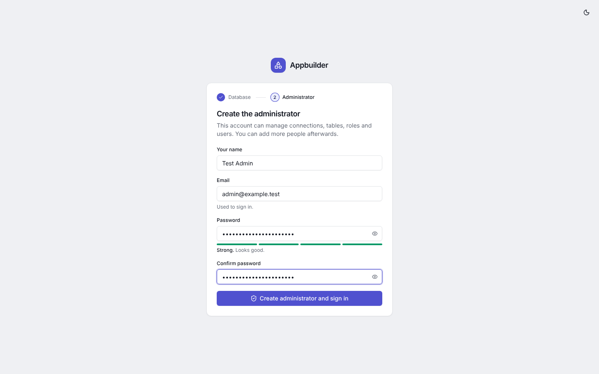
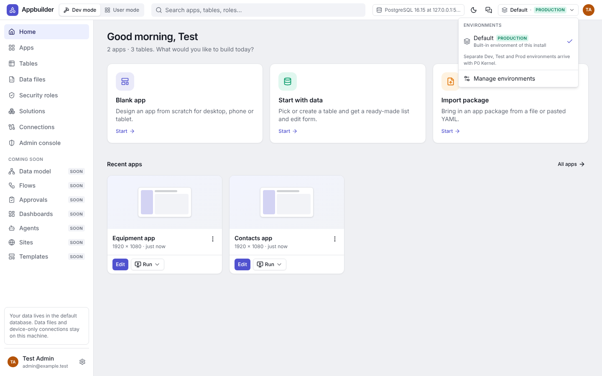
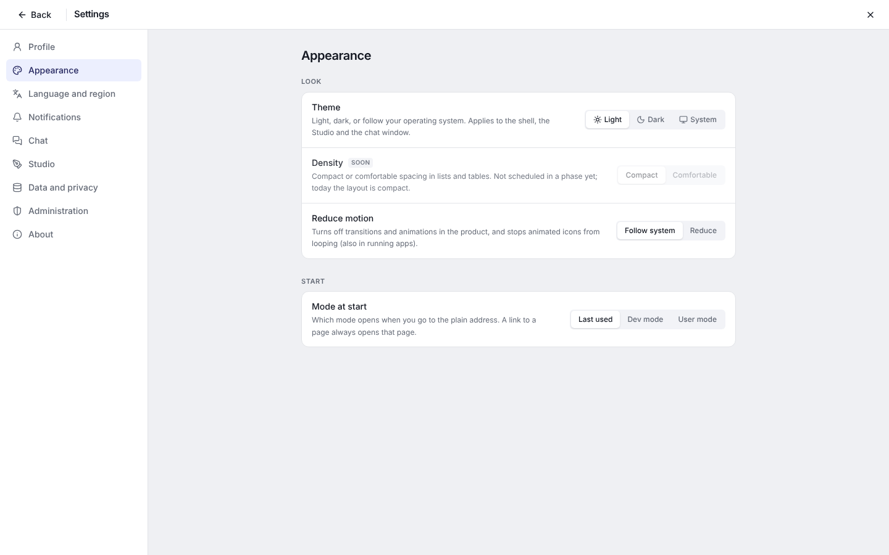
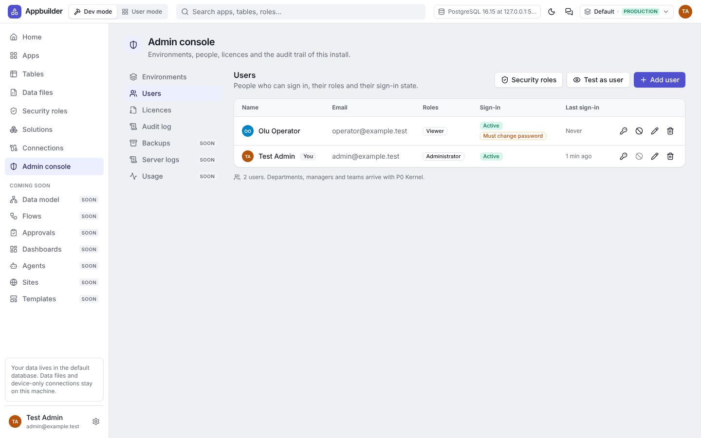
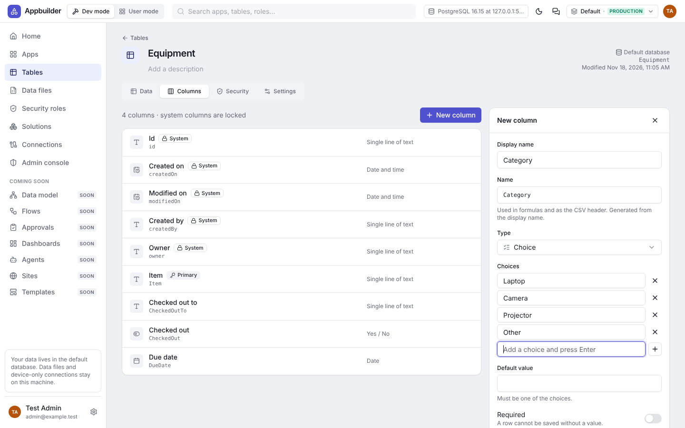
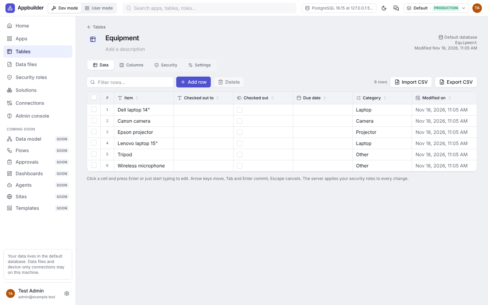

# Getting started

Appbuilder is a tool for building small business apps (forms, lists, dashboards) without writing code. You design screens on a canvas, connect them to tables, and describe behaviour with short formulas. Apps run in a browser window on the same machine that runs Appbuilder.

## What you need

- Windows 10 or 11.
- Node.js. The installer checks for version 20, but the server itself needs **Node 22.18 or newer**. Install the current LTS release to be safe.
- git.
- PostgreSQL 15 or newer (17 recommended). The next section shows how to install it.

## Install

1. Open PowerShell and run `scripts\setup-offline.ps1`. By default it installs into `%USERPROFILE%\Appbuilder-Demo`. Use `-Path` to choose another folder.
2. The script downloads or updates the code, installs dependencies, builds the app, starts the server in a new window, and opens http://localhost:5174 in your browser.

Leave the server window open while you use Appbuilder. Closing it stops the server.

## Set up the database

Appbuilder keeps everything in a PostgreSQL database.

1. If PostgreSQL is not installed yet, install it (the installer asks for a password for the `postgres` superuser; note it):

   ```powershell
   winget install --id PostgreSQL.PostgreSQL.17 -e --interactive
   ```

2. Run `scripts\setup-postgres.ps1` (on Linux `scripts/setup-postgres.sh`). It:
   1. Finds PostgreSQL (`psql.exe` in `C:\Program Files\PostgreSQL\<version>\bin` or on the PATH) and starts its service if needed.
      If PostgreSQL is missing it tells you the `winget` command above.
   2. Asks for the `postgres` superuser password, then twice for a password for the new `appbuilder` role (at least 12
      characters). Nothing you type is shown or saved.
   3. Creates the `appbuilder` role and an empty `appbuilder` database that it owns.
   4. Prints the values to type into the setup wizard.

Options: `-Database`, `-User`, `-Port` (default 5432), `-SuperUser`, `-PsqlPath`. See
[Installation](../admin/installation.md#prepare-the-database) for details and the manual SQL.

## Start Appbuilder later

Run `npm start` in the Appbuilder folder, or run `scripts\start.ps1`, which also opens your browser. The default address is http://localhost:5174. To use another port, set the `PORT` environment variable.

## First run: the setup wizard

The first time you open Appbuilder it asks you to set up a database and the first administrator. Do this **on the PC where Appbuilder runs** (the setup refuses other computers).

**The setup code.** When the server starts for the first time it prints a setup code in its window (the PowerShell window of `npm start` or `scripts\start.ps1`), for example:

```
  FIRST-RUN SETUP CODE:  K7QD-M2XP
```

Type it in the first field, **Setup code (shown in the server window)**. It proves that the person doing the setup is at this PC. The code changes every time the server starts, so if you restarted it, use the newest one. After the administrator is created the code is no longer needed.

**Step 1: Database.** Enter the host (default `127.0.0.1`), port (`5432`), database name (`appbuilder`), user (`appbuilder`) and the password you chose in `setup-postgres`. "Create the database if it does not exist" is only needed when you did not run the script and your PostgreSQL role may create databases. Tick "Use SSL" for a database on another machine.


If something is wrong the wizard tells you in plain words, for example that the password is wrong:


See [Troubleshooting](troubleshooting.md) for each message.

**Step 2: Administrator.** Enter your name, email, and a password of at least 10 characters. A strength meter helps you choose. (If you skipped step 1 because the database is configured with `APPBUILDER_DB_*` settings, this step asks for the setup code.)



When you finish, you are signed in. Appbuilder also adds a few sample tables (Contacts and Orders) and a sample "Contacts app".

## A tour of the portal

Appbuilder has two modes, switched in the top bar. **Dev mode** is where you build: the portal pages below and the
Studio. **User mode** is where people use apps: a **My apps** launcher with search and recently opened apps, and every
app you open becomes a tab under the top bar, like a browser tab (see [Apps](maker/apps.md#user-mode-and-app-tabs)).
Makers and administrators get the switch and return to the mode they used last; everyone else sees only User mode.
The chat button in the top bar opens a chat panel (chat itself is coming soon). Menu entries with a **Soon** badge are
planned modules; they open a short page about what they will do and in which phase.

The right end of the top bar, in this order:

- **Chat**: opens and closes the chat panel.
- **Environment**: shows the environment you work in, for example *Default · Production*. Today every installation has
  one, the built-in *Default*; separate Dev, Test and Prod environments are planned (P0). Administrators find
  **Manage environments** at the bottom of this menu.
- **Your avatar** (the circle with your initials, last): hover for your name and email; click for **Profile settings**,
  **Settings**, **Change password** and **Sign out**. In demo mode this menu lists the people you can switch to instead.




**Settings** is at the bottom of the left menu (your name and a gear), in both modes; the avatar menu opens it too,
also from the Studio. It fills the window, has its own list of sections (Profile, Appearance, Language and region,
Notifications, Chat, Studio for makers, Data and privacy, Administration for administrators, About) and the **Back** or
**x** button (or Esc) returns you to where you were. Your choices (theme, chat side, Studio defaults and so on) are kept
in this browser, per person. Settings that are not built yet are shown greyed out with a **Soon** badge and a line on
when they arrive.



In Dev mode the left menu has:

- **Home**: shortcuts, including "Start with data".
- **Apps**: your apps. Open, run, rename, duplicate, export.
- **Tables**: your data (Maker role).
- **Data files**: CSV, Excel and JSON files used as tables (Maker role).
- **Connections**: where data lives: the default PostgreSQL database, other PostgreSQL or MySQL databases, Google Sheets (Maker role).
- **Solutions**: bundles you move between machines (Maker role).
- **Security roles**: who can see and change what (Administrator only).
- **Admin console**: environments, users, licences and the audit log (Administrator only). Backups, server logs and
  usage are planned (P0).

If a page says "Not available for your role", ask an administrator to give you the Maker role.





## Build your first app in 10 steps

We will build "Equipment checkout": a list of equipment, a search box, and a button that checks the selected item out for seven days.

1. Open **Tables** and choose **New table**. Name it `Equipment`.
2. Add the columns **Item** (Single line of text), **Checked out to** (Single line of text), **Checked out** (Yes/No) and **Due date** (Date).

   
3. Open the **Columns** tab and add a **Category** column of type **Choice** with the options Laptop, Camera, Projector, Other.

   
4. Back in the **Data** tab, choose **Add row** and enter a few items. You can also use **Import CSV** (the header must use column names such as `Item,Category,CheckedOut`).

   
5. Go to **Home** and choose **Start with data**, then pick Equipment. Appbuilder creates "Equipment app" with a table of rows and a form, and opens it in the Studio.

   
6. Click the table. In the formula bar choose the property **Columns** and enter `Item, Category, CheckedOutTo, CheckedOut, DueDate`. Do not type a leading `=`; the bar shows it for you. This hides system columns.

   
7. Insert a **SearchBox** (Insert menu). Then select the table, choose **Items**, and enter:

   `Filter(Equipment, IsBlank(SearchBox1.Value) || SearchBox1.Value in Item)`

   
8. Insert a **Button**, set **Text** to `Check out`. Set **OnSelect** to:

   `Patch(Equipment, DataTable1.Selected, {CheckedOut: true, CheckedOutTo: User().FullName, DueDate: DateAdd(Today(), 7, "Days")}); Notify("Checked out for 7 days", NotificationType.Success)`

   Set **DisplayMode** to `If(IsBlank(DataTable1.Selected), DisplayMode.Disabled, DisplayMode.Edit)` so the button is off until a row is picked.

   
9. Choose **Preview** at the top right. Select a row and click **Check out**. The row shows your name, the box is ticked, and a due date appears. Press `Esc` to return to editing.

   
10. Choose the **Run in window** icon next to Preview to open the app in its own window, the way your users will use it.

## Next steps

- [Apps](maker/apps.md): create, export and run.
- [The Studio](maker/studio.md): design tools and shortcuts.
- [Formulas](maker/formulas.md): a friendly tutorial.
- [Data](maker/data.md): tables, files and connections.
- [Security for makers](maker/security-for-makers.md)
- [Troubleshooting](troubleshooting.md)
