# Getting started

Appbuilder is a tool for building small business apps (forms, lists, dashboards) without writing code. You design screens on a canvas, connect them to tables, and describe behaviour with short formulas. Apps run in a browser window on the same machine that runs Appbuilder.

## What you need

- A Windows 10 or 11 PC (or Windows Server 2016 or newer) with at least 4 GB of memory (8 GB recommended) and 3 GB of free
  disk space, and an account that can run programs as administrator. A Linux server works too (Ubuntu 22.04/24.04,
  Debian 12): see [Installation](../admin/installation.md#install-on-linux).
- The release file `appbuilder-<version>.zip`.
- Internet access during the install (about 450 MB of downloads), or an [offline bundle](../admin/installation.md#offline-install)
  your IT person prepared.

Nothing else: the installer brings Node.js, PostgreSQL and everything Appbuilder needs.

## Install

1. Right-click `appbuilder-<version>.zip` > **Extract All**, for example to `C:\Install`.
2. Click Start, type **PowerShell**, right-click **Windows PowerShell** > **Run as administrator**.
3. Type (adjust the folder name) and press Enter:

   ```powershell
   cd C:\Install\appbuilder-<version>
   powershell -ExecutionPolicy Bypass -File .\scripts\install\windows\install.ps1
   ```

4. Wait until it says **Done** (a few minutes; most of it is downloading). It prints each step. If it stops with an
   ERROR line, the line says what to do; you can run it again safely.

Appbuilder now runs as a Windows service: it starts by itself when the PC starts, and keeps running when you sign out. You
do not need to keep any window open.

To let other PCs in your office use it too, add `-Https Lan -OpenFirewall` to the command (see
[Installation](../admin/installation.md#which-way-users-reach-it) first, including how the other PCs trust its certificate).

## First run: create the administrator

The installer already connected Appbuilder to its database. One step is left, and it must be done **on this PC**:

1. Read the one-time **setup code**: in the same administrator PowerShell, type

   ```powershell
   appbuilder setup-code
   ```

   (or `Get-Content 'C:\ProgramData\Appbuilder\workspace\setup-code.txt'`). On Linux: `sudo appbuilder setup-code`.
   The setup screen says the same: for a server installed as a service the code is in its setup-code file, not in a
   window.

   It shows something like `K7QD-M2XP`. The code changes every time Appbuilder starts; the file disappears once you have
   created the administrator.
2. Open **Appbuilder** from the Start menu (or `http://localhost:5174` in your browser).
3. Type the setup code, your name, email and a password of at least 10 characters (a strength meter helps), and click
   **Create administrator**.


When you finish, you are signed in. Appbuilder also adds a few sample tables (Contacts and Orders) and a sample
"Contacts app".

Then, in the Admin console: set up **Email** (so people can reset forgotten passwords), check **Backups** (a nightly
backup is on; copy backups to another disk), and create a second administrator. The
[hardening checklist](../admin/hardening-checklist.md) lists the rest.

## Later

- Appbuilder starts with the PC. To restart it: `Restart-Service Appbuilder` in an administrator PowerShell.
- New versions: [Upgrades](../admin/upgrades.md) (`appbuilder update <file>`, or upload it in Admin console > Updates).
- Something wrong: Admin console > **Server logs** shows the health checks and the log; the **Diagnostics bundle** button
  there makes a file for support ([Operations](../admin/operations.md)).

**Developers** can also run Appbuilder from its source folder without installing it (`npm ci`, `npm run build`,
`npm start`, and a PostgreSQL database you prepare yourself): [Install from source](../admin/installation.md#install-from-source-developers).
The setup screen then also asks for the database (host, port, database, user, password):

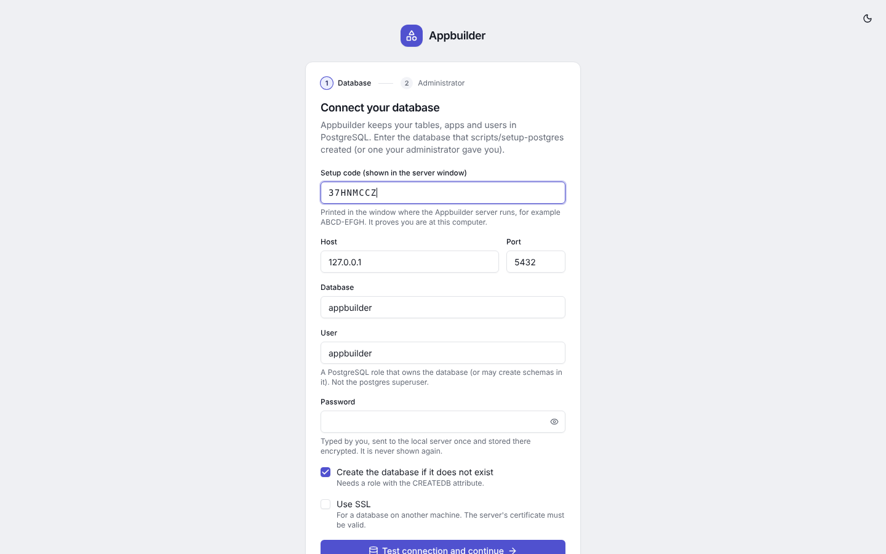

If something is wrong it tells you in plain words, for example that the password is wrong (see
[Troubleshooting](troubleshooting.md) for each message):


## A tour of the portal

Appbuilder has two modes, switched in the top bar. **Dev mode** is where you build: the portal pages below and the
Studio. **User mode** is where people use apps: a **My apps** launcher with search and recently opened apps, and every
app you open becomes a tab under the top bar, like a browser tab (see [Apps](maker/apps.md#user-mode-and-app-tabs)).
Makers and administrators get the switch and return to the mode they used last; everyone else sees only User mode.
The chat button in the top bar opens a chat panel (chat itself is coming soon). Menu entries with a **Soon** badge are
planned modules; they open a short page about what they will do and in which phase.

The right end of the top bar, in this order:

- **Chat**: opens and closes the chat panel.
- **Environment**: shows the environment you work in, for example *Default* with a red *Production* badge. Every
  installation has the built-in *Default*; administrators can add Sandbox and Developer environments, and the list shows the
  ones you may enter. Pick one to switch (see [Environments](../admin/environments.md)). Administrators find
  **Manage environments** at the bottom of this menu.
- **Your avatar** (the circle with your initials, last): hover for your name and email; click for **Profile settings**,
  **Settings**, **Change password** and **Sign out**. In demo mode this menu lists the people you can switch to instead.

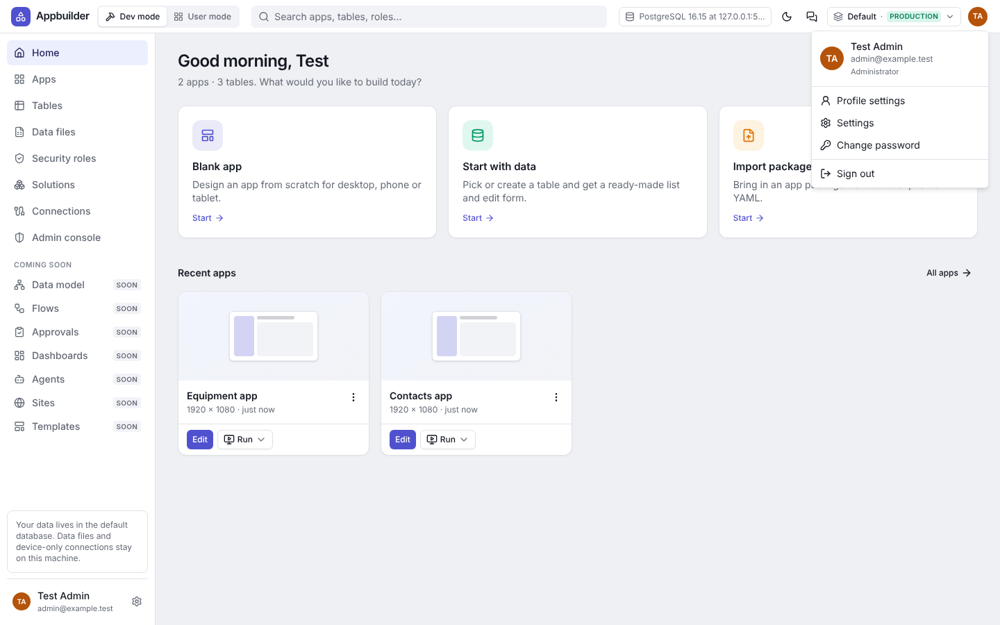
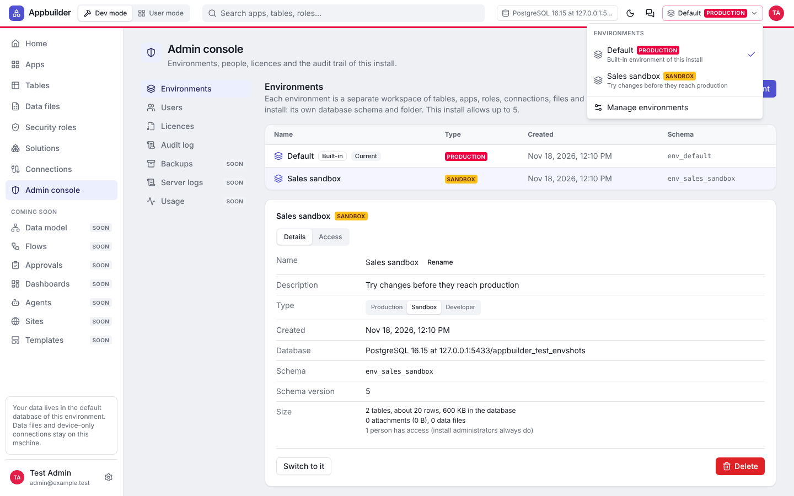

**Settings** is at the bottom of the left menu (your name and a gear), in both modes; the avatar menu opens it too,
also from the Studio. It fills the window, has its own list of sections (Profile, Appearance, Language and region,
Notifications, Chat, Studio for makers, Data and privacy, Administration for administrators, About) and the **Back** or
**x** button (or Esc) returns you to where you were. Your choices (theme, chat side, Studio defaults and so on) are kept
in this browser, per person. Settings that are not built yet are shown greyed out with a **Soon** badge and a line on
when they arrive.


In Dev mode the left menu has:

- **Home**: shortcuts, including "Start with data".
- **Apps**: your apps. Open, run, rename, duplicate, export.
- **Tables**: your data (Maker role).
- **Data files**: CSV, Excel and JSON files used as tables (Maker role).
- **Connections**: where data lives: the default PostgreSQL database, other PostgreSQL or MySQL databases, Google Sheets (Maker role).
- **Solutions**: bundles you move between machines (Maker role).
- **Security roles**: who can see and change what (Administrator only).
- **Admin console**: environments, users, licences and the audit log (Administrator only). Backups, server logs and
  usage are planned (P0).

If a page says "Not available for your role", ask an administrator to give you the Maker role.

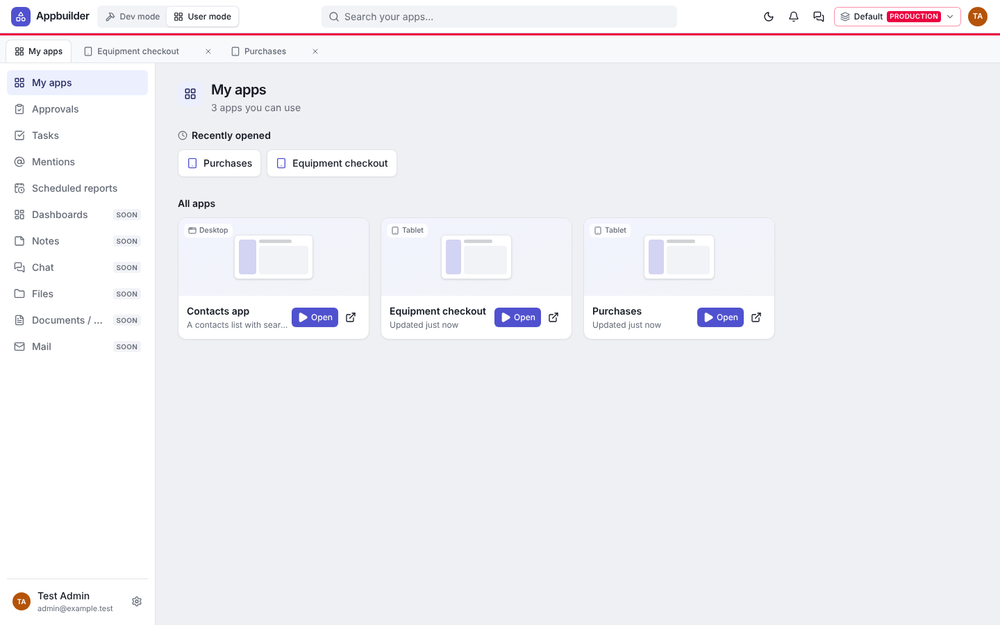


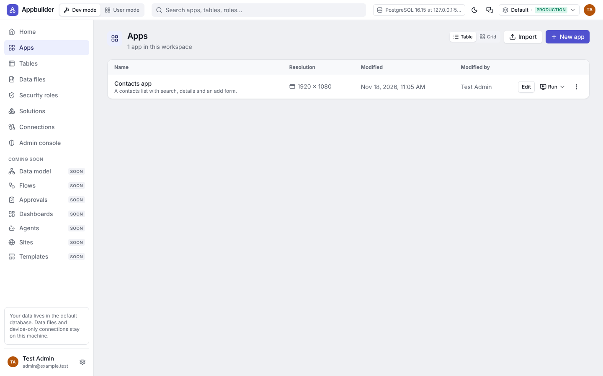
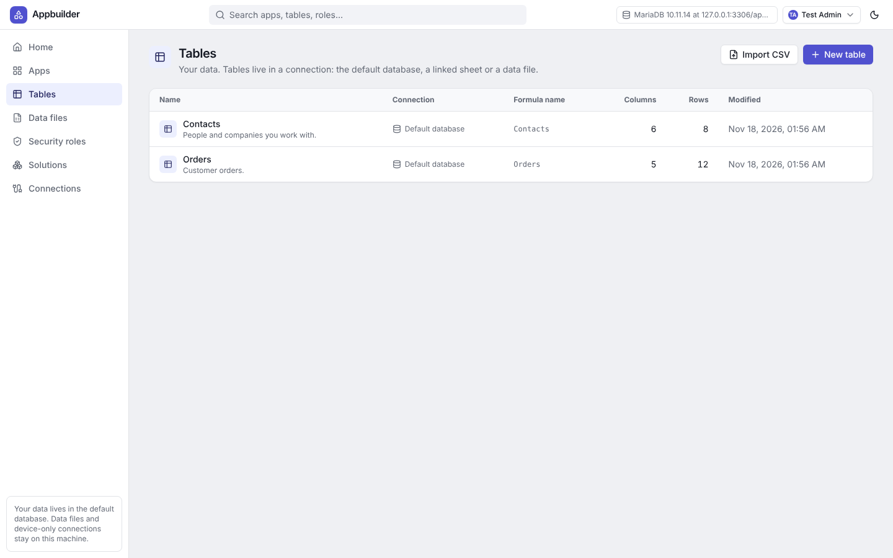

## Build your first app in 10 steps

We will build "Equipment checkout": a list of equipment, a search box, and a button that checks the selected item out for seven days.

1. Open **Tables** and choose **New table**. Name it `Equipment`.
2. Add the columns **Item** (Single line of text), **Checked out to** (Single line of text), **Checked out** (Yes/No) and **Due date** (Date).

   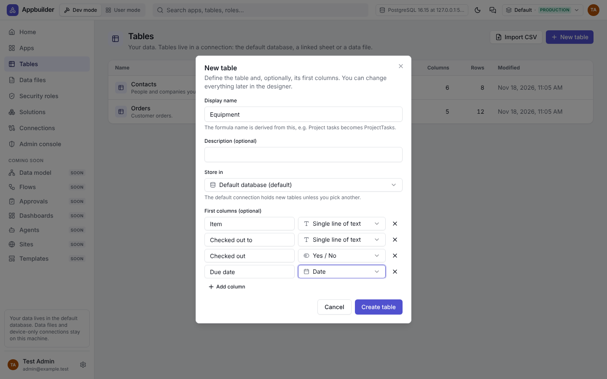
3. Open the **Columns** tab and add a **Category** column of type **Choice** with the options Laptop, Camera, Projector, Other.

   
4. Back in the **Data** tab, choose **Add row** and enter a few items. You can also use **Import CSV** (the header must use column names such as `Item,Category,CheckedOut`).

   
5. Go to **Home** and choose **Start with data**, then pick Equipment. Appbuilder creates "Equipment app" with a table of rows and a form, and opens it in the Studio.

   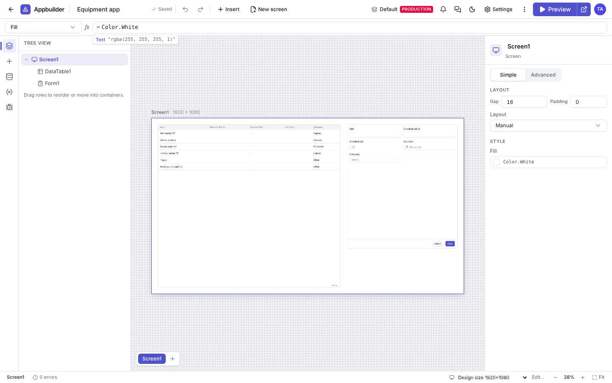
6. Click the table. In the formula bar choose the property **Columns** and enter `Item, Category, CheckedOutTo, CheckedOut, DueDate`. Do not type a leading `=`; the bar shows it for you. This hides system columns.

   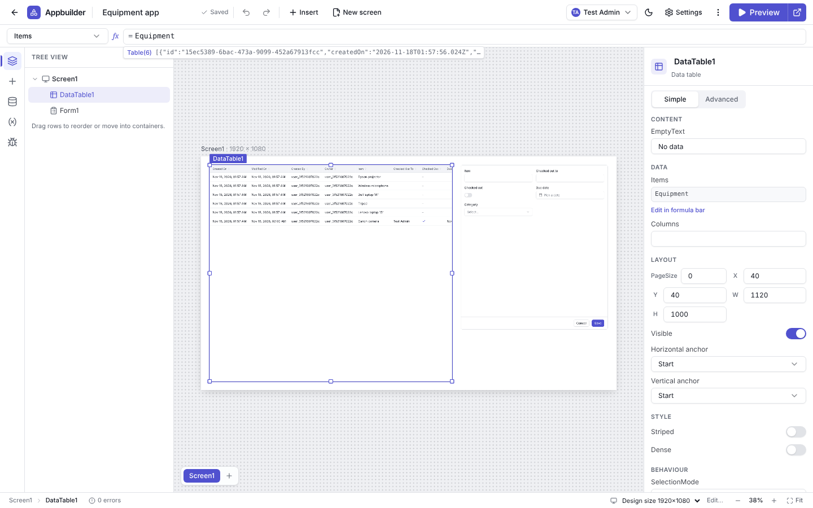
7. Insert a **SearchBox** (Insert menu). Then select the table, choose **Items**, and enter:

   `Filter(Equipment, IsBlank(SearchBox1.Value) || SearchBox1.Value in Item)`

   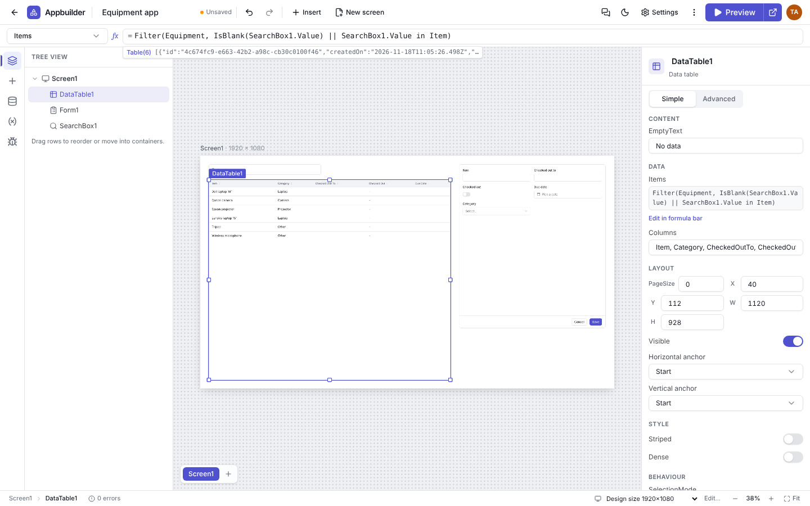
8. Insert a **Button**, set **Text** to `Check out`. Set **OnSelect** to:

   `Patch(Equipment, DataTable1.Selected, {CheckedOut: true, CheckedOutTo: User().FullName, DueDate: DateAdd(Today(), 7, "Days")}); Notify("Checked out for 7 days", NotificationType.Success)`

   Set **DisplayMode** to `If(IsBlank(DataTable1.Selected), DisplayMode.Disabled, DisplayMode.Edit)` so the button is off until a row is picked.

   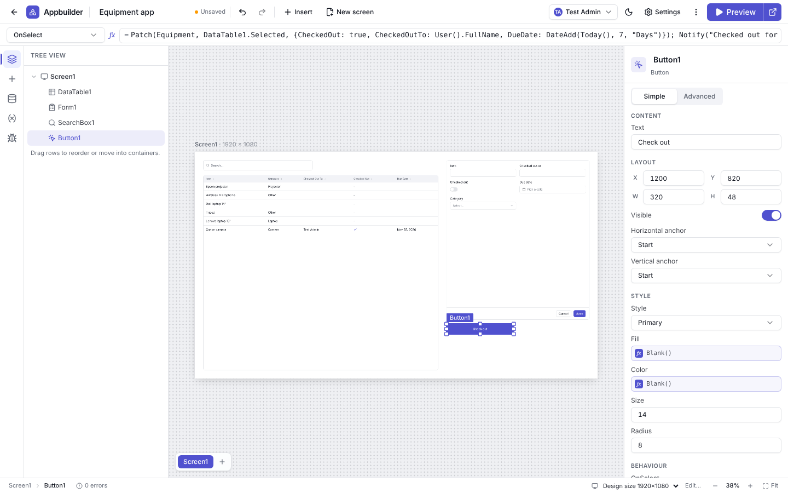
9. Choose **Preview** at the top right. Select a row and click **Check out**. The row shows your name, the box is ticked, and a due date appears. Press `Esc` to return to editing.

   
10. Choose the **Run in window** icon next to Preview to open the app in its own window, the way your users will use it.

## Next steps

- [Apps](maker/apps.md): create, export and run.
- [The Studio](maker/studio.md): design tools and shortcuts.
- [Formulas](maker/formulas.md): a friendly tutorial.
- [Data](maker/data.md): tables, files and connections.
- [Data model designer](maker/data-model.md): the diagram, relationships and delete behaviours, patterns, reporting views.
- [Security for makers](maker/security-for-makers.md)
- [Troubleshooting](troubleshooting.md)
