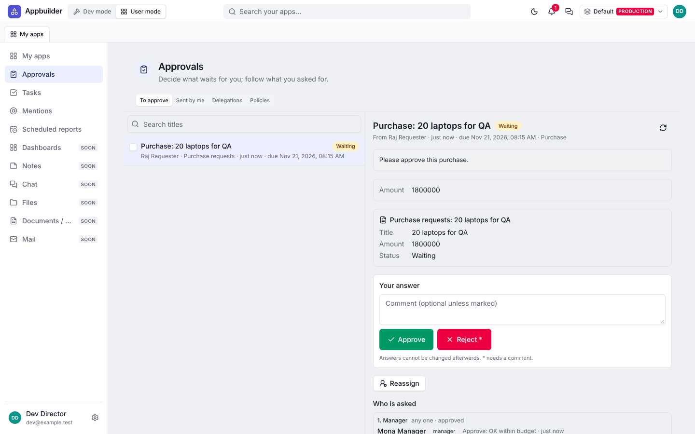
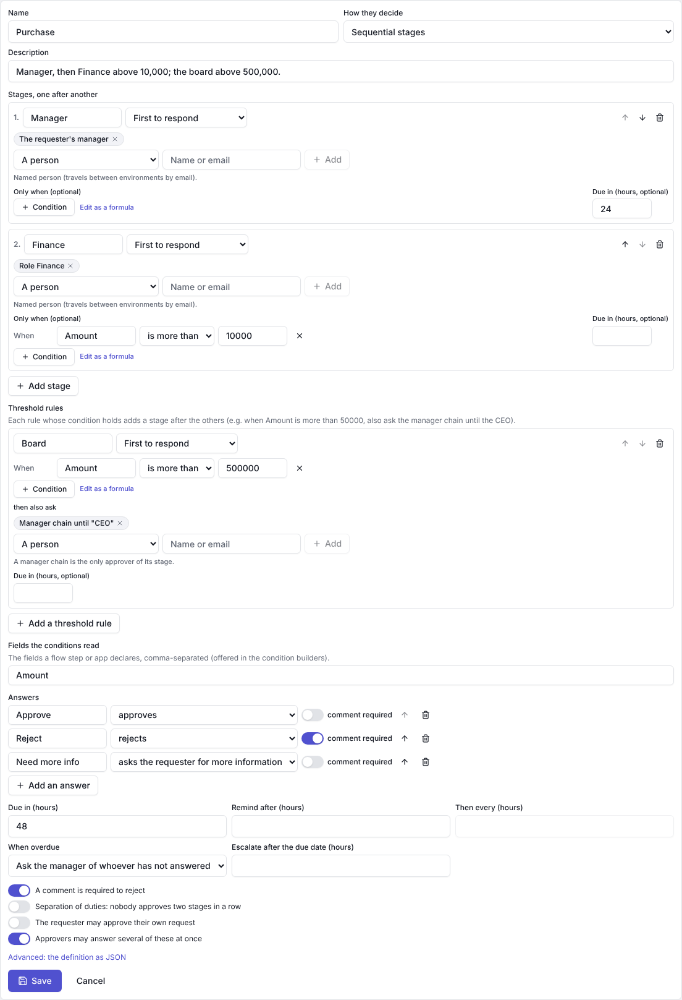
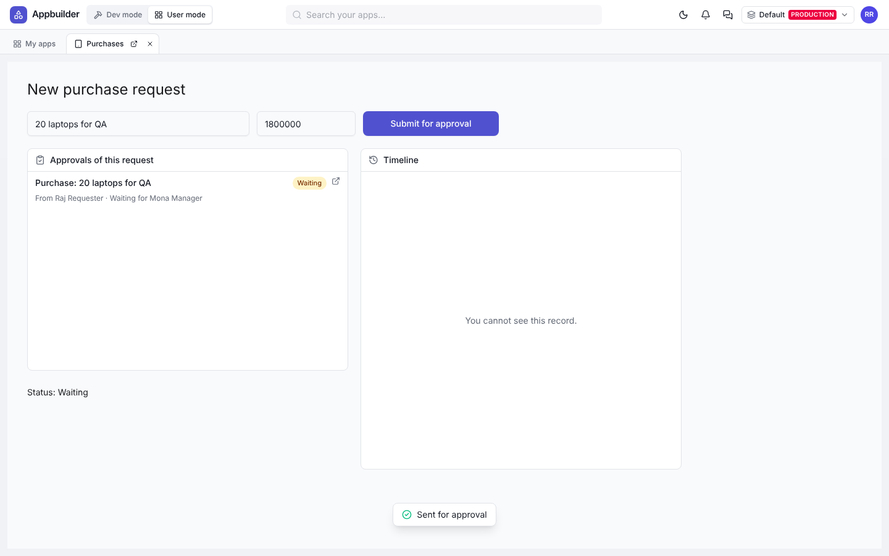

# Approvals

Ask people to approve something, wait for their answer, and act on it. Requests come from **flows** (the step "Start
and wait for an approval"), from **apps** (`RequestApproval`) or from the API. Approvers answer on the **Approvals** page,
from the bell, or with the **Approve / Reject buttons in the email** (they confirm in the app). Every action is kept in
the request's history.

Reference of every type, approver reference, escalation action and step output: [reference/approvals.md](../../reference/approvals.md).
Administrators: [admin/approvals.md](../../admin/approvals.md). Design: [dev/approvals.md](../../dev/approvals.md).



## How people decide

| Type | Use it for |
| --- | --- |
| Single approver | One person decides. |
| First to respond (`any`) | A group, and the first answer counts (a shared inbox of buyers). |
| Everyone must approve (`all`) | Each of them must agree; the first rejection rejects (or set "wait for everyone"). |
| Quorum (N of M) | A committee: 2 of 3 must approve. |
| Sequential stages | Manager, then finance, then the director; each stage is any, all or quorum and may have a condition. |

**Who is asked** is written as references, so a policy keeps working when people change jobs:
`asha@example.com`, `role:Finance`, `team:QA`, `department:FIN`, `department-head`, `manager` (the requester's),
`manager:2` (two levels up), `manager-chain:3` (each level, one stage each), `manager-chain-until-title:CEO`.

**Rules that always apply:** the requester never approves their own request (unless the policy allows it); if they
were the only approver, their manager is asked, else an administrator, and the history says why. With **separation of
duties**, whoever approved one stage is not asked in the next. Disabled people are skipped. Delegations are followed.

**Amount thresholds** are rules: "if `Amount > 50000`, add a stage with `manager-chain-until-title:CEO`". Rules read the
request's **fields** (see below).

**Answers**: Approve and Reject by default. Add your own: "Need more info" sends the request back to the requester and
waits for their answer; a custom answer such as "Rework" ends the request with that outcome. Any answer can require a
comment ("A comment is required to reject" is one switch).

**Due date, reminders, escalation**: due 48 hours after the request; remind after 24 hours (and every few hours); when
overdue: ask the manager of whoever has not answered, ask a named person, skip to the next stage, approve or reject
automatically (recorded as an automatic decision), or let it expire.

## Policies

A **policy** is a reusable definition: Approvals page > **Policies** (makers). Give it a name ("Purchase"), choose how
they decide, and pick who, all by clicking:

- **Approvers**: choose **A person** (type a name or email), **Everyone with a role**, **A team**, **A department**,
  **Department head**, **The requester's manager** (direct, or 2 to 5 levels up), **Manager chain** (each level up to N,
  one stage each), **Manager chain until a job title** (for example CEO) or **until a role**. Each choice shows as a chip
  in words ("Role Finance", "Manager chain until "CEO"").
- **Stages** (Sequential stages): **Add stage**, give it a name, its approvers, how they decide (first to respond,
  everyone, quorum N of them), optionally **Only when** (a condition on the fields, for example *Amount is more than
  10000*) and its own **Due in (hours)**: a stage's due date counts from when that stage starts. Move stages up and down
  with the arrows.
- **Threshold rules**: **Add a threshold rule**: *When Amount is more than 500000*, then also ask *Manager chain until
  "CEO"*. Each rule that holds adds a stage after the others. Conditions are built from **Field**, a comparison (is more
  than, is at least, is, is not, contains, is blank ...) and a value, joined by *and* / *or*; **Edit as a formula** shows
  the formula (`Amount > 500000`). The fields are the ones the flow step or the app declares; list them under **Fields the
  conditions read** so the builders offer them.
- **Answers**: Approve and Reject by default. **Add an answer** and choose what it does: *approves*, *rejects*, *asks the
  requester for more information* ("Need more info"), or *ends the request with this answer* (a custom outcome such as
  "Rework"); tick **comment required** where needed.
- **Due in**, **Remind after** / **Then every**, **When overdue** (and **Escalate after the due date**), **Escalate to** (a
  person picker), and the switches (comment to reject, separation of duties, self-approval, bulk answers).

Problems are listed under the form (for example "A manager chain must be the only approver of its stage") and Save waits
for them.



**Advanced: the definition as JSON** shows the same definition as JSON, for experts; changes there show in the
form above. For example, the Purchase policy is:

```json
{
  "type": "sequential",
  "stages": [{ "name": "Manager", "approvers": ["manager"] }, { "name": "Finance", "approvers": ["role:Finance"], "condition": "Amount > 10000", "dueMinutes": 1440 }],
  "rules": [{ "name": "Board", "condition": "Amount > 500000", "approvers": ["manager-chain-until-title:CEO"] }],
  "responses": [{ "label": "Approve", "kind": "approve" }, { "label": "Reject", "kind": "reject", "requireComment": true }, { "label": "Need more info", "kind": "info" }]
}
```

Policies travel in solutions (add them as components). Roles, teams, departments and "manager" mean the same in the
target environment; a person named directly travels by email, and the import plan shows whether that person has an
account there.

## In a flow

Add the step **Start and wait for an approval** (group Approvals in the designer). Fill in the title, the approvers (picked
like in a policy, or **Take them from the record or another step** for a formula such as `Trigger.Record.Manager`) or a
policy, the record it is about, and the **fields shown to approvers**. The step has the same stage, threshold rule and
answer editors as a policy (no JSON), so a one-off approval needs no policy: these are what an approver sees even when they
cannot open the record (for example Amount and Requester), and what threshold rules read. The run waits (costing
nothing) until the request is decided, then continues with:

| `Steps.<name>.Output` | |
| --- | --- |
| `Outcome` | The deciding answer: "Approve", "Reject", "Rework", "Expired", "Cancelled" |
| `Status` | approved, rejected, completed, expired, cancelled |
| `Responses` | A table: Approver (email), Name, Response, Comment, Time, Stage |
| `Approvers`, `Comments`, `CompletedOn`, `ApprovalId` | Who was asked; all comments; when; the request |

A step timeout ends the step with **timedOut** (handle it with "run after: timed out"); the request then expires. The
trigger **When an approval is decided** starts a flow for every decided request (optionally of one policy), with
`Trigger.Request` (Id, Title, Status, Outcome, RequestedBy, RegardingId, Fields ...) and `Trigger.Responses`.

Who is the requester? The flow's run-as person: for "run as the person who triggered it", the one who added the row.

## In an app

```
RequestApproval("Purchase", ThisItem, "Purchase: " & ThisItem.Title, "Please approve.", {Amount: ThisItem.Amount})
```

returns the request's id at once (the signed-in user is the requester). The first argument is a policy name or approvers
(`"manager"`, `"asha@example.com; role:Finance"`, a table of people). `Approvals(ThisItem)` lists the requests about a
record that the user may see; `MyApprovals()` what waits for the user. The **Approvals panel** UI component shows a
record's requests, who is asked or decided, the answer buttons for the user, and optionally "Request approval".



## Who sees a request

The requester, everyone asked (and those who delegated or were replaced), administrators, and people whose role has
**Approvals: view** for records they can read. An approver who cannot open the record sees only the title, the details
and the declared fields. The record's timeline shows "asked for approval" and the outcome to those who may see the request.

## Examples

**Purchase request.** Table PurchaseRequests; policy "Purchase": sequential, Manager (`manager`) then Finance
(`role:Finance`, condition `Amount > 10000`), rule `Amount > 500000` -> `manager-chain-until-title:CEO`, due 48 h,
escalate to the manager. A flow on "row created" with the approval step (policy Purchase, fields Amount) and an
"Update a row" setting Status to `Steps.Approve.Output.Outcome`.

**Leave request.** Policy "Leave": single, `manager`, answers Approve / Reject (comment required). The requester submits
from an app button with `RequestApproval("Leave", ThisItem, ...)`; a flow "When an approval is decided" (policy Leave)
updates the leave balance.

**Document sign-off.** Policy "Sign-off": everyone must approve, `team:QA` and `department-head`, answers "Sign off" and
"Send back" (comment required), separation of duties off. The Approvals panel on the document's screen.

**NCR disposition.** Policy "NCR disposition": single, `role:Quality`, answers "Use as is" (approve), "Scrap" (reject,
comment required), "Rework" (other), "Need more info" (info). The flow branches on `Steps.Disposition.Output.Outcome`.
