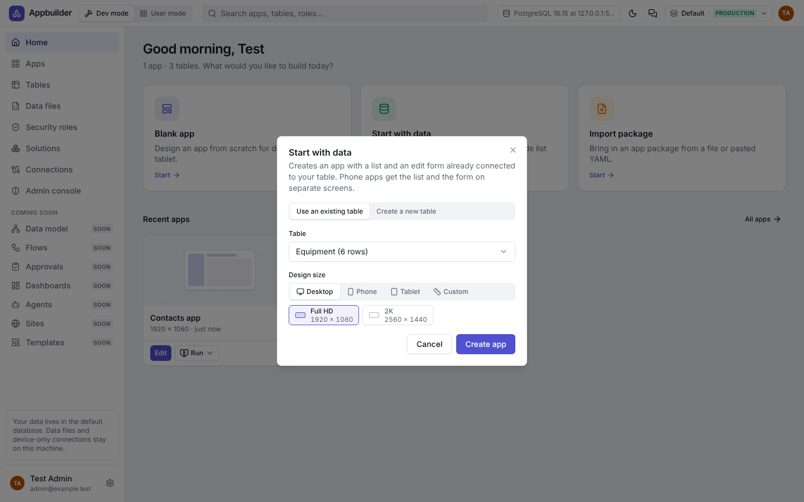

# Apps

An app is a set of screens with UI components, formulas and links to tables. Apps are listed on the **Apps** page.

## Create an app

- **New blank app**: choose a design size and a scaling mode (Responsive, or Fit, which letterboxes). Sizes:

  | Device | Sizes |
  |---|---|
  | Desktop | Full HD 1920x1080, 2K 2560x1440 |
  | Phone | 360x800 (the default phone), 390x844, 412x915 |
  | Tablet | 800x1280 portrait, 1280x800 landscape |
  | Custom | any width and height from 320 to 7680 px, landscape or portrait (the swap button turns one into the other) |

- **From a table** / **From the data model** (Apps page), **Create app** (Tables page and a table's page) and
  **Start with data** (Home): Appbuilder generates a working app from your tables. See below.

A table UI component with an empty **Columns** property shows every column, including system ones (id, createdOn and so on). Set **Columns** to the ones you want.

## Create an app from a table or the data model

Makers can let Appbuilder build a list / detail / edit app from tables in one step. Where:

| Entry point | What it does |
|---|---|
| A table's page, **Create app** | that table |
| Tables page, **Create app** and Apps page, **From the data model** | several tables you tick; **Add related tables** ticks the tables they point at and the tables that point at them |
| Apps page, **From a table** | one table you pick |
| Home, **Start with data** | one table (or a new one) at any design size; no preview |

The dialog asks for the app's name, the device (**Desktop** 1920 x 1080 or **Phone** 360 x 800) and the tables, and shows
what will be created before you confirm: the screens, the fields of each form, the list columns, and a list of what it
cannot do or does only partly (marked **Not used**, **Left out**, **Limited** or **Note**). Nothing is skipped without
being listed there. **Create and open** creates the app the normal way and opens it in the Studio.

What you get, per table:

- **List screen**: a table of the records (on phones: cards), newest first, a search box (when the table has a text
  column), sorting by any column (the column headers; on phones the **Sort by** box), and paging from the server, so it
  works on large tables. **+ New** opens an empty form.
- **Detail screen**: a form with the record. The title column comes first, then required columns, then the others by
  kind (short text, choices, lookups, numbers, dates, yes/no, long text, images, files). System columns (id, created and
  modified on and by, owner) are left out; calculated columns are shown read-only. **Save**, **Cancel**, and **Delete**,
  which asks first; if the table keeps deleted rows (recycle bin), the delete can be undone from the message that
  follows. On phones an image column offers **Take photo**.
- **Related records**: for every table that has a lookup to this one, a list of the rows that point at this record. If
  that table is in the app too, a row opens its detail screen and **+ Add** creates a new row with the lookup already
  filled in. On desktop the related lists and the **Activity** timeline (comments, tasks, files, history) are tabs beside
  the form; on phones they are on a separate **Related** screen.
- Several tables: a **Home** screen with a tile per table and its number of records. On desktop a lookup to another
  table of the app gets an **Open ...** button on the detail screen (at most two).
- **Lookups**: in the form, a lookup is a search box: type part of the record's name and pick it (the server is asked as
  you type, so it works for tables of any size; on phones it opens a sheet from the bottom). An optional lookup has a
  clear button. Lists and phone cards show the record's name (the target table's primary column). A record you are not
  allowed to see, or one that was deleted, shows as *Not available*, never as an id. The list's search box finds rows by
  that name too. A list cannot be sorted by a lookup column (its header has no sort arrow): the server would sort by the
  hidden record id, not by the names you see.

The result is an ordinary app: change, move or delete anything in the Studio. Nothing stays linked to the generator, so
generating again creates a new app; it never changes the one you have. Who can use the app and its data is decided by
security roles, as for any app.

Not supported yet:

- Sorting a list by a lookup column (see above).
- Pick-and-choose of fields or columns in the dialog (change them in the Studio afterwards), tablet-specific layouts
  (the phone layout is used for portrait sizes), and dashboards beyond the record counts on the home screen.
- System tables (people, collaboration, logs) are not offered; tables whose formula name is a built-in name of the
  formula language (such as `Color`) cannot be used until renamed.
- The generated screens use fixed colours (a coloured header bar); the app's dark theme does not change them.

## Phone and tablet apps

A portrait app (phone, tablet portrait) is designed in the Studio at its size, like any other app. When it runs:

- on a phone or another portrait window, a Responsive app fills the screen (at least 320x480);
- in a landscape window or an app tab on the desktop, it keeps its design size, is scaled down if needed and is
  centred on a neutral background;
- a Fit app is always scaled uniformly.

Changing the size of an existing app in **App settings** keeps every UI component where it is: check anchors and layouts
after switching between a desktop and a phone size. Package export and import keep the size.

## Open, run, rename, duplicate, delete

Use the menu on an app's row:

- **Edit** opens the Studio.
- **Run** offers two choices: **Open in a tab** (switches to User mode with the app as a tab) and **Open in new window**
  (the standalone app in its own browser window). The app menu has the same two entries.
- **Rename**, **Duplicate**.
- **Export package** (see below).
- **Add to solution** (see [Solutions](solutions.md)).
- **Delete**. Tables the app used are not deleted.

## Export and import packages

An app package is a YAML file (`kind: appbuilder/app`). On the app menu choose **Export package**. A toggle lets you include table rows. In the Studio, the "..." menu has **Export package** and **Import package**; importing from the Studio always creates a new app and opens it, never overwriting.

## User mode and app tabs

Switch to **User mode** in the top bar (people without the Maker or Administrator role are always in User mode).

- **My apps** lists the apps your security roles let you run, with a search box (top bar) and **Recently opened**.
  Each tile shows whether the app is for desktop, phone or tablet.
- **Open** (or a click on the tile) opens the app as a **tab** under the top bar. **My apps** is always the first tab.
  Several apps can be open at once; each keeps its state (variables, collections, typed values, the screen it is on)
  while you switch tabs, switch to Dev mode or open the Studio.
- Close a tab with its **x**, a middle-click or `Delete` when the tab has focus. The open tabs come back after a
  reload (the app state starts fresh).
- **Open in new window** (the icon on a tile, and on a tab when you point at it) opens the standalone app in a separate
  browser window. If the browser blocks pop-ups the app opens as a tab instead.
- Every tab has its own address (`#u-<app id>`), so a link opens that app as a tab.

The left menu in User mode also lists planned modules (Tasks, Notes, Chat, Files, Documents / Slides / Sheets, Mail,
Approvals, Dashboards) with a **Soon** badge.

## Run window and hot reload

**Open in new window** opens a 1600x900 pop-up. If your browser blocks pop-ups, the app opens in the current page instead. In the Studio, **Preview** runs the app in place (press `Esc` to leave, **Restart** to reset), and the **Run in window** icon opens the pop-up.

While the Studio is open, a run window reloads automatically when you change the app and keeps its current state. It shows a debug bar with Hot restart, a screen picker, size presets (Full HD, 2K, 1366, 21:9) and Trace and errors. Changes save on their own about 0.7 seconds after you stop; the status next to the name reads Saved, Saving, Unsaved or Not saved.

If a user without access runs an app they see "You don't have access to this app. Ask an admin to add the app to one of your security roles."

## App settings

In the Studio, choose **Settings**:

- Name
- Design size (the same Desktop, Phone, Tablet and Custom choices as for a new app) and Scale mode (Responsive or Fit)
- Theme (Light or Dark), primary colour, corner radius
- **App.OnStart**: a formula that runs when the app opens
- **App.Formulas**: named formulas and your own functions (see [Formulas](formulas.md))
