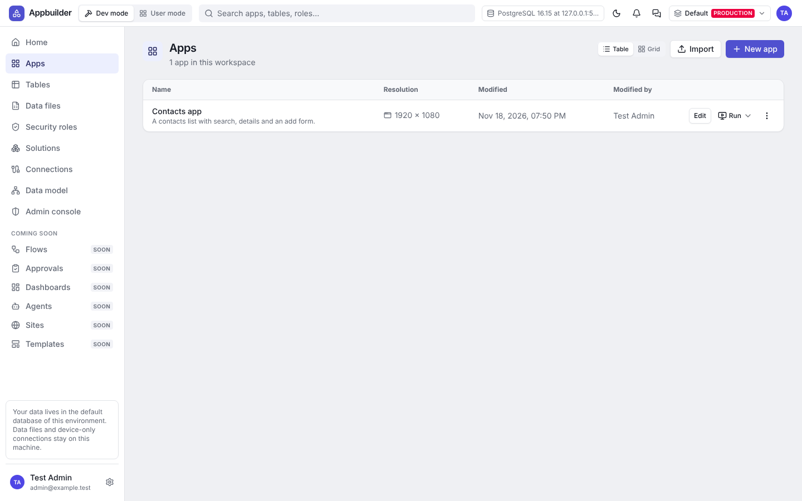
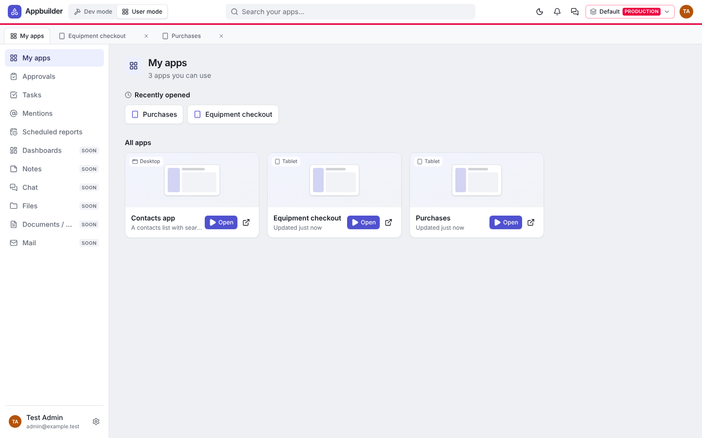

# Apps

An app is a set of screens with UI components, formulas and links to tables. Apps are listed on the **Apps** page.

## Create an app

- **New blank app**: choose a design size and a scaling mode (Responsive, or Fit, which letterboxes). Sizes:

  | Device | Sizes |
  |---|---|
  | Desktop | Full HD 1920x1080, 2K 2560x1440 |
  | Phone | 360x800 (the default phone), 390x844, 412x915 |
  | Tablet | 800x1280 portrait, 1280x800 landscape |
  | Custom | any width and height from 320 to 7680 px, landscape or portrait (the swap button turns one into the other) |

- **Start with data**: on Home, pick a table and a design size. Appbuilder creates "<Table> app" with the data source
  added and screens already connected to the table:
  - desktop and landscape sizes: a table UI component and an edit form side by side;
  - tablet portrait: the table above the form;
  - phone: a list screen (a gallery with a **+ New** button) and a separate form screen with **< Back**; tapping a row
    opens the form, saving or cancelling goes back to the list.

A table UI component with an empty **Columns** property shows every column, including system ones (id, createdOn and so on). Set **Columns** to the ones you want.

## Phone and tablet apps

A portrait app (phone, tablet portrait) is designed in the Studio at its size, like any other app. When it runs:

- on a phone or another portrait window, a Responsive app fills the screen (at least 320x480);
- in a landscape window or an app tab on the desktop, it keeps its design size, is scaled down if needed and is
  centred on a neutral background;
- a Fit app is always scaled uniformly.

Changing the size of an existing app in **App settings** keeps every UI component where it is: check anchors and layouts
after switching between a desktop and a phone size. Package export and import keep the size.

## Open, run, rename, duplicate, delete

Use the menu on an app's row:

- **Edit** opens the Studio.
- **Run** offers two choices: **Open in a tab** (switches to User mode with the app as a tab) and **Open in new window**
  (the standalone app in its own browser window). The app menu has the same two entries.
- **Rename**, **Duplicate**.
- **Export package** (see below).
- **Add to solution** (see [Solutions](solutions.md)).
- **Delete**. Tables the app used are not deleted.

## Export and import packages

An app package is a YAML file (`kind: appbuilder/app`). On the app menu choose **Export package**. A toggle lets you include table rows. In the Studio, the "..." menu has **Export package** and **Import package**; importing from the Studio always creates a new app and opens it, never overwriting.

## User mode and app tabs

Switch to **User mode** in the top bar (people without the Maker or Administrator role are always in User mode).

- **My apps** lists the apps your security roles let you run, with a search box (top bar) and **Recently opened**.
  Each tile shows whether the app is for desktop, phone or tablet.
- **Open** (or a click on the tile) opens the app as a **tab** under the top bar. **My apps** is always the first tab.
  Several apps can be open at once; each keeps its state (variables, collections, typed values, the screen it is on)
  while you switch tabs, switch to Dev mode or open the Studio.
- Close a tab with its **x**, a middle-click or `Delete` when the tab has focus. The open tabs come back after a
  reload (the app state starts fresh).
- **Open in new window** (the icon on a tile, and on a tab when you point at it) opens the standalone app in a separate
  browser window. If the browser blocks pop-ups the app opens as a tab instead.
- Every tab has its own address (`#u-<app id>`), so a link opens that app as a tab.

The left menu in User mode also lists planned modules (Tasks, Notes, Chat, Files, Documents / Slides / Sheets, Mail,
Approvals, Dashboards) with a **Soon** badge.

## Run window and hot reload

**Open in new window** opens a 1600x900 pop-up. If your browser blocks pop-ups, the app opens in the current page instead. In the Studio, **Preview** runs the app in place (press `Esc` to leave, **Restart** to reset), and the **Run in window** icon opens the pop-up.

While the Studio is open, a run window reloads automatically when you change the app and keeps its current state. It shows a debug bar with Hot restart, a screen picker, size presets (Full HD, 2K, 1366, 21:9) and Trace and errors. Changes save on their own about 0.7 seconds after you stop; the status next to the name reads Saved, Saving, Unsaved or Not saved.

If a user without access runs an app they see "You don't have access to this app. Ask an admin to add the app to one of your security roles."

## App settings

In the Studio, choose **Settings**:

- Name
- Design size (the same Desktop, Phone, Tablet and Custom choices as for a new app) and Scale mode (Responsive or Fit)
- Theme (Light or Dark), primary colour, corner radius
- **App.OnStart**: a formula that runs when the app opens
- **App.Formulas**: named formulas and your own functions (see [Formulas](formulas.md))
