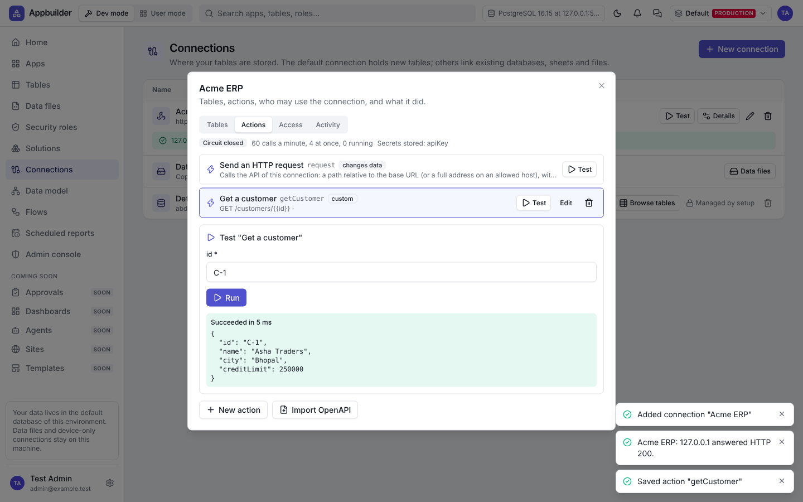
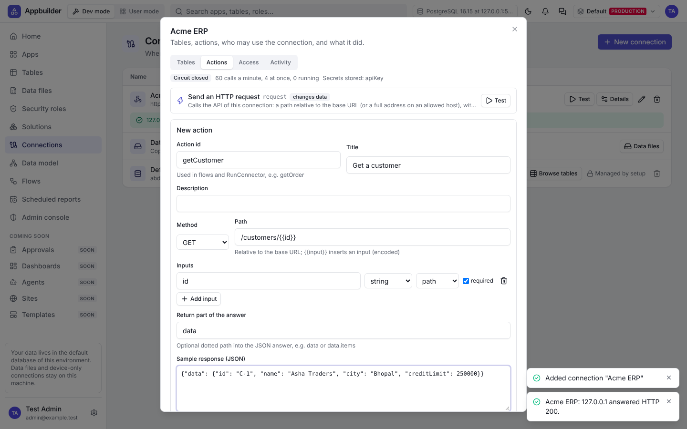
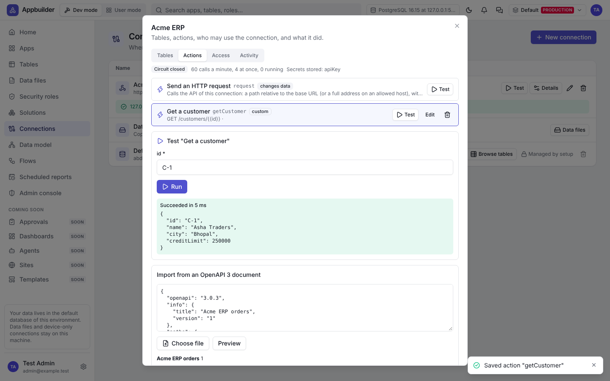

# Connections and actions

A **connection** stores where something lives and how to sign in to it. Database, sheet and file connections give you
**tables**. Since P1 two kinds give you **actions** instead: things flows and table events can do in other systems.

| Connection | Actions | Typical use |
| --- | --- | --- |
| **HTTP (REST API)** | `request` (any call), plus the custom actions you define or import | Create an order in the ERP, look up GST details, post to a chat channel |
| **Email** | `send` | Send a confirmation with a PDF attached, a daily list to a supplier |

An administrator creates the connection and gives you **use** (attach and test) or **manage** (also define actions) on its
Access tab. You never see its passwords or keys: they stay encrypted on the server, and if an API echoes them back you see
`[hidden]`. The full list of built-in actions and their inputs is in the
[connector actions reference](../../reference/connector-actions.md).

## Open a connection's actions

**Connections > Details** on the connection, then the **Actions** tab. Each action shows whether it changes something
outside Appbuilder ("changes data"). Under the list: how many calls a minute and at once the connection allows, and the
**circuit**: after 5 failures in a row calls pause for 30 seconds (longer if it keeps failing), so a broken API is not
hammered. People with manage can resume calls.

## Test an action

Press **Test** on an action: a form is made from the action's inputs. **Run** really calls the system (an action that
"changes data" really changes it). The answer, or the error and whether a retry could help, appears below.



## Define your own action (custom connector)

On an HTTP connection with manage: **New action**.

- **Action id** (used in flows and `RunConnector`), title, description.
- **Method** and **path**, relative to the base URL. `{{name}}` inserts an input; it is encoded, so `a/b` stays one path
  part and cannot reach another path.
- **Inputs**: name, type, required, and where each goes: in the **path**, the **query**, a **header**, or a field of the
  JSON **body**.
- **Return part of the answer**: for example `data` returns only `data` of `{"data": {...}, "meta": ...}`.
- **Sample response**: paste one answer; flow designers then know the output's fields.



GET and HEAD actions count as reading (no side effect); POST, PATCH actions as changing data and not repeatable, PUT and
DELETE as changing data but repeatable. A flow that runs a changing action passes an idempotency key, so a retry after a
crash does not create the order twice (the result is remembered for 24 hours).

## Import an OpenAPI document

Many APIs publish an OpenAPI 3 description (JSON or YAML). **Import OpenAPI**, paste it or choose the file, **Preview**,
untick what you do not want, **Import selected**. Each operation becomes an action with its parameters and body as inputs
and its answer as output. What is understood: paths, path/query/header parameters, JSON request bodies, JSON responses,
`$ref` inside the document, and the API key, basic, bearer and OAuth 2.0 client credentials security schemes (shown as a
suggestion for the administrator). Not understood (a warning tells you): Swagger 2.0 (convert it first), form or file
bodies, cookies, references to other files, OAuth sign-in per user.



Custom actions travel with the connection in a [solution](solutions.md) (without its secrets).

## Use an action from a table event

In a table event that runs **after** the save, attach the connection (you need "use" on it), then call:

```
RunConnector("Acme ERP", "createOrder", { body: { customer: New.Customer, amount: New.Amount } })
```

The connection is named by its name or id. The call runs in the background with the identity of the person who made the
change; failures that a retry could fix are retried, others go to the events run log. Events that run before the save
cannot call other systems. Flows call actions with the **action** step (see the flows guide).

## Email from flows and events

The Email connection's `send` action takes `to`, `cc`, `bcc`, `subject`, `text` and/or `html`, `replyTo` and
`attachments`: a file from an attachment column (by its id; the identity the flow runs as must be able to open it) or a
generated file (`{ fileName: "lines.csv", text: "..." }`). Addresses on the administrator's suppression list are skipped.
Each environment has sending limits (by default 200 recipients an hour and 1,000 a day).

## Activity

The **Activity** tab lists the calls: yours, or everyone's if you manage the connection. Inputs and answers are never
stored.

## Not available yet

- OAuth sign-in as each user (only server-to-server client credentials).
- Actions on database connections (stored procedures, SQL written by makers).
- Postman collections and cURL import.
