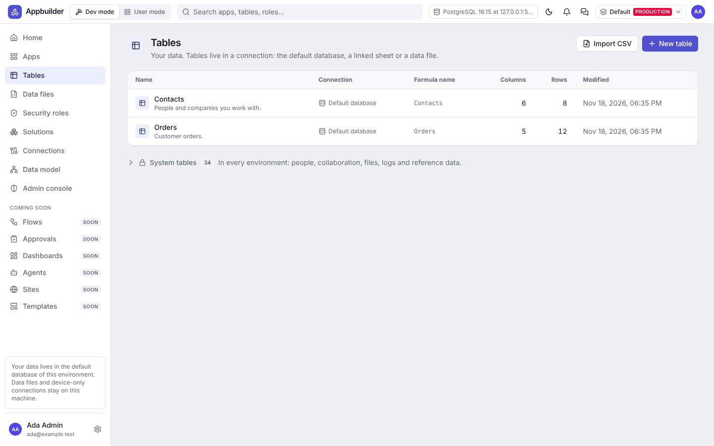
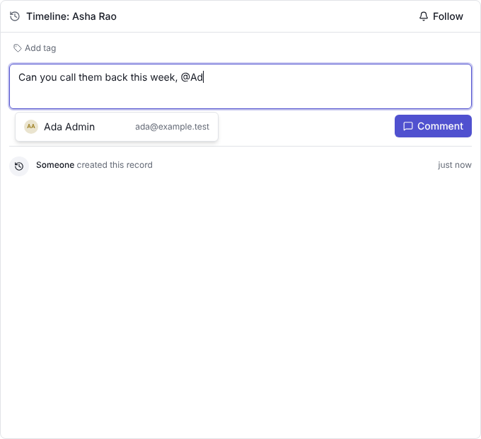
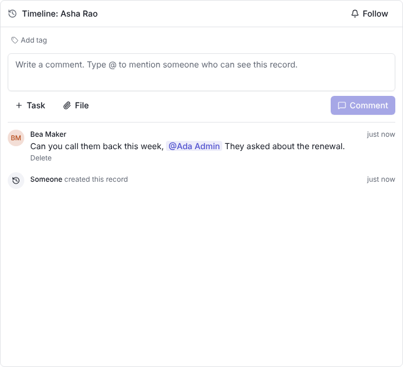
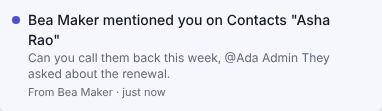
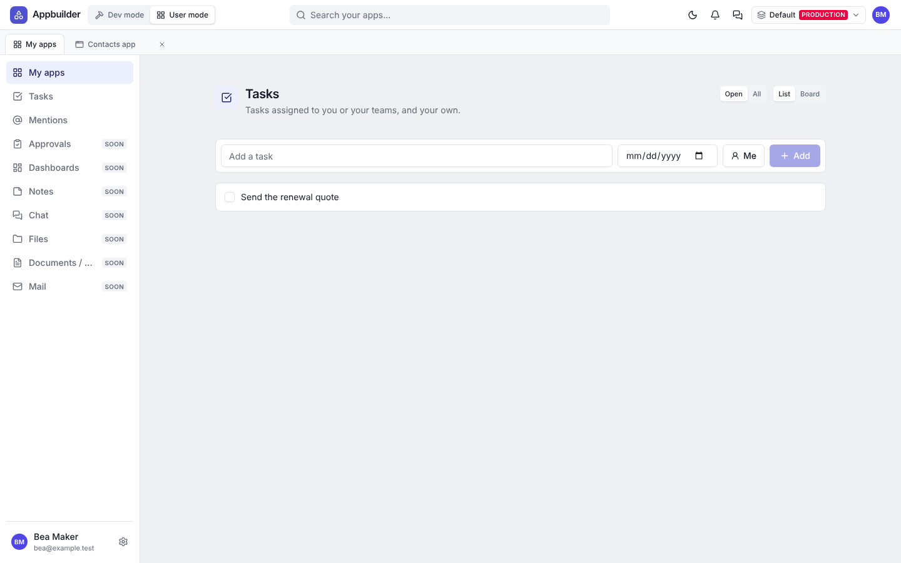
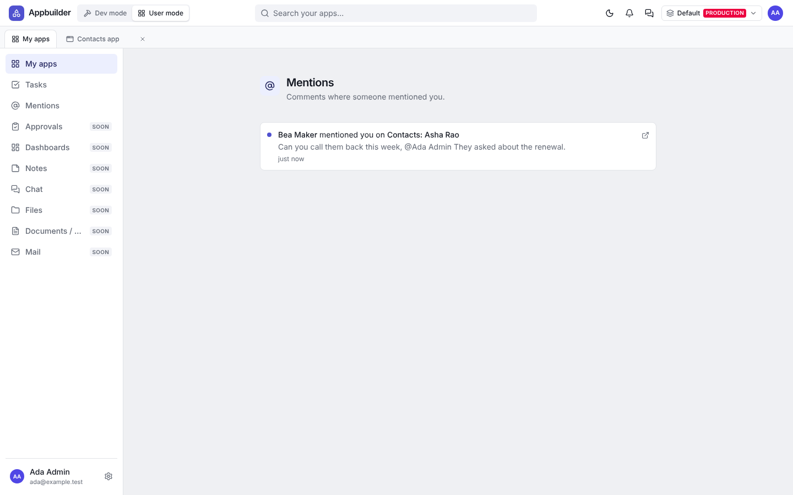

# The core data model: people, comments, tasks, files and reference data

Every environment comes with a set of **system tables**. You do not create them and you cannot delete them; your apps
use them like any other table. They give every app the same people, the same comments and tasks, the same files and the
same reference data (currencies, countries, Indian states, units, number sequences, settings), so you do not build these
again in each app.

In Dev mode > **Tables**, open **System tables** under your own tables. They are grouped:

| Group | Tables | What they are |
| --- | --- | --- |
| People and organisation | Users, Departments, Teams, Team members, Roles, Role assignments | A read-only view of the people in this environment and the organisation the administrator set up. |
| Collaboration | Activities, Comments, Mentions, Follows, Tags, Tag links, Shares, Notifications | Comments, tasks and other activities about any record; who was mentioned, who follows a record, tags. |
| Files | Documents, Document versions, Attachment links | Documents with versions, and one row for every file attached to a record. |
| Communication | Channels, Channel members, Messages, Message reactions | Reserved for chat (coming later). The tables exist so apps can be built against them; nothing writes to them yet. |
| Logging | Audit entries, Sign-in log, Job runs, Event runs, Flow runs | Read-only views of the logs, for administrators (your own sign-ins for everybody). Flow runs is reserved for flows. |
| Reference data | Currencies, Units of measure, Countries, States, Calendars, Holidays, Number sequences, Settings | Lists that every app shares. Administrators keep them up to date. |



## What you can and cannot change

- You can **read** the system tables in formulas, data tables, galleries and forms, like any table:
  `Filter(Users, Department = ThisItem.Department)`, `LookUp(Currencies, Code = "INR").Symbol`.
- You can **add your own columns** to most collaboration, files and reference tables (the ones that show **Add column**),
  for example a `Region` column on Activities. These columns travel in solutions like your other changes.
- You cannot rename or delete a system table, or change or delete its built-in columns (they show a lock).
- The tables that are views (Users, Teams, Roles, the logs, Shares, Notifications) are **read-only**. People are managed
  in the Admin console; you cannot add a user by adding a row to Users.
- If one of your tables already had one of these names, your table keeps it and the system table is called
  `Sys<Name>` (for example `SysComments`) in formulas.

## Who sees what

You do not set up roles for the system tables; each has a built-in rule.

- **Users, Departments, Teams** are a directory: everyone in the environment sees active people with their name and email.
  Department, manager, job title, phone and employee code are for administrators.
- **Comments, Activities, Mentions, Follows, Tag links, Documents, Attachment links** are about a record (they have a
  `regardingTable` and a `regardingId` column). **You see them only if you can read the record they are about.** If your
  role sees only your own Orders, you see the comments of your own orders and nothing about the others, not even that
  they exist. An activity assigned to you is visible to you even when the record is not; the record stays hidden.
- **Reference data** is readable by everyone and changed by administrators.
- **Notifications** are always your own. The logs are for administrators; the Sign-in log shows everyone their own
  sign-ins.

You can only @mention people who can read the record; the mention list only offers them.

## The Record timeline UI component

Add **Record timeline** (Insert > Data) to a screen and set its **Record** property to the record it is about, usually
the selected row: `ContactsTable.Selected` or `Gallery1.Selected`. It shows, newest first, the record's comments,
activities, files and changes, and a box to write a comment. Type `@` and a name to mention someone; they get a
notification, and clicking it opens your app on that record (see below). **Task** adds a task about the record,
**File** attaches a file, **Follow** gets you notified about new comments, **Add tag** tags the record.




| Property | What it does |
| --- | --- |
| Record | The record (or its id). Blank shows "Select a record". |
| Title | The header text. Empty shows "Timeline: <the record's name>". |
| Show composer | Off hides the comment box (a read-only timeline). |
| Page size | How many items load at a time (more load as you scroll). |
| Table | Only needed when Record is a bare id; the table's name. |

**Opening the app on a record from a link.** Notifications link to `#u-<app>?record=<id>`. Read the parameter with
`Param("record")` so the app opens on that record:

```
If(IsBlank(Param("record")), ContactsTable.Selected, LookUp(Contacts, id = Param("record")))
```

Use this formula for the timeline's Record and the form's Item.



### Other UI components

| UI component | What it does |
| --- | --- |
| Person picker | Picks a person from Users. `Selected` is the user's record, `Value` the user's id. |
| Avatar | Set **User** to a user's id (for example `ThisItem.createdBy`) and it shows their initials and name. |
| Avatar group | Set **Users** to a table of user ids; it shows the first few and "+3". |
| Tag input | Shows and edits the tags of a record. |
| Activity list | A list of activities (tasks) with a check box to complete them: `Items = MyTasks()` or `Activities(record)`. |

## Tasks and Mentions in User mode

User mode has two built-in pages for everyone:

- **Tasks**: the open tasks assigned to you or your teams, and the ones you created for yourself, as a list or a board
  (Open, In progress, Done). Type a task and press Enter to add one; pick a due date and a person.
- **Mentions**: the comments where someone mentioned you. Click one to open the record.




## Formula functions

| Function | What it gives |
| --- | --- |
| `Comments(record)` | The record's comments, newest first (a table; you can Filter and sort it further). |
| `Activities(record)` | The record's activities, newest first. |
| `MyTasks()` | Open tasks assigned to me, earliest due date first. |
| `Mentions()` | Comments that mention me, newest first. |
| `Setting("key")` | A value from the Settings table, for example `Setting("DefaultCurrency")`. |
| `Convert(value, "from", "to")` | Converts between units of the same dimension: `Convert(2.5, "KG", "G")` is 2500. Blank when the units cannot be converted. |
| `NextNumber("name")` | Takes the next number of a number sequence, for example `INV/2026-27/0042`. |
| `AddComment(record, text)` | Adds a comment about the record. |
| `AddActivity(record, subject [, type [, due [, assignedTo]]])` | Adds an activity (a task by default). |
| `Follow(record)`, `Unfollow(record)` | Start or stop following the record. |
| `Tag(record, "name")`, `Untag(record, "name")` | Add or remove a tag (a new tag name creates the tag). |

`Comments`, `Activities`, `MyTasks`, `Mentions`, `Setting` and `Convert` are read on the server like any `Filter` or
`LookUp`, so they work on large tables. The others are behaviour functions: use them in `OnSelect` and other behaviour
properties.

You can also follow a lookup to read a field of the row it points at: `ThisItem.createdBy.FullName` gives the name of the
person who created the row, and `Filter(Orders, createdBy.Department = "Sales")` is answered on the server.

### Numbering records

To give every new invoice a number, ask your administrator to add a number sequence (Reference data, see
[Reference data, number sequences and the financial year](../../admin/reference-data.md)), then set the default value of
your Number column to `=NextNumber("Invoices")`. The server gives out the number when the row is saved, so two people
saving at the same time never get the same number, and a save that fails does not use up a number.

## The common business model (optional)

Accounts, Contacts, Addresses, Tax codes, Products, Price lists and Price list items are **not** created in every
environment. If you want them, import the **Common business model** solution package: it is served by
`GET /api/v1/templates/business-model` (save the `yaml` field of the answer as a `.yaml` file) and imported in Dev mode >
Solutions > Import like any package. (A button for it comes with the Templates page.) The tables use the reference data (currencies, countries, states, units) and get
timelines, tags and files like any table.

## In solutions

- System tables themselves are never exported. Your **custom columns** on them are, and are added when the solution is
  imported.
- Comments, activities, files and the other collaboration rows are not exported with a solution's data. When an
  administrator copies a whole environment **with data**, they are copied too.
- Deleting a record removes its comments, mentions, tags, follows, activities and attachment links. Deleting a table
  removes all of them for its records.
