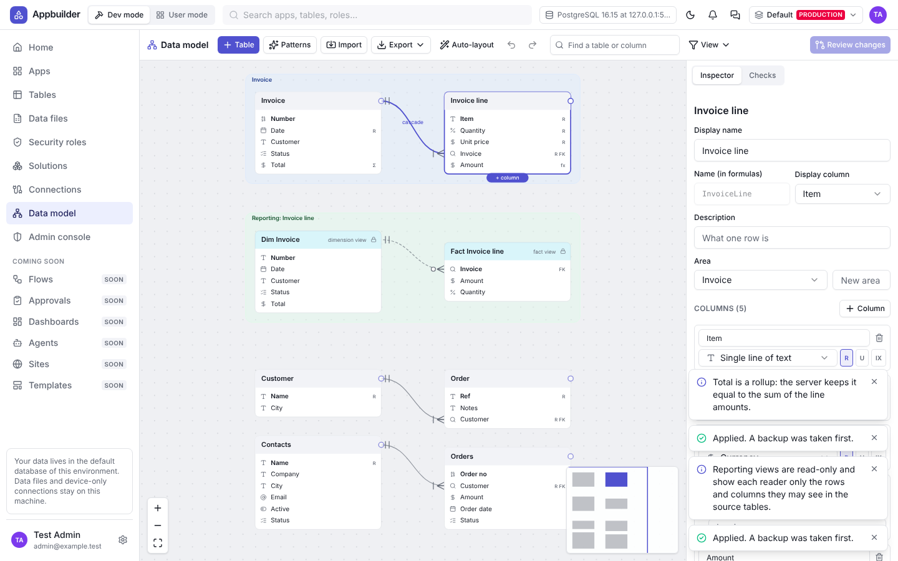
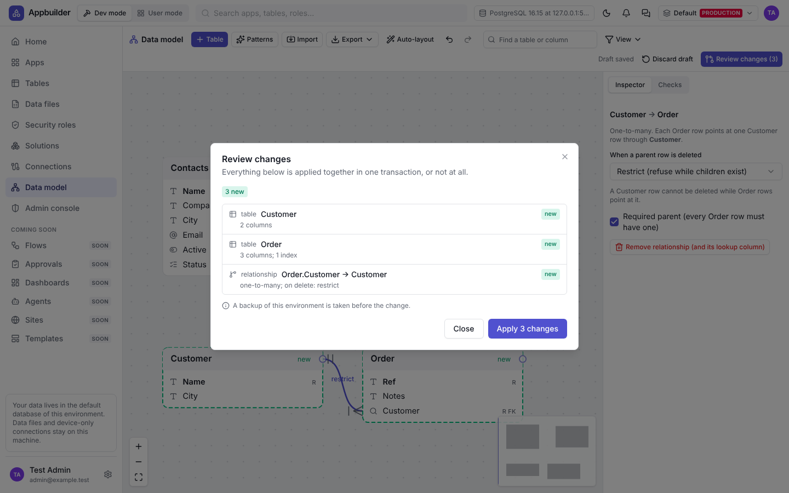
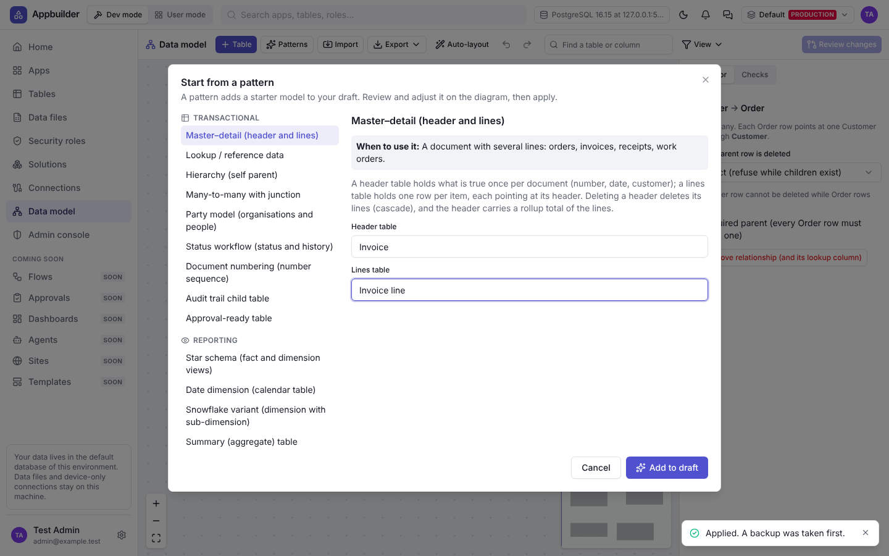
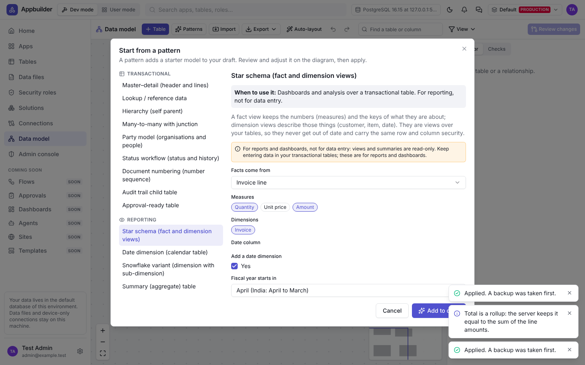

# Data model designer

Dev mode > **Data model** shows every table of the environment on one diagram, with its columns and the relationships
between tables, and lets you change the model in a **draft**: nothing in the environment changes until you **review the
changes** and apply them, all together or not at all. Makers and administrators can use it; in a **locked production
environment** it is read-only (changes arrive there as solutions).

## The diagram

- Each table is a card: its display name, then its columns with a type icon and badges: **R** required, **U** unique,
  **IX** indexed, **FK** lookup, **fx** formula column, **Σ** rollup. The display column is in bold.
- A line is a **relationship**. The end with three prongs (crow's foot) is the "many" side, the bar is "one"; a small
  circle or a dashed line means the lookup is optional. Select a line to see its delete behaviour.
- New tables in your draft have a green dashed border, changed ones a blue border.
- **Move** a table by dragging its header. **Pan** by dragging the background or scrolling; **zoom** with Ctrl (Cmd) +
  scroll or the buttons at the bottom left; the **minimap** at the bottom right jumps to any part. **Auto-layout**
  arranges the tables in layers (parents left, children right), one block per area.
- **Areas** group tables with a colour (Sales, Production, ...): select a table and pick or type an area in the inspector.
- **Find** highlights tables whose name or columns match; Enter brings the first one into view.
- **View**: show or hide the **system tables** (User, Team, Activity, ... read-only), show key columns only, show only
  the tables of one **solution**, and choose between the **shared layout** and **your own layout** of positions.

## Editing in the draft

- **+ Table** adds a table. Select it to edit it in the inspector on the right: display name, display column,
  description, area, and the columns (rename, change type, required / unique / indexed, lookup target, choices, delete).
  **+ column** on a selected card adds a column; double-click a column on the card to rename it in place.
- **Relationships**: drag from the dot on the right edge of a table onto another table (or onto itself), then choose:

  | Kind | What is created |
  | --- | --- |
  | One-to-many | a lookup column on the "many" table (you can swap the sides) |
  | One-to-one | a unique lookup column |
  | Many-to-many | a junction table with a lookup to each side, the pair unique together, and optional extra columns |
  | Hierarchy (self) | a "Parent" lookup to the same table, with **prevent loops** (a row can never become its own ancestor) |

  For each relationship choose **required parent** and what happens when a parent row is deleted:

  | Delete behaviour | When a parent row is deleted |
  | --- | --- |
  | **Restrict** | refused while child rows point at it (the message says how many) |
  | **Cascade** | its child rows are deleted too, with the permissions of the person deleting: if they may not delete every child row (even one they cannot see), nothing is deleted |
  | **Set blank** | the child rows stay; their lookup is cleared (not possible for a required lookup) |

  Lookups that existed before the designer behave as recorded at the upgrade: required ones **restrict**, optional ones
  **set blank**. Change them on the line's inspector.
- **Undo / Redo** (Ctrl+Z, Ctrl+Shift+Z) step through your draft. The draft is saved as you work, for you and this
  environment; come back later and it is still there. **Discard draft** throws it away.
- If someone else changed the schema since your draft started, a bar offers **Rebase draft**: your changes are replayed
  on the current schema; the ones that no longer fit are listed and dropped.

## Review changes and apply

**Review changes** shows the plan, the same kind of list as a solution upgrade:

- new, changed and removed tables, columns, relationships, views and indexes;
- **destructive** items in red with the number of rows affected (a dropped column: the rows that have a value); you
  tick that you understand before applying;
- **data conversions** are checked first: changing a text column to a number lists how many values will not convert,
  with examples, and the apply is refused until you fix them;
- index builds and the background jobs a change starts (formula backfills, rollups);
- whether a backup of the environment is taken first.

Apply runs everything in one database transaction: if anything fails, nothing changes. If the schema changed after you
opened the plan, you are asked to review it again.

## Patterns

**Patterns** adds a starter model to your draft. Each one says when to use it; adjust the result on the diagram.

### Transactional (for entering data)

| Pattern | Use it when | What you get |
| --- | --- | --- |
| Master–detail | a document has several lines: orders, invoices, work orders | header + lines (cascade), Amount = Quantity × Unit price on the line, a rollup **Total** on the header |
| Lookup / reference data | people pick from a short list that changes now and then | Code (unique), Name, Active, Sort order; optionally a lookup from a table (restrict) |
| Hierarchy | things inside things of the same kind: locations, departments, categories | a Parent lookup to the same table with loop prevention |
| Many-to-many | both sides have many of the other: products and suppliers | a junction table with a unique pair and extra columns |
| Party model | you deal with companies and their people | Account (with a type: customer, supplier, partner) and Contact |
| Status workflow | records move through stages and you need the history | a Status choice and a status-history child table |
| Document numbering | documents need a running number such as INV-0001 | an autonumber column with a prefix |
| Audit trail child table | users must see a record's history inside the app | a change-log child table (cascade) |
| Approval-ready table | someone asks and someone decides | requester, approver, status, submitted on, decided on, comment |

### Reporting (for reports and dashboards, not for data entry)

Reporting tables are read-only. Keep entering data in your transactional tables.

- **Star schema**: pick a transactional table, its **measures** (numbers) and **dimensions** (lookups). You get a
  **fact view** (the measures, the dimension keys and a DateKey) and one **dimension view** per lookup. Views always show
  current data and carry the **same security** as their source: each reader sees only the rows and columns they may see
  in the source table.
- **Snowflake variant**: like the star, but a dimension keeps its own lookups as keys to sub-dimension views.
- **Date dimension**: a calendar table, one row per day, with year, quarter, month, weekday and the **fiscal year**
  (default April to March, labelled FY2026-27). Facts join it on DateKey (yyyymmdd).
- **Summary table**: totals of a big table by the columns you choose, refreshed by a scheduled job (hourly by default,
  Admin console > Jobs). It is computed by the system, so only roles that may read every row of the source can read it.

### Industry starters (tables only)

Manufacturing basics, CRM basics and Inventory basics: small, correct models to start from (see the worked example).

## Worked example: a small plant

1. **Patterns > Manufacturing basics**. You get Item, BOM and BOM line, Machine, Work order, Production log, Downtime,
   Inspection and NCR in an area "Manufacturing". Look at the lines: a BOM line belongs to its BOM (cascade), an item
   used in a BOM cannot be deleted (restrict), a work order's machine is optional (set blank).
2. Select **Production log** and add a column **Operator** (text). Make **Work order > Status** indexed if you filter
   by it on a big table.
3. **Review changes**: 9 new tables and their relationships, no destructive items. **Apply**.
4. Build apps on the tables as usual. When the production log grows, **Patterns > Star schema**: facts from Production
   log, measures Good quantity and Scrap quantity, dimensions Work order and Machine, date column Logged on, with a date
   dimension. Apply. Dashboards can now chart scrap by machine and fiscal month; a shift supervisor whose role reads only
   their own logs sees only those through the views.
5. **Export > Picture (PNG)** for the wall, **Text schema (DBML)** for the documentation.

## Model checks

The **Checks** tab lists what to look at, and selecting a finding brings its table into view: tables without a display
column, junction tables without a unique pair, tables related to nothing, required lookups in a circle (no first row
could ever be created), very wide tables, columns used by row rules without an index, mixed naming styles, lookups on
other databases without an index. **Check data** also finds text columns whose values are numbers or dates.

## Import and export

- **Import > Excel or CSV**: one table per sheet; types from the values; a column whose values are all different
  becomes a key; columns named like another sheet, or whose values are that sheet's keys, are offered as lookups. You
  tick the relationships to keep. (Demo mode reads CSV only.) Rows are imported afterwards from the table page.
- **Import > Database**: a PostgreSQL or MySQL connection's tables and foreign keys. **Link** registers the tables where
  they are (a foreign key to an `id` column becomes a lookup); **Copy the structure** creates new tables in the default
  database with every foreign key as a lookup.
- **Import > DBML text** and **Export > Text schema (DBML)**: the model as text.
- **Export > Picture (PNG)** and **Drawing (SVG)** of the diagram as shown (hidden tables are left out).
- **Export > Solution package (data model)**: tables, relationships with their delete behaviours and reporting settings,
  no rows; import it into another environment from Solutions.

## Demo mode

The designer works on the browser workspace: drafts, layout, patterns, imports from CSV and DBML, checks and exports.
Applying runs the changes one after the other (no transaction, no backup). Delete behaviours are recorded but enforced
only by the server; reporting views, summary tables, unique pairs, rollups and database imports need the local server.
