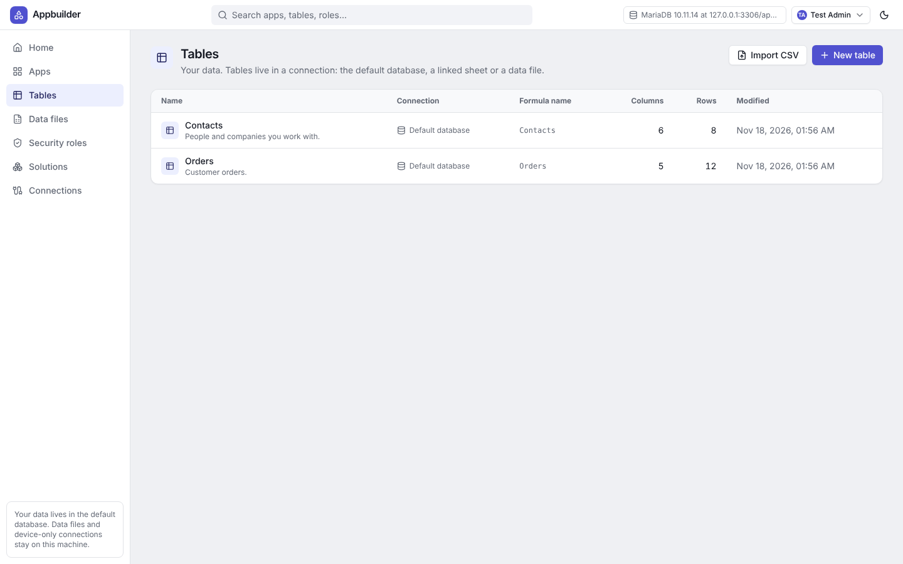
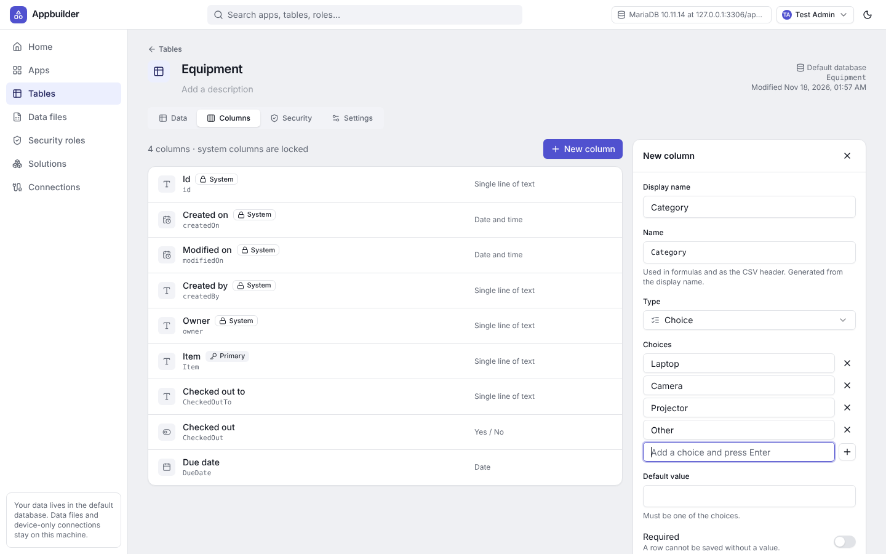
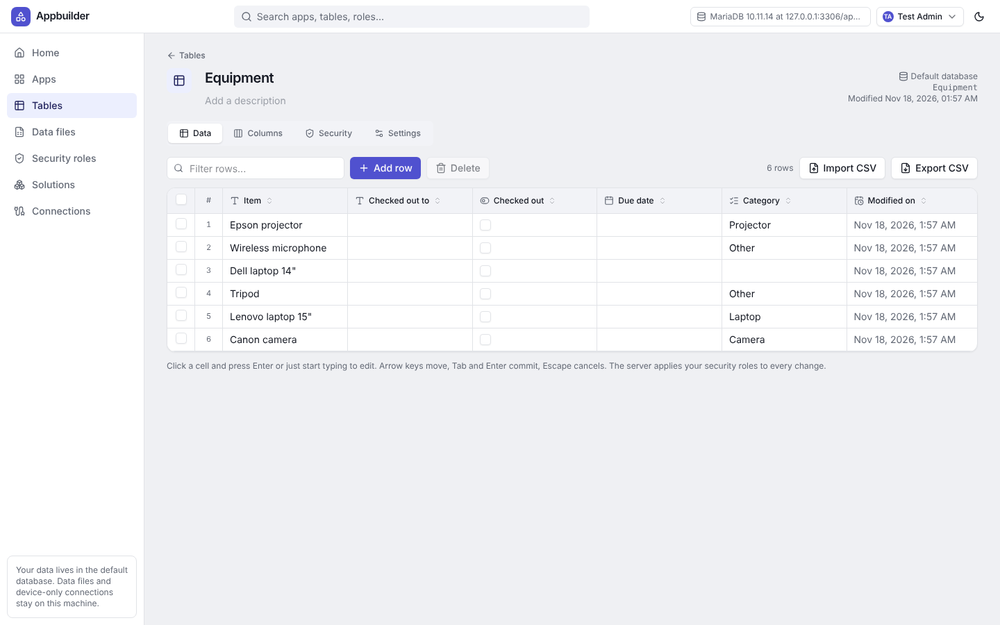
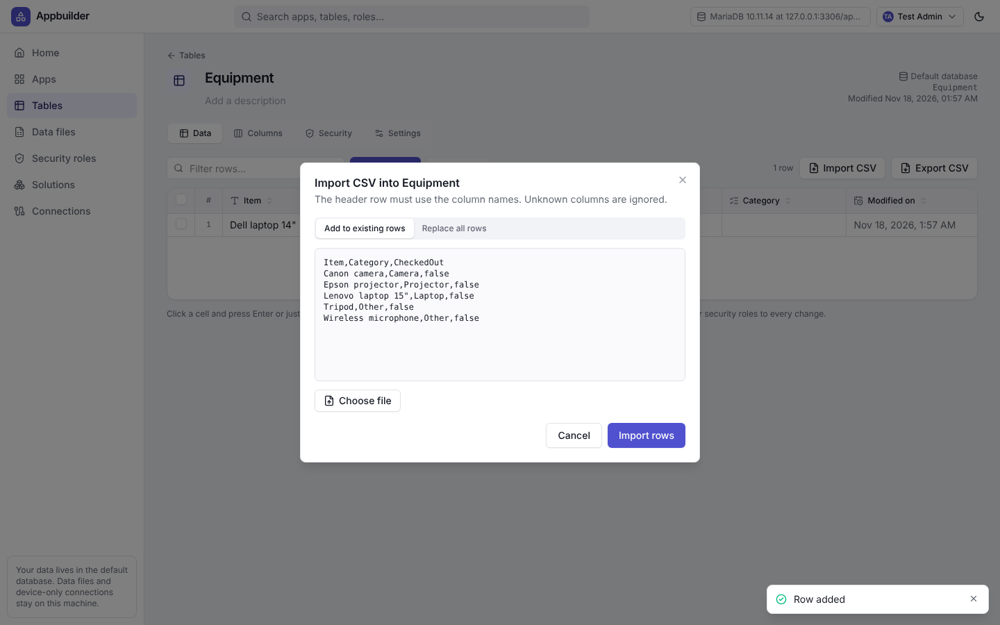
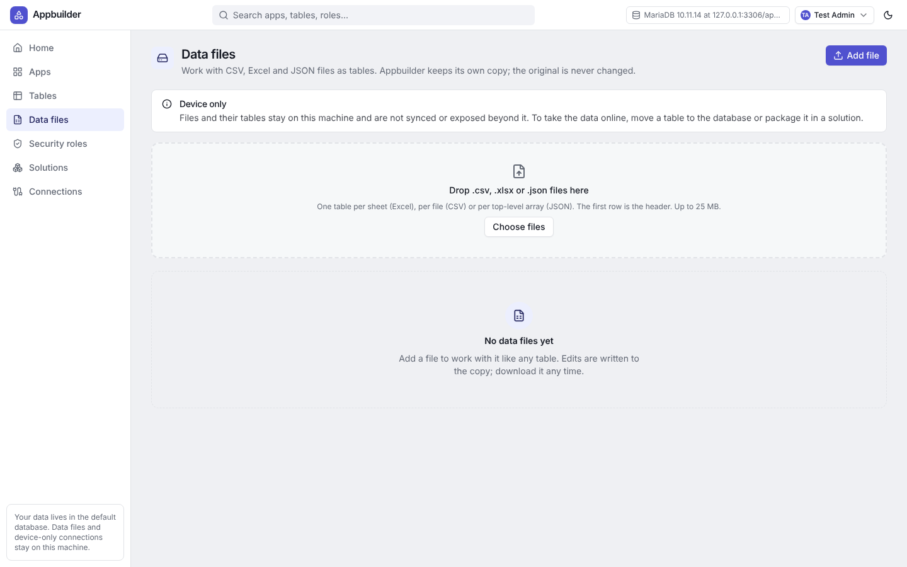

# Data

Apps read and write **tables**. You manage them under **Tables** (Maker role).

## Create a table

Choose **New table**, name it, add columns, and pick where to **Store in** (a connection; the default MySQL database is normal). The table designer has four tabs: **Data**, **Columns**, **Security** and **Settings** (primary column and delete table).

## Column types

Single line of text, Multiple lines of text, Email, URL, Phone, Whole number, Decimal number, Currency, Yes/No, Date, Date and time, Choice (a fixed list of options), Lookup (a link to another table), Image, File attachment, and Autonumber (with an optional prefix).

The formula name comes from the display name: "Checked out to" becomes `CheckedOutTo`. Every table also has system columns: id, createdOn, modifiedOn, createdBy and owner. They are locked.

Image and File columns accept uploads up to 25 MB by default; you can restrict accepted types and allow multiple files.

## Edit rows in the data grid

The grid has filter, **Add row**, **Delete**, **Import CSV** and **Export CSV**. Keyboard: arrows and Tab move, Enter or F2 edits, Delete clears, Space toggles Yes/No.

**Import CSV** can append or replace. The header row must use column names (for example `CheckedOut`), not display names (`Checked out`). Unknown columns are ignored. Row order after import is not guaranteed.

If your role cannot create rows, Add row and Import CSV are disabled.

## Data files

On **Data files** you can add .csv, .xlsx or .json files (up to 25 MB). Appbuilder copies the file into its workspace; your original is never changed. Each file, sheet or array becomes a table. You can Replace (it warns if the data was edited since import), Download, or Remove (optionally dropping the tables). **Move to database** copies a table's rows to the default MySQL connection under the same table name.

Data files and their tables stay on the machine running Appbuilder.

When you edit a sheet of an Excel file in Appbuilder, the stored copy is written back with values only: formulas in the edited sheets become their last calculated values, and date number formats may be reset. Macro-enabled workbooks are rejected.

## Connections

Administrators create connections: **MySQL / MariaDB** (host, port, database, user, password, SSL) and **Google Sheets** (spreadsheet URL or id plus a service-account key; share the sheet with the service account email as Editor). On a connection use **Test**, **Browse tables** (link existing MySQL tables or Sheets tabs), **Set as default** (MySQL), **Edit** and **Delete** (the default cannot be deleted). Linking a source that has no `id` column asks permission to add one.

## The 5,000-row limit

Apps load at most the first 5,000 rows of a table. A banner says "Only the first 5,000 rows are loaded", and the Studio shows "Data truncated at N rows". Formulas such as CountRows or Filter only see those rows. Split large data across tables or archive old rows. There is no server-side filtering yet, despite what the banner suggests.
