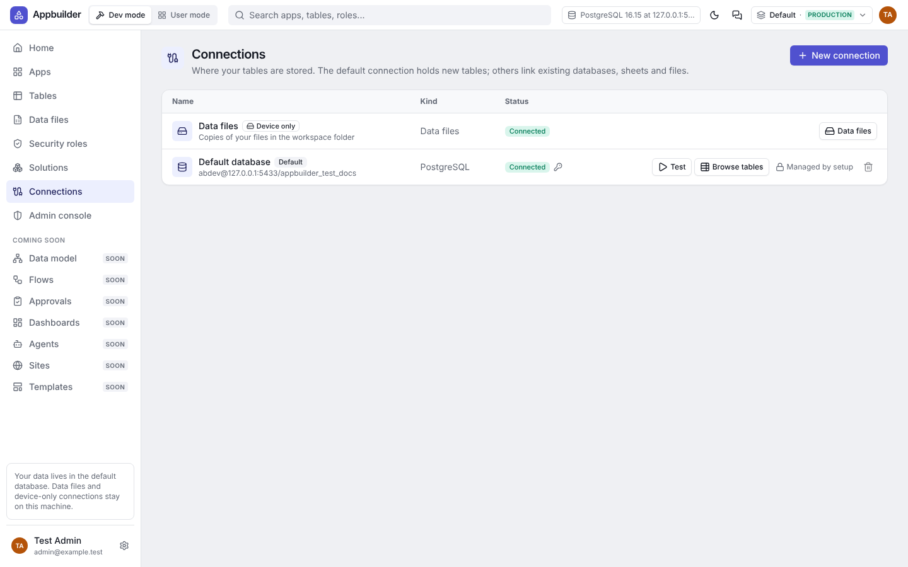

# Data

Apps read and write **tables**. You manage them under **Tables** (Maker role).

## Create a table

Choose **New table**, name it, add columns, and pick where to **Store in** (a connection; the default database is normal). The table designer has four tabs: **Data**, **Columns**, **Security** and **Settings** (primary column and delete table).

## Column types

Single line of text, Multiple lines of text, Email, URL, Phone, Whole number, Decimal number, Currency, Yes/No, Date, Date and time, Choice (a fixed list of options), Lookup (a link to another table), Image, File attachment, and Autonumber (with an optional prefix).

The formula name comes from the display name: "Checked out to" becomes `CheckedOutTo`. Every table also has system columns: id, createdOn, modifiedOn, createdBy and owner. They are locked.

Image and File columns accept uploads up to 25 MB by default; you can restrict accepted types and allow multiple files.

## Edit rows in the data grid

The grid has filter, **Add row**, **Delete**, **Import CSV** and **Export CSV**. Keyboard: arrows and Tab move, Enter or F2 edits, Delete clears, Space toggles Yes/No.

**Import CSV** can append or replace. The header row must use column names (for example `CheckedOut`), not display names (`Checked out`). Unknown columns are ignored. Row order after import is not guaranteed.

If your role cannot create rows, Add row and Import CSV are disabled.

## Data files

On **Data files** you can add .csv, .xlsx or .json files (up to 25 MB). Appbuilder copies the file into its workspace; your original is never changed. Each file, sheet or array becomes a table. You can Replace (it warns if the data was edited since import), Download, or Remove (optionally dropping the tables). **Move to database** copies a table's rows to the default database under the same table name.

Data files and their tables stay on the machine running Appbuilder.

When you edit a sheet of an Excel file in Appbuilder, the stored copy is written back with values only: formulas in the edited sheets become their last calculated values, and date number formats may be reset. Macro-enabled workbooks are rejected.

## Connections

Administrators create connections: **PostgreSQL** (host, port, database, user, password, schema, SSL), **MySQL / MariaDB** (host, port, database, user, password, SSL) and **Google Sheets** (spreadsheet URL or id plus a service-account key; share the sheet with the service account email as Editor). On a connection use **Test**, **Browse tables** (link existing MySQL tables or Sheets tabs), **Set as default** (MySQL), **Edit** and **Delete** (the default cannot be deleted). Linking a source that has no `id` column asks permission to add one.

## Large tables: what runs on the server

With the local server, formulas over tables run **in the database**: Appbuilder translates `Filter`, `Search`, `Sort`,
`SortByColumns`, `LookUp`, `First`/`Last`, `FirstN`/`LastN`, `CountRows`, `CountIf`, `Sum`/`Average`/`Min`/`Max` (also over
calculations such as `Qty * Price`), `Distinct`, `GroupBy` with totals, `ShowColumns`/`DropColumns` and `IsEmpty` into one query
and only the answer travels to the browser. A table of a million rows works: a gallery or data table shows the first rows at once and
loads more as you scroll, the row count is exact, sorting a data table by a header and its search box run on the server, a dropdown
over a large table searches as you type, and charts get their totals from the server. Your security roles are applied in that same
query, so counts and totals only include rows you may see.

Some formulas can't be translated, for example `Len(Title) > 3`, `Month(DueDate) = 3`, a division by a column, `Concat(Filter(...), ...)`
over a whole table, or a `LookUp` of another table inside a `Filter`. Then:

- **Small tables (up to 2,000 rows you can see)** are loaded into the browser whole and the formula runs there as before. The Studio
  shows a yellow **Runs in browser** label and a data warning, because it will stop working once the table grows.
- **Larger tables**: the formula is an **error**, never an answer computed from part of the rows. The formula bar underlines the part
  that can't run, says why ("Can't run on the server: ...") and suggests a rewrite; the error list shows it too.

Typical fixes: compare the column itself and move the calculation to the other side (`DueDate < DateAdd(Today(), -7, "Days")` rather
than `DateAdd(DueDate, 7, "Days") < Today()`), use `Year(DueDate) = 2026` (that one works), multiply instead of dividing by a column
(`Price > 2 * Cost`), read a value from another table into a variable first (`Set(minTier, LookUp(Tiers, ...).Min)` in OnVisible), add
a column that stores the computed value, or limit the rows with `FirstN(..., 500)` before working through them.

The formula bar says where a table formula runs: **Runs on server**, **Runs in browser** or **Can't run**. Hover the label for the
steps.

**Make big tables fast.** Filters, sorting and paging by a column are fast when the column is indexed. Lookup and unique columns always
are. For other columns you filter, sort or search by, open the column in the table designer and turn on **Indexed** (server mode). An
index costs a little time on every save, so mark only the columns you use.

**Tables on other connections.** Tables in a PostgreSQL connection run their formulas in that database too. Tables on a MySQL/MariaDB
connection, data files and Google Sheets can't run queries themselves: Appbuilder works on their first 5,000 rows and warns ("only
the first 5,000 rows are searched, sorted and counted"). Copy such a table into the default database to use every row (for a data
file: **Data files > Move to database**).

**Demo mode** (the browser-only page) keeps every row in the browser and runs every formula there, as before.
