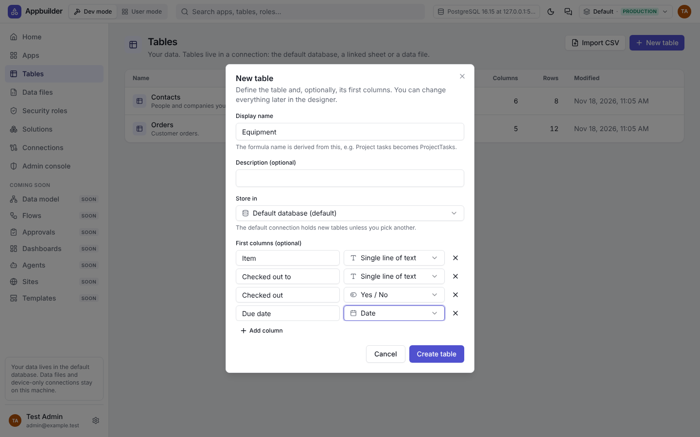
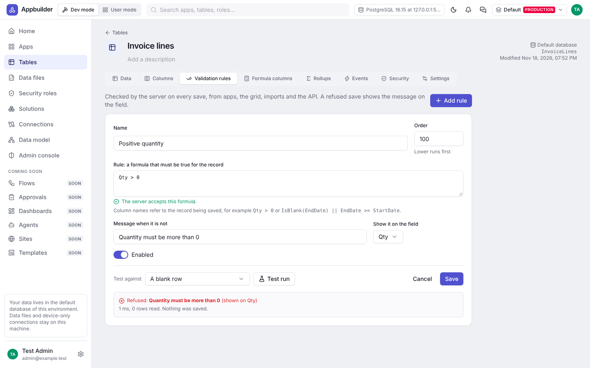
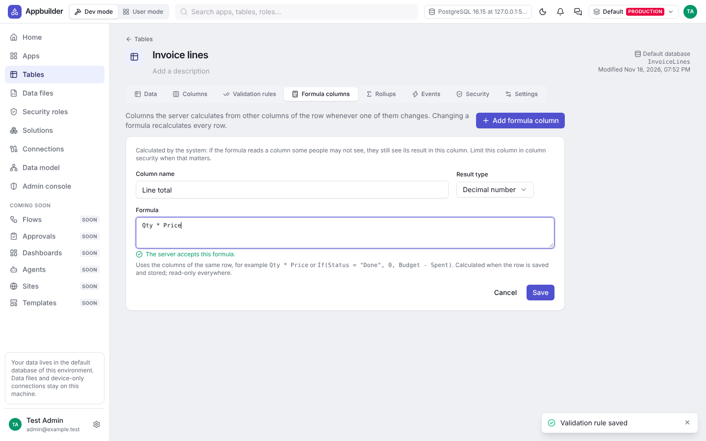
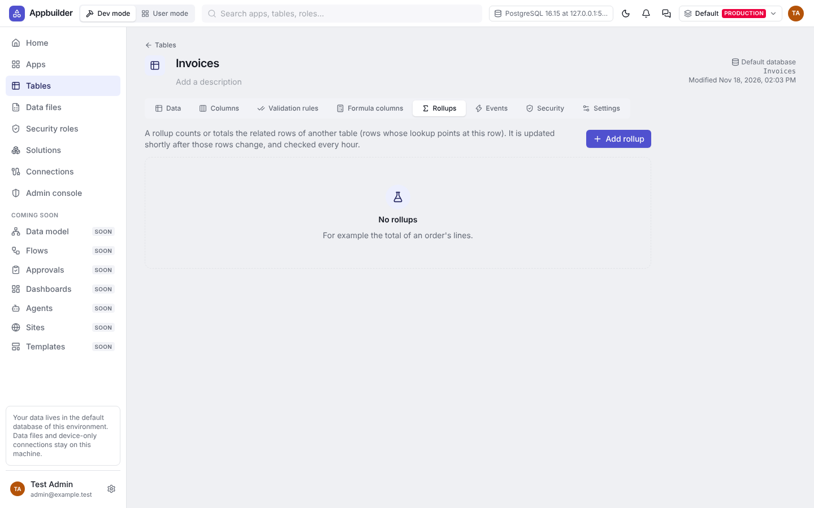
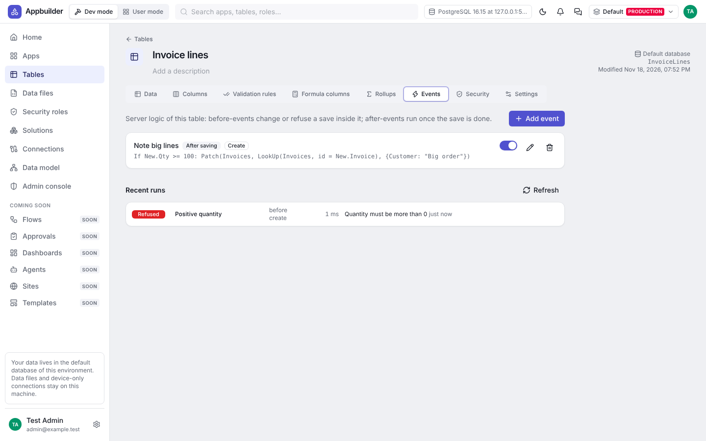
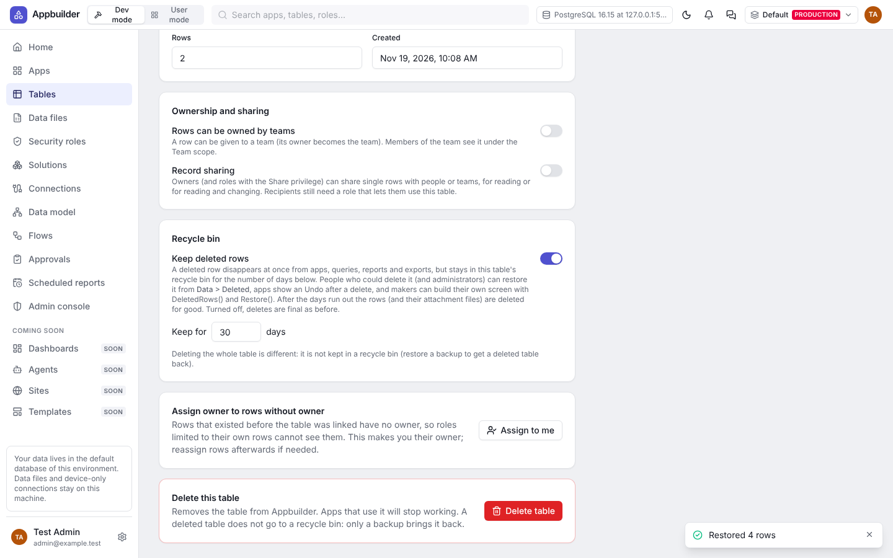
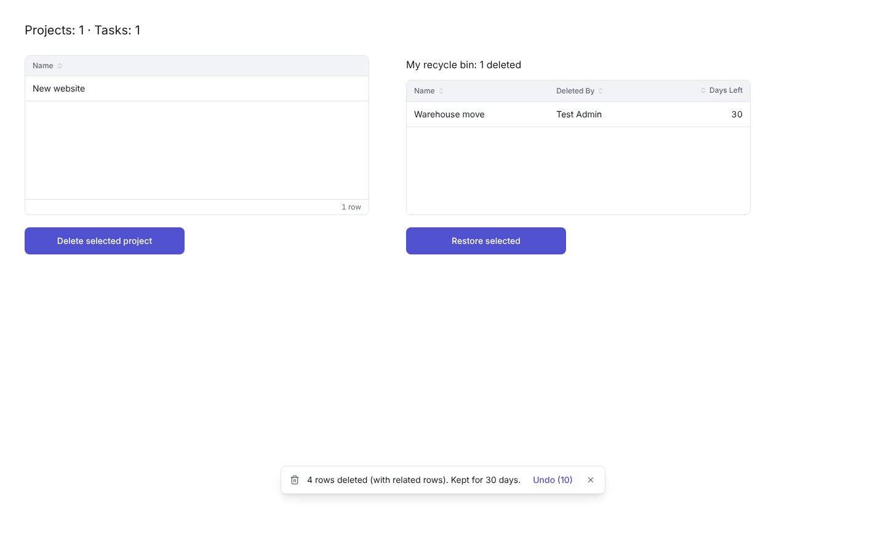
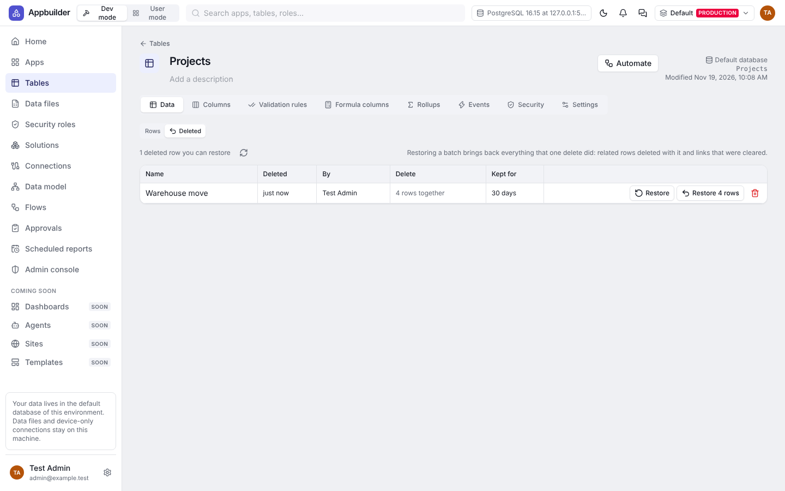

# Data

Apps read and write **tables**. You manage them under **Tables** (Maker role). To see all tables and their
relationships on one diagram, change several of them in one reviewed step, set what happens to related rows when a row is
deleted, or start from a pattern (master-detail, hierarchy, star schema, ...), use the
[data model designer](data-model.md) (Dev mode > Data model).

## Create a table

Choose **New table**, name it, add columns, and pick where to **Store in** (a connection; the default database is normal). The table designer has these tabs: **Data**, **Columns**, **Validation rules**, **Formula columns**, **Rollups**, **Events**, **Security** and **Settings** (primary column and delete table).

## Column types

Single line of text, Multiple lines of text, Email, URL, Phone, Whole number, Decimal number, Currency, Yes/No, Date, Date and time, Choice (a fixed list of options), Lookup (a link to another table), Image, File attachment, and Autonumber (with an optional prefix).

The formula name comes from the display name: "Checked out to" becomes `CheckedOutTo`. Every table also has system columns: id, createdOn, modifiedOn, createdBy and owner. They are locked.

Image and File columns accept uploads up to 25 MB by default; you can restrict accepted types and allow multiple files.

## Rules and calculations that the server keeps

Four tabs of the table designer hold logic that belongs to the **table**, not to one app: it applies to every save, from
every app, the data grid, CSV imports and the API. You write it in the same formula language as apps. In these formulas,
column names (for example `Qty`) and `New.Qty` mean the record being saved, `Old.Qty` the value before the change (blank for
a new record), and `User()` the person saving. Inside `Filter` and `LookUp`, plain names are the columns of the table being
searched, so write `New.Customer` there.

Validation rules, rollups and events need the server; formula columns also work in the browser-only demo.

### Validation rules

A rule is a formula that must be true for the record, a message, and the field to show it on.

| Rule | Message | Field |
| --- | --- | --- |
| `Qty > 0` | Quantity must be more than 0 | Qty |
| `IsBlank(EndDate) \|\| EndDate >= StartDate` | The end date cannot be before the start | EndDate |
| `Status <> "Closed" \|\| !IsBlank(ClosedOn)` | Fill in the closing date | ClosedOn |
| `CountRows(Filter(Bookings, Room = New.Room, Day = New.Day)) = 0` | This room is already booked that day | Day |

**Test run** checks the rule against a row you pick (or a blank one) and shows whether it passes, without saving anything.
When someone saves a record that breaks a rule, nothing is saved: a form in an app shows the message under the field, and
a message pops up.

### Formula columns

A formula column is calculated from other columns of the same row whenever one of them changes, and stored, so it can be
filtered, sorted and totalled like any column. Examples: `Qty * Price`, `If(Status = "Done", 0, Budget - Spent)`,
`Text(DueDate, "yyyy-mm")`, `LineTotal * 1.18` (a formula column may use another one). Choose the result type (number,
currency, text, yes/no, date). Formula columns are read-only in forms and the grid. When you change a formula, every
existing row is recalculated in the background. A formula that cannot be calculated for a row (for example a division by
zero) stores a blank and the problem appears in the run log.

### Rollups

A rollup counts or totals the related rows of another table: the rows whose **lookup** points at this row. For example on
**Invoices**: *Sum of LineTotal in Invoice lines (through Invoice)*, or *Count of rows*. Choose count, sum, smallest or largest.
The value is updated a moment after a related row is added, changed, moved to another invoice or deleted (apps refresh it
shortly after a save), and every hour a check repairs anything that went wrong. Both tables must be in the default database.

**Who sees the total.** A rollup (and a formula column) is calculated by the system over **all** related rows, also rows
and columns some people may not open, and everyone who can see the column sees the result. If the related rows are
private (people see only their own lines, a row rule, a hidden column), limit the rollup column in the table's column
security. The rollup editor reminds you.

### Events

An event is server logic with an optional **condition** (it runs only when the condition is true) and **actions**.

- **Before saving**: runs inside the save and can change the record or refuse it. Example: keep codes upper case and refuse
  blocked orders:
  `SetField({Code: Upper(New.Code)}); If(New.Status = "Blocked", Reject("Blocked orders cannot be saved", Status))`.
  It can read other tables: `If(New.Qty > LookUp(Stock, Item = New.Item).OnHand, Reject("Not enough stock", Qty))`.
- **After saving**: runs in the background once the save is done (if it fails it is retried, and the save stays). It can
  change rows of any table, notify someone or start a job. Example: when an order is approved, add a delivery and tell the
  store: `Collect(Deliveries, {Order: New.id, Status: "Planned"}); NotifyUser("store@example.test", "Order " & New.Ref & " approved")`
  with the condition `New.Status = "Approved" && Old.Status <> "Approved"`.

Events run with the permissions of the person who saved (they cannot see or change more than that person). An administrator
can make an event run **as the system** (all rows); this is recorded in the audit log. Functions that only make sense in an
app (`Navigate`, `Notify`, `SubmitForm` ...) are refused when you save the event, with an explanation. **Test run** shows what an
event would change, write or refuse for a sample row. **Recent runs** lists what events did, what they refused and what failed.

## Edit rows in the data grid

The grid has filter, **Add row**, **Delete**, **Import CSV** and **Export CSV**. Keyboard: arrows and Tab move, Enter or F2 edits, Delete clears, Space toggles Yes/No.

**Import CSV** can append or replace. The header row must use column names (for example `CheckedOut`), not display names (`Checked out`). Unknown columns are ignored. Row order after import is not guaranteed.

If your role cannot create rows, Add row and Import CSV are disabled.

## Deleted rows: the recycle bin

A table in the default database can **keep deleted rows** for a number of days. New tables start with **30 days**; tables
you made before this version keep deleting for good until you turn it on. Set it in the table designer, **Settings >
Recycle bin**: switch **Keep deleted rows** on and type the number of days (1 to 3,650).

What happens when a row is deleted from a table that keeps deleted rows:

- it disappears **at once** everywhere: apps, galleries, counts, sums, searches, lookups, reports, rollups, exports,
  scheduled reports, flows and the timeline treat it as gone;
- what the delete did is remembered as one **batch**: rows deleted with it by a cascade, links that were cleared in other
  tables (set blank), its comments, tasks, follows, tags and file links, and its shares. Its attachment files stay;
- a unique value it had (an order number, a code) is free at once: a new row may use it;
- after the days run out the rows and their attachment files are deleted for good (an hourly job).

**Getting rows back**

- In a running app, a delete shows **"N rows deleted. Kept for N days. Undo"** for ten seconds. **Undo** brings back
  everything that delete did.

  

- In the portal, open the table's **Data** tab and switch to **Deleted**: who deleted each row, when, with which other
  rows, and how many days are left. **Restore** brings back the row and the rows its delete took along (the order with its
  lines); **Restore N rows** brings back the whole delete. Administrators can **delete for good** (the bin icon).

  

- In your own screens: `DeletedRows(Orders)` is the table of deleted rows the signed-in person could delete and can see
  (administrators: all), newest first, at most 500, with the table's columns plus `DeletedOn`, `DeletedBy`, `DeleteBatch`,
  `DaysLeft`, `DeletedTable` and `CascadedFrom`. `Restore(Gallery1.Selected)` brings back a row of it;
  `Restore(ThisItem.DeleteBatch)` the whole delete. For example a gallery with `Items: DeletedRows(Orders)` and a button
  with `OnSelect: Restore(ThisItem)` is a recycle bin screen. No extra UI component is needed.

**Who may restore**: people who could delete the row and can see it (their roles, row rules and shares as they are now),
and administrators. Someone else's deleted rows are not listed for a person whose role covers only their own rows.

**When a restore is refused** (nothing changes, the message says why):

- a unique value of the row is used by another row now: change or delete that row first (the message names it);
- the row points at a parent that is in the recycle bin too: restore that first; or at a parent deleted for good;
- one row alone whose parent was deleted together with it: restore the whole delete;
- the delete also removed rows of a table that keeps no deleted rows (those are gone for good): only an administrator
  can restore the rest.

A restore does not run your validation rules or before-events again (the rows come back as they were). After-events and
flows can react to it: tick **Restore** under **On** (events running after saving) or **Restored** in a flow's table
trigger. Existing events and flows do not fire on restores. Rollups count the rows again.

**Turning it off** makes future deletes final; rows already in the bin stay until their days run out. The setting
travels in solutions. Deleting a whole **table** is different: it does not go to a recycle bin (a backup brings it back).
Tables in other connections (MySQL, your own PostgreSQL databases, data files, Google Sheets) always delete for good; the
setting says so for them. Of the system tables, Activities (tasks), Comments and Documents can keep deleted rows too (off
by default): User mode's Tasks and Comments then work the same way.

In demo mode (no server) the recycle bin works in the browser for the session: reloading the page empties it.

## Data files

On **Data files** you can add .csv, .xlsx or .json files (up to 25 MB). Appbuilder copies the file into its workspace; your original is never changed. Each file, sheet or array becomes a table. You can Replace (it warns if the data was edited since import), Download, or Remove (optionally dropping the tables). **Move to database** copies a table's rows to the default database under the same table name.

Data files and their tables stay on the machine running Appbuilder.

When you edit a sheet of an Excel file in Appbuilder, the stored copy is written back with values only: formulas in the edited sheets become their last calculated values, and date number formats may be reset. Macro-enabled workbooks are rejected.

## Connections

Administrators create connections: **PostgreSQL** (host, port, database, user, password, schema, SSL), **MySQL / MariaDB** (host, port, database, user, password, SSL) and **Google Sheets** (spreadsheet URL or id plus a service-account key; share the sheet with the service account email as Editor). On a connection use **Test**, **Browse tables** (link existing MySQL tables or Sheets tabs), **Set as default** (MySQL), **Edit** and **Delete** (the default cannot be deleted). Linking a source that has no `id` column asks permission to add one.

## Live updates: several people on the same data

With the local server, every app shows other people's changes **as they happen**: when someone adds, changes or deletes a row,
every open data table, gallery, chart and label that shows that table refreshes within a moment, without reloading the page.
The rows you are looking at stay where they are while the new ones load, and your scroll position is kept.

**Forms do not overwrite what you are typing.** If someone else saves the record you are editing in a form:

- without unsaved changes, the form simply shows their new values;
- with unsaved changes, the form keeps your typing and shows **This record was changed by <name>** with two choices:
  **Reload** (show their version; your edits are dropped) and **Keep mine** (your next Save replaces their version).

The same panel appears when you press Save on a record someone else saved in the meantime: the server refuses to overwrite
their newer version without asking (the form sends the version it started from).

Running apps also show the avatars of the other people who have the same app open, and an **Update available** button when a
maker saves a newer version of the app (it loads the new version and keeps what you entered).

If the live connection is not available (for example a proxy in between does not pass it), the top bar shows **Live updates
paused** and data refreshes every 30 seconds instead. In demo mode (no server) the tabs of one browser keep each other up to date.

What other people see is security-checked: someone who may not see a column never learns its name or values, and someone who
sees only some rows only learns "the table changed" and gets the rows they may see.

## Large tables: what runs on the server

With the local server, formulas over tables run **in the database**: Appbuilder translates `Filter`, `Search`, `Sort`,
`SortByColumns`, `LookUp`, `First`/`Last`, `FirstN`/`LastN`, `CountRows`, `CountIf`, `Sum`/`Average`/`Min`/`Max` (also over
calculations such as `Qty * Price`), `Distinct`, `GroupBy` with totals, `ShowColumns`/`DropColumns` and `IsEmpty` into one query
and only the answer travels to the browser. A table of a million rows works: a gallery or data table shows the first rows at once and
loads more as you scroll, the row count is exact, sorting a data table by a header and its search box run on the server, a dropdown
over a large table searches as you type, and charts get their totals from the server. Your security roles are applied in that same
query, so counts and totals only include rows you may see.

Some formulas can't be translated, for example `Len(Title) > 3`, `Month(DueDate) = 3`, a division by a column, `Concat(Filter(...), ...)`
over a whole table, or a `LookUp` of another table inside a `Filter`. Then:

- **Small tables (up to 2,000 rows you can see)** are loaded into the browser whole and the formula runs there as before. The Studio
  shows a yellow **Runs in browser** label and a data warning, because it will stop working once the table grows.
- **Larger tables**: the formula is an **error**, never an answer computed from part of the rows. The formula bar underlines the part
  that can't run, says why ("Can't run on the server: ...") and suggests a rewrite; the error list shows it too.

Typical fixes: compare the column itself and move the calculation to the other side (`DueDate < DateAdd(Today(), -7, "Days")` rather
than `DateAdd(DueDate, 7, "Days") < Today()`), use `Year(DueDate) = 2026` (that one works), multiply instead of dividing by a column
(`Price > 2 * Cost`), read a value from another table into a variable first (`Set(minTier, LookUp(Tiers, ...).Min)` in OnVisible), add
a column that stores the computed value, or limit the rows with `FirstN(..., 500)` before working through them.

The formula bar says where a table formula runs: **Runs on server**, **Runs in browser** or **Can't run**. Hover the label for the
steps.

**Make big tables fast.** Filters, sorting and paging by a column are fast when the column is indexed. Lookup and unique columns always
are. For other columns you filter, sort or search by, open the column in the table designer and turn on **Indexed** (server mode). An
index costs a little time on every save, so mark only the columns you use.

**Tables on other connections.** Tables in a PostgreSQL connection run their formulas in that database too. Tables on a MySQL/MariaDB
connection, data files and Google Sheets can't run queries themselves: Appbuilder works on their first 5,000 rows and warns ("only
the first 5,000 rows are searched, sorted and counted"). Copy such a table into the default database to use every row (for a data
file: **Data files > Move to database**).

**Demo mode** (the browser-only page) keeps every row in the browser and runs every formula there, as before.
