# Flows

A **flow** does work for you when something happens: a row is added or changed, a time comes round, someone presses a
button in an app, or another system sends a web request. It runs **steps**: check a condition, change data, ask someone to
approve, wait, send a message, call another system, run another flow. Flows run on the server, so they keep going when
nobody has an app open, and every run is recorded with what each step got and gave back.

Flows need the Appbuilder server; demo mode (everything in your browser) has none. Open them in **Dev mode > Flows**.
You build a flow on a canvas by clicking: no code and no JSON. Every trigger and step kind with its fields:
[reference/flows.md](../../reference/flows.md).

## Start a flow

**New flow** opens a gallery: a blank flow by its trigger, or a template that already works. Pick a template, choose the
tables and columns it should use (it suggests ones that fit), and it is created, turned off, ready to change.

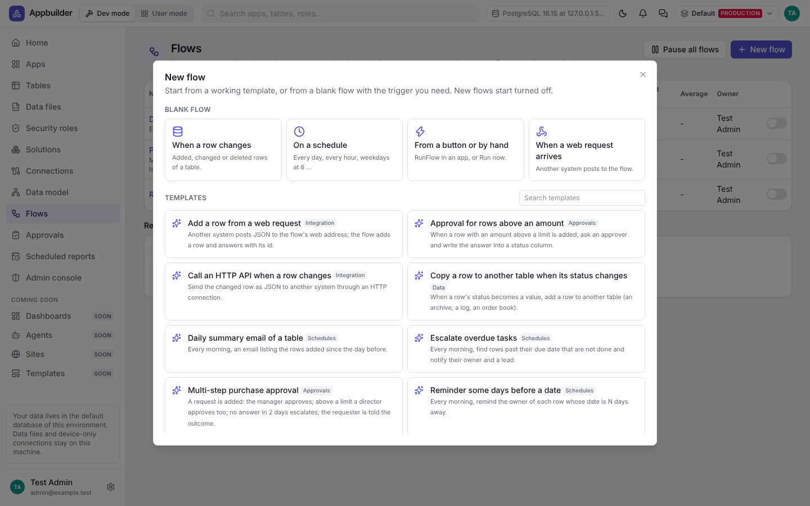

| Template | What it does |
| --- | --- |
| Tell the owner when a row is added | A notification to the row's owner |
| Daily summary email of a table | Every morning, an email listing yesterday's new rows |
| Approval for rows above an amount | Ask an approver when the amount is above a limit; write the answer into a status column |
| Escalate overdue tasks | Every weekday, notify the owners of rows past their due date, and a lead |
| Copy a row to another table when its status changes | Add a row to another table when the status becomes a value |
| Call an HTTP API when a row changes | Post the changed row to another system |
| Add a row from a web request | Another system posts JSON; the flow adds a row and answers with its id |
| Scheduled data clean-up | Every Sunday night, delete rows older than N days |
| Reminder some days before a date | Every morning, remind owners N days before a date |
| Multi-step purchase approval | Manager approval, a second approval above a limit, escalation after 2 days, the requester is told |

Templates marked **needs approvals** use the approval step; on a server without the approvals module, runs stop at that
step until it is there.

From elsewhere: **Automate** in a table's designer opens the gallery for that table; in the Studio, a behaviour property
such as OnSelect has **Run a flow** (below).

## The canvas

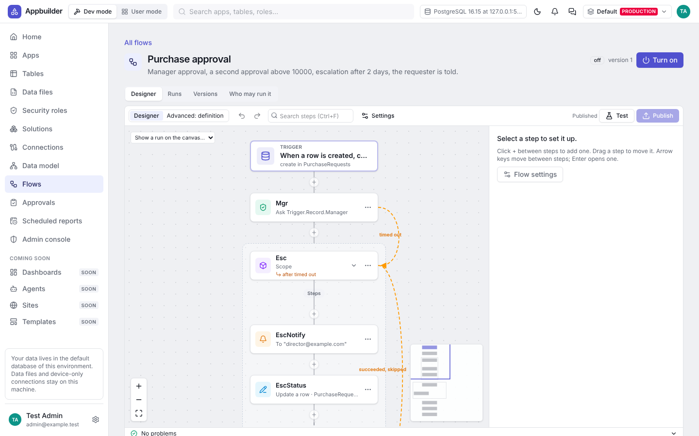

* The **trigger** is the card on top; the steps follow, top to bottom.
* Click **+** between two steps (or **Add a step** in an empty branch) to add one. The step picker groups steps
  (Control, Data, Approvals, Notifications, Connectors, Advanced), searches them, and lists the ones you used last.
* **Containers** hold steps of their own and are drawn as regions: a **Condition** has its *If yes* and *If no* branches
  side by side, a **Switch** one lane per case, **For each**, **Do until** and **Scope** a body. Collapse a container with
  its arrow (or double-click it) to keep a long flow readable.
* **Drag** a step onto any **+** to move it, also into or out of containers. Ctrl or Shift + click selects several steps;
  they move, copy and delete together.
* Each step's menu (**...**): rename, run after, a note, duplicate, copy, paste, delete.
* Zoom with Ctrl + mouse wheel or the buttons; drag the background to move around; the minimap shows where you are; the
  search box (Ctrl+F) highlights matching steps.

**Keyboard**: the arrow keys move between steps (left: to the container, right: into it), Enter opens a step, Delete
removes it, Ctrl+Z / Ctrl+Y undo and redo, Ctrl+C / Ctrl+V copy and paste (also into another flow), Ctrl+D duplicates,
Insert adds a step after the one in focus.

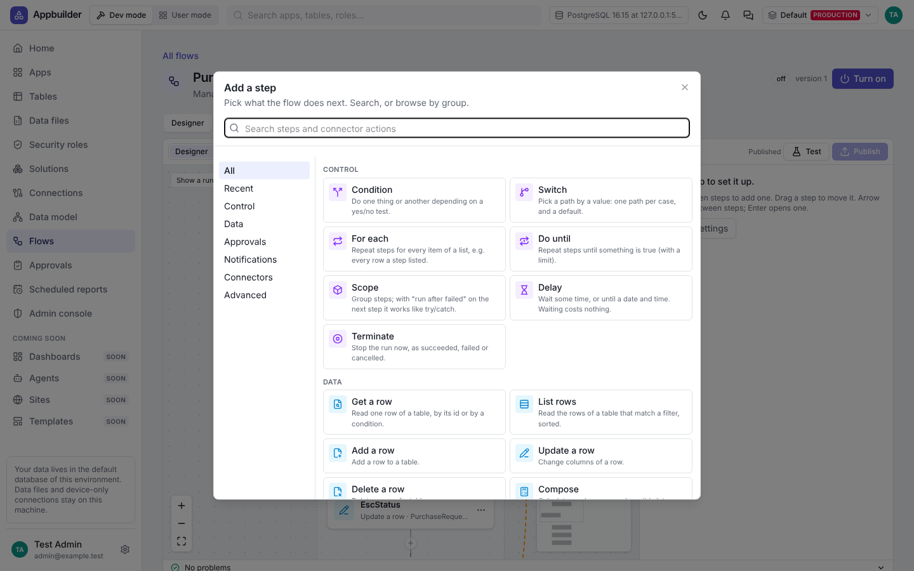

**Names.** A step's name is how later steps read it: `Steps.Approve.Output.Outcome`. Rename a step in its panel or menu and
every formula that uses it follows. Names use letters, digits and `_`.

## Setting up a step

Click a step to open its panel. The fields depend on the step kind:

* **Data steps**: pick the table; **Add a row** starts with the required columns and **Add a field** adds more; each
  column takes a value of its type (a number, a date, a choice from its list, a row of a lookup found by search) or a
  formula. **Update a row** and **Delete a row** need the row: `Trigger.Record` is the row that started the run.
* **List rows** has a **filter builder**: rules such as *Status is "Open"*, *Amount is more than 1000*, joined by all or
  any, with one level of groups. **Advanced** shows the filter as a formula. **Get a row** finds a row by its id or as the
  first row that matches rules.
* **Condition** and **Do until** have the same rules builder on any value (pick it from dynamic content).
* **For each**: pick the list (the rows a List rows step read) and name the current item.
* **Delay**: days, hours and minutes, or until a date and time.
* **Notify** and **Send an email**: pick people and teams (or a formula such as `Trigger.Record.Manager`); the email body
  is rich text.
* **HTTP request** and **connector actions**: pick a connection (you need "use" access to it, otherwise the picker says
  so); the action's inputs are a form made from its definition, nested records and lists included, or raw JSON. Paste a
  sample response of an HTTP call to get its fields as dynamic content.
* **Run a child flow**: pick a flow started by hand; its inputs are listed with their types.
* **Approval**: who approves, how they decide, the answers, the record it is about, the time limit (the approvals
  module's settings).

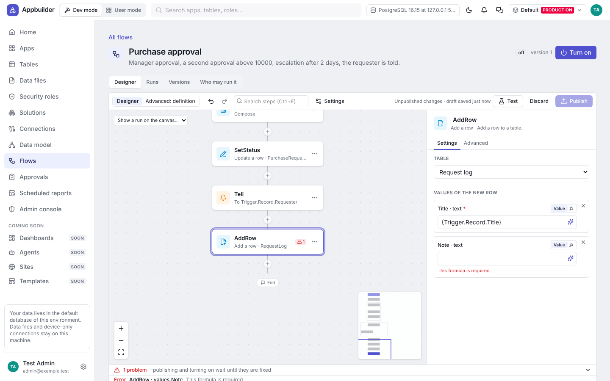

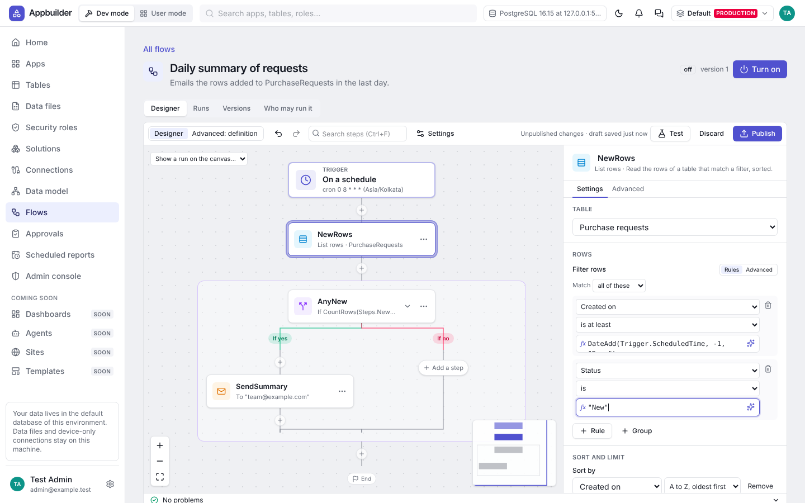

**Advanced** (in each step's panel): run after, the retry policy (how temporary failures are tried again), the time limit,
a note for the people who read the flow later.

### Values and formulas, dynamic content

Every field takes a plain **value** or a **formula** (switch with *Value* / *fx*). A value can hold **dynamic content**:
click the sparkle in a field to pick what the step can read, typed: the trigger's row and its lookups (one step away),
the row before the change, the manual inputs, the fields of a web request sample, the outputs of earlier steps (rows of
their table, approval outcomes, HTTP responses, action outputs), variables, the loop item, the run's id, who it runs as.
In a text it appears as `{Trigger.Record.Title}`.

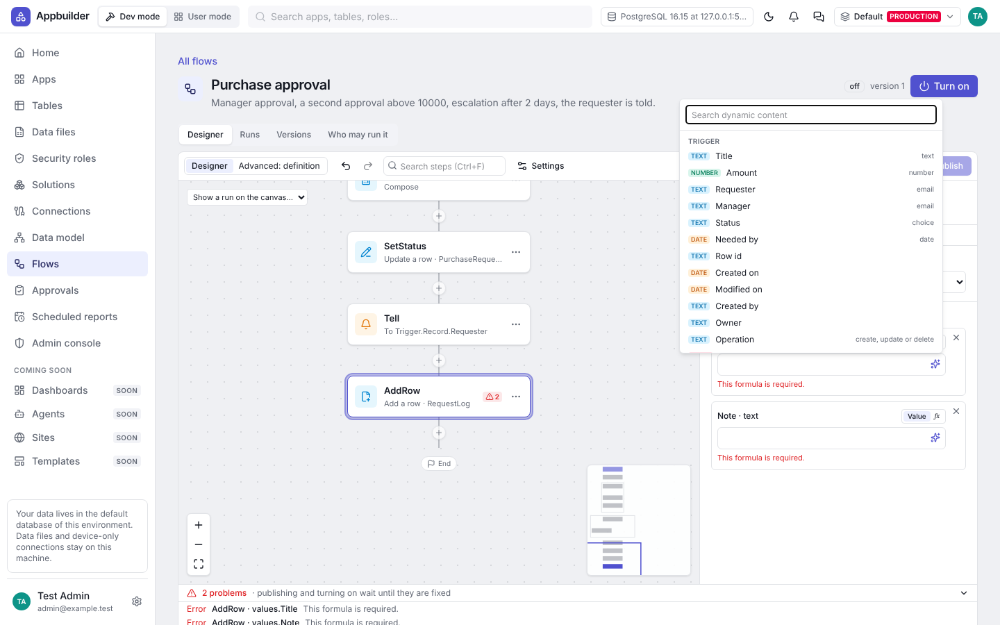

Formulas are the same language as in apps. The formula editor suggests functions and names as you type and shows the
signature of the function you are in. The server checks every field as you go, with the Studio's wording, under the
field; a formula that reads a table shows **Runs on server**, or **Can't run** with the reason (a flow reads tables on
the server and never a whole table at once).

```
"Order " & Trigger.Record.Ref & " needs approval"                      // Compose
Trigger.Record.Amount > 50000 && Steps.Manager.Output.Outcome = "Approve" // Condition
LookUp(Customers, id = Trigger.Record.Customer).Email                     // a lookup, one step away
DateAdd(Now(), 2, "Days")                                                 // Delay until
{Total: Variables.Total, Lines: CountRows(Steps.Lines.Output)}            // Respond
```

Formulas only calculate: to change data use a data step, to tell people a Notify step.

## The trigger

Click the trigger card.

* **When a row is created, changed or deleted**: the table and the operations; for changes, optionally the columns that
  matter; optionally a **condition** (rules or a formula, with `Trigger.Old` the row before). *Fold changes together*
  updates a run that is still waiting to start instead of adding one; *Run for changes this flow makes itself* is off by
  default so a flow that updates its own row does not loop.
* **On a schedule**: a preset (every hour, weekdays at 08:30 ...) or a cron expression, in a time zone; the next five runs
  are shown, computed by the server.
* **Run by a person or an app**: typed inputs (text, number, yes/no, date, choice, record, table) and where it may be
  started. Run it with **Run now** on the flow's page, or from an app (below).
* **When a web request arrives**: **Create the web address** shows the address and the signing secret **once**, with copy
  buttons; rotate either later, require signatures or not, turn the address off, or revoke it. The panel shows how to sign
  a request (HMAC-SHA256). Paste a sample body to get its fields as dynamic content. Details: [webhooks](webhooks.md).

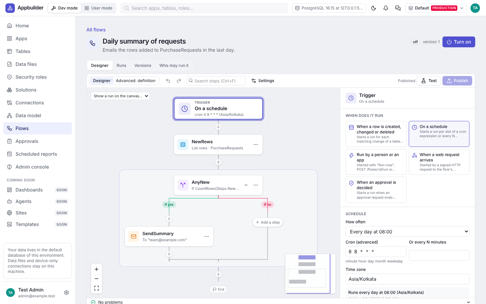

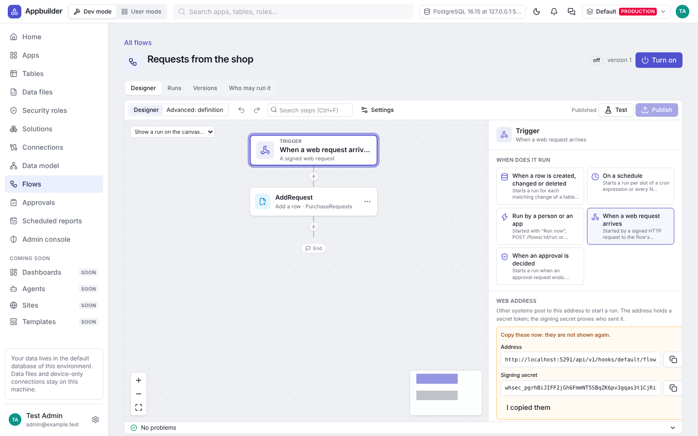

## Flow settings

**Settings** in the toolbar:

* **General**: name, description; **run as**: the owner (default: the owner's rights, also when others start it), the
  person who starts it, or a service account (administrators only); changing it asks you to confirm, and again when you
  publish. At the same time: any number of runs, one at a time, or one per record in the order of the changes; the time
  limit of a run; how long runs are kept; what a failure does; at most runs per minute.
* **Variables**: values the run keeps and changes with Set variable (`Variables.Total`).
* **Connections**: the connections the flow's steps use under a short name. Attaching one needs "use" access to it. In
  another environment the solution import asks which connection replaces each one ([solutions](solutions.md)).
* **Run permissions**: which roles may run it by hand, besides its owner and administrators.

## Run after, errors and retries

By default a step runs when the step before it succeeded. **Run after** (step menu, or the step's Advanced tab) changes
that: tick which earlier steps of the same list, and which outcomes (succeeded, failed, skipped, timed out). The canvas
draws these as dashed connectors with the outcomes. Put risky steps in a **Scope** named `Try` and add a step after it that
runs after `Try` failed or timed out: it runs only when something in `Try` went wrong, and the run then counts as
succeeded. An approval with a time limit and a step that runs after it timed out is an escalation.

Steps that call other systems try again on their own when the failure looks temporary: 4 attempts with growing waits;
data steps 3 attempts on temporary database errors. Change it in the step's retry policy. A failure that cannot get better
(no permission, a missing row, a bad formula) fails at once.

## Draft, publish, versions

Your changes are saved as the flow's **draft** while you work ("draft saved"); runs keep using the **published** version.
The problem list under the canvas lists what the server found, step and field; click a problem to go to the field.
**Publish** makes the draft the running version (a new version); it waits until there are no problems, and so does turning
a flow on. **Discard** goes back to the published version.

**Versions** lists every published version. Pick one to see what changed from the version before it, or since then:
added steps in green, removed in red, changed in amber (with the fields), moved in blue. **Restore** publishes an old
version as a new one.

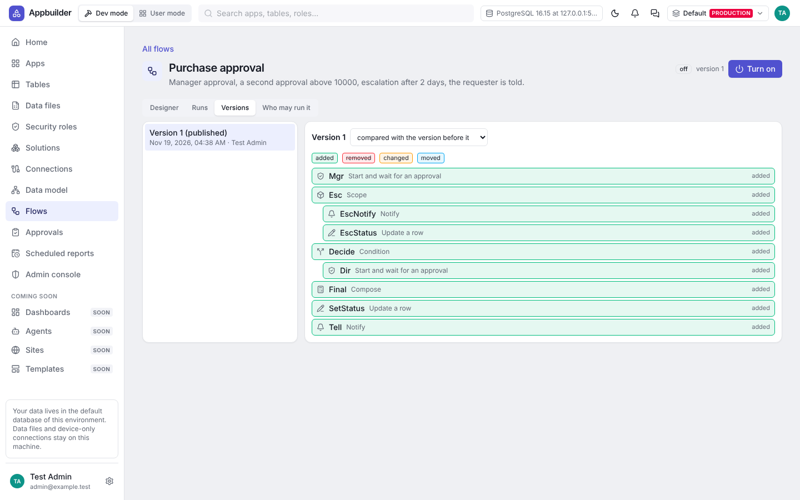

The first maker who opens a flow edits it; others see it read-only with **Take over editing**. In a locked production
environment flows are read-only (they change by deploying a solution).

**Advanced: definition** shows the flow as JSON; changes there show on the canvas and the other way round.

## Test and debug

**Test** runs what is on the canvas, unpublished changes included, with a sample trigger: an existing row of the trigger's
table, a recent real trigger from the run history, values you fill in (manual inputs, a web request body). By default data
changes, messages, web calls and approvals are **simulated** and marked as such (reads are real), and you choose what a
simulated approval answers. **Run for real** asks first.

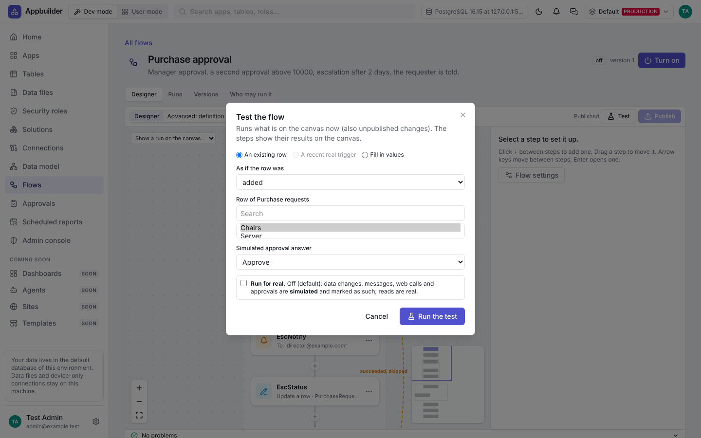

The run is shown **on the canvas**: each step's status, duration and attempts, live while it runs. Click a step for what it
got and gave back (**In this run**: inputs, output, error; passwords, tokens and Authorization headers are never shown).
Inside a loop, the arrows on the loop's card page through its iterations. **Show a run on the canvas** opens any earlier
run; the **Runs** tab lists them as a table (with **Show on the canvas**). A failed step's menu has **Run again from this
step**: a new run that keeps the steps that succeeded. Once a run has ended, a completed step **at the top level** of the
flow has **Run again from this step…** too: the steps before it are not repeated (their results are used as they were),
that step and every later one run again, emails and data changes included, so it asks first. A step inside a condition,
loop or scope says why not ("only top-level steps": a half-run container cannot be rebuilt safely); run again from the step
that holds it.

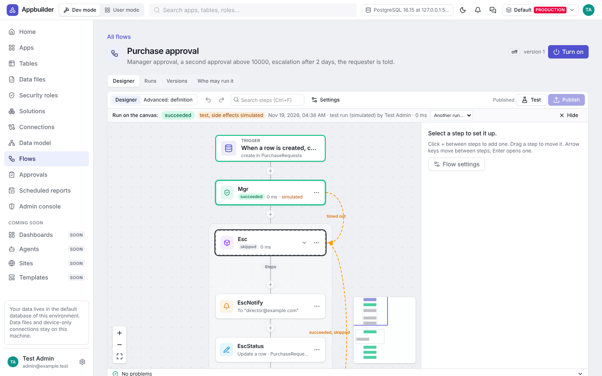

The flow list shows each flow's health over the last 7 days: success rate, last run, average duration. When a flow fails
you get a notification; further failures that day come as one summary the next morning. A failing flow is never switched
off on its own.

## Running a flow from an app

In the Studio, select a button, choose a behaviour property such as **OnSelect**, and click **Run a flow** next to the
formula bar: pick a flow started by hand, fill its inputs with formulas of the app (`TextInput1.Text`, `3`, `Today()`), and
optionally wait for its answer. The helper adds for example

```
RunFlow("Quote", {Qty: Slider1.Value}, {Wait: true, Result: "Answer"})
```

With `Wait`, the flow's **Respond** step puts its answer in the global variable `Answer` (at most 30 seconds).

## Good to know

* **Who the flow acts as.** A flow that runs as its owner uses the owner's rights, also when someone else starts it (only
  people whose role you allow under **Run permissions**). A flow that runs as the person who starts it can do only what
  that person could do by hand.
* **A flow does not trigger itself** unless its trigger says so (then at most 3 times per record).
* **Waiting costs nothing.** An approval can wait a week; the server can restart in between.
* **Solutions.** Add flows to a solution like apps and tables. In another environment they arrive turned off, and the import
  asks which connection there replaces each connection the flows use ([solutions](solutions.md)).
