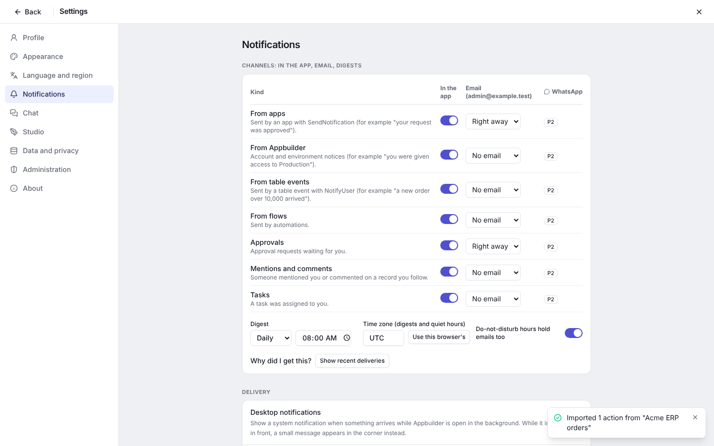

# Notifications: in the app and by email

Appbuilder notifies people under the bell (in the app) and, since P1, **by email**: right away or collected in a
**digest**. Everything that notifies goes through the same place, so the same choices apply to all of it: apps
(`SendNotification`), table events (`NotifyUser`), flows (the notify step), approvals, mentions and comments, tasks and
backups.

## Your choices (Settings > Notifications)

For each kind (from apps, from Appbuilder, from table events, from flows, approvals, mentions, tasks):

- **In the app**: on or off.
- **Email**: no email, **right away**, or **in a digest**. WhatsApp arrives in Phase 2.
- A lock means your administrator decided for everyone (for example "approvals always by email").

Below the table: the **digest** (hourly, or daily at a time), your **time zone** (for the digest and quiet hours) and
whether your **do-not-disturb hours** also hold emails (on by default: an email that arrives at night is sent when your
quiet hours end).

**Why did I get this?** shows recent deliveries with the reason for each ("You chose an email right away for From apps",
"Your administrator set Approvals to email right away for everyone", "More than 20 emails reached you within an hour, so
this one was collected").

## The email

It shows the notification's title and text, who sent it, and an **Open in Appbuilder** button that goes straight to the
record or page. At the bottom: why you got it, and a link that **stops emails of that kind without signing in** (mail
programs that support one-click unsubscribe show their own button too).

## For makers

- Give a notification a link (`#u-<app id>`, `#u-tasks` ...) so the email's button opens the right place.
- Keep titles short and meaningful on their own: they are the email subject.
- Administrators set the defaults and locks in Admin console > Email, and the public address used in links.
