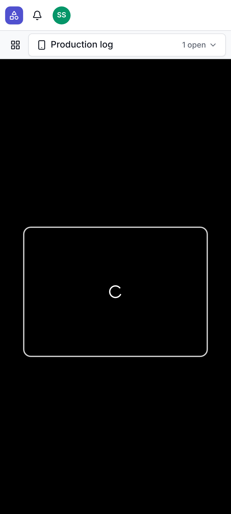
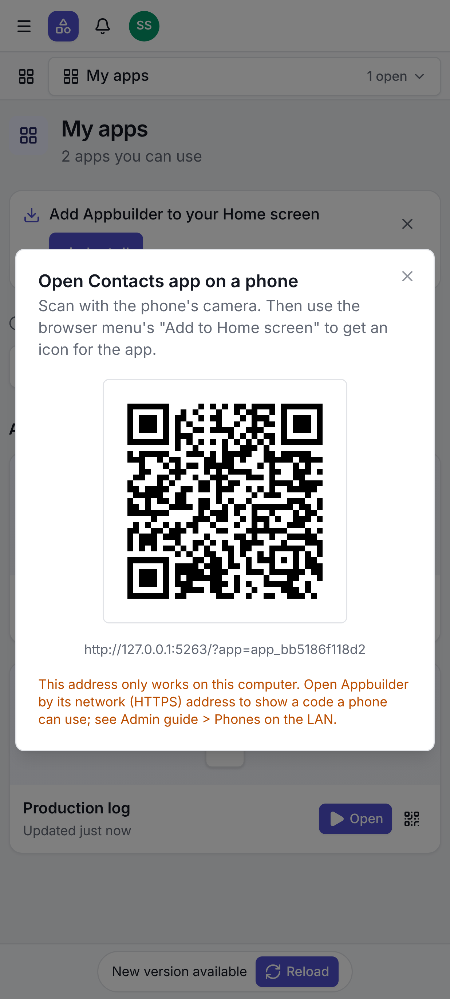

# Phone apps

How to build apps that people use on their phones on the shop floor: design size and layout, scanning, photos, working
without a connection, and testing on a phone.

## Design for a phone

- **New app > Phone** (360 x 800) or **Start with data > Phone** (a list screen and a form screen). 360 px wide is the
  narrowest common phone; 390 and 412 are also offered.
- On a phone the app is drawn **1:1 at the phone's width** and **scrolls vertically**. A wider phone (or the phone
  turned sideways) makes the screen wider: set **AnchorH = Stretch** on fields, buttons and lists so they use the width.
  A phone narrower than your design shows the whole screen slightly smaller (never a sideways scroll). Content below
  the design height scrolls; anything anchored to the bottom stays at the bottom of the screen.
- Fingers need room: make tappable things **at least 44 px high**. Smaller UI components (a 24 px checkbox, a rating)
  get an invisible 44 px touch area automatically, but neighbours closer than that compete for taps. Leave 8 px between
  tappable things.
- Nothing appears "on hover" on a phone. Do not hide actions behind hover.
- A **Data table** shows as cards on a phone (narrower than 600 px): the first text column is the card title and a few
  more columns follow. Set **Phone card columns** to choose and order them, for example `Name, Status, Amount` (the first
  is the title, the second sits under it, the rest are labelled lines). A Gallery or List still gives you full control.
- **Dropdowns, combo boxes and person pickers** open a bottom sheet with a search field and large rows. **Date pickers and
  the time picker** open the phone's own picker and show the date in the phone's format (the Format property applies
  on desktop only; the 12/24-hour setting is the phone's). **Number inputs** show a digits-only keypad when Min and Max
  are whole numbers and Min is 0 or more, otherwise a keypad with a decimal point, plus a +/- button when negatives
  are allowed.
- **Dialogs and side sheets** open as bottom sheets on a phone; drag the handle down, tap outside or use the phone's
  Back gesture to close (Back runs the dialog's OnClose; lists that open as bottom sheets close the same way).
- On a form, the **Save** and **Cancel** buttons stay on screen above the keyboard while the form is longer than what
  you can see.
- Pull down at the top of a running app to reload its data.

## Scanning barcodes and QR codes

- **Scan input** is a text field for codes. A Bluetooth or USB scanner that types like a keyboard fills it and runs
  **OnScan** (a burst of keys ending with Enter, faster than a person types). The camera button scans with the camera.
  
- **Barcode scanner** is a button that opens the camera; the code is in `Value`, its type in `Format`, and **OnScan**
  runs. **Continuous** keeps the camera open for stock counts: OnScan runs for every code (the same code again after 2
  seconds), for example `Collect(Counted, {Code: Scanner1.Value})`.
- **Formats**: "All" or a list such as "qr, ean13, code128".
- Which codes work where: Chrome on Android reads QR, Data Matrix, EAN, UPC, Code 128, Code 39 and ITF with the camera.
  iPhones and desktop browsers without a built-in reader read EAN, UPC, Code 128, Code 39 and ITF with the camera, and
  **QR codes** with a bundled open-source decoder (jsQR, Apache-2.0, built into the product). **Data Matrix** is not
  read on those browsers: use Chrome on Android, a keyboard scanner or a different label. Keyboard scanners work
  everywhere. QR codes on an iPhone are read a little slower than on Android and need a steady, well-lit code that
  fills a good part of the frame; the iPhone path has not been tried on a real phone yet (see the phone test script).
- **Scan to find a record**: `LookUp(Parts, Code = ScanInput1.Value)` in a label or a form's Item.
- **Scan to fill a form**: a form in New mode takes starting values from an Item that is not a row:
  set the form's **Item** to `{Code: ScanInput1.Value}` and scan before filling the other fields.

## Photos

A form field for an **image** column shows **Take photo** on phones (the phone's own camera opens) and **Use camera** on
computers with a camera. Photos are turned the right way up and made smaller (at most 1600 px on the longer side) before
they are uploaded, so they arrive fast on plant Wi-Fi; the photo's location data is not uploaded. A column with
**multiple** allows several photos.

## Signatures

- **In a form**: set the form's **Signature fields** (Advanced tab) to the image column, for example `"Signature"`. The
  field becomes a pad to sign with a finger, a stylus or the mouse, with **Clear**. The signature is saved as a PNG picture
  into that column when the form is saved, like a photo (without a connection it waits on the phone and is sent after
  its row). An existing signature shows as a picture with **Sign again**.
- **On its own**: insert a **Signature pad**. `HasSignature` is true once someone has signed (a stray tap does not count),
  `OnSign` runs after each stroke, `Image` shows it in an Image UI component, and a button saves it:
  `Patch(Visits, ThisItem, {Signature: SignaturePad1.FileToken}); Reset(SignaturePad1)`.
- **Printing**: in a print template, an image block with source "attachment" on the signature column prints it.
- The pad is a 3:1 signature line inside the UI component; the picture is at most 1200 x 400 px, white background.
- While signing the screen does not scroll, so place the pad where people do not need to scroll past it.

## Device() and Location()

- `Device().Kind` is "Phone", "Tablet" or "Desktop"; also `Platform`, `Touch`, `Online`, `Standalone` (opened from the
  home screen), `ScreenWidth`, `ScreenHeight`, `Orientation`. Example: `If(Device().Online, "", "Offline: saved on this phone")`.
- `Location()` asks for the position once (the browser asks the user the first time) and updates formulas when it
  arrives: `Location().Latitude`, `.Longitude`, `.Accuracy` (metres), `.Status` ("Pending", "Ready", "Denied",
  "Unavailable", "NeedsHttps"). `UpdateLocation()` in a button asks again. Location needs HTTPS.

## Working without a connection

Turn on **App settings > Works offline (entry)** for apps people use where Wi-Fi drops. Then, on the phone:

- **Adding and changing rows and taking photos** without a connection works: the change is saved on the phone
  (encrypted) and the screen shows "You're offline" and "N waiting to send". When the connection returns, the changes are
  sent in the order they were made, exactly once.
- **Screens** show the last data the phone loaded while it was connected. A search or filter the phone never ran shows
  "Could not reach the server" instead of data, unless its table is available offline (below).
- **Available offline**: under Works offline (entry), tick the tables people need to look things up in without a
  connection (parts, customers, locations). When the app opens with a connection, their rows are downloaded to the phone
  (encrypted) as the signed-in person, so they get only the rows they may see. Offline, dropdowns, combo box searches,
  lookups and simple lists over those tables use these rows. Set a **row limit** (2,000 if blank, at most 10,000) and
  an optional **filter** the server can run, such as `Status <> "Closed"` or `owner = User().Id`. If the limit cuts the
  table, the phone says so ("Only 2,000 of 5,130 rows of Parts are kept ..."); offline, searches then find only those
  rows. Pulling down to refresh downloads them again. Keep these tables small: whatever is on the phone can be read by
  anyone holding the unlocked phone with the app open.
- **Forms keep a draft**: if the page reloads by accident or the phone closes the browser tab in the background, an
  unsaved form comes back with "Draft restored" and a **Discard** button (this works in every app, not only offline ones).
  If the record was changed by someone else meanwhile, the note says so and saving asks whether to keep yours.
- **Not without a connection**: deleting, approvals, running flows, connector actions. They fail with a message.
- **Server rules win**: a change the server refuses (a validation rule, a required column, a permission) waits on the
  phone with the reason; the person fixes and resends it or discards it. If someone else changed the same row meanwhile,
  the person chooses "Keep mine" or "Use the server's".
- Opening the app for the first time, or after closing the browser, needs a connection once.
- Formulas that read big tables run on the server: offline they show their last result or "Could not reach the server".

## Testing on a phone

1. The server must be reachable over HTTPS from the phone (ask your administrator; see the administrator guide "Phones on
   the local network").
2. On your PC, open **My apps** and tap the QR icon (**Open on a phone**) on the app's card; scan the code with the phone.

   

3. On the phone, add it to the home screen (Android: menu > Add to Home screen; iPhone: Share > Add to Home Screen).
4. Test with Wi-Fi off: save a row, turn Wi-Fi on, check it arrives once.
