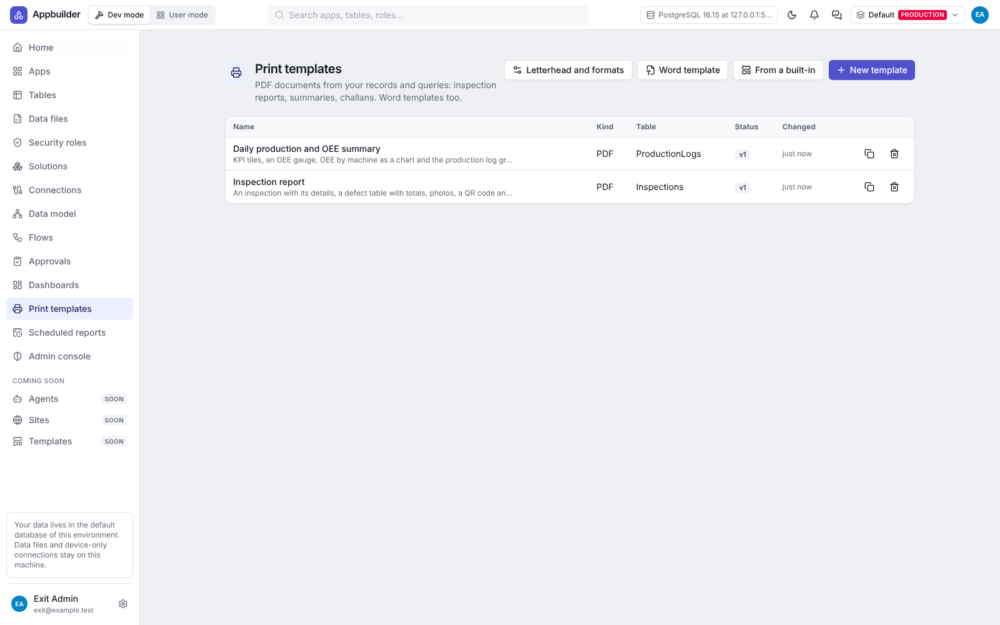
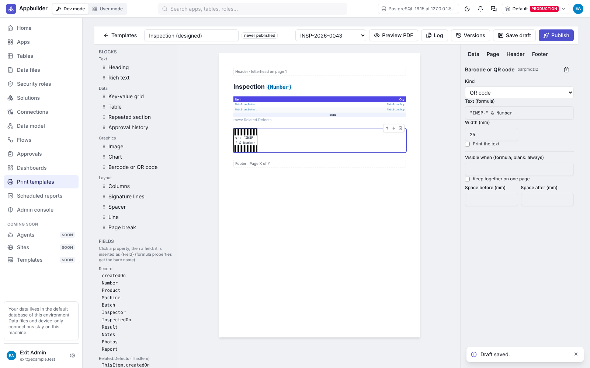
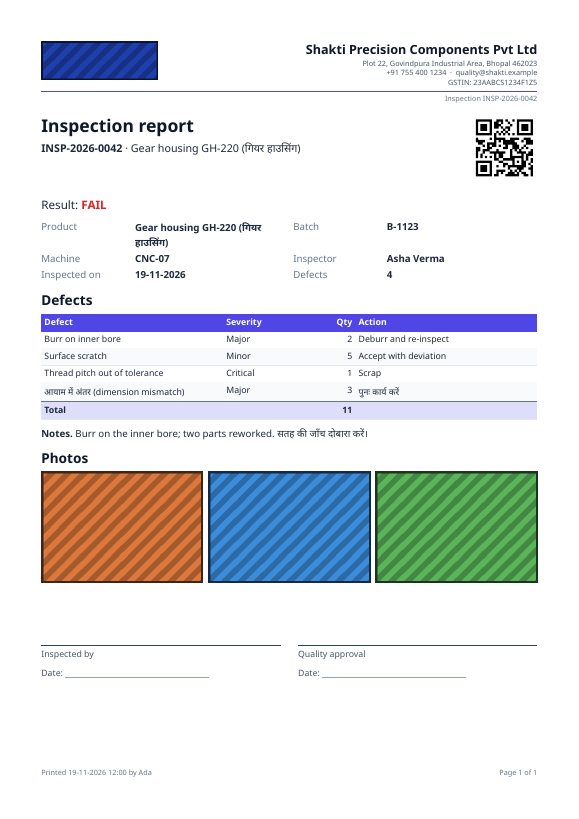

# Print templates: PDF documents from your data

A **print template** turns a record (an inspection, a purchase request, a challan), the rows of a table (today's
production log) or a formula's result into a PDF, with your company's letterhead. People print it from an app, it is
stored with the record, a flow emails it every morning, a scheduled report attaches it. Word (.docx) templates are
possible too. Every block and function: [reference/print-templates.md](../../reference/print-templates.md); how it works:
[dev/pdf.md](../../dev/pdf.md); administrators: [admin/printing.md](../../admin/printing.md).

Open **Dev mode > Print templates** (makers). The list shows each template, its table, whether it is published and when
it changed.

## Start

- **From a built-in**: six ready templates, yours to change afterwards.

  | Built-in | Prints | Expects |
  | --- | --- | --- |
  | Inspection report | one inspection: details, PASS/FAIL, a defects table with a total, photos, a QR code, signature lines | Inspections (Number, Product, Machine, Batch, Inspector, InspectedOn, Result, Notes, Photos) and InspectionDefects (Inspection, Defect, Severity, Qty, Action) |
  | Daily production and OEE summary | today's production log: KPI tiles, an OEE gauge, OEE by machine and shift, the log grouped by machine with subtotals | ProductionLogs (LogDate, Machine, Shift, PlannedMinutes, RunMinutes, IdealRatePerMinute, TotalCount, GoodCount) |
  | Purchase request | one request with its lines, the total and the approval history | PurchaseRequests (Number, Title, Requester, Department, NeededBy, Status, Justification) and PurchaseRequestLines (Request, Item, Qty, Unit, Rate) |
  | Delivery challan | consignee, vehicle, items and quantities, a barcode, receiver's signature (no tax is computed) | DeliveryChallans (Number, ChallanDate, Customer, ShipTo, VehicleNo, Transporter, Reference) and ChallanLines (Challan, Item, HSN, Qty, Unit, Remarks) |
  | Record sheet | every column of one record of the table you choose | any table |
  | Table list | the rows of the table you choose, landscape, header on every page | any table |

  When your tables or columns have other names, change the names in the template (the data source and the formulas).
- **New template**: a blank page for one record of a table, the rows of a table, or no data source.
- **Word template**: upload a .docx with merge fields (see "Word templates" below).

## The designer

- **Left**: the blocks (click to add after the selected one, or drag onto the page) and the **fields** of the data
  source. Click a property on the right, then a field: `{Field}` is inserted (formula properties get the bare name).
- **Middle**: the page, as an approximate preview: formulas appear as blue chips, tables with two sample rows, and
  dashed blue lines where a page will probably end. Click a block to select it; drag it to move it, or use the arrows
  above it. Click **Header** or **Footer** on the page to edit them.
- **Right**: the selected block's properties, or the **Data**, **Page**, **Header** and **Footer** tabs.
- **Preview PDF** makes the real PDF on the server from the draft for the **sample record** you choose (the list at the
  top), with your access, and shows it below the page with its page count and any warnings. This is the exact document
  people will get.
- **Save draft** keeps your work; **Publish** makes it the version everyone prints (version 1, 2, ...). **Versions**
  lists the published versions; **Restore** puts an old one into the draft. **Log** shows every document made from the
  template (who, as whom, pages, time, warnings).

## Data source

| Source | One document is | Formulas see |
| --- | --- | --- |
| One record | a record of the table, chosen when printing | its columns by name (`Number`, `Product`), `ThisRecord`, and its **related lists** |
| Rows of a table | the rows matching the filter (e.g. `LogDate = Today()`), sorted, at most N | `Rows` |
| A formula | a table (`Rows`) or a record | as above |
| None | fixed content | only formulas without data |

A **related list** is a list of child rows: give it a name, the child table and the lookup column that points at the
record (for example Defects: InspectionDefects, column Inspection). Formulas read it as `Related.Defects`.

Everywhere: `Company.Name`, `Company.Address`, `Company.GSTIN` (the letterhead), `User().FullName` (who prints),
`Now()` and `Today()` (the time of printing), and `FormatNumber`, `FormatCurrency`, `FormatPercent`, `FormatDate`.
Formulas may also read other tables delegably (`LookUp(Machines, Code = Machine).Name`), with the printer's access.

## Blocks

| Block | Use |
| --- | --- |
| Heading | Titles in three sizes |
| Rich text | Paragraphs with `**bold**`, `*italic*`, `__underline__`, `[color=#dc2626]red[/color]`, `- ` bullets, `1. ` numbers, `{formulas}` |
| Key-value grid | Label: value pairs in 1 to 4 columns; **boxed** makes KPI tiles |
| Table | Rows of a related list, a query or a formula; column widths (mm, or shared), alignment, formats (number, currency, percent, date ...), totals (sum, count, average, min, max, a label), **group by** with group headers and subtotals; the header repeats on every page and a row is never split |
| Repeated section | Blocks once per row (`ThisItem`), optionally a page each |
| Approval history | Who decided what and when on the record's approvals |
| Image | The letterhead logo, an uploaded image, or photos from an image column (several in a grid, with captions) |
| Chart | Bar, line, pie or gauge (OEE) |
| Barcode / QR code | Code 128 or QR from a formula, scannable on paper |
| Columns | 2 to 4 columns side by side |
| Signature lines | Up to 4 labelled lines, with a date line |
| Spacer, Line, Page break | Layout |

Every block has **Visible when** (a formula: `Result = "Fail"`), **Keep together on one page**, and space before/after.

More printed samples of the built-ins: [daily OEE summary](../../images/print/daily-oee-1.png),
[purchase request with approvals](../../images/print/purchase-request-1.png),
[delivery challan](../../images/print/delivery-challan-1.png).

## Formats and Hindi

Numbers, currency and dates use the environment's settings (Indian grouping 12,34,567.00 by default, ₹, dd-MM-yyyy,
India time): set a column's **format**, or use `FormatCurrency(Amount)` in text. Hindi text (and any Devanagari) is
printed with Noto Sans Devanagari and shaped correctly (conjuncts, matras, reph); it can be copied and searched in the PDF.
Other scripts (Chinese, Arabic ...) are not supported yet.

## Using a template

- **In an app**: `Print("Inspection report", Gallery1.Selected)` opens the PDF in a new tab (on a phone it downloads);
  the **Print button** UI component does the same with its Template and Record properties.
  `Patch(Inspections, ThisItem, {Report: GeneratePdf("Inspection report", ThisItem)})` stores the PDF in a file column.
- **From a record**: the record timeline's **Document** button stores the PDF in the record's Documents.
- **In a flow**: the step **Generate a document** (output: the file, a file column of the record, or Documents); attach
  it to an email step with `Table({fileToken: Steps.GenerateDocument.Output.FileToken})`.
- **Scheduled reports**: tick **Attach a PDF** (an automatic layout of the report's rows, or a template with a query).
- **Many records**: **Many records** in the designer makes one PDF per record in a zip file, or one merged PDF, in the
  background.

Documents are always made **with the access of the person printing** (or the flow's identity, or each report recipient):
rows they cannot read are not printed; a column hidden from them prints blank, and the log says so. An administrator can
make a template run as a service account instead (shown in red in the list).

## Word templates

Upload a .docx with fields in curly braces; each field is a formula:

- `{Number}`, `{FormatDate(InspectedOn)}`, `{Company.Name}`
- a loop: `{#Related.Defects}` ... `{Defect}` `{Qty}` ... `{/Related.Defects}` (inside a table row, one row per item)
- a condition: `{#Result = "Fail"}` REWORK `{/Result = "Fail"}`; `{^...}` for "not"

The result is a Word file (`GenerateDocx` in apps). Images, charts and HTML in Word templates are not supported, and
Word files are **not** converted to PDF.

## Solutions and environments

Add print templates to a solution (component **Print templates**); they travel with their published version and Word
file. In a locked production environment templates are read-only; printing works.
