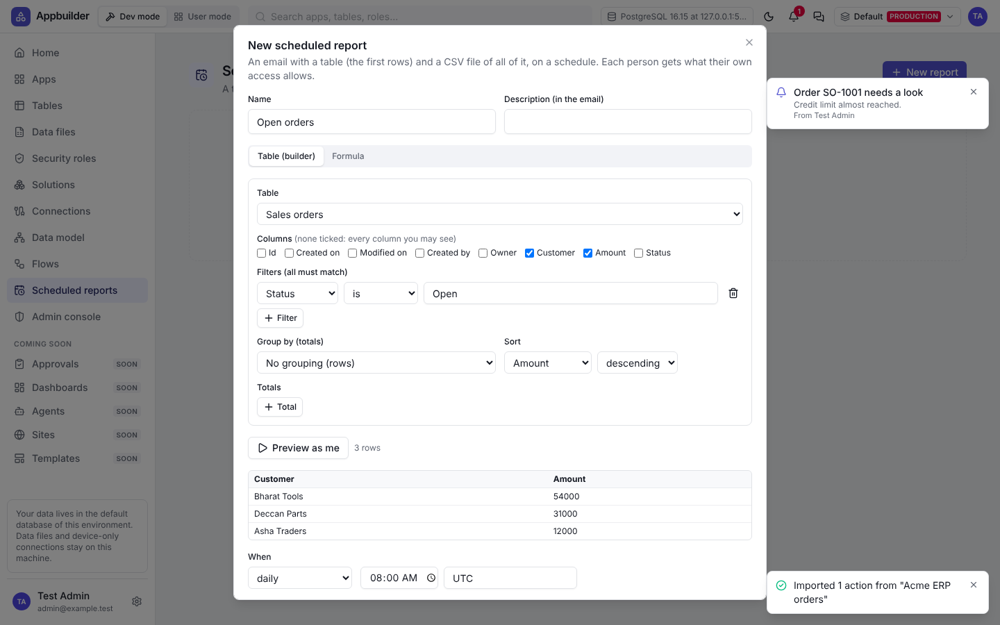
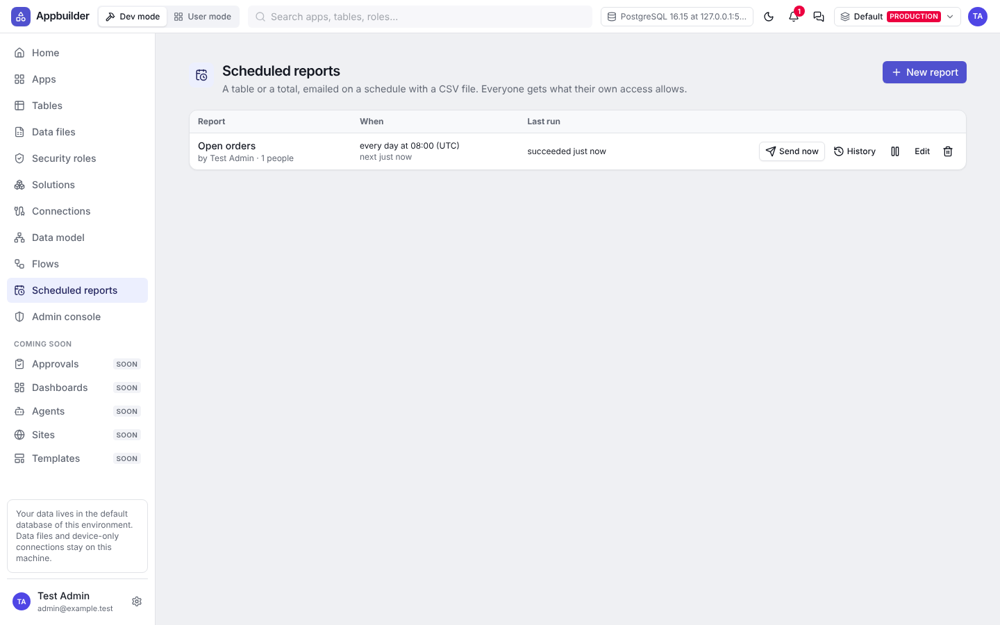

# Scheduled reports

A scheduled report emails a table or a total on a schedule: "open orders every morning at 8", "sales by region every
Monday". Each email has the first rows in the message, all rows (up to 5,000) in a CSV file, and a link back to
Appbuilder. PDF reports come in Phase 2.

Open **Scheduled reports** (Dev mode menu, or User mode menu for the reports you receive) and press **New report**.

## What to send

- **Table (builder)**: choose the table, tick the columns (none ticked: every column the reader may see), add filters (all
  must match: is, is not, greater, less, contains, starts with, is blank), a sort, and optionally **Group by** with
  **Totals** (count, sum, average, minimum, maximum), for example the sum of Amount by Region.
- **Formula**: a formula that returns a table, for example `Filter(Orders, Status = "Open" && Amount > 10000)`. Reads must
  be ones the server can run as a query (the same rule as in table events).

**Preview as me** shows what you would get.

## When and to whom

- **When**: daily, on weekdays, weekly on a day, monthly on a day (1 to 28), hourly, or only by hand; at a time in a time
  zone (your browser's by default).
- **Recipients**: anyone can subscribe themselves. Makers and administrators can add other people and teams.
- **Rows in the email body** (default 20) and **when there are no rows**: send nothing (default) or send anyway.

**Security**: every recipient gets the data **their own access** allows. Someone who may only see their own orders gets
only their orders; someone who cannot read the table gets no email (the history says why). An administrator can instead
choose **Run as** a service account: then everybody gets the same data, including rows they could not open themselves.
The page warns about this and it is audited.

## Sending, history, unsubscribing

**Send now** sends it at once (for the owner: to everyone; for a recipient: just a copy to them). **History** shows each
run and what happened per recipient (sent, skipped and why). **Pause** stops the schedule. Every email has an
**Unsubscribe from this report** link that works without signing in. Addresses on the administrator's suppression list get
nothing.

The CSV file is safe to open in Excel: values that a spreadsheet would treat as a formula (starting with `=`, `+`, `-`, `@`)
get a leading `'`.
