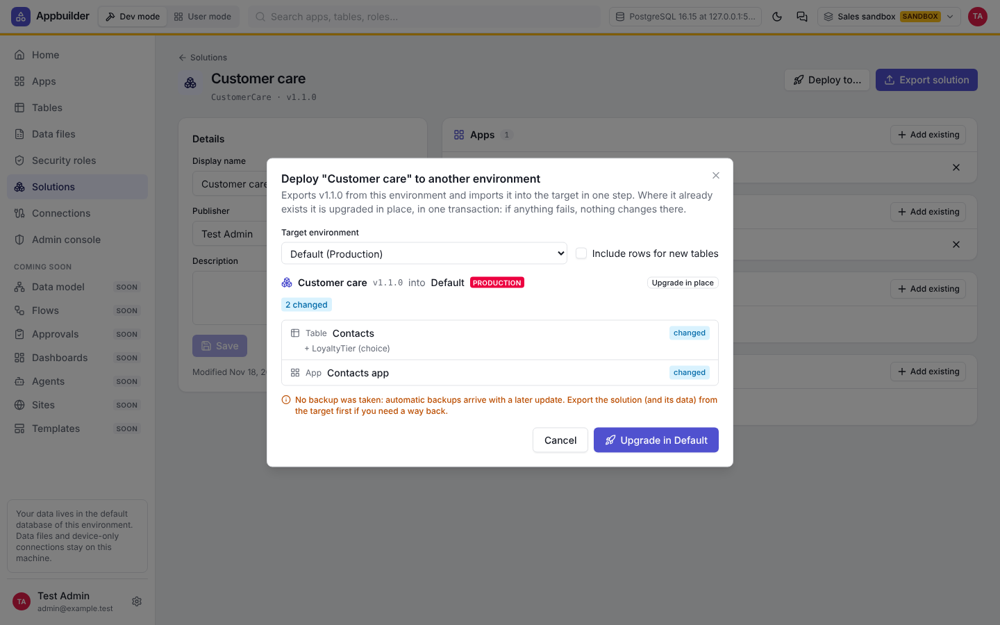

# Solutions

A solution bundles apps, tables, roles, connections and files so you can move them between
[environments](../../admin/environments.md) (from a sandbox to production) or between machines.

## Create and fill

Open **Solutions** (Maker role), create one, and use **Add existing** to add apps, tables, roles and connections. An app can also be added from its menu.

A solution and everything in it keep their **identity** (their ids) wherever they go. That is what lets a later version
**upgrade** what an earlier one installed, instead of making copies.

## Deploy to another environment

On a solution's page, **Deploy to…** exports it from the environment you are in and imports it into another one in one step.
Choose the target, optionally **Include rows for new tables**, and **Review plan**:

The plan lists what will happen in the target, before anything does:

- **new**: apps, tables, roles, connections and data files the target does not have yet. They are created with the same ids.
- **changed**: what exists there (same id) and differs. For a table, every column: `+ Column (type)` is added, `Column: text →
  number` changes type (the values are converted; if one cannot be, the whole deployment stops and nothing changes), `Column:
  settings change` (display name, required, unique, choices, default ...). For an app: its definition is replaced. For a role:
  its privileges on the solution's tables and its access to the solution's apps are replaced; people who hold it keep it; its
  privileges on other tables stay.
- **removed**: what the previous version of the solution in the target had and this one does not. An app or role is deleted;
  a table is dropped **with all its rows**.
- **Destructive changes are red**: a dropped table or column loses its data. You must tick *I understand that the data in the
  red items is lost* before you can confirm.
- **Problems** block the deployment (for example a table that lives in another database in the target, or a lookup to a
  table that exists in neither).
- Whether a **backup** is taken first. In this version it is not, and the plan says *No backup was taken* in amber: export the
  solution with data from the target first if you want a way back.

**Upgrade** (or **Install** when nothing exists there yet) applies exactly the plan you reviewed, **in one transaction**: if
anything fails, the target is exactly as before. If the target changed since you looked (someone else deployed, for example),
you are asked to review the new plan.

Rules:

- You need access to the target environment and the Maker role there. Upgrading what exists there needs its **administrator**
  (it changes apps, tables and roles other people use); installing something new does not.
- Connections that exist in the target are kept as they are: their settings and passwords belong to that environment. New ones
  arrive without passwords.
- Rows are never replaced. *Include rows for new tables* only fills tables the deployment creates.
- Roles never bring the administrator flag. Data files already in the target are data and are left alone.
- A **locked** production environment refuses direct changes to apps, tables and roles; deploying (or importing) a solution
  into it is the way to change it. See [Environments](../../admin/environments.md#change-the-type-lock).

### Table logic travels with the tables

A table in a solution brings its **validation rules, events, formula columns and rollups** (and its sharing and team
ownership settings). The upgrade plan lists each rule and event as new, changed or removed. An event that **runs as the
system** can only be brought in by an administrator, who must tick a box allowing it (also for a first install); the import
is recorded in the audit log. Importing as a copy brings such events switched off, for an administrator to review.

## Export and import

**Export** saves a package (YAML); a toggle includes table data. **Import solution** (on the Solutions page) shows the same plan
first: a package whose solution or components already exist here is upgraded in place after you confirm, otherwise it installs
them with their ids. **Import as a copy** gives everything new identities instead (the old behaviour: never overwrites, and a later
import will not upgrade those copies). Packages exported by versions before 0.5 have no solution id and are always imported as
copies.

- Imported **connections** have no passwords or keys: edit each one and enter the secrets.
- Imported **roles** do not keep the administrator flag.
- File data (data files) is imported as database tables by default; the import dialog can keep them as data files.
- The portal cannot add file components to a solution.

App packages (an app's **Export**) are for sharing one app: importing one always creates a copy.

## Moving to another machine

1. Export the solution with data included.
2. On the other machine, install Appbuilder and finish the setup wizard.
3. Import the package, then fix connections as above. Importing a newer version later upgrades it in place.
