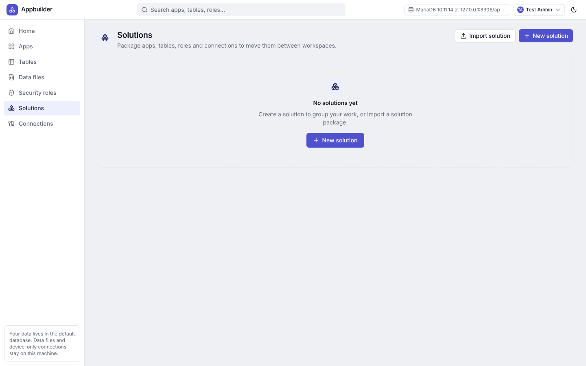

# Solutions

A solution bundles apps, tables, roles, connections and files so you can move them between machines.

## Create and fill

Open **Solutions** (Maker role), create one, and use **Add existing** to add apps, tables, roles and connections. An app can also be added from its menu.

## Export and import

**Export** saves a package; a toggle includes table data. **Import** creates new copies and never overwrites existing items.

- Imported **connections** have no passwords or keys: edit each one and enter the secrets.
- Imported **roles** do not keep the administrator flag.
- File data (data files) is always imported as database tables when you use the portal. The API also supports keeping them as files; the portal has no setting for it.
- The portal cannot add file components to a solution.

## Moving to another machine

1. Export the solution with data included.
2. On the other machine, install Appbuilder and finish the setup wizard.
3. Import the package, then fix connections as above.
