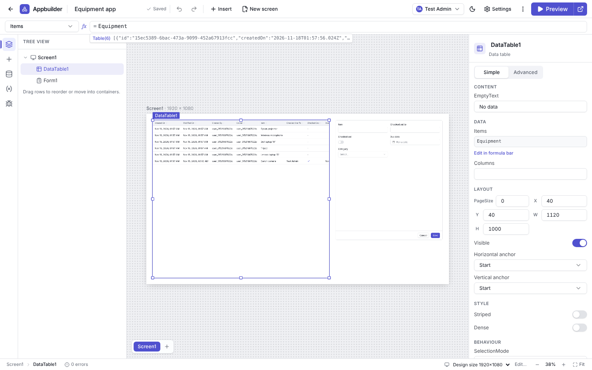

# The Studio

The Studio is where you design an app. Open it with **Edit** on the Apps page.

## Layout

- **Top bar**: back, app name and save status, undo and redo, Insert menu, New screen, theme, Settings, the "..." menu (Export and Import package), Preview and Run in window.
- **Formula bar**: pick a property on the left and edit its formula.
- **Left rail**: Tree view, Insert, Data, Variables and Debug console.
- **Canvas**: your screen. Screen tabs are at the bottom left.
- **Properties panel** on the right, with **Simple** and **Advanced** tabs. Simple groups properties as Content, Data, Layout, Style and Behaviour. Advanced lists every property and has a search. A property whose value is a formula shows an "fx" pill.
- **Status bar**: breadcrumb, error list, viewport, zoom and Fit.

## Selecting, moving, resizing

Click to select, Shift+click to add, or drag on empty canvas to select several. Drag to move and use the handles to resize. Things snap to an 8 px grid and to neighbours; hold `Alt` to move freely. Hold `Shift` while resizing to keep the shape. Locked controls cannot be moved. When two or more are selected an align toolbar appears (left, centre, right, top, middle, bottom; distribute needs three).

## Zoom and pan

Mouse wheel pans, `Ctrl`/`Cmd` + wheel zooms. Hold `Space` and drag, or use the middle button, to pan. Use the status bar zoom buttons or **Fit**. At 1440 px wide, Fit zooms out to roughly 38 percent for a Full HD app; closing the left pane helps.

## Keyboard shortcuts

| Shortcut | Action |
|---|---|
| Ctrl/Cmd+Z | Undo |
| Ctrl+Shift+Z or Ctrl+Y | Redo |
| Ctrl/Cmd+C, X, V | Copy, cut, paste |
| Ctrl/Cmd+D | Duplicate |
| Ctrl/Cmd+A | Select all siblings |
| Delete or Backspace | Delete |
| Esc | Select the parent |
| Arrow keys | Nudge 1 px (Shift: 8 px) |
| Space + drag, middle drag, wheel | Pan |
| Ctrl/Cmd + wheel | Zoom |
| Alt + drag | Move without snapping |
| Alt + click | Run the control's event in design |
| Shift + click | Add to selection |
| Double-click a control | Jump to the formula bar |
| Ctrl+Space (formula bar) | Show suggestions |

Shortcuts work in design mode when you are not typing in a field. Arrow nudging is off when viewing at a size other than the design size.

## Tree view and Insert

The tree shows every control. Drag to reorder or move into another container, double-click to rename. The right-click menu offers Rename, Duplicate, Copy, Lock, Bring to front, Send to back and Delete. Hide a control with its eye icon (it sets Visible to false). A screen can only be deleted if there are at least two.

The Insert pane has a search box and recent items. Click or drag to insert. Dialogs and sheets always go to the root of the screen.

## Data pane and Variables pane

**Data** lists your tables grouped by connection, with a "device only" badge for data files, plus collections and a 20-row preview. **Variables** shows global variables and each screen's context variables.

## The formula bar

The bar shows the leading `=` for you. Typing one is optional; a single leading `=` is ignored, so `=Filter(...)` and `Filter(...)` behave the same. Autocomplete appears as you type. `Up`/`Down` and `Tab` or `Enter` accept; `Esc` closes. `Enter` finishes, `Shift+Enter` adds a new line. A call tip shows the function signature with the current argument in bold. A chip shows the result type and value, or the error message.

## Viewports and anchors

The status bar viewport menu previews the screen at Full HD, 2K, Laptop 1366x768, 16:10, 21:9, Ultrawide or a custom size. These views are read-only ("Viewing at W x H. Switch to design size to edit."). To make controls adapt, set **AnchorH** and **AnchorV** (Start, End, Stretch, Center, Scale).

## Auto-layout

Set a container's **LayoutMode** to Row, Column or Grid (or use the Row, Column and Grid controls). Options include Gap, Padding, Justify, AlignItems, Wrap, Columns and Scroll. Children can use Grow and AlignSelf. Anchors apply only to manual layouts.

## Galleries and templates

A Gallery repeats a template for each item. Set **Items**, then design the first template; use `ThisItem` inside it. Options: TemplateHeight/Width, Layout (Vertical, Horizontal, Grid), Columns, Gap, Selectable and OnSelect. Outputs: Selected, SelectedIndex, AllItems, VisibleCount. With no data the design view shows one blank row.

## Dialogs and sheets

Dialog and Sheet controls have an **Open** property and an **OnClose** action. The close button and `Esc` only run OnClose; they do not close it for you. Typical pattern: **Open** = `showDlg`, **OnClose** = `Set(showDlg, false)`, and a button with `Set(showDlg, true)`.

## Screens and navigation

Add screens with **New screen**; switch with the tabs. Move between them with `Navigate(Screen2)` and `Back()`.

## Undo, copy and paste

Use undo and redo to step back through design changes, and copy and paste to reuse controls.

## Errors and debugging

The status bar error list has Data warnings, Formulas and Runtime sections. The **Debug console** pane shows messages from `Trace` and runtime errors. A "Data truncated" warning means a table has more rows than apps can load (see [Data](data.md)).

More: [controls reference](../../reference/controls.md).
