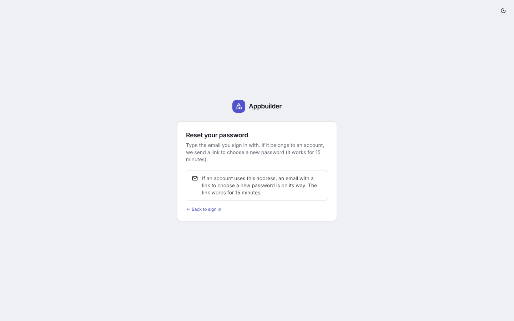
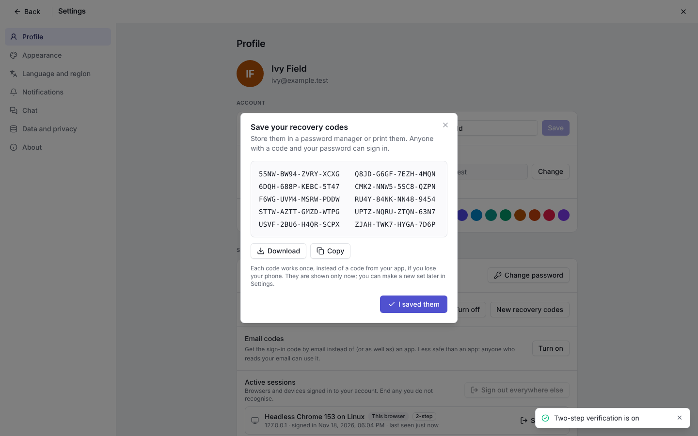
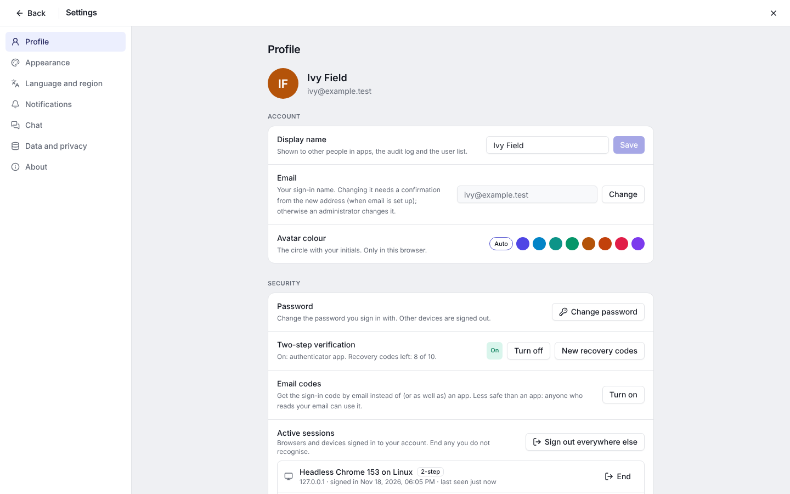

# Signing in, two-step verification and a forgotten password

For everybody who uses Appbuilder with the server (demo mode in a browser has no sign-in).

## Your first sign-in

Your administrator either **invited** you (an email "You are invited to ...": open the link, choose a password, and you
are signed in; the link works once, for 7 days) or gave you a **temporary password** (sign in with it; Appbuilder then
asks you to choose your own before anything else).

A good password is long rather than complicated: a few unrelated words work well. Appbuilder refuses passwords from a
list of commonly used ones and your email address.

## Forgot your password?

On the sign-in screen choose **Forgot your password?** and type your email.

- When your server sends email, you get a message "Reset your password" with a link. It works **once, for 15 minutes**.
  Choose a new password; every place you were signed in is signed out. If no email arrives, check the spam folder, and
  ask your administrator (the screen says the same thing whether or not the address has an account, on purpose).
- When it does not (the screen tells you), or your administrator gave you a **one-time reset code**: choose **I have a
  reset code from an administrator**, type your email, the code and a new password. The code works once, for 24 hours.

Two-step verification still applies afterwards.

## Two-step verification

With two-step verification, signing in needs your password **and** a 6-digit code from an app on your phone, so a stolen
password alone is not enough. Your administrator may require it; Settings tells you from when.

### Turn it on

1. **Settings > Profile > Two-step verification > Set up authenticator app.**
2. Open an authenticator app on your phone (Google Authenticator, Microsoft Authenticator, 1Password, Aegis or similar)
   and scan the QR code. If you cannot scan, choose *Cannot scan? Show the key* and type the key into the app.
3. Type the 6-digit code the app shows and choose **Turn on**.
4. **Save the 10 recovery codes** (Download, or Copy into your password manager, or print them). Each one works once if you
   lose your phone. They are shown only now.

### Signing in with it

After your password, type the current code from the app. Each code works once: if it says "already used", wait for the
next one. Tick **Remember this device for 30 days** only on a computer that only you use.

Other ways on that screen: **Use a recovery code**, or **Get a code by email** if you turned on email codes.

### Email codes

Settings > Profile > **Email codes > Turn on**: we email you a code to confirm. Afterwards you can choose to get the
sign-in code by email. It is less safe than an app (anyone who can read your email can use it).

### Lost your phone?

Sign in with a recovery code, then in Settings turn the authenticator app off and set it up again on the new phone (and
make new recovery codes). No recovery codes left? Ask an administrator to **reset your two-step verification**; then you
sign in with your password and set it up again.

## Your sessions

**Settings > Profile > Active sessions** lists every browser and device signed in to your account, with its address and
when it was last used. **End** signs one out at once; **Sign out everywhere else** keeps only this browser. **Sign-in
history** shows your last 50 sign-ins and failed attempts. Something you do not recognise? Change your password, end the
other sessions, and tell your administrator.

## Confirm it is you

Some changes ask for your password (or an app code) again, if you have not typed it in the last 10 minutes: changing your
sign-in email, turning two-step verification off, new recovery codes.

## Change your sign-in email

Settings > Profile > Email > **Change**. We send a link to the new address (it works for 24 hours) and a notice to the
current one; the change happens when you open the link. If your server does not send email, ask an administrator.
