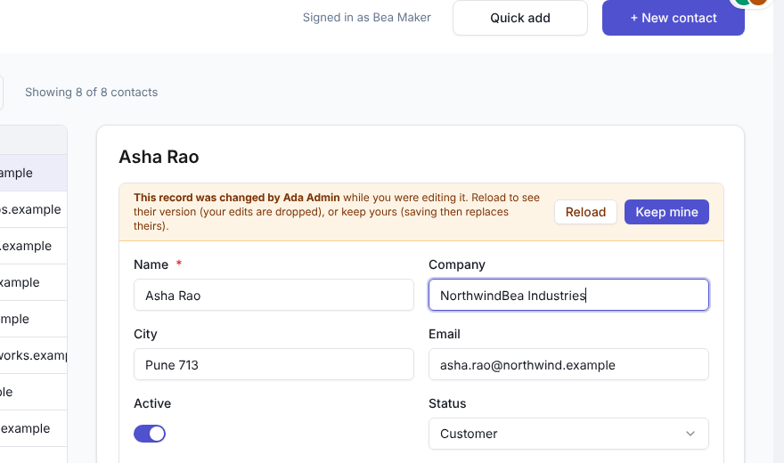

# "This record was changed by ..." (someone else changed it)

Appbuilder shows live changes. While you edit a record, a colleague may save the same record. To avoid silently losing their work or
yours, Appbuilder shows a message at the top of the form:

> **This record was changed by <name>** while you were editing it. Reload to see their version (your edits are dropped), or keep
> yours (saving then replaces theirs).

The name is the person who saved it. You have two buttons.

| Button | What happens |
| --- | --- |
| **Reload** | You see their saved version. **What you typed is dropped.** |
| **Keep mine** | Your next **Save** replaces their version with yours. **Their changes are lost.** |

## What should I do?

1. **Do not rush.** Nothing has been overwritten yet.
2. Copy what you typed (select it and press Ctrl+C) or take a screenshot.
3. If the change is small, press **Reload**, then enter your change again on top of their version.
4. If you are sure your version is the right one, press **Keep mine** and then **Save**.
5. If you are not sure, call or message the person named. They may have fixed the same thing.

## If you did not see any message but your values changed

If you had not typed anything yet, the form simply shows the new values. If you had typed and saved a record a colleague saved in the meantime,
you get the message above when you press **Save**.

## Why does it happen?

Two people edited the same record at about the same time. In a busy workshop agree who updates which records, for example one person per machine.

## When it keeps happening

Tell your administrator the app, the record and the times. It may mean the app should be changed so that two people do not edit the same thing.
