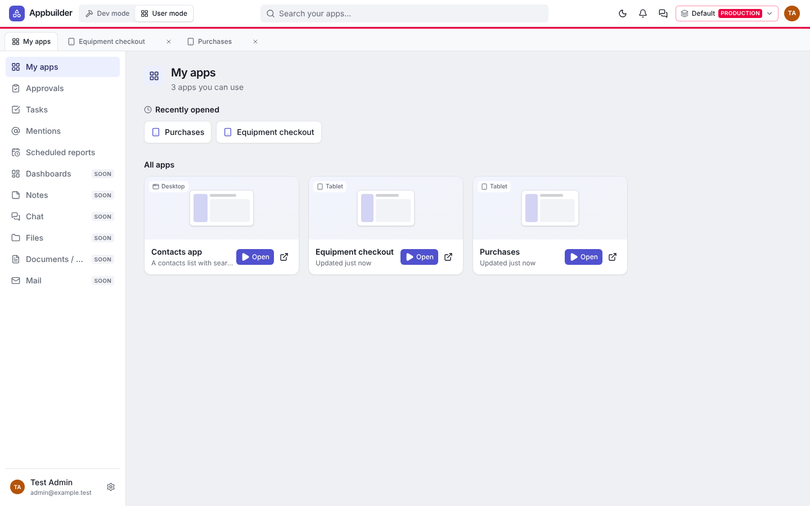

# Finding and opening apps

An **app** is a set of screens made by your company for a job: for example "Production log" or "Leave requests". Which apps you
see depends on what your administrator gave you.

## User mode

If you only use apps, you are always in **User mode**. (People who also build apps have a switch at the top: Dev mode and User mode.
Choose **User mode**.)

## Open an app

1. Go to **My apps** (the first item in the left menu, and the first tab at the top).
2. Use the search box at the top (**Search your apps...**) to find an app by name, or look under **Recently opened** and **All apps**.
3. Click **Open** (or click the tile). The app opens as a **tab** under the top bar.

Each tile says whether the app is made for a desktop, a phone or a tablet screen.

## Tabs

- You can keep several apps open at once. Each keeps what you were doing (what you typed, the screen you were on) while you switch
  between tabs.
- Close a tab with its **x** (or a middle-click).
- If you reload the page, your open tabs come back, but each app starts fresh. Unsaved typing is lost, so save first.
- Every tab has its own address. You can send the link to a colleague who has access to the same app.

## Open in new window

The small arrow icon on a tile (and on a tab when you point at it) says **Open in new window**. It opens the app in its own browser
window, useful when you want two screens side by side.

If nothing opens, or the app opens as a tab instead, your browser blocked the pop-up. It says: "The browser blocked the new window, so the
app opened as a tab. Allow pop-ups for this site to use new windows." Ask your administrator to allow pop-ups for this address, or look
for the blocked-pop-up icon in the address bar.

## "No apps for you yet"

The page says: "Apps appear here when an administrator adds them to one of your security roles." Ask your administrator to give you the
app you need. If you open an app and it says "You don't have access to this app. Ask an admin to add the app to one of your security
roles.", the answer is the same.

## "No matching apps"

Nothing matches what you typed in the search box. Clear the box and look at **All apps**.

## "Update available"

When your company improves an app while you have it open, a button **Update available** appears. Press it: the new version loads and
keeps what you entered.

## Other people in the same app

You may see small circles with initials in the corner of an app. They are colleagues who have the same app open. You can hide
yourself in **Settings > Notifications > Presence > Hide my presence**.

## Left-menu items marked "Soon"

Approvals, Dashboards, Notes, Chat, Files, Documents and Mail are planned. They are not usable yet.
