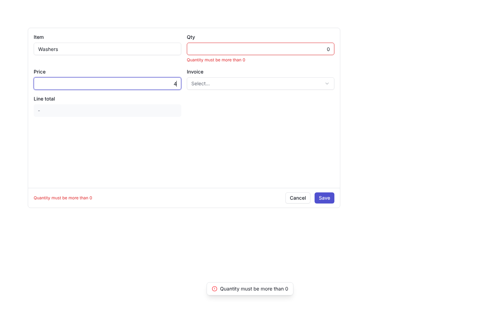

# Filling in forms

A form is a screen with fields where you add or change a record (an order, a log entry, a leave request). Your company decides
which fields it has. What follows is true for all forms.

## Adding a record

1. Open the app and press the button for a new record (often **New**, **Add** or **+ New**).
2. Fill in the fields. A field marked as required cannot be left empty.
3. Press the save button (it may be called **Save** or something your company chose).

While it saves the button says "Saving...". Wait until it finishes. Do not close the tab or press the button twice.

## Changing a record

Open the record from the list, change the fields, press **Save**. If you change your mind, use **Cancel**. A note **Unsaved
changes** shows when you have typed something that is not saved yet.

## Messages under a field

Appbuilder tells you what is wrong in red under the field. The usual ones:

| Message | What to do |
| --- | --- |
| `<Field> is required` | Fill the field in. |
| Enter a valid email address | Check the spelling, for example `name@company.com`. |
| Enter a valid URL | A web address such as `www.example.com`. |
| Enter a valid phone number | Digits, with an optional + and spaces. |
| Enter a whole number | No decimals or letters: `12`, not `12.5`. |
| Enter a number | Digits with an optional decimal point. |
| Pick one of the listed choices | Choose from the list, do not type your own text. |
| Pick an existing record | Choose a record that exists in the list (for example a customer or a machine). |
| Fix the highlighted fields | One or more fields are red. Fix them all, then save again. |

### Messages written by your company

Your company can add its own rules, for example "Quantity must be more than 0" or "The end date cannot be before the start".
When a rule says no, **nothing is saved**. Read the message, change the value and save again. If you think the rule is wrong, tell your
administrator the exact message (see [When something goes wrong](something-wrong.md)).

## Fields you cannot change

- A field with a **lock** icon is read-only for you. It is the way your company set your access.
- Some fields are filled in by the system (numbers, dates, totals). You cannot type in them.
- A form may say **Read-only for your role**: you can look but not change.

## Files and images

Use **Choose file**, **Choose image** or **Add files**. The usual limit is 25 MB a file, and your company may allow only some types.
If a file is refused, make it smaller or ask your administrator.

## If it says someone else changed the record

See [Someone else changed this record](changed-by-someone.md).

## If a save fails

Your screen may show a message such as "Could not save in <table>: <reason>". It usually means you are not allowed to make that change.
Take a screenshot and tell your administrator ([When something goes wrong](something-wrong.md)). Do not try again and again.

## Tips

- Fill in forms one at a time. Wait for the save to finish.
- Dates: check the day and the month before you save.
- If the page seems stuck, do not enter the data a second time; check the list first, it may have saved.
