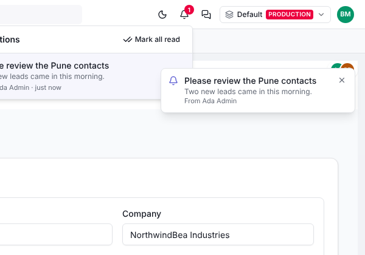
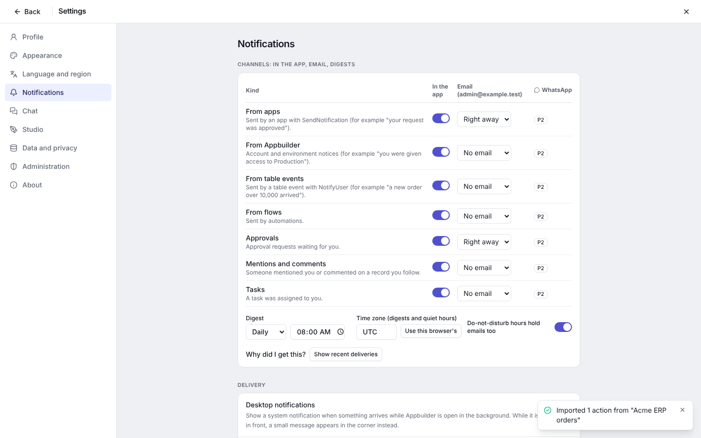

# Notifications and email

Appbuilder tells you about things that need you: a mention, a task, a message from an app, or an approval request (when your company
uses them). You get them in two places: under the **bell** in the top bar, and, if you choose, by **email**.

## The bell

A red number shows how many are unread. Click the bell to see them, newest first. Click one to open the record or page it is
about. **Mark all read** clears the number. Use the small cross to dismiss one, or **Show older** to see earlier ones. If your
screen is open, a notification may also appear in the corner for a few seconds.

## Choose what you get

Open **Settings > Notifications**. For each kind (from apps, from Appbuilder, from table events, from flows, approvals, mentions,
tasks; install administrators also see **Server health**, the daily health summary and alerts):

- **In the app**: on or off.
- **Email**: **No email**, **Right away** or **In a digest** (hourly or daily at a time you choose).
- A **lock** means your administrator decided for everyone, for example "approvals always by email". You cannot change that one.

Below the table:

- **Digest time** and **Time zone** (use this browser's, or pick one).
- **Quiet hours hold emails**: an email that arrives at night is sent when your quiet hours end.
- **Do not disturb**: no messages in the corner and no desktop pop-ups in the hours you set. Notifications still collect under the bell.
- **Desktop notifications**: allow your browser to show them.

WhatsApp messages can be chosen when your administrator has set WhatsApp up and you have agreed to receive them on your number.

## "Why did I get this?"

Press **Why did I get this?** and **Show recent deliveries**. It lists what was sent to you and the reason, for example "You chose an email right away
for From apps". If you get too many emails, change those kinds to **In a digest**. If it says more than 20 emails came in an hour, the rest were collected
into one.

## The email

It shows the title and text, who sent it, and an **Open in ...** button (with your company's name for Appbuilder) that goes
straight to the record. Approval emails also have a button per answer (**Approve**, **Reject** ...): see
[Quick-start for approvers](quick-start-approver.md). At the bottom is the reason you got it and a link that stops
emails of that kind (it works without signing in).

## I do not get emails

1. Settings > Notifications: is **Email** on (not **No email**) for that kind?
2. Do your quiet hours hold emails?
3. Check the spam folder.
4. Ask your administrator to check the email delivery log for your address.

## I clicked "unsubscribe" by mistake

Go to Settings > Notifications and set **Email** for that kind back to **Right away** or **In a digest**.

## If it says "Live updates paused"

You still receive notifications, but they may appear when you reload the page.
