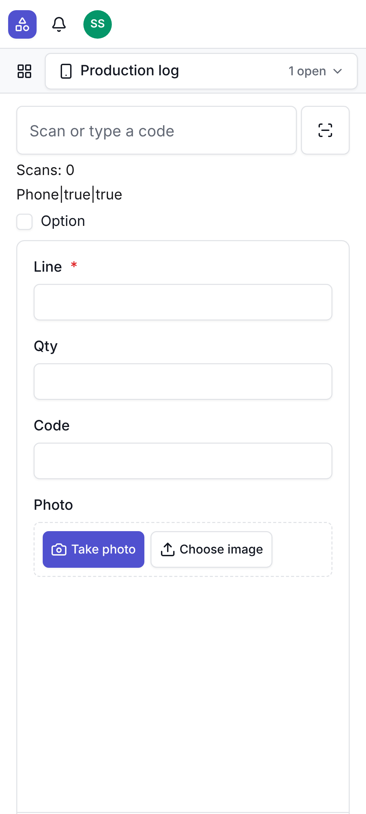
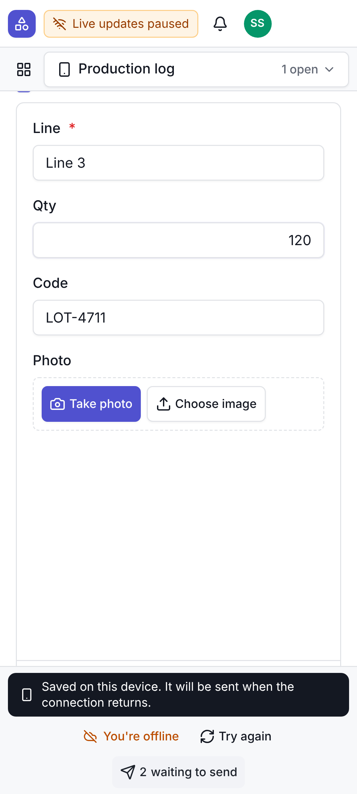
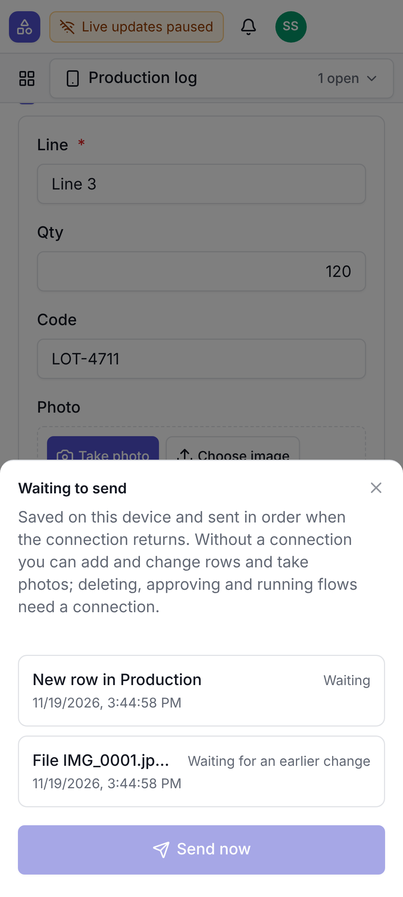

# Using apps on your phone

## Open an app on your phone

- Ask for the address (it starts with `https://`), or scan the QR code your supervisor shows on the PC (the QR icon on
  the app's card in **My apps**).
- Sign in as on the PC. The code for two-step verification works the same.
- At the top, the button with the app's name switches between the apps you have open; the grid button goes back to
  **My apps**.

## Add an app to your home screen

Open the app first, then:

- **Android (Chrome)**: tap the menu **⋮** at the top right, then **Add to Home screen** or **Install app**.
- **iPhone (Safari)**: tap **Share** (the square with an arrow) at the bottom, then **Add to Home Screen**.

The icon opens the app directly, full screen. If you do not see the option, the address is not secure (no `https://`):
ask your administrator.

## Scanning

- Tap the scan button (or the small barcode button next to a field) and point the camera at the code. The first time,
  the phone asks whether the app may use the camera: tap **Allow**.
- In a stock count the camera stays open; each code is listed. Tap **Done** when you have finished.
- The torch button lights the code where the phone has a torch.
- With a handheld scanner, tap the field first, then scan.
- If nothing happens: hold the phone 10-20 cm from the code and keep it straight. On an iPhone QR codes cannot be scanned
  inside the app; use a barcode or a handheld scanner.

## Taking photos

Tap **Take photo** in the form; the camera opens; take the picture and confirm. The photo is made smaller before it is
sent, so it uploads quickly.

## Working without a connection

Some apps work when the Wi-Fi drops. You then see **You're offline** at the bottom.

- Save as usual. The app says "Saved on this device" and shows **N waiting to send**.

  

- When the connection returns, the changes are sent by themselves, in order. You can tap **N waiting to send** to see
  each one, and **Send now**.

  

- Deleting, approving and running flows need a connection.
- **Changed on the server**: someone else changed the same record. Choose **Keep mine** or **Use the server's**.
- **Refused by the server**: the message says why (for example a missing value). Tap **Fix and resend**, correct it,
  **Send**. Or **Discard** it.
- Do not sign out while changes are waiting: signing out deletes them from the phone (the app asks first).
- If the app shows **No connection to the server** when you open it, wait for the Wi-Fi; your saved changes are kept.

## Lost your phone?

Tell your administrator at once. They can make the phone discard everything the apps kept on it. You can do it yourself
from a PC: **Settings > Data and privacy > Wipe phone and offline data**.
