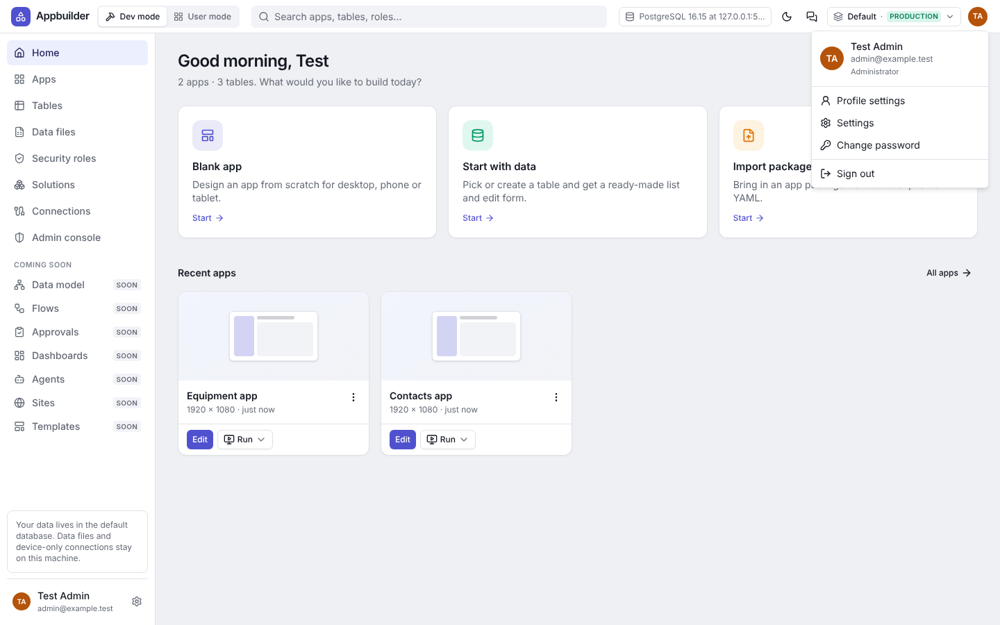
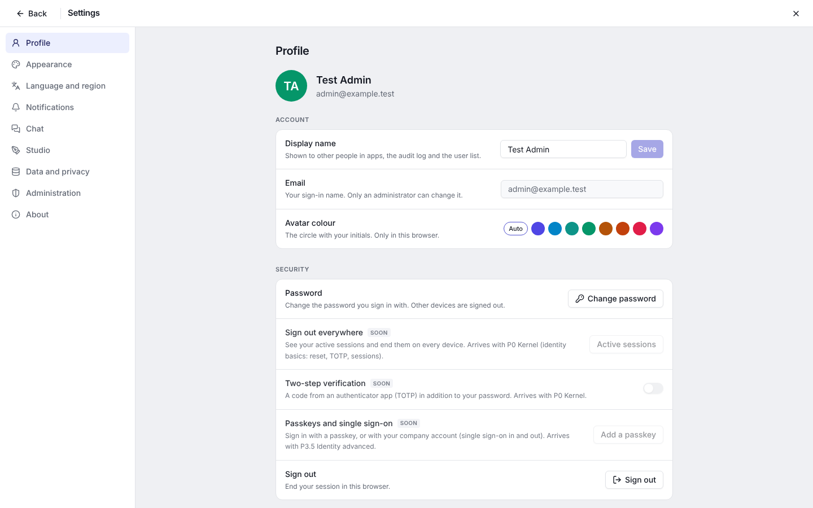

# Your profile and settings

Open **Settings**: click your **avatar** (circle with your initials, top right) and choose **Settings**, or use the gear at the bottom of
the left menu. Press **Back** or **x** (or Esc) to go back to where you were. Most choices follow you to another computer; a few belong to this
browser only, and the page says which.

| Section | What you can do |
| --- | --- |
| **Profile** | Change your **Display name** (shown to colleagues in apps and in records) and **Avatar colour** (this browser only). Change your sign-in **Email** (a link goes to the new address). Change your **password**. Set up **two-step verification**, **Email codes** and **recovery codes**. See **Active sessions** and **Sign-in history**. |
| **Appearance** | **Light**, **Dark** or **System** theme; **Reduce motion**; the mode the portal starts in (people who also build apps). |
| **Language and region** | Date and number formats, the first day of the week and your **time zone**. The screen language is English only. |
| **Notifications** | What reaches you in the app and by email; digest; do not disturb; desktop notifications; **Hide my presence**. See [Notifications](notifications.md). |
| **Chat** | The chat panel (the chat itself is not built yet). |
| **Data and privacy** | What this browser keeps; export your settings; clear local data. |
| **About** | The version of Appbuilder and a health check. Useful when you report a problem: write down the version. |

Some entries say **Soon**: they are not built yet.

## Change your password

Avatar menu > **Change password**, or Settings > Profile. You will be asked for your current password. Choose at least 10 characters; common passwords are refused.
All your other sessions are signed out when you change it.

## Change the email you sign in with

Settings > Profile > Email > **Change**. We send a link to the **new** address (valid 24 hours) and a notice to the old one. The change happens when you open the link.
Your administrator must have email set up for this; otherwise ask them to change it.

## You cannot change

Your roles, your department, whether your account is active. Those are set by your administrator.

## Time zone

If times in notifications or reports look wrong by a few hours, check Settings > Language and region and Settings > Notifications > Time zone.
