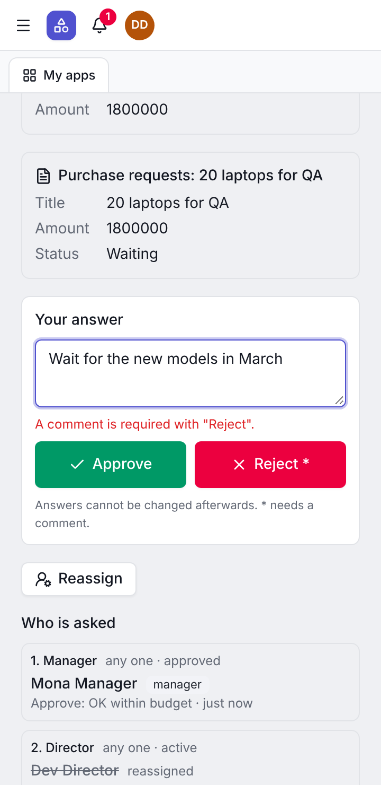
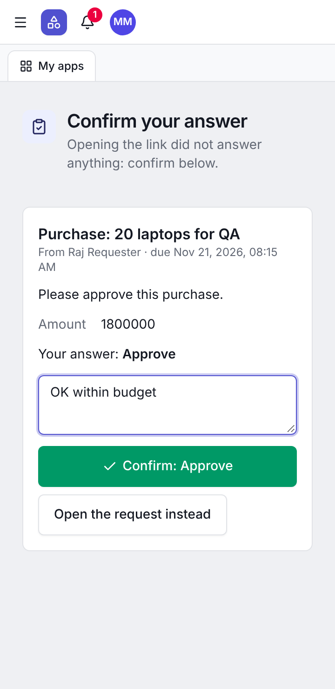

# Quick-start for approvers

You are asked to approve (or reject) something someone else asked for: a purchase, a leave, a document. This page shows
how, on a PC or on your phone.

## Where requests reach you

- **The bell** at the top shows "Approval needed: ...". Click it to open the request.
- **An email** with the buttons **Approve** and **Reject** (and any other answers).
- The **Approvals** page in the left menu (on a phone: the menu button at the top left), tab **To approve**.
- **Chat**: a card in your conversation with **Approvals**, with the answer buttons (see below).

## Answering on the Approvals page

1. Open **Approvals**. **To approve** lists what waits for you, with who asked and when it is due.
2. Click a request. You see what was asked, the details and fields the requester included, and the record it is about
   (if you may open that record; otherwise a note says so and you see only what was included).
3. Type a comment if you want (some answers need one: they are marked with *), and click **Approve**, **Reject**, or
   another answer. Answers cannot be changed afterwards.

**Several at once.** Tick the requests in the list, type one comment, and click **Approve all** (some kinds of request
must be answered one by one; they say so).

**Need more information?** Choose **Need more info** (if offered) and write your question. The request goes back to the
requester; when they answer, it is back in your list.

**Not for you?** Click **Reassign** and type the email of the right person.

## Answering from the email

1. Click **Approve** (or **Reject**) in the email.
2. Appbuilder opens. Sign in if asked.
3. A page shows the request and your answer. **Nothing is decided yet.** Add a comment if you want and press
   **Confirm**.

Each email button works once and for a few days. If it says the link expired or was used, open **Approvals** instead.

## Answering in chat

Open chat and the conversation **Approvals**. Each request waiting for you is a card: pick an answer, add a comment
(the card refuses an answer that needs one without it), then click **Send**. It is the same answer as on the Approvals
page: it cannot be changed afterwards, and a request decided elsewhere shows its decision on the card by itself. You
cannot answer by typing a message. More in [chat](chat.md#approvals-in-chat).

## Going away

On **Approvals > Delegations**, type the email of the colleague who decides for you, and the dates. What waits for you
moves to them while you are away and comes back if still open when you return. You still see those requests.

## What the requester sees

Who has answered and what, on the Approvals page (**Sent by me**) and on the record's timeline (one line per answer,
with its comment). Every action is kept.

## Good habits

- Read the details before you decide; ask (comment, or "Need more info") if unsure.
- Say why in the comment, especially when you reject.
- Tell your administrator if you are away for long and did not set a delegation.
