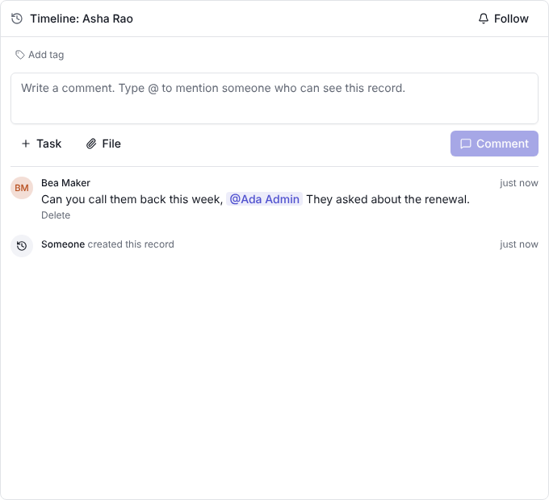
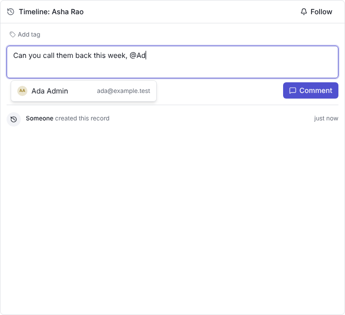
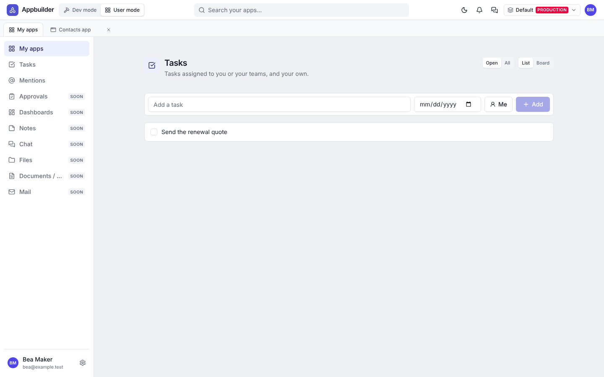
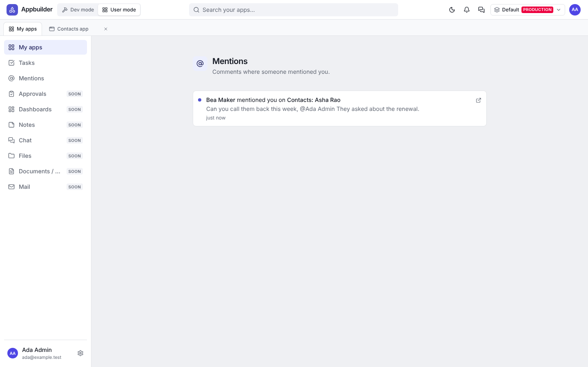

# Working with records: comments, mentions, tasks, files, following

Many apps show a **timeline** next to a record: a list, newest first, of its comments, tasks, files and changes, with a box to
write a comment. The buttons here are the same in every app that has a timeline.

## Write a comment

1. Click in the box that says "Write a comment. Type @ to mention someone who can see this record."
2. Type your comment and send it. It appears at the top of the timeline.

Comments are part of the record: other people with access to the record can read them. Be factual and polite.

## Mention a colleague with @

Type **@** and the start of a name. A list appears with the people who can see this record. Pick one. They get a notification, and
clicking it opens the record. You can mention only people who can read the record. If the list says "No match among the people who can see
this record. Only they can be mentioned.", that person has no access to it: ask your administrator.

## Add a task

Press **Task**. Type the subject, pick a due date, choose who it is for (**Assign**), press **Add task**. Press **Cancel** to leave.

## Your own task list

In the left menu choose **Tasks**. You see the open tasks assigned to you or your teams, and the ones you made for yourself, as a **List** or a
**Board** (Open, In progress, Done). Type in **Add a task** and press Enter to add one. Use **Done**, **Start** or **Reopen** on a task.

## Mentions

In the left menu choose **Mentions**: comments where someone mentioned you. Click one to open the record.

## Attach a file

Press **File** in the timeline (or the file field in a form), choose the file and confirm. You may see "You can view these files but not
change them." if your role only allows reading, or "You may not have access to this file." if you cannot open the record that the file belongs to.

## Follow a record

**Follow** at the top of the timeline means you are notified about new comments on this record. The button then says **Following**; press it to
stop.

## Tags

**Add tag** puts a short label on a record (for example "urgent"), if your app shows tags.

## "You cannot see this record"

You do not have access to that record. Tell your administrator if you think you should.

## If the timeline says "Nothing here yet."

There are no comments, tasks or files for this record yet. Use **Show older** to load more when there are many.

## I deleted something by mistake

Many tables keep deleted records for a while (usually 30 days). What you can do depends on the app:

- **Right after deleting**: a message appears at the bottom, "1 row deleted ... **Undo**". Click **Undo** within ten
  seconds and everything comes back, including the lines or tasks that were deleted with it.
- **Later**: if your app has a recycle bin screen (ask whoever made the app), open it, select the record and choose
  **Restore**. Otherwise ask your administrator: they can restore it from the table's **Deleted** list, as long as the
  days have not run out. Tell them which record, which app and roughly when.
- You can restore only records you were allowed to delete. If restoring says another record now uses the same number or
  code, that record has to change first.
- If no Undo appeared, that table deletes for good. Your administrator may be able to get the data back from a backup.

