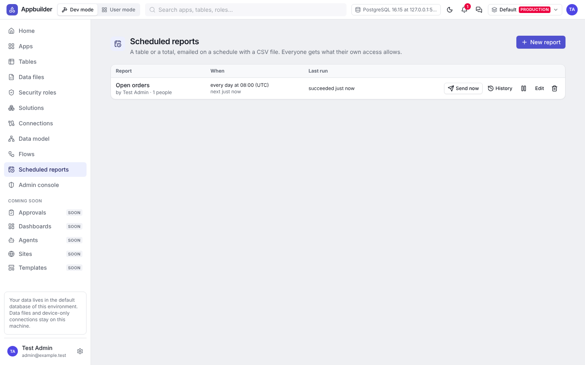

# Scheduled emails (reports you receive)

A **scheduled report** is an email with a table or a total that arrives on a timetable, for example "open orders every morning"
or "sales by region every Monday". Your company decides which reports exist and who gets them.

## What the email contains

- A short preview of the first rows in the message.
- A **CSV file** with the rows (up to 5,000) that you can open in Excel.
- A link back to Appbuilder.

If some cells in the file start with a small apostrophe, that is on purpose: it stops Excel from treating text that starts with
`=`, `+`, `-` or `@` as a formula.

## You get what you are allowed to see

Everyone who receives a report gets the data **their own access** allows. If you may see only your own records, your report shows
only those. A colleague with wider access gets a bigger report, so your totals can differ from theirs. If you cannot read the table at
all, nothing is sent to you.

## See and manage your reports

In **User mode** choose **Scheduled reports** in the left menu. You see the reports you receive, the **History** of what was sent,
**Send now** and **Send me a copy**. Which of these you can use depends on your role.

## Stop or restart a report

Every report email has an **Unsubscribe from this report** link. It works without signing in. To start again, ask the person who
manages the report (your administrator or the maker of your app) to add you again.

## "The report did not arrive"

1. Check the spam folder.
2. Ask your administrator to open the report's **History**: it shows each run and, for each person, whether it was sent or skipped, and why.
3. A report may be set to send nothing when there are no rows that day.
4. The report may be paused.

## PDF reports

A report can also attach a **PDF**: either a printable table of the same rows, or a designed document (for example the
daily production summary) made from a print template, with your own access like the rest of the email. See
[printing and PDFs](printing.md).
