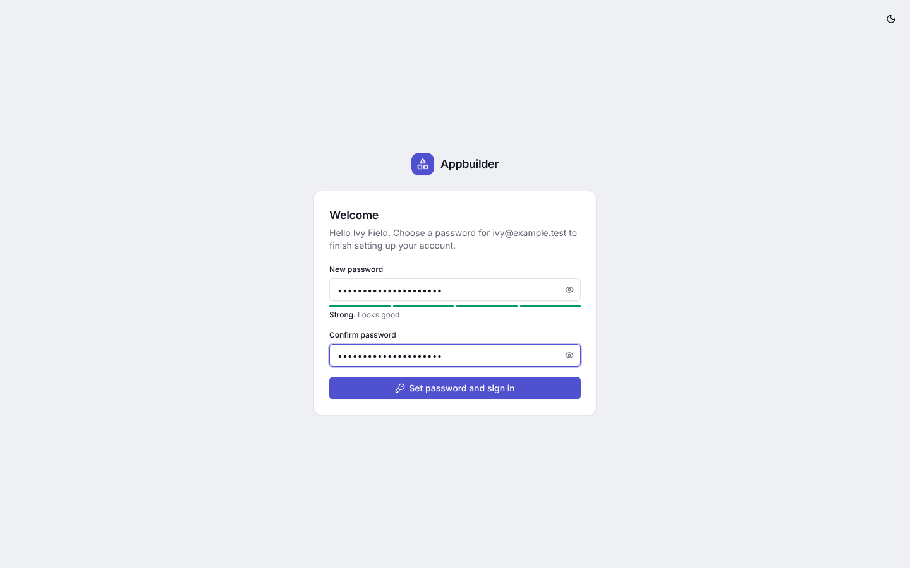
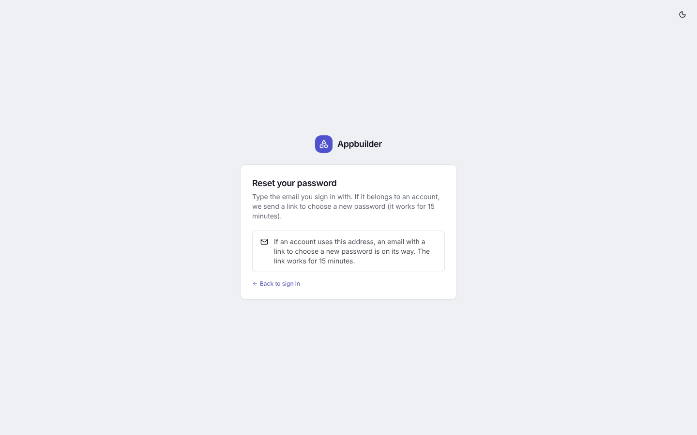
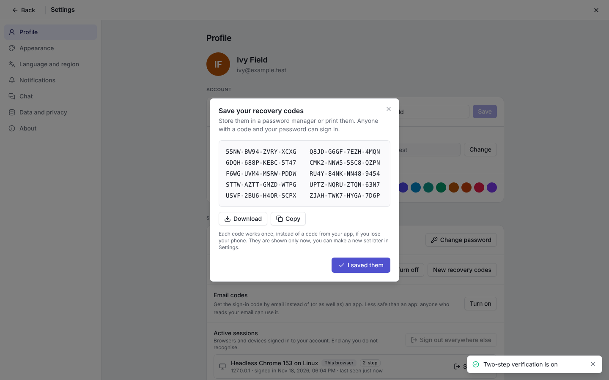
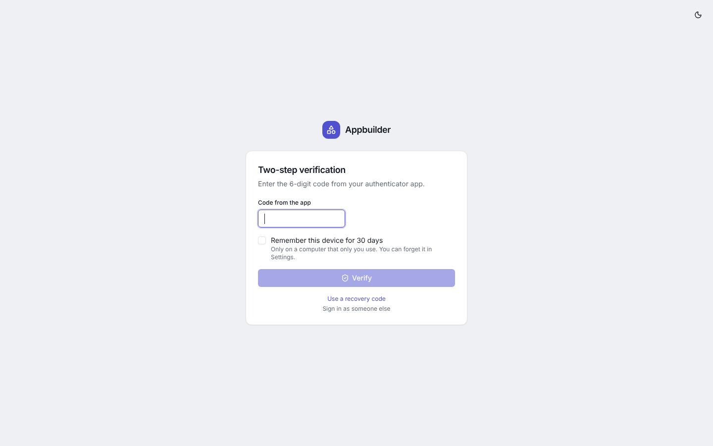
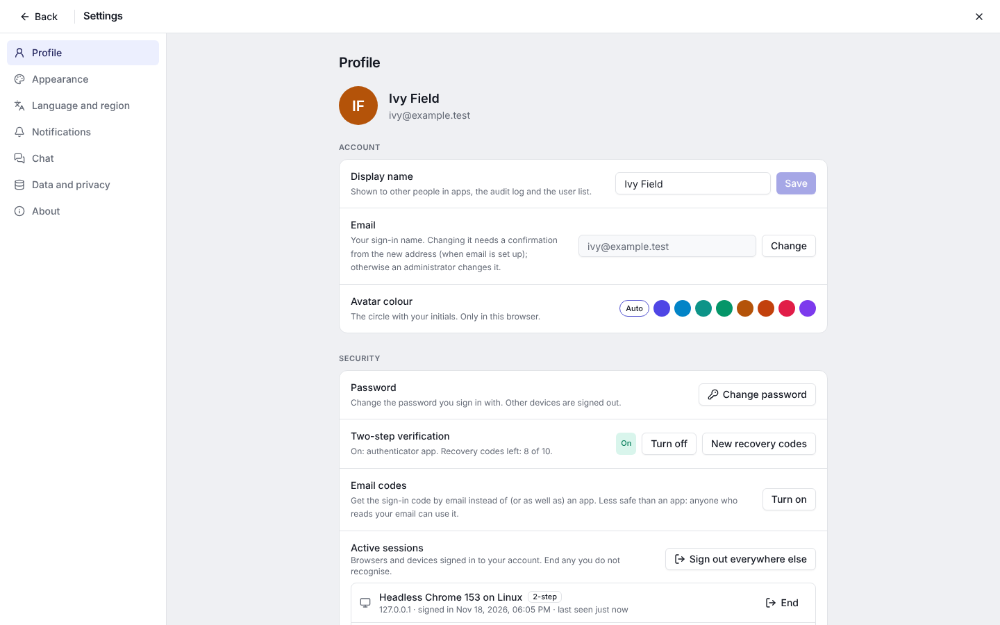
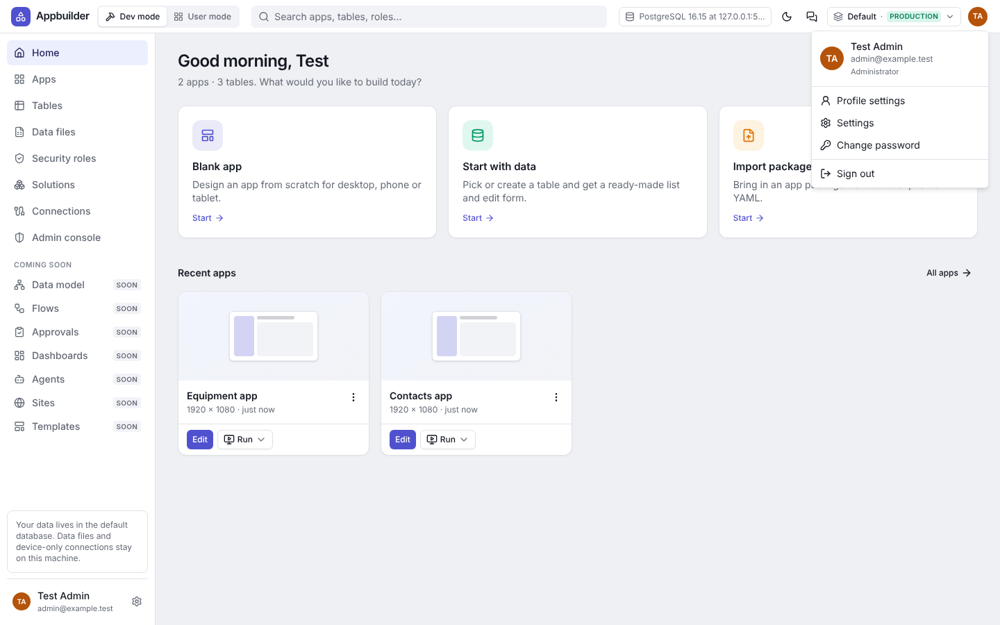

# Signing in

## Your first time

Your administrator gives you one of two things:

- **An invitation email** ("You are invited to ..."). Open the link, choose your own password, and you are signed in. The link
  works **once** and for **7 days**. If it says the link is used or old, ask your administrator to send it again.
- **A temporary password.** Sign in with it. Appbuilder then asks you to **choose a new password** before anything else. Type
  the temporary password as the current one, then your new one.

### A good password

Long is better than complicated: a few unrelated words are fine (at least 10 characters). Appbuilder refuses very common passwords
and your own email address. Do not use the same password as your phone or bank.

## Signing in every day

1. Open the address your company gave you (a bookmark is best).
2. Type your **Email** and **Password**, then press **Sign in**.
3. If your company uses two-step verification, type the 6-digit code from the app on your phone (see below).

If it says the email and password do not match, check both and check Caps Lock. After several wrong tries it says "Too many
attempts": wait about 15 minutes, then try once, slowly. Do not keep guessing.

## I forgot my password

On the sign-in screen choose **Forgot your password?** and type your email.

- If your company's email is set up, you get a message "Reset your password". The link works **once for 15 minutes**. Check the spam
  folder.
- If no email comes, or the screen says it cannot send one, ask your administrator for a **reset code**. Choose **I have a reset
  code from an administrator**, then type your email, the code (it works once, for 24 hours) and a new password.

## Two-step verification (a code from your phone)

It means signing in needs your password **and** a 6-digit code from an app on your phone, so a stolen password is not enough.
Your administrator may require it. Settings tells you from when.

### Turn it on

1. Open **Settings > Profile > Two-step verification > Set up authenticator app**.
2. On your phone open an authenticator app (Google Authenticator, Microsoft Authenticator, Aegis, 1Password or similar) and scan
   the picture (QR code). If you cannot scan, choose **Cannot scan? Show the key** and type the key into the app.
3. Type the 6-digit code the app shows and choose **Turn on**.
4. **Save your 10 recovery codes** (Download, Copy, or print). They appear only once. Keep them where your phone is not: a password
   manager or a locked drawer.

### Signing in with it

After your password, type the current code from the app. Each code works once: if it says the code was already used, wait for the
next one. Tick **Remember this device for 30 days** only on a computer that only you use.

On that screen you can also choose **Use a recovery code**, or **Get a code by email** if you turned email codes on.

### My code is not accepted

- Check the clock on your phone: it must be on automatic time.
- A code works only once. Wait for the next one.
- After too many wrong codes the second step is locked for a while. Wait, or use a recovery code.

### I lost my phone

- **You have recovery codes:** sign in with your password, choose **Use a recovery code**, type one code. Then in Settings > Profile turn
  the app off and set it up again on the new phone, and make **New recovery codes**.
- **You have no recovery codes:** ask an administrator to **reset your two-step verification**. Then you sign in with your password
  and set it up again.

## Your sessions

**Settings > Profile > Active sessions** lists every browser and device signed in to your account. **End** signs one out. **Sign out
everywhere else** keeps only this browser. **Sign-in history** shows your last sign-ins and failed attempts. If you see something you
do not recognise: change your password, end the other sessions and tell your administrator.

You may be signed out by itself after a long time of not using it (default 7 days) or after 30 days in total.

## Signing out

Click your **avatar** (the circle with your initials, top right) and choose **Sign out**. Do this on shared computers.

