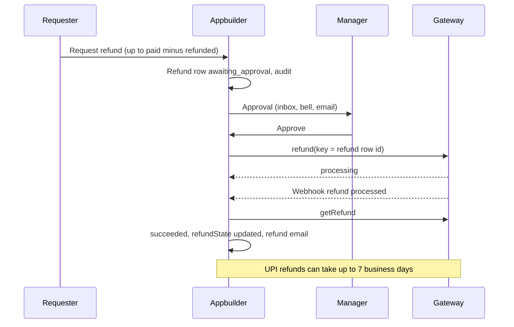

# Payments: connector design (Part A) and our own billing (Part B)

Status: research and design draft, 19 Nov 2026. Not legal, tax or financial advice: every regulatory and tax point is research for a lawyer or CA to confirm. Provider facts were read on official pages on 19 Nov 2026 unless labelled.

Labels: **[V]** read on an official provider or regulator page; **[S]** secondary source only; **[U]** unverified (memory, or page not reachable); **[I]** our inference or recommendation.

Two purposes, kept apart. **Part A** is a Payments connector family: our customers' apps collecting from *their* customers into *their* gateway account. **Part B** is us billing our customers for licences and AMC into *our* account. Different money, account and entity. The platform never sits in the money flow of Part A.

## 1. Summary

- **Build order [I]:** Razorpay, then Cashfree; Stripe third (clean API, but India access is invite-only); PayU, PhonePe, Paytm, CCAvenue, PayPal on demand.
- **Design [I]:** one provider-neutral action set, five system tables, hosted checkout only (we never touch card data), and a **doorbell rule**: a webhook only tells us to look; state always comes from a fresh API fetch.
- **Self-hosting changes the problem [I]:** installs sit on a customer PC or small VPS, often unreachable or switched off. Razorpay retries 24 hours then disables the webhook ([V](https://razorpay.com/docs/webhooks/best-practices/)); Cashfree's default is three retries ([V](https://www.cashfree.com/docs/payments/online/webhooks/overview)). Polling reconciliation is the primary guarantee.
- **Demand is unproven [I]:** no customer has asked. Ship a recipe on the generic HTTP connector now (section 8); build the family with the P3 template packs unless a design partner needs it sooner.
- **Part B [I]:** first ten customers: annual GST tax invoice by bank transfer. Gateways later.

## 2. Provider facts

Fees are headline platform fees before 18% GST on the fee; several are promotions. Orientation, not a quote.

### 2.1 Availability, onboarding, fees, settlement

| Provider | New Indian merchants and KYC | Headline fees | Settlement |
| --- | --- | --- | --- |
| **Stripe** | **Invite-only** for Indian businesses; request via sales, waitlist; existing accounts continue ([V](https://support.stripe.com/questions/stripe-accounts-are-invite-only-in-india)). Registered business only (sole proprietorship, LLP, company), not individuals; IEC for exported goods; one purpose code per account ([V](https://docs.stripe.com/india-exports)) | Domestic cards 2%; international 3% (+2% conversion); USD presentment 4.3%; Billing 0.7%; UPI/netbanking unlisted; GST not mentioned ([V](https://stripe.com/in/pricing)) | Rolling, weekly or monthly, paid in INR |
| **Razorpay** | Open. LLP, partnership, private/public limited, proprietorship, trust, HUF, society, section 8, individual; PAN, bank account, UBO declaration above 10% ([V](https://razorpay.com/docs/build/llm-docs/payments/business-types-kyc-documents.md)) | 2% on cards, UPI, netbanking, wallets; international cards 3%; subscriptions about 0.99% extra; GST 18% on fee (2.36% all-in); 0% platform fee promo for merchants activating from 1 Jul 2026 up to Rs 5 lakh or 90 days, Rs 199 KYC fee ([V](https://razorpay.com/blog/razorpay-payment-gateway-pricing-explained/)). Its pricing page served us the US edition, so the India rate card is **[U]** | T+2 domestic, T+7 international (same blog) |
| **Cashfree** | Open; claims paperless same-day onboarding ([V](https://www.cashfree.com/payment-gateway-india/)); documents **[U]** | 1.95% plus tax; international 2.99%; instant settlement 0.30%; zero-fee promo to Rs 20 lakh GMV ([V](https://www.cashfree.com/payment-gateway-charges/)); its pricing page also shows a Rs 4,999 yearly fee ([V](https://www.cashfree.com/pricing/)) | T+1, instant in about 15 min, international T+2 |
| **PayU** | Open; documents **[U]** | 2% cards/netbanking/wallets; 3% Amex, EMI, international; UPI unlisted; GST extra ([V](https://www.payu.in/pricing)) | **[U]** |
| **PhonePe PG** | Open; documents **[U]** | 1.99% "limited period offer", terms apply ([V](https://business.phonepe.com/payment-gateway)) | **[U]** |
| **Paytm PG** | RBI final payment-aggregator authorisation (filing dated 26 Nov 2025) lets it onboard online merchants again ([S](https://entrackr.com/snippets/paytm-gets-final-rbi-nod-to-operate-as-a-payment-aggregator-10815461)); documents **[U]** | 1.99% on all methods plus GST ([V](https://www.paytmpayments.com/pricing)) | "Real time" claimed, no timing |
| **CCAvenue** | Open; documents **[U]** | 2% domestic incl. UPI; international 3%; Rs 1,200 yearly upgrade charge (first year waived); card mandate Rs 15 ([V](https://dashboard.ccavenue.com/web/genregistration.do?command=navigateSchemeForm)) | Custom |
| **PayPal India** | Export receipts only: **in-principle** RBI approval as cross-border export aggregator; domestic business ceased 2021 ([S](https://yourstory.com/2025/05/paypal-rbi-nod-facilitate-outbound-cross-border-payments)) | **[U]** | **[U]** |

### 2.2 API, webhooks, sandbox

| Provider | Auth and idempotency | Webhook signature, replay, retries | Sandbox |
| --- | --- | --- | --- |
| **Stripe** | Bearer key; `Idempotency-Key` up to 255 chars, kept 24 h+ ([V](https://docs.stripe.com/api/idempotent_requests)) | `Stripe-Signature: t=..,v1=..`, HMAC-SHA256 of `t.rawBody`, 5-minute tolerance, several `v1` during secret rolls, retries up to 3 days, no ordering, dedupe on event id ([V](https://docs.stripe.com/webhooks)) | Sandbox, India mandate test cards ([V](https://docs.stripe.com/india-recurring-payments)) |
| **Razorpay** | HTTP Basic `key_id:key_secret` ([V](https://razorpay.com/docs/api/authentication/)). Orders: **no** idempotency header, use unique `receipt`; refunds: `X-Refund-Idempotency` ([V](https://razorpay.com/docs/payments/payment-gateway/s2s-integration/test-s2s/best-practices/retries-and-idempotency.md)) | `X-Razorpay-Signature` = hex HMAC-SHA256 of raw body, **no timestamp**, `x-razorpay-event-id` for dedupe ([V](https://razorpay.com/docs/webhooks/validate-test/)); 5 s timeout, retries 24 h, out-of-order possible, ports 80/443 only | Test keys, mock bank ([V](https://razorpay.com/docs/payments/payments/test-card-details/)) |
| **Cashfree** | `x-client-id`, `x-client-secret`, required `x-api-version`; `x-idempotency-key`, 422 on different body ([V](https://www.cashfree.com/docs/api-reference/payments/latest/orders/create)) | `x-webhook-signature` = base64 HMAC-SHA256 of `x-webhook-timestamp + rawBody`; docs disagree on a dot separator ([V](https://www.cashfree.com/docs/payments/online/webhooks/signature-verification)); `x-idempotency-header`; default retries at 2, 10, 30 min | Sandbox, test UPI `testsuccess@gocash` ([V](https://www.cashfree.com/docs/payments/online/resources/sandbox-environment)) |
| **PayU** | SHA-512 of `key|txnid|amount|productinfo|firstname|email|udf1..5||||||salt` ([V](https://docs.payu.in/docs/generate-hash-merchant-hosted)) | Reverse-hash check, form-encoded, no timestamp ([V](https://docs.payu.in/docs/webhooks)) | `test.payu.in` |
| **PhonePe** | OAuth client credentials, `O-Bearer` token ([V](https://developer.phonepe.com/payment-gateway/website-integration/standard-checkout/api-integration/api-reference/authorization)) | `Authorization` = SHA256(`username:password`) you configure: **static, no payload binding, no timestamp**; reply in 3 to 5 s ([V](https://developer.phonepe.com/payment-gateway/website-integration/standard-checkout/api-integration/api-reference/webhook)) | Test-mode toggle |
| **Paytm** | Merchant-key checksum on every call ([V](https://www.paytmpayments.com/docs/checksum-implementation)) | Checksum on callback, then status API ([V](https://www.paytmpayments.com/docs/jscheckout-verify-payment)) | `securestage.paytmpayments.com` |
| **CCAvenue** | AES-encrypted `encRequest` plus access code (older v3.1 kit, [V](https://mars.ccavenue.com/downloads/CCAvenue_Integration%20_Ver_3_1.pdf)) | No signature described | `test.ccavenue.com` |
| **PayPal** | OAuth **[U]** | Post headers and untouched event to the verify endpoint with `webhook_id`; 25 retries over 3 days ([V](https://developer.paypal.com/api/rest/webhooks/rest/)) | Sandbox |

Supported flows (all hosted pages): Razorpay payment links with due date, reminders, partial payments ([V](https://razorpay.com/docs/payments/payment-links/)) and QR codes ([V](https://razorpay.com/docs/payments/qr-codes/)); Cashfree links with partial payments, expiry and QR ([V](https://www.cashfree.com/docs/api-reference/payments/latest/payment-links/create)); Stripe Checkout and links. Stripe's UPI page lists eligible *business locations* and India is not among them, so UPI for India-based Stripe accounts is **[U]** ([V](https://docs.stripe.com/payments/upi)). Stripe supports India e-mandates only through Subscriptions ([V](https://docs.stripe.com/india-recurring-payments)).

### 2.3 Regulation and tax

- **PCI.** Hosted or redirected pages keep card data off our servers; raw card handling can bring 300+ controls ([V](https://docs.stripe.com/security/guide)). RBI's aggregator directions say card credentials must not sit in a database or server the merchant accesses ([V](https://rbi.org.in/scripts/BS_ViewMasDirections.aspx?id=12896)); since 1 Jul 2022 only issuers and card networks may store card details ([V](https://razorpay.com/blog/card-on-file-tokenisation-all-you-need-to-know/)). **No card number, CVV, expiry or token enters our database, logs, flows or AI features**; we keep ids, method, brand, last four, status (last four is out of PCI scope, [V](https://docs.stripe.com/security/guide)). Which SAQ form a customer files is their acquirer's call **[U]**.
- **Data localisation [V].** RBI's 2018 circular requires payment data of authorised operators and their third parties, including gateways, to be stored only in India; processing abroad is allowed if data is deleted there and returned within one business day or 24 hours ([RBI FAQ](https://rbi.org.in/scripts/FS_FAQs.aspx?Id=130)). Whether a merchant's own records count is **[U]**. Conservative rule [I]: payment tables stay on the customer's India-located install, never to a foreign cloud or foreign AI endpoint.
- **Aggregator directions (15 Sep 2025) [V]:** merchant KYC (simplified route up to Rs 40 lakh turnover), escrow, settlement on contract timelines (no fixed T+1), refunds to the original instrument; aggregators need authorisation and may not run marketplaces ([RBI](https://rbi.org.in/scripts/BS_ViewMasDirections.aspx?id=12896)).
- **E-mandates [V].** The E-mandate Framework, 2026 (21 Apr 2026, effective at once) covers cards, prepaid instruments and UPI, domestic and cross-border. Registration needs AFA. Later debits need no AFA up to **Rs 15,000**, or **Rs 1 lakh** for insurance premiums, mutual fund subscriptions and card bills. Pre-debit notice at least 24 hours ahead with merchant, amount, date, reference, reason; customers may modify, withdraw or opt out with AFA; no fees to customers; acquirers must make merchants comply ([RBI](https://www.rbi.org.in/scripts/FS_Notification.aspx?Id=13374)). Tuition and dealer invoices are in neither higher category [I]. Razorpay's own UPI AutoPay FAQ still states Rs 15,000, and says PhonePe and BHIM do not support more ([V](https://razorpay.com/docs/payments/recurring-payments/upi/faqs.md)).
- **UPI limits and MDR.** Per-transaction limit Rs 5 lakh in listed categories including collections since 15 Sep 2025, education unnamed ([S](https://www.newsonair.gov.in/npci-raises-upi-person-to-merchant-transaction-limit-to-%E2%82%B95-lakh)); Stripe lists Rs 1 lakh as its UPI maximum ([V](https://docs.stripe.com/payments/upi)). P2P collect ended 1 Oct 2025; merchant collect stays ([S](https://www.businesstoday.in/personal-finance/banking/story/npci-to-tighten-upi-rules-peer-to-peer-collect-feature-to-end-in-october-489244-2025-08-13)). A 0.4% MDR (cap Rs 300) on P2M UPI above Rs 2,000, with exemptions for small merchants on QR up to Rs 1 lakh a month, was set for 15 Oct 2026; one source says it started, another says postponed, a Supreme Court challenge is pending ([S](https://www.setindiabiz.com/news/gst-on-mdr-itc-eligibility), [S](https://www.caclubindia.com/articles/upi-transaction-charges-from-15-october-2026-latest-update-56420.asp)). NPCI's FAQ would not open. **Unverified: read live rate cards when building.**
- **GST and TDS on fees.** 18% GST applies to the fee, not the payment ([V](https://razorpay.com/blog/razorpay-payment-gateway-pricing-explained/)); registered merchants can generally claim credit ([S](https://www.setindiabiz.com/news/gst-on-mdr-itc-eligibility)). TDS on gateway fees depends on the fee line (commission or technical service, about 2%), now under section 393 of the Income-tax Act 2025 ([S](https://www.terra-insight.com/insights/do-you-deduct-tds-on-payment-gateway-and-aggregator-fees)). A CA question; we only expose fee and tax columns.
- **Disputes and refunds.** Stripe UPI: 90 days to dispute, 7 days for one-shot evidence, refunds asynchronous up to 7 business days ([V](https://docs.stripe.com/payments/upi)). Other providers' timelines **[U]**.

## 3. The Payments connector abstraction

### 3.1 Shape

A new action connector kind `payments`, registered like `http` and `email` ([connectors.md](../dev/connectors.md)), with a `ProviderAdapter` per provider. Makers see one action set. Every call goes through `safeRequest` and the existing run pipeline (breaker, rate limit, secret redaction, 90-day activity without inputs or outputs). Idempotency uses the key store (24 hours) **and** a deterministic merchant reference, our payment id, sent to every provider, because 24 hours is shorter than a payment's life [I].

Actions: `createPaymentLink`, `getPayment`, `cancelPayment`, `refund`, `getRefund`, `createQr`, `createCustomer`, `createSubscription`, `cancelSubscription`, `listSettlements`, `getSettlement`. Reads are idempotent. Embedded `createOrder` is reserved; v1 is hosted pages only.

### 3.2 Mapping

Endpoint names marked **[U]** are from memory; verify against current docs before coding.

| Action | Razorpay | Cashfree | Stripe | Others |
| --- | --- | --- | --- | --- |
| `createPaymentLink` | `POST /v1/payment_links` **[U]** | `POST /pg/links` [V] | Checkout Session (dynamic amounts) **[U]** | PayU signed form; PhonePe Standard Checkout; Paytm initiate + JS Checkout; CCAvenue encrypted redirect (all need crypto the HTTP connector lacks) |
| `getPayment` | `GET /v1/payments/{id}` **[U]** | orders payments **[U]** | PaymentIntent get | Status APIs (Paytm `/v3/order/status` [V], PhonePe Order Status [V]) |
| `refund` | payment refund + `X-Refund-Idempotency` [V] | order refunds **[U]** | `POST /v1/refunds` | provider APIs |
| `createQr` | QR API [V exists] | `link_qrcode` in link response [V] | UPI QR in Checkout [V] | PhonePe dynamic QR |
| `createSubscription` | Plans + subscriptions, UPI AutoPay **[U]** | Subscriptions **[U]** | Billing (only India e-mandate path) [V] | PhonePe AutoPay |
| `listSettlements` | recon APIs **[U]** | reports **[U]** | payouts, balance transactions **[U]** | dashboard reports |

Razorpay's settlement recon API could not be read (US-edition docs); verify before estimating reconciliation.

### 3.3 Connection settings

- `provider`, `mode` (`test` or `live`, **fixed at creation**), `defaultCurrency`, `statementName`.
- Sealed secret, never read back: Razorpay `{keyId, keySecret, webhookSecret}`; Cashfree `{clientId, clientSecret}`; Stripe `{secretKey, webhookSecret}`; PhonePe `{clientId, clientSecret, clientVersion, webhookUser, webhookPass}`; PayU `{key, salt}`.
- **Test and live are separate connections.** Flows and apps refer to a connection by name; dev and test environments bind the test one, production binds the live one. A live connection cannot attach outside production; a test connection in production shows a red banner [I].
- Secrets never reach app users or makers. Grants today are "use" and "manage"; add **collect** (create links) and **refund** so a clerk collects and only a manager refunds [I].

## 4. Standard data model

Five system tables (`sys_*`, extensible, written only by the Payments service, never by formulas or the Data API). They use the existing **regarding** pair so a payment is readable only if the record it concerns is readable ([core-data-model.md](../dev/core-data-model.md)).

- **Payments:** `id` (UUIDv7), `number` (gap-free `NextNumber("PAY")`), `connectionId`, `provider`, `mode`, `regardingTable`/`regardingId`, payer contact lookup plus name/email/phone snapshot, `amountMinor`, `currency`, `amountPaidMinor`, `amountRefundedMinor`, `feeMinor`, `feeTaxMinor`, `status`, `refundState` (none/partial/full), `disputeState` (none/open/won/lost), `method`, `providerRef`, `checkoutUrl`, `expiresOn`, `idempotencyKey`, `failureCode`, `failureText`, `paidOn`, `settledOn`, `settlementId`, `lastSyncedOn`.
- **Payment refunds:** `paymentId`, `amountMinor`, `reason`, `status` (requested, awaiting_approval, rejected, submitted, processing, succeeded, failed), `approvalId`, `requestedBy`, `approvedBy`, `providerRefundId`, `idempotencyKey`.
- **Payment events:** `connectionId`, `providerEventId`, `type`, `receivedOn`, `signatureResult`, `outcome` (applied, duplicate, stale, ignored, rejected, error), `paymentId`, redacted payload. **Unique on (connectionId, providerEventId).** Payload retained 90 days.
- **Settlements** and **Settlement lines:** provider settlement id, UTR, gross, fees, tax, net, date; lines link to a payment or refund (types payment, refund, adjustment, dispute, fee).

**State machine.** `draft` (row, no provider call) -> `created` (link or order exists) -> `attempted` -> `processing` (UPI or bank pending) -> `paid`. Exits: `failed` (may return to `attempted` or `paid`, since links allow retries), `expired`, `cancelled`. Rules [I]: (1) status is set only by applying a provider fetch; (2) `paid` never reverts to `failed`, `expired` or `created`, and a late event that tries is logged `stale`; (3) refunds and disputes are overlays, so a refunded payment stays "paid, refunded"; (4) each transition and its outbox event commit in one transaction, so flow triggers fire once; (5) paid above amount raises an exception task.

## 5. Webhook handling

### 5.1 The doorbell rule

Today's endpoint checks a URL token, rate limit, size, and one scheme: `X-Appbuilder-Signature: t=..,v1=` HMAC-SHA256 of `t.body`, five-minute tolerance, each signature once. It has **no vendor schemes** and is bound to a flow ([webhook-security.md](../admin/webhook-security.md)). Payments needs a route bound to a connection:

`POST /api/v1/hooks/pay/<env>/<connectionId>/<token>`: (1) token, rate limit, size, raw body as today; (2) provider verifier; (3) insert event row (duplicate: answer 200, stop); (4) enqueue `payments.syncOne` and answer 200; (5) the job fetches the object with the connection's credentials and applies the state. **A forged or replayed event can at worst trigger a harmless re-fetch.** That makes weak schemes acceptable (PhonePe's static header, CCAvenue, Razorpay's missing timestamp) and makes ordering irrelevant [I].

### 5.2 Verification recipes

Constant-time compare on **raw bytes**, before JSON parsing.

| Provider | Recipe |
| --- | --- |
| Stripe | Split header on `,` then `=`; keep `t` and all `v1`, ignore `v0` and debug keys; signed string `t + "." + body`; HMAC-SHA256 with the `whsec_` secret; any `v1` may match; reject if `abs(now - t)` exceeds tolerance (5 min, never 0); secrets are per endpoint and mode; accept old and new secret during a roll up to 7 days ([V](https://docs.stripe.com/webhooks)) |
| Razorpay | Hex HMAC-SHA256 of raw body with webhook secret equals `X-Razorpay-Signature`; dedupe on `x-razorpay-event-id`; accept the old secret after rotation ([V](https://razorpay.com/docs/webhooks/validate-test/)). Browser result: HMAC-SHA256 of `order_id|payment_id` with the key secret, using the order id from *our* record ([V](https://razorpay.com/docs/payments/payment-gateway/web-integration/standard/build-integration.md)) |
| Cashfree | Base64 HMAC-SHA256 of timestamp plus raw body with the client secret; try no separator first, dot as fallback while the docs disagree **[I]**; check timestamp freshness; dedupe on `x-idempotency-header` ([V](https://www.cashfree.com/docs/payments/online/webhooks/signature-verification)) |
| PhonePe | Constant-time compare of `Authorization` with SHA256(`username:password`); hex or base64 not stated, test both **[U]**; sender authentication only, so always confirm via Order Status ([V](https://developer.phonepe.com/payment-gateway/website-integration/standard-checkout/api-integration/api-reference/webhook)) |
| PayU | Recompute reverse hash (salt, status, UDFs, email, name, product, amount, txnid, key) with SHA-512; check txnid and amount against our record ([V](https://docs.payu.in/docs/generate-hash-merchant-hosted)) |
| Paytm | `verifySignature` with the merchant key (form callbacks drop `CHECKSUMHASH` first), then status API ([V](https://www.paytmpayments.com/docs/checksum-implementation)) |
| PayPal | Post transmission headers and the untouched event to the verify endpoint with our token and stored `webhook_id` ([V](https://developer.paypal.com/api/rest/webhooks/rest/)) |
| CCAvenue | No signature in the kit we read: fetch only, never trust the posted status **[U]** |

### 5.3 Duplicates, order, downtime

- **Duplicates:** unique event constraint, plus idempotent apply.
- **Out of order:** the fetch returns current truth, so a refund event before the capture event resolves itself (Stripe and Razorpay disclaim ordering).
- **Reachability:** needs the public address (Caddy ships with the installer) and an allowed host name; Razorpay accepts ports 80 and 443 only ([V](https://razorpay.com/docs/webhooks/)). Unreachable installs run poll-only; a hosted relay is a separate product decision [I].

### 5.4 Reconciliation

- **Stuck payments:** every 5 minutes, fetch payments in `created`, `attempted` or `processing` older than 2 minutes, backing off to hourly until expiry plus grace. Razorpay itself advises fetching when a time-sensitive flow misses its webhook ([V](https://razorpay.com/docs/webhooks/)).
- **After an outage:** at startup and daily, re-list recent provider payments and diff **[U: list endpoints]**.
- **Daily settlement import:** fill Settlements and lines, set `settledOn`, `feeMinor`. Exception tasks: paid but unsettled past the cycle (T+2 Razorpay, T+1 Cashfree), a line with no payment, amount mismatch, a refund without a line.

## 6. Flows, UI, receipts, security

### 6.1 Flows

- **Triggers:** "payment succeeded, failed, refunded, expired" are table triggers on `sys_payments` with a status condition (P1 reads the outbox), grouped in the designer. No new trigger kind [I].
- **Steps:** `Create payment link` (outputs `paymentId`, `checkoutUrl`, QR image), `Get payment`, `Refund`. A refund above a threshold, or by a non-manager, writes a refund row as `awaiting_approval` and uses the P1 `approval` step; the provider call happens after approval, keyed by the refund row id.
- **Run-as:** payment steps run as the triggering user so the record's security applies; a service identity is admin-set and audited (existing rule).

### 6.2 The Pay component

A UI control ([frontend.md](../dev/frontend.md)) with `record`, a payable definition, `label`. A click calls a server route that creates the link and returns `checkoutUrl`; the browser redirects or opens a tab. **It never has a card field.** For a counter QR it shows the provider's dynamic QR and listens on the realtime hub for the row to turn `paid`. It shows a test-mode banner and a clear "waiting for your bank" state.

### 6.3 Security rules

1. **Amount and currency are computed on the server** from the regarding record and its payable definition (amount column, balance, minimum part-payment). The client sends a record id and optionally "pay this much now", checked between the minimum and the balance. Never an amount.
2. Link creation needs "collect" on the connection **and** read plus update on the record under the caller's identity; refund needs "refund" plus approval.
3. Rate limits per user and per record (for example 5 links per record per hour) on top of the connection limiter.
4. Audit: link created, refund requested, approved, rejected, connection changed (never keys).
5. One active link per payable record and purpose; a new one cancels the old, so two cannot both be paid.
6. Keys sealed and redacted by the existing step; connection references in solutions never carry keys.

### 6.4 Receipts, invoices, currency, instalments

- **Now:** email receipt from a flow using the Email connector, numbered by `NextNumber`. **PDF receipts need P2.**
- **GST invoice hook [I]:** the paid trigger lets a flow create an invoice record from a financial-year sequence (gap-free, built). Receipt voucher versus tax invoice for an advance is a CA question. **Tally export** waits for the P3 Tally connector.
- **Multi-currency:** minor units plus ISO code, decimals from the currencies table (zero- and three-decimal currencies exist). Non-INR needs provider enablement: Stripe wants customer name, billing address, description, IEC for goods and a purpose code ([V](https://docs.stripe.com/india-exports)); Cashfree enables other currencies through support ([V](https://www.cashfree.com/docs/api-reference/payments/latest/payment-links/create)).
- **Instalments (fees):** do not depend on provider partial-payment features, which differ. Each instalment is an app record with its own due date and its own link (customer present, so AFA every time); balance is a formula over paid payments regarding the fee record. UPI auto-debit is limited to Rs 15,000 ([V](https://docs.stripe.com/payments/upi/upi-autopay)), so larger instalments go by link.

### 6.5 Failure modes

| Situation | Behaviour | Message |
| --- | --- | --- |
| Provider down, breaker open | Retryable error, nothing created | "Could not create the payment link. Try again in a minute." |
| Link paid, webhook lost | Poll finds it | Paid after next poll, shown as "confirmed by check" |
| UPI pending | `processing`, nothing fulfilled | "Waiting for your bank. Do not pay again." |
| Paid on two links, or amount mismatch | Exception task, refund offered | Operator only |
| Mandate cancelled or notice undelivered | Marked at risk, pay-by-link sent | "Your auto-debit needs attention." |
| Refund failed | Row `failed`, payment stays paid | "Refund could not reach the original method." |

## 7. Sequence diagrams

### 7.1 Payment link with webhook confirmation

```mermaid
sequenceDiagram
  participant U as Staff user
  participant A as Appbuilder
  participant G as Gateway
  participant P as Payer
  U->>A: Create link for record R
  A->>A: Read R as U, compute amount, insert Payment (draft)
  A->>G: createPaymentLink(reference = paymentId, idempotency key)
  G-->>A: link id + URL
  A-->>U: URL (shown, emailed; WhatsApp later)
  P->>G: Opens link, pays on gateway page
  G-->>A: Webhook (signed)
  A->>A: Verify, insert event (unique), answer 200
  A->>G: getPayment (doorbell)
  G-->>A: captured
  A->>A: paid + outbox event, flow sends receipt
  Note over A,G: No webhook? The 5-minute poll runs the same fetch
```

### 7.2 UPI QR at a counter

```mermaid
sequenceDiagram
  participant C as Counter clerk
  participant A as Appbuilder
  participant G as Gateway
  participant D as Payer
  C->>A: Show QR for record R
  A->>G: createQr(fixed amount, expiry, reference)
  G-->>A: QR image
  A-->>C: QR + "waiting"
  D->>G: Scans, enters UPI PIN
  G-->>A: Webhook credited
  A->>G: getPayment
  A-->>C: Realtime tick, receipt
  Note over C,A: Expired QR closed by poll; a late payment becomes an exception task
```

### 7.3 Subscription / e-mandate

```mermaid
sequenceDiagram
  participant P as Payer
  participant A as Appbuilder
  participant G as Gateway
  participant B as Bank
  A->>G: createSubscription(plan, max amount)
  G-->>A: authorisation link
  A-->>P: Send link
  P->>B: Register mandate with AFA (UPI PIN or 3DS)
  G-->>A: Webhook: active
  Note over G,B: Each cycle: notice at least 24 h before
  G->>B: Debit (no AFA up to Rs 15,000)
  G-->>A: Webhook: charged or failed
  A->>A: Payment per cycle; failure raises task + pay-by-link
  P->>B: May cancel any time
  G-->>A: Webhook: cancelled
```

### 7.4 Refund with approval



## 8. Recommendation, and what the HTTP connector can do now

### 8.1 First two providers

| Criterion | Razorpay | Cashfree | Stripe |
| --- | --- | --- | --- |
| New small entity can sign up today | Yes, widest entity list | Yes, claims same day | **No**, invite-only |
| Links, QR, partial payments, UPI AutoPay | Documented | Documented | UPI for India accounts unverified |
| API and docs | Good | Most explicit headers and idempotency | Best |
| Webhook safety | HMAC, no timestamp | HMAC with timestamp | HMAC with timestamp |
| Headline fee | 2% + GST | 1.95% + tax, T+1 | 2% domestic |

**Razorpay first**: most small Indian businesses already hold an account, it accepts every entity type, and links, QR, partial payments and AutoPay are documented. **Cashfree second**: an independent second source (gateways freeze accounts, so a second adapter is continuity), the most explicit REST and idempotency conventions I read, and faster settlement. **Stripe third** for global customers and for Part B if invited. These are judgements from documents. I have **no reliability data** on either gateway's webhooks, which is why polling is built first [I].

### 8.2 The HTTP connector today

Outbound works without new code. Razorpay: `basic` auth with key id and secret; custom actions for link, get payment, refund (`X-Refund-Idempotency` as a header input). Cashfree: `defaultHeaders` plus secret `headers` for `x-client-id`, `x-client-secret`, `x-api-version`; `x-idempotency-key` as a header input. Stripe bearer works but nested form bodies are awkward **[U]**; PayPal's OAuth fits; PhonePe's token request has a non-standard `client_version` field **[U]**.

**Inbound recipe:** a flow with a webhook trigger in "token only" mode whose first step calls `getPayment` on the same connection; only the fetched status and amount update the record. That is the doorbell rule with today's parts.

**Limits:** no vendor signature verification (the endpoint knows only its own scheme; the formula language has no HMAC, I found none in `src/fx`); no dedupe on `x-razorpay-event-id` (ours reads `X-Appbuilder-Delivery` or `Idempotency-Key`), so the flow must dedupe on payment id with a unique column; no replay protection beyond the token; no ordering; action idempotency lasts 24 hours; PayU, Paytm and CCAvenue are **impossible** (SHA-512, checksum, AES); no settlements, approval-gated refunds, Pay control or reconciliation. Fine for a pilot recipe; not something to sell as "Payments".

## 9. Part B: how we collect our own money

### 9.1 Options

| Option | Fits | Notes |
| --- | --- | --- |
| Annual licence, manual GST invoice, NEFT/RTGS/IMPS or UPI to a current account | First 10 customers | No gateway fees or KYC. Large licences go by bank transfer (Stripe's UPI maximum is Rs 1 lakh, [V](https://docs.stripe.com/payments/upi); other rails differ). Customers may deduct TDS, so receipts can fall below the invoice: ask for the certificate and reconcile **[I; CA to confirm]** |
| Payment links (Razorpay or Cashfree) | Renewals, AMC, seats under about Rs 1 lakh | About 2.36% all-in on Razorpay; roughly Rs 700 on a Rs 30,000 licence |
| Subscriptions (Razorpay, Stripe Billing) | Scale, monthly plans, international | Debits above Rs 15,000 need AFA each time ([V](https://www.rbi.org.in/scripts/FS_Notification.aspx?Id=13374)); an on-prem licence is yearly, so little gain early [I] |
| Marketplaces and resellers | Later | **[U]** not researched. Never pool customers' money in our account |

### 9.2 What a new Indian entity needs

Per Razorpay: a proprietorship needs two of Udyam, GST certificate, shop licence, IEC or postpaid bill, plus owner PAN, address proof, bank details and a power of attorney; a private limited needs incorporation certificate, CIN, MOA/AOA, PAN, bank details, signatory documents with board resolution and UBO declaration ([V](https://razorpay.com/docs/build/llm-docs/payments/business-types-kyc-documents.md)). Website checklist: a live working site, terms, privacy policy, refund policy, contact details, SSL, business email ([V](https://razorpay.com/blog/documents-required-for-payment-gateway)); a product or pricing description is often asked **[U]**.

**Timing:** the founder is under a no-moonlighting policy until about end January 2027 ([BRIEF.md](BRIEF.md)). Opening a gateway or invoicing before the entity and employer position are settled is a lawyer's question.

### 9.3 International

- **Stripe** if invited: INR payouts, purpose code, IEC only for goods, export fields per payment, 3DS ([V](https://docs.stripe.com/india-exports)).
- **PayPal:** export receipts only, in-principle approval, fees unverified ([S](https://yourstory.com/2025/05/paypal-rbi-nod-facilitate-outbound-cross-border-payments)).
- **Bank wire** against a USD invoice; keep the bank's inward remittance advice (FIRA/FIRC) as proof of realisation.
- **GST:** an export of service is zero-rated if five conditions hold (supplier in India, recipient abroad, place of supply abroad, payment in convertible foreign exchange or permitted INR, distinct entities); export under a yearly Letter of Undertaking, or pay IGST and claim refund; BRC/FIRC supports refunds ([S](https://razorpay.com/blog/export-services-gst-conditions-guide/)). Whether our licences qualify is a CA question **[U]**. E-invoicing starts above Rs 5 crore turnover ([S](https://tallysolutions.com/business-guides/what-changed-in-e-invoicing-compliance-in-2026/)).

### 9.4 By stage [I]

| Stage | Do | Do not |
| --- | --- | --- |
| **Pilot** | Written pilot terms, no money | Open a gateway before the entity exists |
| **First 10** | Annual licence plus AMC, GST tax invoice (registration status with a CA), bank transfer, invoices and renewal reminders in an Appbuilder app of our own; a payment link only for small renewals; wire for a first foreign customer | Subscriptions, marketplaces |
| **Scale** | Razorpay or Cashfree for renewals and seats; Stripe Billing for international if invited; licence key issued by a flow on "payment succeeded" (dogfoods Part A) | A gateway we cannot reconcile |

## 10. Compliance, never-do list, effort, phasing

### 10.1 Never do

1. Store, log or process card numbers, CVV, expiry or tokens; add a card field to any control.
2. Bypass AFA: no merchant-initiated debit without a registered mandate, none above Rs 15,000 on UPI auto-debit, none without the 24-hour notice ([RBI](https://www.rbi.org.in/scripts/FS_Notification.aspx?Id=13374)).
3. Accept an amount or currency from the browser.
4. Send keys or webhook secrets over chat, email or tickets, or show them after creation.
5. Test with real cards in live mode, or run live keys in dev or test.
6. Trust a webhook payload without the doorbell fetch.
7. Collect customers' money into our account: that makes us an intermediary, and aggregators need RBI authorisation (Rs 15 crore net worth) and may not run marketplaces ([V](https://rbi.org.in/scripts/BS_ViewMasDirections.aspx?id=12896)). Each customer is merchant on their own account [I].
8. Send payment data to a foreign cloud or AI endpoint; log provider payloads unredacted.
9. Refund without approval above threshold, or call a refund or charge without an idempotency key.

### 10.2 Pre-launch checklist

- Current rate card read (UPI MDR status), shown as the customer's, not ours.
- Webhook public over HTTPS and tested with each provider's own tool; poll, settlement import and exception tasks running; clock synchronised.
- Test banner, grants, approval threshold, audit verified.
- Terms, privacy and refund pages on the customer's site; statement name shows the legal business name (UPI requires it, [V](https://docs.stripe.com/payments/upi)).
- CA or lawyer review: GST invoice versus receipt, TDS on fees, localisation, export treatment.

### 10.3 Effort (one builder with AI agents) [I]

| Component | Size |
| --- | --- |
| `payments` kind, adapter interface, settings form, secrets, test/live rule | M |
| Razorpay adapter plus fake provider | M |
| Cashfree adapter | M |
| Stripe adapter | S to M |
| Five tables, state machine, apply logic, regarding security | L |
| Webhook route and verifier registry | M |
| Reconciliation, settlement import, exceptions | M |
| Flow triggers, three steps, approval-gated refund | S to M |
| Pay control, QR, realtime, banner | M |
| Email receipt; docs and HTTP recipe | S |
| PDF receipt, phone Pay layout, WhatsApp delivery, payer portal | blocked on P2, P2, P2, P6 |
| Tally receipt export | blocked on P3 Tally connector |

### 10.4 Phase placement (proposal; master-plan.md not edited)

| What | Where |
| --- | --- |
| HTTP-connector recipe and doc | Now, with the P1 docs sweep |
| Payments v1: tables, Razorpay, webhook route, poll, Pay control, email receipt, approved refunds | **P3**, with the manufacturing and CRM template packs (dealer advances, fee collection); nobody needs it before |
| Cashfree, settlement import, exceptions | Late P3 or P3.5 |
| PDF receipts, phone Pay, WhatsApp delivery | P2, if payments is pulled earlier |
| Payer-facing portal pages | P6; until then payers use gateway-hosted links |
| Stripe adapter, Tally export | On demand; Tally connector is P3 |

If a design partner needs payments sooner, pull forward only the recipe and v1; do not reorder P2.

## 11. Not verified

- Razorpay India pricing page, settlement recon API, test UPI ids, dispute timelines, AutoPay category limits (its FAQ says Rs 15,000, RBI allows Rs 1 lakh for three categories; possibly an old FAQ).
- Stripe UPI for India-based accounts; Stripe link and session API specifics.
- PayU, PhonePe, Paytm, CCAvenue settlement, KYC documents, current APIs, PhonePe header encoding, Paytm checksum algorithm; PayPal fees.
- Whether the UPI MDR is in force (reports conflict; NPCI FAQ not openable).
- TDS on gateway fees and our licence fees, GST on licences, merchant-side localisation, SAQ category, endpoints marked [U].

## Sources

Read 19 Nov 2026; every provider and regulator claim is linked inline. Hubs: [RBI e-mandate framework](https://www.rbi.org.in/scripts/FS_Notification.aspx?Id=13374), [RBI aggregator directions](https://rbi.org.in/scripts/BS_ViewMasDirections.aspx?id=12896), [RBI storage FAQ](https://rbi.org.in/scripts/FS_FAQs.aspx?Id=130), [NPCI MDR FAQ (not opened)](https://www.npci.org.in/uploads/FA_Qs_Merchant_Discount_Rate_MDR_on_Select_UPI_P2_M_Transactions_Updated_15_October_2026_a1f433513f.pdf), [Stripe India](https://docs.stripe.com/india-exports), [Razorpay](https://razorpay.com/docs/webhooks/), [Cashfree](https://www.cashfree.com/docs/payments/online/webhooks/overview), [PayU](https://docs.payu.in/docs/webhooks), [PhonePe](https://developer.phonepe.com/payment-gateway/website-integration/standard-checkout/api-integration/api-reference/webhook), [Paytm](https://www.paytmpayments.com/docs/checksum-implementation), [CCAvenue](https://mars.ccavenue.com/downloads/CCAvenue_Integration%20_Ver_3_1.pdf), [PayPal](https://developer.paypal.com/api/rest/webhooks/). Repo: [connectors.md](../dev/connectors.md), [webhook-security.md](../admin/webhook-security.md), [core-data-model.md](../dev/core-data-model.md), [p1-spec.md](../plan/p1-spec.md), [master-plan.md](../plan/master-plan.md), [BRIEF.md](BRIEF.md).
